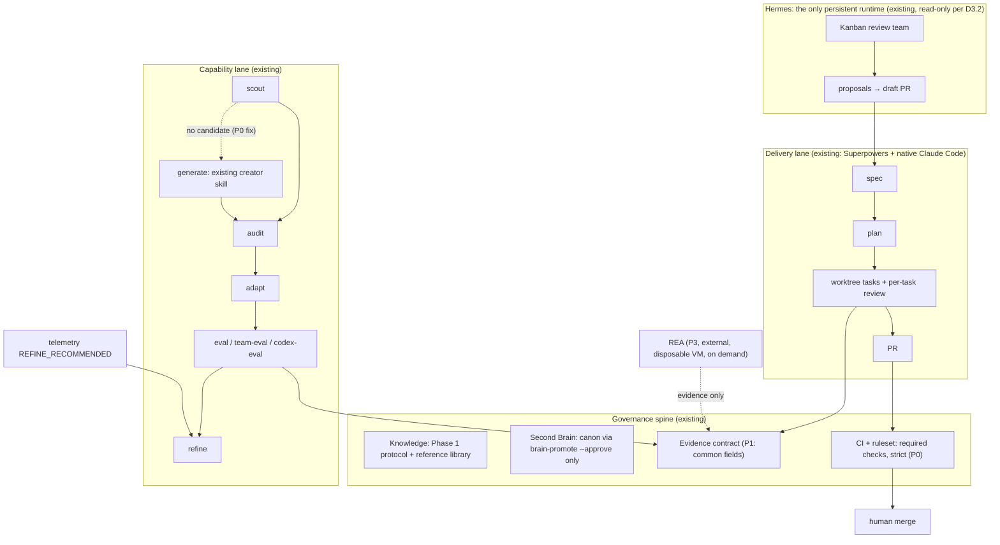

# Software Factory Architecture: Strategic Evaluation & Optimization Proposal for `claude_code`

> **Date:** 2026-10-14
> **Phase:** 2 of the optimization initiative. It builds on Phase 1: `docs/CLAUDE_CODE_KNOWLEDGE.md` and `docs/evaluations/2026-10-14-claude-code-knowledge-sources.md`.
> **Method:**
> - Shallow read-only clones of the four repositories at the revisions in §2. No repository code was executed.
> - Every load-bearing claim was spot-checked in the source by the evaluator.
> - Internal facts were measured in this repository and on this machine.
> - Claude Code 2.1.300.
>
> **Status:** approved 2026-10-14 (D1 writing-skills, D2 approve, D3 audit only, D4 drop the route, D6 start with P0-A; the §4 rejections and deferrals were not selected, so they stay out of scope). Phase 3 implements §8.
>
> **Legend:** **F** = verified fact (file or command cited) · **I** = inference · **P** = proposal · **U** = unknown.

---

## 1 · Executive summary

**Recommendation: preserve the current architecture with selective enhancements, and reject the
proposed two-factory expansion as a new subsystem.**

The software-factory approach as a *set of patterns* is valuable. As an *architecture to add*, it is
largely already here:

- **The "Capability Factory" exists.** It is the scout → audit → adapt → eval → refine pipeline for skills and agents, plus team-eval, telemetry, the reference library and the brain. (F)
- **The "Software Delivery Factory" exists, and is used daily.**
  - Every feature since the summer went through Superpowers' brainstorm → spec → plan → subagent-driven tasks with per-task review (F). The record is 51 plans in `docs/superpowers/plans/`, specs in `docs/superpowers/specs/`, and 156 task-numbered commits since August.
  - Merges are gated by CI behind a GitHub ruleset (F).
  - Hermes runs a read-only Kanban review team and delivers its proposals as draft PRs: `make-review-board.py`, `claude-code-reviewer`, `open-proposal-pr.sh` (F).
- **The external repositories add no orchestration this project lacks.** Hermes Kanban is the durable orchestrator; Claude Code's own subagents, dynamic workflows and worktrees cover in-session work (Phase 1 §3). Adopting Super-Board would add a *second* Kanban (GitHub Projects) and an autonomous merge path (F, §2).
- **A general autonomous Builder → QA → Reviewer → merge factory would contradict standing decisions.**
  - Track A says "Hermes proposes; the human + Claude Code develop" (`2026-07-23-hermes-improvement-proposals-design.md`).
  - D3.2 says Hermes runs read-only.
  - The charter targets specialized client-service teams, not a general code factory.

**The most valuable opportunities are small and mostly internal: make the existing gates true.**

1. **The pipeline's "generate" exit is broken.**
   - `write-a-skill` is the recommended build-from-scratch path in 7 places. Among them: `skills/skill-scout/SKILL.md:78,111`, `skills/skill-refine/SKILL.md:70`, `skills/skill-refine/REFERENCE.md:101`, `.claude/agents/skill-scout-agent.md:102` and `.claude/agents/skill-refine-agent.md:130`.
   - No skill by that name exists anywhere (F).
   - Generated capabilities have no defined route back into audit → eval.
2. **Two CI gates do not block merges.**
   - The AgentShield security gate and the frontmatter validator run in `ci.yml` but are not required checks in the `main-protection` ruleset.
   - The required checks are only "Test suites" and "Bind agreement".
   - `strict` is false, so a PR can merge green against a stale base (F).
3. **There is an unaudited, unused global framework.**
   - GSD installs 72 user-level skills, 64 agents and about 18 user-level hooks. The hooks fire in every session (PreToolUse on Read, Grep, Bash, Write and Agent; SessionStart; Stop; PreCompact) (F).
   - This project has no `.planning/` directory and no commit since September mentions GSD (F).
   - The brain records no audit of GSD (F: no hit in brain search).
   - Hooks run with full user privileges (Phase 1, hooks.md).
   - Skill descriptions compete for a 1%-of-context listing budget, so this probably also degrades skill-eval trigger measurements (I; Phase 1 insight 2).
4. **Three patterns are worth adapting, as patterns rather than code:**
   - a revision-stamped evidence manifest with explicit `untested` and limitations (Ras Mic + REA);
   - head-pinned verification with a reviewer who reruns the tests and keeps stable finding IDs (Super-Board);
   - a fresh verifier per candidate with fingerprint dedupe for improvement intake (Super-Board `super-collect`).

**Investment is justified only at that scale:** roughly 2 small PRs plus 3 owner decisions for P0, and about 3 more PRs for P1. Larger adoption is not justified.

---

## 2 · Comparative repository analysis (revisions examined)

| | Ras Mic `michaelshimeles/skills` | Super-Board `EricTechPro/super-board` | Skill Factory `alirezarezvani/claude-code-skill-factory` | REA `morluto/rea` |
|---|---|---|---|---|
| Revision | `4b72f46` (2026-09-17) | `7d848f7` (2026-10-13), v3.1.2 | `ba18b31` on `dev` (2025-11-12); **~11 months stale** | `d9cd239` (2026-10-14), v6.5.0 |
| License | **No root license.** Folders: PolyForm Shield (before-and-after), MIT (greploop, unslop), none (originals) | MIT | MIT. The vendored doc copies have unclear provenance | MIT, plus GPL/LGPL/Apache for bundled tools. IDA, Hopper and JEB are commercial |
| Maintainers | 1 | 1 (+ a robot account) | 1 | ~3 major + tail |
| Tests / CI | 23 pytest tests for `evidence.py` only; no CI; no skill evals | 59 offline suites, 7 paid behavioural evals, cross-platform CI | **No tests.** The CI "quality gate" only runs compileall, safety and a link check | 1,291 test files, mutation testing, 29 workflows |
| What it is | 7 prose skills, of which **only 3 are original** (new-feature, code-structure, evidence-driven-testing); the rest are copied from Greptile, Vercel and Cursor | A GitHub-Projects-backed autonomous delivery loop: waves of cards, then Builder, QA and Reviewer lanes, then a merge gate | Generation front-ends: prose mega-templates plus shallow Python generators | An MCP (stdio) and CLI reverse-engineering suite, with a strict evidence schema |
| Strongest asset (F) | `evidence-driven-testing/scripts/evidence.py`: annotated, commit-stamped evidence manifest, plus the evidence types for non-UI changes | `super-board-merge-gate.sh`: lock, verify against the current base, then `--match-head-commit`. Also the fail-safe dependency parser and "review remembers" | `hook-factory/installer.py`: settings backup, atomic write and duplicate detection | `src/domain/evidence.ts`: hashed evidence IDs; provenance, confidence, authority and limitations; unknowns kept explicit |
| Disqualifying issues (F) | `greploop` pre-approves `Bash(gh:*) Bash(git:*)`, auto-pushes with `git add -A`, lets the implementer resolve the reviewer's threads, and needs the paid Greptile SaaS. `before-and-after` uploads publicly by default | Reviewer self-merges: `merge_policy.default: "auto"` (`references/config-schema.json:128`), contradicted by its own `run.md:141`. Legacy path uses `--dangerously-skip-permissions` (`super-build-dispatch.sh:143`). Rebuild cap resets on a new failure hash | Hook schema **wrong**: object matchers, the nonexistent `$CLAUDE_TOOL_FILE_PATH` (103 uses), the invented event `PrePush` (`installer.py:213`), and blocking with `exit 1`. Issue-triage interpolates the untrusted issue body into a Claude prompt with write tools. The kill switch is read before checkout | "This is not a sandbox" (`SECURITY.md:33`). Active modes run targets with host privileges. `setup` writes `~/.claude.json` and installs a skill directly, bypassing our gate. About 10 releases in 9 days. 237k stars in 6 months, an anomaly not trusted as a signal |
| Hypothesis verdict | H2 **partially confirmed.** Discipline is mostly prose; about half is copied; review needs a SaaS | H3 **confirmed with a correction.** Draft-PR delivery is contradicted: it auto-merges. There is no scheduler service; the "runtime" is GitHub Projects | H4 **partially confirmed.** It covers only "Generate", with outdated schemas. The lifecycle would have to be ours | H5 **confirmed with a correction.** Isolation must be supplied by us |

---

## 3 · Current-state gap analysis (only where material)

| Proposed capability | State in `claude_code` | Evidence |
|---|---|---|
| Discover / audit / adapt / eval / refine for skills and agents | **Implemented** | `skills/skill-*`, `skills/agent-*`, `.claude/agents/*-agent.md` |
| Generate when nothing suitable exists | **Broken.** The exit points to the nonexistent `write-a-skill`, with no return path into audit → eval | 7 dangling references (§1) |
| Team / orchestration evaluation | **Implemented** | `team-eval`, `fixtures/teams/repo-audit-ensemble/team.json` |
| Independent second-model eval | **Implemented** | the `codex-eval` skill and `scripts/codex/` |
| Isolated development (worktrees) | **Implemented, natively.** `claude --worktree`, `isolation: worktree` and Superpowers' `using-git-worktrees` | Phase 1 §3; plugin skills |
| Spec → plan → task execution with per-task review | **Implemented** (Superpowers) | 51 plans; specs; task-numbered commits |
| Commit-pinned deterministic verification | **Partial.** CI is required, but `strict: false` lets a PR merge against a stale base. 0 approvals required | ruleset `main-protection` (F) |
| Security gate blocking merges | **Partial.** AgentShield and frontmatter jobs run but are **not required checks** | `ci.yml` vs ruleset (F) |
| Evidence manifest (SHA, environment, passed/failed/**untested**, limitations) | **Partial.** Eval reports, `result.json` and Hermes review evidence exist; no common fields for SHA, untested items or limitations | `SKILL-EVAL.md`, `scripts/codex/`, `collect-review-evidence.py` |
| Bounded correction loops | **Implemented** (refine: max 10 iterations; rewrite exit at < 40%) | `skills/skill-refine/SKILL.md` |
| Durable multi-agent orchestration with dependencies | **Implemented** (Hermes Kanban, read-only) | `make-review-board.py`, Kanban design spec |
| Draft-PR delivery | **Implemented** (proposals); code PRs are Track B, **deferred by decision** | `open-proposal-pr.sh`; D3.2 |
| Operational-issue intake → improvement | **Partial.** Telemetry `REFINE_RECOMMENDED`, `skill-discovery`, Hermes proposals. No per-candidate verifier or dedupe | `scripts/telemetry/`, `skills/skill-discovery` |
| Second delivery framework (GSD) | **Duplicative and unused**, with global hooks | §1 item 3 |
| Reverse engineering of packaged artifacts | **Missing**, and **no current use case** (I) | |
| GitHub Projects board, autonomous merge, Greptile loop | **Unnecessary / conflicting** | §4 |

---

## 4 · Capability adoption matrix

| # | Capability | Source | Existing overlap | Expected benefit | Complexity / risk | Decision | Priority |
|---|---|---|---|---|---|---|---|
| 1 | Defined "generate" path whose output **must** re-enter audit → eval | gap found here; Rezvani is a negative example | scout/refine exits point to a missing skill | Closes a broken lifecycle edge; prevents unaudited generated skills | Low: text edits in about 7 files plus a resolver check | **IMPROVE EXISTING** | **P0** |
| 2 | Skill-reference resolver in CI (every `invoke X` and `` `X` `` skill mention resolves) | — | `scripts/validate-skills.js` | Prevents dangling references recurring | Low | **IMPROVE EXISTING** | **P0** |
| 3 | Make the security and frontmatter jobs required checks; require "up to date" (`strict`) | Super-Board's verify-against-current-base, done natively | ruleset `main-protection` | Commit-pinned, deterministic, independent verification on every merge | Low; slower merges when `main` moves | **IMPROVE EXISTING** (owner action in GitHub) | **P0** |
| 4 | Audit-or-remove the GSD global install | — | unused here; 18 global hooks | Smaller attack surface; likely restores the skill-listing budget | Low to medium: global and affects other projects; some hooks (secret-read guard, injection scanner) are protective | **Owner decision.** Run `project-audit` / skill-audit on its hooks first | **P0** |
| 5 | Measure the skill-listing budget's effect on trigger accuracy (Phase 1) | Claude Code docs, skills.md | skill-eval | Protects the validity of the core metric | Low (measurement) | **IMPROVE EXISTING** | **P0** |
| 6 | Common evidence fields: `commit_sha`, environment, `passed/failed/untested`, `limitations[]`, `confidence: observed/derived/inferred` | Ras Mic `evidence-driven-testing/SKILL.md`; REA `src/domain/evidence.ts` (patterns only) | `SKILL-EVAL.md`, `result.json`, Hermes review evidence | Fewer false-confidence passes; comparable evidence across eval, review and delivery | Low to medium: schema plus report templates | **ADAPT** (pattern) | **P1** |
| 7 | Reviewer protocol: form hypotheses from the acceptance criteria and diff *before* reading the builder's report; rerun the tests; keep stable finding IDs across re-reviews | Super-Board `references/run.md`, Reviewer steps 3–8 | Superpowers per-task reviewers; `/code-review` | Implementer is not the sole authority; regressions in "fixed" findings become visible | Low: project guidance, no new agent | **ADAPT** (pattern) | **P1** |
| 8 | Capture the failure *before* fixing; non-UI evidence types (measured probe, output pair, transcript excerpt) | Ras Mic `evidence-driven-testing/SKILL.md` | the TDD skill (red-first) | Better bug-fix evidence | Low | **ADAPT** (into item 6/7 guidance) | **P1** |
| 9 | Improvement intake: a fresh verifier per candidate, fingerprint dedupe, "seen again" recurrence | Super-Board `skills/super-collect/SKILL.md`, `super-collect-file.sh` | telemetry `REFINE_RECOMMENDED`, `skill-discovery`, Hermes `proposals-index.py` | Fewer duplicate and false-positive proposals as volume grows | Medium | **ADAPT** when proposal volume shows duplicates | **P2** |
| 10 | Settings backup + atomic write + duplicate detection for any hook install | Rezvani `hook-factory/installer.py` | `install.sh` / `uninstall.sh` | Safer installs and uninstalls | Low | **ADAPT** if `install.sh` touches settings | **P2** |
| 11 | Native dynamic workflows for eval fan-out (resumable, bounded concurrency) | Claude Code workflows.md (Phase 1) | skill-eval-agent's Agent fan-out (18–42 subagents) | Resumability, cost visibility | Medium; token cost must be measured | **DEFER** to a measured experiment | **P2** |
| 12 | Freshness monitoring (Phase 1 §5) | Phase 1 | `schedule` routines / Hermes box | Notices Claude Code changes cheaply | Low | **DEFER** (approve with item 11's automation review) | **P2** |
| 13 | REA, run on demand inside a disposable VM | REA | none | Analysis of closed-source and packaged artifacts | High: host execution, churn, 150+ tools, legal | **INTEGRATE EXTERNALLY, only on a real use case** | **P3** |
| 14 | Agent teams | Claude Code (experimental) | Hermes Kanban, subagents | Peer coordination | Experimental and off | **DEFER** | P3 |
| 15 | Super-Board runtime / GitHub Projects as a Kanban / Reviewer self-merge | Super-Board | Hermes Kanban; ruleset | — | Second source of truth for tasks; model approves its own merge | **REJECT** | — |
| 16 | greploop / Greptile review loop | Ras Mic (copy of Greptile) | Codex layer, `/code-review` | — | Paid SaaS; broad git/gh pre-approval; implementer resolves reviewer threads. A Codex variant conflicts with CLAUDE.md "Never enable the Codex plugin review gate" | **REJECT** | — |
| 17 | Rezvani generators, Hook Factory, GitHub automations | Rezvani | pipeline | — | Wrong hook schema; untested; prompt injection in workflows | **REJECT** (keep items 10 and 6's validator-result shape only as ideas) | — |
| 18 | before-and-after, unslop | Ras Mic | — | — | PolyForm Shield license; public uploads; auto-triggering style rewrites | **REJECT** | — |
| 19 | Two-factory model as a new subsystem | prior researcher H6 | §5 | — | Relabels existing parts; invites duplicate orchestration | **REJECT** (use the "one pipeline, two lanes" framing, §5) | — |

---

## 5 · Proposed optimized architecture

**One governance spine, two lanes, one persistent runtime.** It is not two factories, because both
lanes already exist and share everything that matters.

**Responsibilities and boundaries**

| Component | Owns | Never does |
|---|---|---|
| Capability lane | creating and improving skills, agents, hooks and teams | merges code; edits canon |
| Delivery lane | turning a spec into a PR in worktrees | self-approves; merges |
| CI + ruleset | deterministic verification pinned to the merged commit | — |
| Human | merging, canon promotion, permission and policy changes | — |
| Hermes | durable read-only teams and proposals | writes code, holds write credentials (D3.2), executes untrusted artifacts |
| External tools (REA, etc.) | evidence produced in a disposable environment | run on the host or the box; install into `~/.claude` directly |

**Single sources of truth:**

| What | Source |
|---|---|
| Tasks | Hermes Kanban (operations) and plans in git (development); no GitHub Projects board |
| Verification | CI on the merge commit |
| Durable knowledge | the brain |
| Sources | the reference registry |
| Evaluation metrics | the eval artifacts |

---

## 6 · Integration strategy (for approved items; no files created in Phase 2)

| Item | Integration point | Change | Reuses | Verification |
|---|---|---|---|---|
| 1, 2 | `skills/skill-scout/SKILL.md`, `skills/skill-refine/{SKILL,REFERENCE}.md`, `.claude/agents/skill-{scout,refine}-agent.md`, `skills/skill-adapt/SKILL-EVAL.md` (scenario note), `skills/agent-scout/SKILL.md`; `scripts/validate-skills.js` | Replace `write-a-skill` with one named existing creator (owner picks: `superpowers:writing-skills` or `anthropic-skills:skill-creator`) **followed by** `skill-audit` → `skill-eval`. The validator fails on unresolvable skill references. Re-deploy to `~/.claude/skills/` | existing pipeline; CI frontmatter job | `node scripts/run-all-tests.js`; a new validator test with one dangling fixture; re-run skill-eval on skill-scout and skill-refine (trigger and fit must not regress) |
| 3 | GitHub ruleset `main-protection` | Add required checks "Validate skill frontmatter" and "Security gate (AgentShield + static fallback)"; set `strict_required_status_checks_policy: true` | `ci.yml` as is | A test PR with a deliberately invalid frontmatter is blocked; a stale-base PR shows "update branch required" |
| 4 | user `~/.claude/settings.json`, `~/.claude/skills/gsd-*`, `~/.claude/agents/gsd-*`, `~/.claude/hooks/gsd-*` | First `project-audit` / skill-audit over the GSD hooks. Then the owner chooses: keep, keep only the protective hooks, or uninstall with GSD's own uninstaller | `project-audit`, `skill-audit` | Audit report in `docs/evaluations/`; skill count and listing state before and after (item 5) |
| 5 | an eval session | `/doctor` and the startup warnings; record whether skill descriptions are dropped; re-run one skill-eval with and without the global set | skill-eval | A documented delta in trigger accuracy, or "no effect" |
| 6 | `schemas/` (next to `schemas/codex`, `schemas/telemetry`), the `SKILL-EVAL.md` / `AGENT-EVAL.md` / `TEAM-EVAL.md` templates | A small evidence-fields schema; eval reports gain `commit_sha`, `untested[]`, `limitations[]` | existing schema tests in `scripts/codex/test-schemas.js` | schema tests; one regenerated eval report validates |
| 7, 8 | project guidance used during delivery (a short section in `docs/` referenced from the plan template, or a small project skill passed through skill-eval) | Reviewer protocol and evidence types; no new agent | Superpowers reviewers; `/code-review` | Next 5 PRs: the review records the rerun command and finding IDs |
| 9 | `infra/hermes-agent/bin/proposals-index.py`, `skills/skill-discovery` | Fingerprint plus a "seen again" counter before filing a proposal | Hermes proposer; telemetry | `run-bin-tests.sh`; a duplicate-proposal fixture |

---

## 7 · Risks and trade-offs

- **Architectural complexity:** the plan adds no service, scheduler, database or orchestrator. The largest addition is one schema (item 6).
- **Security and authorization:**
  - Item 3 *tightens* the boundary.
  - Item 4 removes unaudited global hooks, but may also remove protective ones (the secret-read guard, and the read-injection scanner that flagged the spec in this session). Audit before removing.
  - Nothing grants a model merge, canon or permission authority.
- **Tool and agent conflicts:** two delivery frameworks (Superpowers and GSD) co-exist today, with overlapping guards and skills. Item 4 resolves this.
- **Duplicate orchestration:** avoided by rejecting GitHub Projects and Super-Board. Hermes Kanban remains the only durable orchestrator.
- **Costs:**
  - P0 and P1 add no runtime cost. Item 3 adds CI time only when `main` moves.
  - Items 11 and 13 are the only ones with material token or infrastructure cost, and both are deferred behind measurement.
- **Upstream drift:** we copy no external code. Pattern adaptation avoids tracking churny upstreams; REA ships about 10 releases in 9 days.
- **False confidence from AI evaluation:** item 6 (explicit `untested` and limitations) and item 3 (deterministic CI) are the counterweights; LLM-judge scores remain advisory.
- **Vendor lock-in:** none added. Rejecting Greptile avoids a SaaS dependency.
- **Overengineering:** the main risk was the two-factory build-out and autonomous merge, both rejected.
- **Changes to existing decisions or invariants:**
  - **None** for P0 and P1.
  - Item 3 changes repository settings, which is a permission boundary and needs owner approval.
  - Any future code-writing PR from Hermes would need Track B and a new security review (D3.2).
  - A Codex-driven PR review loop would require changing the CLAUDE.md rule against enabling the Codex plugin review gate. This is not recommended.

---

## 8 · Prioritized roadmap

**Smallest useful first increment (P0-A):** items 1 and 2 in one PR. It is fully local and fully testable, and fixes a real broken edge.

| Phase | Scope | Depends on | Benefit | Validation | Done when |
|---|---|---|---|---|---|
| **P0-A** | Items 1 and 2: fix the `generate` exit; add the reference resolver to `validate-skills.js` | owner picks the creator skill (D1) | lifecycle closed; recurrence prevented | test suites; validator fixture; skill-eval re-run on skill-scout and skill-refine | `grep -r write-a-skill` returns 0 outside history; CI fails on a dangling fixture; no metric regression |
| **P0-B** | Item 3: required checks plus `strict` | D2 | security gate actually blocks merges | the blocked-PR test | ruleset lists 4 required checks, strict = true |
| **P0-C** | Items 4 and 5: audit GSD hooks; measure the listing budget | D3 | smaller attack surface; trustworthy trigger metrics | audit report; before/after eval | a written decision (keep/trim/remove) with evidence; trigger-accuracy delta recorded |
| **P0-D** | Phase 1 carry-overs: the auto-memory routing conflict (D4); the `--use` comma bug in `brain-reference-repo-add.js` | D4 | governance consistency | brain tests | BRAIN.md matches settings; the nous-hermes entry is repaired |
| **P1-A** | Item 6: evidence fields | P0-A | comparable, honest evidence | schema tests | all three eval report types carry SHA, untested items and limitations |
| **P1-B** | Items 7 and 8: reviewer protocol and evidence types | P1-A | independent review becomes checkable | next 5 PRs audited | ≥ 4 of 5 PRs record a rerun command and finding IDs |
| **P2** | Item 9 (intake dedupe); item 10 (install backup); items 11 and 12 (workflow fan-out experiment, freshness) | P1; measured need | scale readiness | per item | each starts only when its trigger is observed (duplicates, settings writes, eval cost) |
| **P3** | Item 13: REA trial in a disposable VM (pinned `rea-agents@6.5.0`, no `setup`, static tools on our own artifacts); item 14: agent teams | a real closed-source-artifact use case; legal authorization | — | evidence records validate; limitations populated | a recorded go/no-go in `docs/evaluations/` |
| **REJECT** | items 15–19 | — | — | — | — |

**Implementation note (Phase 3, 2026-10-14).** P1-A was delivered in narrower form than item 6 in §6, and that is recorded here, not hidden.
- **What was built:**
  - the subject revision is pinned in `run-manifest.json`: definition sha256 plus commit;
  - an **Evidence and Limits** section was added to the SKILL-EVAL, AGENT-EVAL and TEAM-EVAL report formats.
- **What was not built:** no JSON schema was added.
- **Why:** the reports are model-written Markdown, so a schema would have no producer and no validator.
- **Revisit when:** a machine-readable eval summary exists to validate.
- **Record:** `docs/evaluations/2026-10-14-phase3-implementation.md`.

**Rollback:**

- P0-A, P1-A and P1-B are single-PR reverts.
- P0-B: revert the ruleset settings in GitHub.
- P0-C: GSD reinstalls with its own installer. Back up `~/.claude/settings.json` first.

---

## 9 · Validation and success metrics (baseline before claiming improvement)

| Metric | Baseline (2026-10-14) | Target |
|---|---|---|
| Dangling skill references | 7 (F) | 0, enforced by CI |
| Required CI checks on `main` / strict | 2 / false (F) | 4 / true |
| Unaudited global hooks firing in this project | ~18 GSD hooks (F) | 0 unaudited (kept ones carry an audit record) |
| Skill descriptions dropped from the listing | unknown (U) | measured; 0 for pipeline skills during evals |
| Eval reports with commit SHA + untested + limitations | 0 (I: no such fields in the templates) | 100% of new reports |
| PR reviews recording a rerun command and finding IDs | not tracked (U) | ≥ 80% of PRs |
| Post-merge fixes within 7 days (proxy for defect escape) | count `fix(...)` commits that reference a PR merged in the prior 7 days, last 60 days (to compute in P0) | does not increase; ideally falls |
| Human interventions per delivered task | not tracked (U) | baseline first; no target until measured |
| Security regressions | security review #11 PASS 38/38 (v1.22) | stays PASS |
| New services, daemons or orchestrators added | 0 | 0 |

---

## 10 · Final recommendation

1. **Implement:** P0-A → P0-B → P0-C/D, then P1-A/B. These are text, CI and schema changes inside existing components.
2. **Reuse unchanged:**
   - the scout → audit → adapt → eval → refine pipeline and team-eval;
   - the Codex external eval;
   - Superpowers as the delivery lane;
   - Claude Code-native worktrees and subagents;
   - Hermes Kanban and draft-PR proposals;
   - the brain and its promotion gate;
   - the reference library.
3. **Integrate only when needed:**
   - REA, in a disposable VM, on a real closed-artifact case;
   - dynamic-workflow eval fan-out, after a cost measurement;
   - intake dedupe, when duplicates appear;
   - agent teams, when out of experimental status and a need exists.
4. **Avoid:**
   - a second Kanban (GitHub Projects);
   - Reviewer self-merge;
   - Greptile/greploop;
   - Rezvani's generators and hook templates;
   - before-and-after;
   - a general autonomous code-writing factory;
   - a two-factory subsystem.
5. **First:** P0-A, the broken `generate` exit plus a resolver check. It takes one PR, is fully testable, and needs no new component.
6. **Is the investment justified?** Yes for P0 and P1: small, measurable, and risk-reducing. **No** for a software-factory build-out. The evidence shows the project already has both "factories". The external repositories' best ideas fit as about 5 patterns inside them, and their runtimes would add duplicate orchestration and weaker approval boundaries.

---

## Decisions requiring owner approval

| ID | Decision | Recommendation |
|---|---|---|
| D1 | Which existing skill becomes the "generate" path | `superpowers:writing-skills` (already enabled, TDD-style), followed by skill-audit → skill-eval. The alternative is `anthropic-skills:skill-creator` (official, with built-in evals) |
| D2 | Add the AgentShield and frontmatter jobs as required checks; enable strict | Approve |
| D3 | GSD: audit, then keep / trim to protective hooks / uninstall globally (affects other projects) | Audit first; likely uninstall here, keep only audited protective hooks |
| D4 | Auto-memory: re-enable it, or remove the route from BRAIN.md | Remove the route (the brain is the durable store; machine notes are low value) |
| D5 | Confirm the rejections in §4 (items 15–19) and the deferral of REA and agent teams | Confirm |
| D6 | Approve P0-A as the Phase 3 starting increment | Approve |

## Sources (accessed 2026-10-14)

- **Repositories at the revisions in §2.** Clones in the session scratchpad; files cited inline.
- **Internal:**
  - `.github/workflows/ci.yml`; the GitHub ruleset API for `main-protection`;
  - `~/.claude/settings.json` hooks; `~/.claude/skills`;
  - the Hermes design specs (2026-07-23, 2026-07-24 ×2); `infra/hermes-agent/{open-proposal-pr.sh,bin/make-review-board.py}`;
  - brain canon D3.2;
  - Phase 1 records.
- **Claude Code behaviour:** Phase 1 registry (code.claude.com docs; changelog 2.1.300).
