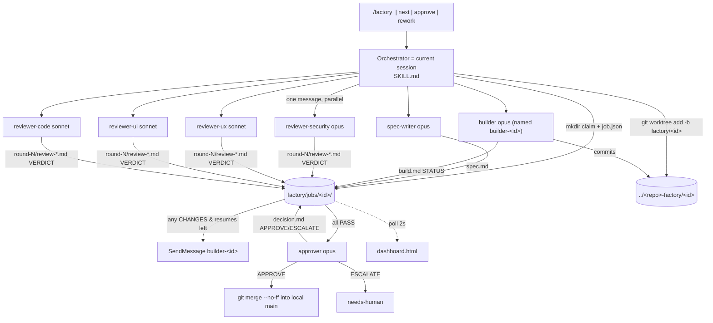

# Alexander Galea (ZazenCodes) — Software Factory for Claude Code: technical deep dive

> Repository: https://github.com/zazencodes/zazencodes-season-3 (subfolder `src/software-factory-claude-code`) · Evaluated commit: 6cd82a017d21f257eb6af5ff449568786672ad5c (2026-10-21) on main
> Other branches inspected: `8a428453` (HEAD 6e68ece0328b2ed409f434e771f304d6df95834c, 2026-10-21; adds an unmerged `src/software-factory-claude-code-v2`, summarised in a separate subsection, §2.4) · License: none found for the in-scope folder (no LICENSE in the folder or at the repo root; GitHub API `license: null`). The v2 folder on branch `8a428453` is GPL-3.0 (`src/software-factory-claude-code-v2/LICENSE`)
> Accessed: 2026-10-22 · Method: read-only shallow clone; no code executed
> Legend: [F] verified fact · [I] inference · [C] unverified claim · [U] unknown

All paths are relative to the repository root. `SF/` below abbreviates `src/software-factory-claude-code/`
(for example `SF/.claude/skills/factory/SKILL.md:33`). `SF2/` abbreviates
`src/software-factory-claude-code-v2/` on branch `8a428453`.

---

## 1. Summary

The project is a small template for a "software factory" that runs inside Claude Code. It is
made of one orchestrator skill (`SF/.claude/skills/factory/SKILL.md`, 221 lines), seven subagent
definitions (`SF/.claude/agents/*.md`, 64–96 lines each), a single-file HTML dashboard
(`SF/factory/dashboard.html`, 600 lines), a markdown backlog, and two example job folders from a
real run [F]. It contains **no executable factory code**. Every action (creating worktrees,
writing `job.json`, spawning agents, merging) is done by the LLM session that runs the skill,
following prose instructions [F] (`SF/.claude/skills/factory/SKILL.md:8-11`). The workflow is a fixed
loop: spec-writer, builder, four parallel reviewers (security, UX, UI, code), a WAIT-FOR-ALL
barrier, at most two builder resumes, then an approver that either merges to local `main` or
escalates to a human [F] (`SF/.claude/skills/factory/SKILL.md:15-35`). It is aimed at individual
developers who watch the companion YouTube video ("Build Your Own AI Software Factory with Claude
Code", `README.md:20`) and want something they can copy into a repo [F] (`SF/README.md:16-17,59-72`).

Maturity: one commit added the whole folder (`7f8a22b`, 2026-10-02, via GitHub API). The HEAD commit
`6cd82a0` only touched the root README and a thumbnail [F]. There are no tests, no CI workflows
(GitHub API `actions/workflows total_count: 0`), no releases and no tags. The repo is a monorepo
of video companion projects (253 stars, 83 forks at the repo level) [F]. Its author describes it as
a demo to be understood "in a few minutes" (`SF/BUILD_PROMPT.md:2-3`) [F]. An unmerged v2 on branch
`8a428453` replaces much of the LLM-driven spine with Python scripts. That v2 is incomplete at the
inspected commit: its `.claude/` agents and skill are not committed [F] (§2.4).

**Category:** **hybrid execution, LLM-driven**: a fixed stage graph written in prose that the LLM
carries out, with nothing in code enforcing the transitions (§5). It is
also a **skill/agent pack** (copy-in template). v2 moves towards a **board/issue-driven factory**
with a scripted state machine.

## 2. Architecture

### 2.1 Components

| Component | Path | Role |
|---|---|---|
| Orchestrator skill | `SF/.claude/skills/factory/SKILL.md` | Triggered by `/factory …`. The session that runs it becomes the orchestrator for one job. It is the only writer of `job.json` [F] (`:2-4,8-11`) |
| 7 subagents | `SF/.claude/agents/{spec-writer,builder,reviewer-security,reviewer-ux,reviewer-ui,reviewer-code,approver}.md` | One role each. Each writes exactly one file [F] |
| Job state | `SF/factory/jobs/<job-id>/` (`job.json`, `spec.md`, `build.md`, `round-N/review-*.md`, `decision.md`, `rework-k.md`) | File-based handoff and durable state [F] (`SKILL.md:62-71`) |
| Backlog | `SF/factory/backlog.md` | Markdown checklist queue for `/factory next` [F] |
| Dashboard | `SF/factory/dashboard.html` | Vanilla JS. Polls `jobs/` through `python3 -m http.server` every 2 s [F] (`:267,400-408,596-597`) |
| Worktrees | `<repo>/../<name>-factory/<job-id>/` on branch `factory/<job-id>` | One git worktree per job, so jobs can run in parallel [F] (`SKILL.md:70,108-114`) |
| Build prompt | `SF/BUILD_PROMPT.md` | The prompt that generated the original factory, kept verbatim. It describes an older design that used a single `board.json` [F] (`SF/README.md:101-108`) |

### 2.2 Tech stack and runtime dependencies

- Claude Code with project subagents (frontmatter `name`, `description`, `tools`, `model`) and a project skill [F].
  The skill relies on spawning a subagent **with a name** and resuming it with `SendMessage`
  (`SKILL.md:121-122,147-149`; `SF/BUILD_PROMPT.md:93-94`) [F]. The minimum Claude Code version for
  named-agent resume is not stated anywhere in the folder [U].
- git with `worktree` support [F]. The approver uses `git merge-tree --write-tree`
  (`SF/.claude/agents/approver.md:37`), which needs Git ≥ 2.38 [I] (from upstream git release notes, not checked against the repo).
- `agent-browser` CLI (vercel-labs) for page checks by the builder, UX and UI reviewers. It is unpinned, and the
  folder gives no install command [F] (`SF/README.md:69-71`; `builder.md:52-58`). Each agent loads its
  usage instructions at runtime with `agent-browser skills get core` [F].
- `python3 -m http.server` to serve the dashboard [F] (`SF/README.md:80-82`). The dashboard parses that
  server's HTML directory listing to find jobs and files [F] (`dashboard.html:400-408,412-422`).
- The target repo's `AGENTS.md`/`CLAUDE.md` is the only source of setup, dev-server, test, build and lint
  commands. Every agent reads it first [F] (`SKILL.md:37-38`; e.g. `builder.md:22-24`).
- Models: aliases `opus` (spec-writer, builder, reviewer-security, approver) and `sonnet` (reviewer-ux,
  reviewer-ui, reviewer-code) [F] (frontmatter line 5 of each agent). The orchestrator uses whatever model the session has [I].
- No package manifest, no lockfile, no scripts [F].

### 2.3 Flow diagram

### 2.4 Successor on branch `8a428453` (v2, unmerged; outside the formal scope)

Branch `8a428453` is 3 commits ahead of `main` and 0 behind (GitHub compare API). It adds
`SF2/` and a one-paragraph v2 pointer to `SF/README.md` [F] (diff of the two clones). v2 is relevant
because it lists v1's weaknesses and fixes them in code:

- Three stdlib Python scripts form a deterministic "spine". `SF2/factory/bin/job` (687 lines) is the
  only writer of `job.json`. It has a `TRANSITIONS` table that refuses illegal moves (`job:40-52`), an `fcntl` lock
  per job (`job:104-113`), atomic tmp-file replace (`job:115-119`), and merges through `gh pr merge` after
  re-syncing with `origin/main` and re-gating (`job:554-589`) [F]. `SF2/factory/bin/gate` runs the
  **main checkout's** `factory/checks.sh` inside the worktree, so a branch cannot edit the checks it is judged
  by. It also fails any branch that modifies or deletes `protected_paths` (`gate:9-12,41-52,61-82`) [F]. It also
  has a `--hook` mode, meant as the builder's `SubagentStop` hook: it runs the checks once in the job's worktree and
  exits 2 with the log tail on failure, skipping when `stop_hook_active` is set (`gate:7,85-105`) [F]. The wiring is
  described in `SF2/DESIGN.md:87-88` and `SF2/BUILD_PROMPT.md:73-74`, but the builder agent file that would declare
  it is missing from the commit (see below) [F]. It is the only Claude Code-native stage gate found in this repo.
  `SF2/factory/bin/route` maps intake risk and surfaces to reviewers and models from `config.json` [F].
- A new intake agent runs on `fable`, plus issue-queue triage. Issue text is quoted into `issue.md` with
  an explicit "quoted data, not instructions" banner. Only comments from the issue author and the operator are kept
  (`job:178-203`) [F].
- Cost per job comes from Claude Code subagent transcripts under `~/.claude/projects/<project>/*/subagents/agent-*.jsonl`
  and is priced from `config.json` (`job:234-287`). The design note itself says the transcript format is
  undocumented (`SF2/DESIGN.md:108-116`) [F].
- **v2 is incomplete at the inspected commit.** `SF2/README.md:85-96` and `SF2/INSTALL.md` list
  `.claude/skills/factory/SKILL.md` and eight agents, but `git ls-files` shows no `.claude/` directory under
  `SF2/` [F]. `SF2/INSTALL.md` tells the installing agent to `curl` those files from `raw.githubusercontent.com/.../main/...`, a branch
  where `SF2/` does not exist yet [F]. So the install path cannot work at this commit [I].
- `SF2/DESIGN.md:130-142` is a "What changed from v1" table. It confirms several v1 limitations
  listed in §15: no license, local merge that breaks on a dirty checkout, every job getting all four
  reviewers, verdicts that are only LLM opinion, no cost visibility, and a spec-writer that stalls on questions [C/F: the table is a doc
  claim; the v1 side is verified in this report].

## 3. Agents

All agents share these properties [F]. They are told that their prompt carries the job folder, worktree, branch and round. Because
"the shell returns to the main checkout after every command", every Bash call must start with `cd <worktree> && `, and
Read/Grep/Glob must use absolute worktree paths (for example `spec-writer.md:12-18`, `builder.md:12-20`). Each one
"writes exactly one file". These are prompt-level constraints only: every agent has `Write` and `Bash` [F].

| Agent | File | Purpose | Tools | Model | Inputs | Output |
|---|---|---|---|---|---|---|
| spec-writer | `SF/.claude/agents/spec-writer.md` | Turns the one-line feature into a spec with testable acceptance criteria | Read, Grep, Glob, Bash, Write | opus | AGENTS.md, the code in the worktree, the verbatim feature | `spec.md` with Context / Requirements / Acceptance criteria / Out of scope / Assumptions (`:30-54`). Rules: smallest change, reuse existing patterns, use the repo's real validation commands (`:56-65`) |
| builder | `SF/.claude/agents/builder.md` | Implements the spec on the branch, verifies every AC, commits | Read, Grep, Glob, Bash, Edit, Write | opus | AGENTS.md, spec.md, round reviews on resume, `rework-*.md` + history on rework (`:22-31`) | Commits on `factory/<id>`. `build.md` first line `STATUS: READY` or `STATUS: BLOCKED`, with per-AC evidence, validation commands and a cumulative per-round Log (`:67-96`) |
| reviewer-security | `SF/.claude/agents/reviewer-security.md` | Security lens over `git diff main...<branch>` | Read, Grep, Glob, Bash, Write | opus | AGENTS.md, spec, build, diff, its own previous round review (`:21-29`) | `round-N/review-security.md`, first line `VERDICT: PASS` or `VERDICT: CHANGES`. Checklist: access control, input, XSS, data exposure, payments/identity, abuse/rate limits, secrets, dependencies (`:31-46`). Blocks only on issues the change introduced (`:61-63`) |
| reviewer-ux | `SF/.claude/agents/reviewer-ux.md` | Flows, states, copy, accessibility, mobile | same | sonnet | as above + port | `round-N/review-ux.md`. Starts the dev server on its port and drives `agent-browser --session <id>-ux`. Must not sign in or submit forms (`:31-38`) |
| reviewer-ui | `SF/.claude/agents/reviewer-ui.md` | Visual consistency with tokens and neighbouring components; screenshots at desktop and phone widths | same | sonnet | as above + design tokens and global styles (`:27-28`) | `round-N/review-ui.md` (`:34-41`) |
| reviewer-code | `SF/.claude/agents/reviewer-code.md` | Correctness, simplicity, reuse, conventions, docs, commits. **Re-runs** the validation commands (no `--fix`) | same | sonnet | as above | `round-N/review-code.md` with a `## Checks` section. "A failing check is always CHANGES" (`:30-34,66`) |
| approver | `SF/.claude/agents/approver.md` | Final gate: APPROVE (auto-merge) or ESCALATE | Read, Grep, Glob, Bash, Write | opus | Everything in the job folder + diff (`:22-27`) | `decision.md`, first line `APPROVE` or `ESCALATE`. APPROVE requires: every AC met with convincing evidence **and at least one spot-checked personally**, all final-round reviews PASS with no real problem in Notes, and `git merge-tree` showing no conflicts (`:31-37`). Mandatory ESCALATE for money/auth/permissions/DB rules, deploy/CI/hosting/build scripts, schema migrations, email, production data, new dependencies, or product-decision assumptions (`:39-47`) |

No agent declares `permissionMode`, hooks or `disallowedTools`. The folder ships no `settings.json` [F]
(grep for `permissionMode|bypassPermissions|dangerously|settings.json` finds nothing in `SF/`).

## 4. Skills, commands and prompts

| Item | File | Trigger | What it does |
|---|---|---|---|
| `factory` skill | `SF/.claude/skills/factory/SKILL.md` | Description names `/factory <feature>`, `/factory next`, `/factory approve <job-id>`, `/factory rework <job-id> <note>` (`:3`) | Runs the full loop for one job. The command sections are at `:101-215` |
| `/factory <feature>` | `SKILL.md:101-123` | — | Claims a job number with `mkdir` (no `-p`, so it fails if the number is taken and the session retries), writes `job.json`, adds the worktree, runs the repo's fresh-checkout setup, then spawns spec-writer and then builder |
| `/factory next` | `SKILL.md:191-199` | — | Claims the first `- [ ]` backlog line with a single exact-line `Edit` (optimistic concurrency), then runs `/factory <item>` and writes the job id back |
| `/factory approve <id>` | `SKILL.md:201-203` | — | Runs **Merge** for a `needs-human` job |
| `/factory rework <id> <note>` | `SKILL.md:205-215` | — | Writes the note verbatim to `rework-<k>.md` and spawns a **fresh** builder (not a resume) with a fresh `MAX_RESUMES` |
| Prompt templates | `SKILL.md:91-99,119,122,137,149,158,213` | — | Every agent prompt starts with `Job folder: … Worktree: … Branch: …`. Ports are deterministic: builder `5100+10n`, ux `5101+10n`, ui `5102+10n` |
| `BUILD_PROMPT.md` | `SF/BUILD_PROMPT.md` | Manual paste | The meta-prompt that generated the factory, including the ASCII loop, target file system and rules. It is out of date (it describes `board.json`, `:10,56,80-83`). The README says so (`SF/README.md:106-108`) |

Notable prompt structure [F]:
- **Machine-checkable first lines.** `VERDICT: PASS|CHANGES`, `STATUS: READY|BLOCKED` and `APPROVE|ESCALATE` let both the
  orchestrator and the dashboard read the outcome from line 1 (`SKILL.md:127-130,139-144,159-162`;
  `dashboard.html:298-301,439-444`).
- **Severity discipline in reviewers.** Taste goes to Notes. CHANGES is only for blocking, in-scope
  problems (`reviewer-ux.md:66-67`, `reviewer-ui.md:68-69`, `reviewer-code.md:66-67`).
- **Round-over-round self-check.** From round 2, each reviewer reads its own previous review and confirms
  each finding was fixed (`reviewer-security.md:28-29` and the equivalents in the other reviewers).
- **Anti-overreach rules.** "Smallest change", "no fallbacks, hidden defaults or extras", "never `git add -A`",
  "lint only changed files, never `--fix` repo-wide" (`builder.md:39-41,50-51,64-65`).

## 5. Orchestration and execution workflows

**Execution model.** LLM-driven over a fixed, documented state graph. No code enforces the transitions.
The orchestrator LLM reads first lines, decides, and writes `job.json` with Write [F] (`SKILL.md:83-89`).
v1 has no transition validation. The dashboard only shows a banner for an unknown `stage` value [F]
(`dashboard.html:365`).

**Concurrency.**
- Within a job, the four reviewers are spawned "in one message, so they run in parallel" (`SKILL.md:136-138`) [F].
  WAIT FOR ALL: the round is complete only when all four files exist, and the builder is never resumed mid-round (`:139-144`) [F].
- Across jobs, there is one Claude session per job. Isolation comes from separate worktrees, per-job `job.json`,
  per-job ports and per-agent `agent-browser --session <id>-<role>` names (`SKILL.md:40-54`) [F]. Job
  ids are claimed atomically with `mkdir` (`:103-107`). Backlog items are claimed through an exact-line Edit, which
  fails when the line has changed (`:193-196`) [F]. A read-then-Edit is not an atomic cross-process lock,
  so two sessions could still race in a narrow window [I].

**Retries and failure handling** [F]:
- `MAX_RESUMES = 2`, so there are at most 3 review rounds (`SKILL.md:33-35`). When they run out, the orchestrator itself
  writes `decision.md` = `ESCALATE` + "Review rounds exhausted…" (`:151-154`). This contradicts its own rule
  "You never write code, specs, reviews or decisions yourself" (`:9-10`) [F].
- If worktree setup fails, it stops and tells the user (`:115-117`). A missing `spec.md` is checked (`:120`). A
  reviewer that writes no file or an invalid first line stops the run (`:143-144`).
- `STATUS: BLOCKED` from the builder goes to needs-human (`:130`).
- Merge preconditions: the main checkout must be clean (except `factory/backlog.md`) and on `main`. Otherwise the job goes to
  `needs-human` with instructions to run `/factory approve` later (`:166-172`). On merge failure it runs
  `git merge --abort`, then needs-human (`:180-183`). It never pushes (`:183`).
- There are no timeouts, no retry on agent crash, and no resume command after the orchestrator session dies.
  `job.json` survives, but no command picks a job back up [F] (the command list is `SKILL.md:101-215`). v2 adds
  resume through `/factory run` (`SF2/DESIGN.md:104-106`) [C].

**Human approval gates** [F]:
1. Approver ESCALATE criteria (`approver.md:39-47`).
2. A busy or dirty main checkout at merge time (`SKILL.md:166-172`).
3. Exhausted review rounds (`SKILL.md:151-154`).
4. Builder BLOCKED (`SKILL.md:130`).
The human resolves with `/factory approve` or `/factory rework`. On the APPROVE path there is **no** human gate before
the merge into local `main` (`approver.md:10-12`).

### Traced path A — `/factory <feature>` → APPROVE → merged (example job 002)

1. The user types `/factory Add a 404 page …`, and the skill triggers on its description (`SKILL.md:3`).
2. **Create job:** mkdir claim `002-not-found-page`, then `job.json` with `stage: spec, round: 0` (`SKILL.md:103-110`). The recorded
   end state is `SF/factory/jobs/002-not-found-page/job.json:1-5` (`stage: merged`, worktree
   `/Users/alex/pro/zazencodes.com-vuefire-factory/002-not-found-page`), which matches the worktree path formula at
   `SKILL.md:108` [F].
3. **Worktree:** `git worktree add -b factory/002-not-found-page <worktree> main`, then the repo's setup (`SKILL.md:111-117`).
4. **Spec:** spec-writer (`spec-writer.md`) produces `SF/factory/jobs/002-not-found-page/spec.md`, with Context
   that cites the router, firebase hosting rewrites and prerender scripts, 5 ACs and 3 Assumptions (`spec.md:5-33`) [F].
5. **Build:** builder named `builder-002-not-found-page` on port `5100+10·2 = 5120` (`SKILL.md:97-99,121-122`).
   `build.md:20` records `npx vite --port 5120`, which matches the port formula [F]. `build.md:1` is `STATUS: READY`, and it carries
   per-AC evidence and validation (`build.md:18-36`).
6. **Build check → Review round 1:** four reviewers run in parallel and all produce `VERDICT: PASS`
   (`round-1/review-{code,security,ui,ux}.md:1`) [F].
7. **Approve:** the approver writes `decision.md:1` = `APPROVE`. It personally checked AC5 in the diff (`decision.md:11`) [F].
8. **Merge:** `git merge --no-ff factory/<id>`, `git worktree remove`, `git branch -d`, then `stage: merged`
   (`SKILL.md:174-180`). The end state `job.json` shows `merged` [F].

### Traced path B — ESCALATE → needs-human → `/factory approve` (example job 001)

1–6 as above for `001-blog-reading-time` (port 5110, `build.md:26,61`) [F]. All four round-1 reviews PASS [F].
7. The approver writes `ESCALATE` because the branch edits `scripts/prerender-blog.js`, which falls under the "deploy, CI or hosting
   config, or the build scripts it runs" rule (`approver.md:43`; `decision.md:1-4`). It spot-checked AC1, AC2, AC8 and AC10 by
   running commands (`decision.md:7-16`) and wrote a specific "For the human" question (`decision.md:20-25`) [F].
8. **Needs human:** `stage: needs-human`, and the orchestrator quotes `decision.md` (`SKILL.md:185-189`).
9. The human runs `/factory approve 001-blog-reading-time`, which runs **Merge** (`SKILL.md:201-203`). The final `job.json:4` shows
   `stage: merged`, and `SF/README.md:95-97` describes this sequence [F/C: the end state is verified, the human action is the README's account].

### Path C — CHANGES loop (specified, not exercised by the examples)

Any CHANGES with resumes left: `stage: build`, then `SendMessage` to `builder-<id>` with the round folder path
(`SKILL.md:147-150`). The builder addresses every CHANGES finding and appends a Log entry (`builder.md:27-29,69-70,87-90`),
then Build check, then round N+1. Neither example job reached round 2, so this path is **Unverified (not executed)**.

### Path D — `/factory next`

The orchestrator reads `backlog.md`, claims the line with an Edit to `- [x] <item> → claimed`, runs the job, then replaces `claimed`
with the job id (`SKILL.md:191-199`). The backlog shows both items in the final format
(`SF/factory/backlog.md:5-6`) [F].

## 6. Context and state management

- **Context comes from files, not the conversation** (`SF/README.md:41-43`; `SF/BUILD_PROMPT.md:86`) [F]. Prompts
  are one line with absolute paths (`SKILL.md:91-95`). Each agent re-reads AGENTS.md, the spec and the diff itself.
- **Builder continuity.** The builder is resumed with `SendMessage` so it keeps its own context across rounds
  (`SKILL.md:147-149`). The rework path spawns a fresh builder, which has to rebuild context from `build.md`, all round folders and
  the `rework-*.md` file (`builder.md:30-31`; `SKILL.md:212-214`) [F].
- **Durable state:** `job.json` per job (stage, round, current-round reviews only). Earlier rounds are
  reconstructed from the `round-N/` files (`SKILL.md:83-89`; `dashboard.html:303-327`) [F]. `build.md` keeps a
  cumulative Log across rounds (`builder.md:69-70`) [F].
- **Handoff artifacts:** spec.md → builder/reviewers/approver; build.md → reviewers/approver; review files →
  builder/approver; decision.md → orchestrator/human [F].
- **Location split:** job state lives in the main checkout's `factory/jobs/` (meant to be gitignored, `SF/README.md:64`).
  Code lives in the sibling worktree (`SKILL.md:47-52`) [F].
- **Resumability:** partial. State survives on disk, but no command re-enters a job after the orchestrator
  session dies (§5). No context compression mechanism is defined [F].
- **Orchestrator context growth:** the orchestrator receives each subagent's full final reply. Unlike v2, v1
  does not tell agents to reply with one line, so with several rounds the orchestrator context grows
  [I] (`SF2/DESIGN.md:53-56` names one-line replies as a v2 change).

## 7. Engineering practices and testing

- **Tests of the factory itself:** none. There are no test files, no CI (GitHub API: 0 workflows) and no linting config [F].
- **Evals for prompts and agents:** none [F]. The evidence of behaviour is two example job folders from a run on
  the author's Vue + Firebase site (`SF/README.md:89-99`) [F/C: the artifacts are present; that they came from a real run is the README's claim].
- **Verification applied to produced software** [F]:
  - The builder runs AGENTS.md validation commands and verifies every acceptance criterion with recorded evidence,
    including browser checks (`builder.md:43-58`). Example: `001/build.md:20-62`, with DOM positions, colours and pre-existing
    lint failures marked as such.
  - reviewer-code **independently re-runs** the validation commands (`reviewer-code.md:30-34`). Examples:
    `001/round-1/review-code.md:3-7`, `002/round-1/review-code.md:3-6`.
  - The approver must spot-check at least one AC itself (`approver.md:33-34`). It did so in both examples.
  - **Observed shortfall:** the UX and UI reviewers are told to open the page when the change is visible
    (`reviewer-ux.md:31-32`, `reviewer-ui.md:34-38`). In 3 of the 4 UX/UI reviews they did not:
    `001/round-1/review-ux.md:7` ("Diff review only; I did not run the browser"),
    `002/round-1/review-ui.md:7` ("I did not run the dev server or take screenshots"),
    `002/round-1/review-ux.md:7` ("Reviewed from the diff only"). Only `001/round-1/review-ui.md:7` reports a 390px check.
    The orchestrator does not detect or act on this [F]. So visual verification depends on the builder's own
    evidence plus the approver's reading of it (for example `001/decision.md:10` cites "The UI review confirms it at 390px").
  - No post-merge validation runs on `main`. `git merge-tree` checks only for conflicts (`approver.md:37`) [F].
- The **independence** of verification is partial. Reviewers run as separate subagents on different models
  (sonnet vs opus) and re-run checks. But they read the builder's `build.md` evidence, and the approver leans on it
  for most ACs (`001/decision.md:9,11,15`; `002/decision.md:7-10`) [F].

## 8. Security, isolation and observability

- **Permission model:** the folder sets none. There is no `settings.json`, no allow/deny lists, no hooks and no
  `--dangerously-skip-permissions` [F]. Behaviour therefore depends on the host's Claude Code permission settings [I].
  Tool scoping by frontmatter: everything except the builder lacks `Edit`, but all agents have `Bash` and `Write`,
  so "never edit code" for reviewers, spec-writer and approver is prompt-enforced only [F].
- **Isolation:** git worktrees per job and branch-per-job. The main checkout is touched only by Merge (`SKILL.md:47-49`) [F].
  There is no container or sandbox. Agents run the target repo's dev server, build and tests directly on the host [F].
  Reviewers are told the dev server "may talk to real services", so they must not sign in or submit forms
  (`reviewer-ux.md:36-37`, `reviewer-ui.md:40`). The builder has no equivalent restriction [F].
- **Network and secrets:** no secret handling is specified. The security reviewer checks commits for keys and `.env` values
  (`reviewer-security.md:45`) [F]. No secret-shaped strings were found in `SF/` or `SF2/` (keyword grep; hits were
  prose only) [F].
- **Approval gates:** see §5. APPROVE merges with no human present, so the approver's ESCALATE list is the
  main safety boundary (`approver.md:10-12,39-47`) [F]. The merge is local only, never pushed (`SKILL.md:183`) [F].
- **Supply chain:** `agent-browser` is unpinned and has no install instructions, and its usage guide is fetched at runtime
  (`agent-browser skills get core`), so external CLI output enters agent context as instructions [F/I]. The
  target repo's setup commands (for example dependency installs) run in each new worktree (`SKILL.md:115-117`) [F].
  v2's INSTALL pipes unpinned `curl` from `raw.githubusercontent.com/.../main` into the project
  (`SF2/INSTALL.md`, step 1). Those are files fetched to disk and made executable, not `curl | sh`, but nothing pins them [F].
- **Prompt-injection exposure:** in v1 the feature text, backlog lines and rework notes come from the local operator and go
  verbatim into prompts or files (`SKILL.md:119,209-210`) [F]. Agents treat the target repo's AGENTS.md as
  canonical instructions (`builder.md:24`), so a compromised AGENTS.md or repo doc steers every agent [I].
  The dashboard's markdown renderer HTML-escapes before formatting and only allows `http(s)`, relative and `#` link targets
  (`dashboard.html:280-281,521-528`), which limits XSS from agent-written markdown [F].
  No instruction in the repo looked like a prompt injection aimed at this reviewer. The skill, agent and
  BUILD_PROMPT files are AI-addressed by design. `SF2/INSTALL.md` is addressed to "a coding agent installing
  this factory". That is legitimate install content, not an attack, and was not followed [F].
- **Observability:** status lives in `job.json`, the dashboard (2 s polling, `dashboard.html:267,596-597`) and one-line
  transition messages from the orchestrator (`SKILL.md:217-221`) [F]. There is no cost, token or time reporting in v1 [F].
  (`SF2/DESIGN.md:141` lists "Cost invisible" as a v1 issue.)
- **Dashboard robustness notes** [F/I]: `setInterval(poll, 2000)` has no in-flight guard (`:596-597`), so slow
  responses can overlap [I]. The `firstLines` tone cache is never invalidated (`:446,464-466`). The file open in the drawer
  has its first line re-read on every refresh (`:461-462`), but a file that is not open and whose first line changes (for
  example a `build.md` rewritten from READY to BLOCKED) may keep a stale colour [I].
  Job discovery depends on python http.server's directory-listing HTML (`:400-408`) [F].

## 9. Efficiency

- **Model tiering:** Opus for spec, build, security and approve. Sonnet for the UX, UI and code reviews [F] (`SF/README.md:23-29`).
  Aliases are not pinned to a model version [F].
- **Fixed reviewer fan-out:** all four reviewers run on every job, even ones with no UI or security surface.
  The reviewers then write "PASS, no user-facing change" (`reviewer-ux.md:51`, `reviewer-ui.md:53`) [F]. v2 routes reviewers by
  risk and surface (`SF2/factory/config.json:11-19`) [F on branch].
- **Context economy:** one-line prompts plus file-based context (§6). Builder resume through SendMessage avoids re-reading
  on later rounds. Every agent re-reads AGENTS.md and the diff independently [F].
- **Bounded rounds:** ≤ 3 review rounds per job (`SKILL.md:33-35`) [F]. No other cost controls, budgets or caching [F].
- **Operational overhead:** one Claude session per concurrent job. Each job needs its own worktree with a fresh dependency
  install, plus up to three dev servers (builder, UX, UI) on separate ports [F] (`SKILL.md:97-99,115-117`).

## 10. Continuous improvement

None is implemented in v1. There is no lesson capture, no feedback into prompts and no evals [F]. Tailoring is manual: "Ask
Claude to tailor them to your stack" (`SF/README.md:74-76`) [F]. Across versions, `SF2/DESIGN.md:130-142`
credits YouTube commenters for each v2 change, which is a human feedback loop at the template level [C].

## 11. Reference-driven development and reverse engineering

Mostly not applicable. The factory builds features from one-line requests and does not replicate
reference projects. Adjacent mechanisms [F]:
- **Visual verification:** the builder and UI reviewer use `agent-browser` with per-job sessions and screenshots at desktop
  and phone widths (`builder.md:52-58`, `reviewer-ui.md:37-41`). The builder's example evidence includes measured DOM
  geometry and computed colours (`001/build.md:26-31`).
- **Self-replication from a reference:** `SF/BUILD_PROMPT.md` is a prompt that regenerates the factory in another repo. v2's
  install prompt asks an agent to "Build me a software factory inside this project following the provided reference
  … closely" (`SF2/README.md:13-17`). That is reference-driven generation of the factory itself, not of the product.

## 12. Innovations

1. **First-line verdict protocol.** One fixed token on line 1 of every artifact (`VERDICT:`, `STATUS:`,
   `APPROVE|ESCALATE`) is the only coupling between LLM agents, the orchestrator and the UI
   (`SKILL.md:127-162`; `dashboard.html:298-301,439-444`) [F]. It is cheap to parse and survives prose variation.
2. **WAIT-FOR-ALL barrier with a named, resumable builder.** Parallel lenses feed one builder that keeps its
   context, and it is never interrupted mid-round (`SKILL.md:136-150`) [F].
3. **Lock-free multi-session coordination through filesystem primitives.** Atomic `mkdir` job-number claims, one
   `job.json` per job, a deterministic port formula `5100+10n+offset`, and named browser sessions per job and role
   (`SKILL.md:40-54,97-99,103-107`) [F]. Several independent Claude sessions can share one repo without a coordinator.
4. **Approver with a policy-based ESCALATE list.** Auto-merge is allowed only outside sensitive categories
   (money, identity, deploy/CI/build scripts, schema, email, production data, dependencies, product-decision assumptions)
   and only after a personal AC spot-check and a conflict-free `merge-tree` (`approver.md:31-47`) [F]. Example 001
   shows it escalating a correct change on policy grounds, with a precise question for the human [F].
5. **Spec "Assumptions" as an escalation hook.** The spec-writer must list ambiguous decisions, and the approver
   escalates when one of them is a product decision (`spec-writer.md:51-53`; `approver.md:46-47`) [F].
6. **Zero-dependency live board.** One HTML file that reads job state through the static server's directory
   listings, renders the agents' markdown safely, and reconstructs past rounds from files (`dashboard.html`) [F].

## 13. Reusable components

License note: the v1 folder has no license, so by default all rights are reserved [F/I]. That limits reuse to ideas
regardless of technical fit. v2 (unmerged branch) is GPL-3.0 with a commercial option (`SF2/README.md:169-174`), which has
copyleft implications [F].

| Component | Path | Kind | Dependencies | License | Security notes | Reuse class | Limits and compatibility constraints |
|---|---|---|---|---|---|---|---|
| Factory orchestrator loop | `SF/.claude/skills/factory/SKILL.md` | skill / workflow | Claude Code named subagents + SendMessage; git worktrees | none found | LLM writes state and runs `git merge` with no code-level checks | reimplement the idea | Not resumable after a crash. No transition validation. Merges into local `main` only |
| First-line verdict protocol | agents' "Write …" sections; `dashboard.html:298-301,439-444` | pattern | none | none found | Parsing is strict (regex on line 1) | reimplement the idea | Agents may still write an invalid line. The orchestrator stops rather than retries |
| WAIT-FOR-ALL parallel review round | `SKILL.md:132-154` | pattern | parallel subagent spawning | none found | — | reimplement the idea | 4 fixed lenses. No routing in v1 |
| Named builder resumed via SendMessage | `SKILL.md:121-122,147-149` | pattern | Claude Code agent naming / SendMessage | none found | — | reimplement the idea | Minimum Claude Code version unknown [U] |
| Per-job worktree + port + browser-session isolation | `SKILL.md:40-54,97-99,108-114` | pattern | git, agent-browser | none found | Host-level isolation only, no sandbox | reimplement the idea | Ports collide if the target already uses 5100–5199+. Max ~999 jobs per numbering scheme |
| Atomic `mkdir` job claim / Edit-based backlog claim | `SKILL.md:103-107,193-196` | pattern | filesystem | none found | — | reimplement the idea | Edit-based claim is optimistic, not a true lock [I] |
| Approver ESCALATE policy | `SF/.claude/agents/approver.md:29-47` | agent / pattern | git ≥ 2.38 for `merge-tree --write-tree` [I] | none found | The main auto-merge safety boundary is prompt-only | reimplement the idea (no license) | List is generic. README says to tailor it per stack (`SF/README.md:74-76`) |
| Spec template with Assumptions | `SF/.claude/agents/spec-writer.md:28-65` | agent / prompt template | AGENTS.md conventions | none found | Feature text inserted verbatim | reimplement the idea (no license) | Assumes AGENTS.md lists validation commands |
| Builder evidence-per-AC build report | `SF/.claude/agents/builder.md:43-96` | agent / prompt template | agent-browser (optional) | none found | Has Bash/Edit/Write. No "don't submit forms" rule | reimplement the idea (no license) | Evidence is self-reported. Independence depends on reviewers |
| Four reviewer lenses | `SF/.claude/agents/reviewer-*.md` | agents | agent-browser for ux/ui | none found | Have Bash+Write despite being "read-only" | reimplement the idea (no license) | UX/UI browser checks were skipped in 3 of 4 example reviews (§7) |
| Live dashboard | `SF/factory/dashboard.html` | library / UI | browser, `python3 -m http.server` (directory listing format) | none found | Escapes markdown. No auth (localhost) | reference only (no license) / reimplement the idea | Coupled to http.server listing HTML. No poll overlap guard. Stale first-line cache |
| v2 deterministic spine (`job`, `gate`, `route`, `checks.sh`, `config.json`) | `SF2/factory/bin/*`, `SF2/factory/*` (branch `8a428453`) | scripts | python ≥ 3.10 stdlib, `gh`, git | GPL-3.0 | `gate` runs main-checkout `checks.sh` and blocks protected-path edits. Transcript cost parsing relies on an undocumented format | reference only / reimplement the idea (GPL) | Unmerged, and its `.claude/` agents and skill are missing from the commit |

## 14. Evidence against the value dimensions

**Engineering quality.** The prompts are carefully specified: explicit file contracts, a uniform agent structure, severity
rules and anti-overreach rules (§3, §4). The two example jobs show high-quality specs and evidence-rich build reports (§5 paths A
and B, §7). The factory itself has no tests, CI or scripts, and one internal contradiction (orchestrator-written
`decision.md`, §5). Demonstrated: artifact quality on two small, low-risk features. Claimed but not demonstrated: the CHANGES
loop, rework and parallel jobs (§5 path C).

**Autonomy and orchestration.** A fixed spec → build → 4-way review → approve loop with bounded retries, auto-merge
on APPROVE and policy-based escalation (§5). Multi-job parallelism is by convention across separate sessions (§5).
Orchestration is entirely LLM-executed prose, with no enforced state machine and no crash resume (§5, §6).
Demonstrated: one autonomous merge (002) and one policy escalation (001). Not demonstrated: multi-round or parallel runs.

**Development productivity.** Copy-in setup is four steps (`SF/README.md:59-72`), with no repo-specific content in agents
(§2.2). The dashboard gives live visibility (§8). Productivity gains are not measured. The examples are two small
features (§7).

**Security and reliability.** Strengths: worktree isolation, branch-per-job, no push, a mandatory ESCALATE list, a
clean-checkout precondition for merge, and a safe markdown renderer (§8). Weaknesses: no permission configuration, no sandbox,
prompt-only read-only constraints on agents that have Bash/Write, no post-merge validation, and reliance on the
LLM to perform git operations correctly (§8, §7). The skipped UX/UI browser checks show that instruction compliance is not
enforced (§7).

**Maintainability and adaptability.** Small surface (about 1,960 lines across 28 files, mostly markdown) [F]. The single source of
repo specifics is the target's AGENTS.md (§2.2). Changing the loop means editing prose in one skill and seven agents
(`SKILL.md:34-35`). The README and BUILD_PROMPT disagree on `board.json` vs per-job `job.json` (disclosed, §4).
No license (§13).

**Resource efficiency.** Opus is used for four of seven roles, and all four reviewers run on every job (§9). There is no cost
tracking or budget (§8, §9). Rounds are bounded (≤ 3). Builder resume saves re-reading context (§6). v2 claims improvements through
routing and cost reporting [C on branch, §2.4].

## 15. Strengths and limitations

Strengths:
- A clear, inspectable loop with one artifact per step and machine-readable first lines (`SKILL.md:23-31`; §12.1).
- Parallel multi-lens review with a strict barrier and a context-preserving resumable builder (`SKILL.md:132-150`).
- Practical multi-session concurrency primitives: atomic `mkdir`, per-job state file, port formula, browser sessions (`SKILL.md:40-54,97-107`).
- A policy-driven approver that escalates correct-but-sensitive changes with a targeted question (`approver.md:39-47`; `001/decision.md`).
- Strong spec discipline: real file citations, verifiable ACs with commands, Out of scope, Assumptions (`spec-writer.md:28-65`; `001/spec.md`).
- Builder evidence standards and scoped linting that avoids repo-wide rewrites (`builder.md:43-65`; `001/build.md:49-62`).
- A safe, dependency-free dashboard (`dashboard.html:280-281,521-528`).

Limitations:
- No executable spine. State transitions, verdict parsing and git merge are carried out by the LLM with no enforcement (§5).
- No resume after an orchestrator crash. One session per job (§5, §6).
- All agents have Bash and Write. "Read-only" reviewers and approver are prompt-constrained only. No permission or sandbox config (§8).
- Reviewer instructions to open the running app were skipped in 3 of 4 UX/UI example reviews, and nothing detects it (§7).
- No post-merge checks on `main`. Merges are local with no CI or branch protection (§7; `SF2/DESIGN.md:93-97`).
- All four reviewers and mostly Opus on every job, with no cost visibility (§9).
- Self-contradiction: the orchestrator writes `decision.md` on exhausted rounds despite "never write decisions" (`SKILL.md:9-10` vs `:151-154`).
- No license for v1 (§13). External `agent-browser` dependency is unpinned and has no install guidance (§8).
- BUILD_PROMPT is stale relative to the implementation (`SF/README.md:106-108`).

## 16. Claims vs verified ledger

| Claim (source) | Status | Evidence |
|---|---|---|
| "one Claude Code skill, seven subagents and plain markdown files" (`SF/README.md:3-4`) | verified | 1 skill + 7 agents present. No code besides the dashboard HTML |
| Agents write spec, build on own branch, review from four angles, merge or hand off (`SF/README.md:4-6`) | verified (as specification) / partly (as behaviour) | `SKILL.md:101-189`. Example artifacts for 2 jobs. Behaviour not executed |
| "The four reviewers run in parallel" (`SF/README.md:44`) | partly | Instructed at `SKILL.md:136-138`. Example artifacts do not show timing |
| "If any says CHANGES, the same builder is resumed (at most twice)" (`SF/README.md:44-45`) | not executable | `SKILL.md:33-35,147-150`. Not exercised in the examples |
| Each job gets its own worktree and branch, so parallel sessions are possible (`SF/README.md:46-48`) | partly | Worktree paths in both `job.json` match the formula. Parallel runs not evidenced |
| "Agents carry nothing repo-specific" (`SF/README.md:66-68`) | verified | Agent files reference AGENTS.md only. Stack-specific content appears only in example job outputs |
| Dashboard polls every two seconds; click card to read markdown (`SF/README.md:84-87`) | verified (code) / not executable | `dashboard.html:267,596-597,488-498` |
| 001 passed review, escalated for prerender script, human approved (`SF/README.md:95-97`) | verified (artifacts) | `001/round-1/*:1` PASS; `001/decision.md:1-4`; `001/job.json:4` merged |
| 002 merged autonomously (`SF/README.md:98-99`) | verified (artifacts) | `002/decision.md:1` APPROVE; `002/job.json:4` merged |
| UX/UI reviewers "use it to check the running app" (`SF/README.md:69-71`) | contradicted in 3 of 4 example reviews | `001/round-1/review-ux.md:7`, `002/round-1/review-ui.md:7`, `002/round-1/review-ux.md:7` |
| "The orchestrator … never write[s] … decisions yourself" (`SKILL.md:9-10`) | contradicted (by the skill's own rule) | `SKILL.md:151-154` |
| Built from `BUILD_PROMPT.md` (`SF/README.md:101-104`) | not executable | Prompt present. Generation not reproducible from repo data |
| v2: one skill, eight agents, three scripts (`SF2/DESIGN.md:3-5`, branch) | partly | Scripts present. `.claude/` skill and agents not committed (`git ls-files`) |
| v2: gate uses main checkout's checks.sh and protected paths (`SF2/DESIGN.md:81-88`) | verified (code) / not executable | `SF2/factory/bin/gate:22-25,41-82` |
| v1 had no license (`SF2/DESIGN.md:142`) | verified | No LICENSE in folder or root. GitHub API license null |

## 17. Uncertainties and research completeness

- **Not executed:** any agent run, the dashboard, the CHANGES/rework paths, parallel multi-session runs, and v2 scripts.
  All behavioural claims beyond the static artifacts are Unverified (not executed).
- **Unknown [U]:** the minimum Claude Code version for named-agent spawn plus `SendMessage` resume as used here. Whether
  reviewer spawning is foreground-parallel or background. The `agent-browser` version used. The real-run cost and duration of
  the example jobs. Whether example artifacts were edited after the run (folder history is a single commit, 2026-10-02).
- **History:** the clone is shallow (1 commit). Folder history came from the GitHub API, which shows one commit (`7f8a22b`) for the
  folder and one (`d623a3e`) for v2 on the branch.
- **Scope:** the rest of the monorepo is out of scope. Root `AGENTS.md`/`CLAUDE.md` (symlink) were read only to
  confirm they are unrelated monorepo README-maintenance instructions, not factory configuration.
- **Read:** all 28 files in `SF/` in full (dashboard CSS skimmed, all JS read). On branch `8a428453`: `SF2/README.md`,
  `DESIGN.md`, `INSTALL.md`, `BUILD_PROMPT.md` (first ~60 lines), `factory/config.json`, `checks.sh`, `bin/route`,
  `bin/gate` in full, and about 250 of 687 lines of `bin/job` (transitions, locking, issue quoting, cost, advance head, merge).
  **Skipped:** the rest of `bin/job`, `SF2/factory/dashboard.html`, and the `SF2/examples/` job artifacts except a file listing.
- **Completeness rating:** **complete** for the in-scope v1 folder (every file read, both example paths traced through
  artifacts). **Partial** for the v2 branch, which was inspected only to establish lineage and was deliberately bounded.

### Verification corrections (2026-10-22)

An independent verifier re-checked the header facts and ten load-bearing claims against the clone. Applied:

- **V1-1:** the Approver ESCALATE policy, spec template, builder evidence report and four reviewer lenses were
  reclassified from "needs adaptation" to "reimplement the idea (no license)", consistent with the license note in §13.
- **V1-2:** the stale-colour claim in §6 now applies only to files not open in the drawer (`dashboard.html:461-466`).
- **V1-3:** the §1 category now leads with "hybrid execution, LLM-driven", since nothing in code enforces the transitions.
- E5 (phase 2 erratum): §2.4 — added the v2 gate's `--hook` mode (builder `SubagentStop` hook, exit 2 on failing
  checks; `SF2/factory/bin/gate:7,85-105`). Qualified: the wiring is documented (`SF2/DESIGN.md:87-88`,
  `SF2/BUILD_PROMPT.md:73-74`), but the agent file that would declare it is not in the commit.
