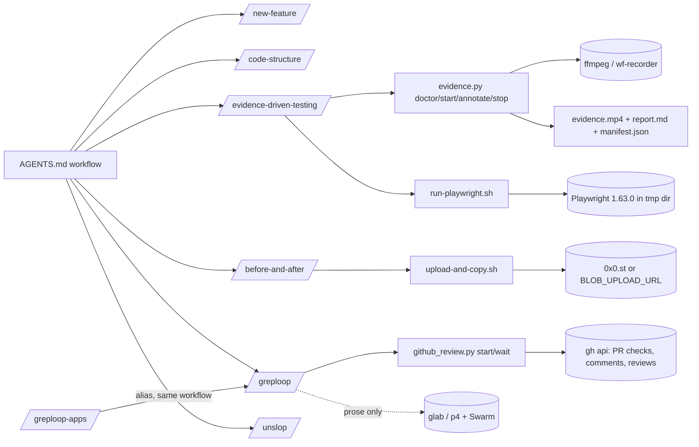

# Ras Mic (Michael Shimeles) — Software Factory Skills: technical deep dive

> Repository: https://github.com/michaelshimeles/skills (repo root; no subfolder) · Evaluated commit: 69558ea1f5328da7b40ba171dfe2171f00ff4884 (2026-10-18 21:49 -0400) on main
> Other branches inspected: `fix/skill-review-findings` (shallow clone, tree identical to main), `feat/address-skill-review-0906` (shallow clone, differs from main by what PR #17 later changed plus `README.md` install-section changes: no skills.sh badge, `cp -r` instead of `npx skills add`); the other 7 remote branches compared through `gh api compare` only (all `behind`, `ahead_by=0`) · License: none found at the root (`gh api` reports `license: null`); per-folder files: MIT in `greploop/LICENSE`, `greploop-apps/LICENSE`, `unslop/LICENSE`; a text titled "PolyForm Shield License 1.0.0" in `before-and-after/LICENSE`; no license for `new-feature/`, `code-structure/`, `evidence-driven-testing/`, `tests/`, `AGENTS.md`
> Accessed: 2026-10-22 · Method: read-only shallow clone; no code executed (no tests, scripts, npm or Python run). `gh api` used read-only for metadata, PR bodies, branch comparisons and two upstream files.
> Legend: [F] verified fact · [I] inference · [C] unverified claim · [U] unknown

## 1. Summary

The repository is a small pack of seven Claude Code / agent skills plus an `AGENTS.md` workflow
template. The author calls the workflow "isolate in worktrees, build to a service layer, prove
with evidence, ship with before/after proof and Greptile review loops" (GitHub description, via
`gh api`) [F]. It is for single developers or teams who run one or more coding agents on the same
repository and want each change isolated, proven with captured evidence, and reviewed by a bot
before a human merges. There is no orchestrator, no subagent definition, no hook and no model
routing. Every step is an instruction in Markdown that the host agent chooses to follow
(`AGENTS.md:15-33`) [F]. Two skills ship real tooling: a 1,358-line cross-platform screen
recorder with annotation burn-in (`evidence-driven-testing/scripts/evidence.py`) and a 257-line
Greptile review-freshness helper (`greploop/scripts/github_review.py`) [F]. Both carry regression
tests (61 test functions, 71 cases with parametrization, `tests/`) [F], but there is no CI
(`gh api .../actions/workflows` → `total_count: 0`; no `.github/`) [F]. Maturity: 37 commits from
2026-07-13 to 2026-10-19, no tags or releases, 1,374 stars and 225 forks, 2 open issues (both ask
for a LICENSE) [F]. Category: **skill/agent pack** with a **spec/planning methodology** layer
(the `AGENTS.md` workflow convention) and a **verification-tooling** component (other). It is not
an orchestration pipeline and not a multi-agent coordinator, though its rules address concurrent
agents (`AGENTS.md:54-72`) [F].

## 2. Architecture

Components (all files at the evaluated commit; 29 tracked files, 4,524 lines) [F]:

| Component | Files | Lines | Kind |
|---|---|---|---|
| Workflow template | `AGENTS.md` | 116 | Markdown instructions |
| `new-feature` | `new-feature/SKILL.md` | 73 | prose skill |
| `code-structure` | `code-structure/SKILL.md` | 123 | prose skill |
| `evidence-driven-testing` | `SKILL.md` + `scripts/evidence.py` + `scripts/run-playwright.sh` + `scripts/playwright/package{,-lock}.json` | 317 + 1,358 + 22 + 50 | skill + Python CLI + Bash helper |
| `before-and-after` (vendored) | `SKILL.md` + `scripts/upload-and-copy.sh` + `scripts/adapters/{0x0st,blob}.sh` + `LICENSE` | 128 + 135 + 91 + 27 | skill + Bash upload helpers |
| `greploop` (vendored, heavily rewritten) | `SKILL.md` + 4 `references/*.md` + `scripts/github_review.py` + `LICENSE` | 72 + 199 + 257 + 21 | skill + Python CLI |
| `greploop-apps` | `SKILL.md` + `LICENSE` | 27 + 21 | alias skill |
| `unslop` (vendored) | `SKILL.md` + `LICENSE` | 80 + 21 | prose skill |
| Tests | `tests/test_evidence.py`, `tests/test_github_review.py`, `tests/test_playwright_runner.py` | 865 + 304 + 80 | pytest |

Tech stack and runtime dependencies:

- Python 3.10+ standard library only for both scripts (`evidence.py:18-46`, `github_review.py:4-11`;
  `from __future__ import annotations`, `X | None` types) [F]. Requirement stated in
  `AGENTS.md:95-96` [F].
- FFmpeg/ffprobe with `libx264` and the `ass` filter, checked at runtime by `dependency_status()`
  (`evidence.py:129-141`) [F]. Optional `wf-recorder`, `wayland-info`/`weston-info`
  (`evidence.py:155-182`) [F].
- `gh` CLI, called with `api --paginate --slurp` (`github_review.py:130-132`) [F]. `--slurp`
  needs a recent `gh` [I]; no version pin [F].
- Node 20+ and npm for the headless helper; Playwright pinned at `1.63.0` with an integrity-hashed
  lockfile (`evidence-driven-testing/scripts/playwright/package-lock.json:14-40`) [F]. Chromium is
  downloaded at run time by `playwright install chromium` (`run-playwright.sh:21`) [F].
- Unpinned external CLIs named in instructions: `@vercel/before-and-after`, `agent-browser`
  (`README.md:20`, `before-and-after/SKILL.md:5-8`), `cua-driver`
  (`evidence-driven-testing/SKILL.md:206-235`), `glab`, `p4` (`greploop/SKILL.md:5`) [F].

External services: Greptile (GitHub app, bot logins `greptile-apps[bot]`,
`greptile-apps-staging[bot]`, `github_review.py:14`) [F]; GitHub REST/GraphQL [F]; 0x0.st public
file host as the default image upload target (`before-and-after/scripts/adapters/0x0st.sh:28`) [F];
an optional custom blob endpoint (`adapters/blob.sh:39`) [F]. No LLM provider, model name or API
key appears anywhere in the repository (`git grep` for `model:`, `subagent`, `hooks`, `dangerously`
returns no match; the only frontmatter tool key is `allowed-tools:` at `before-and-after/SKILL.md:4`) [F].

## 3. Agents

There are **no agent or subagent definitions** in the repository: no `.claude/agents/`, no
`agents/` folder, no `model:` frontmatter, no Task/Agent tool usage (grep, see section 2) [F].
The only "agent" is the host coding agent reading `AGENTS.md`. The README targets Claude Code
(`README.md:3`, `README.md:110`) and the GitHub description adds Cursor and Codex [F]; that the
same files work in Cursor and Codex is [C] (`AGENTS.md` is the file those tools read by
convention [I]).

Roles are expressed as rules for concurrent agents, not as agent files [F]:

- One worktree and one branch per task and per agent; never touch another agent's worktree
  (`AGENTS.md:57-58`).
- Scope check against open PRs before starting (`AGENTS.md:59-64`; same procedure in
  `new-feature/SKILL.md:24-30`).
- `--force-with-lease` only, own branch only (`AGENTS.md:65-66`).
- Lockfile conflicts resolved by regeneration (`AGENTS.md:67`).
- Shared resources (ports, databases) are not isolated by worktrees (`AGENTS.md:68-70`).
- Stop and report on unresolved conflict (`AGENTS.md:71-72`).

## 4. Skills, commands and prompts

| Skill | File | Trigger (description) | What it does | Notable structure |
|---|---|---|---|---|
| `new-feature` | `new-feature/SKILL.md:1-4` | "Isolate repository edits in a Git worktree before starting a feature, fix, or documentation change" | Checks existing isolation (`:12-18`), fetch, scope check via `gh pr list`/`gh pr diff --name-only` (`:22-30`), unique task name with suffix (`:32-34`), `git worktree add ... origin/main` (`:36-46`), verify branch (`:48-57`), cleanup with `git branch -D` (`:65-73`) | Explicitly preserves a worktree the harness already created; "Do not infer isolation from the editor name or a branch prefix alone" (`:17-18`) [F] |
| `code-structure` | `code-structure/SKILL.md:1-4` | "Use when multiple workflows duplicate the same operational logic…" | Two-layer guidance: actions own policy/state/auth/retries, services own reusable operations (`:30-42`); migration checklist (`:77-86`); anti-patterns (`:88-95`) | Pure guidance, defers to existing project architecture (`:10-13`, `:117-121`) [F] |
| `evidence-driven-testing` | `evidence-driven-testing/SKILL.md:1-14` | "Records visual proof while testing UI behavior… Use when changed runtime behavior needs observable verification" | Three evidence tiers: live computer-use session recorded by `evidence.py` (`:26-37`, `:93-192`); `cua-driver` as actuator when the harness lacks computer use (`:206-235`); headless Playwright/screenshots (`:237-294`); non-UI numbers/output pairs/transcripts (`:296-305`) | Jest-style `test_start`/`assertion` annotation protocol with `passed`/`failed`/`untested` (`:133-154`); "Never present `--source test` … as UI evidence" (`:89-91`); guardrail against recording secrets (`:201-202`) [F] |
| `before-and-after` | `before-and-after/SKILL.md:1-17` | "Captures before/after screenshots…" with quoted trigger phrases | Drives the external `@vercel/before-and-after` CLI, uploads a pair and emits a `| Before | After |` table (`:42-54`), PR body edit via `gh pr edit --body-file` (`:106-119`), Vercel protection bypass via `vercel inspect` (`:98-104`) | Only skill with `allowed-tools` (`:4-16`); warns against the unscoped npm package `before-and-after` (`:21-22`) [F] |
| `greploop` | `greploop/SKILL.md:1-9` | "Address Greptile feedback on a PR, MR, or shelved changelist through bounded review and fix cycles" | Six-step review cycle (`:40-61`), stop conditions (`:63-66`), report fields (`:68-72`); per-platform references loaded on demand (`:29-38`) | `--max-iterations` default 10 (`:20`); "do not reuse an earlier score just because it belongs to the same commit" (`:45-46`); "Do not change correct code merely to chase the score" (`:54-55`) [F] |
| `greploop-apps` | `greploop-apps/SKILL.md:1-27` | "Run the greploop workflow with the @greptile-apps trigger…" | Delegates to `greploop` with `--trigger @greptile-apps`; contains no separate implementation (`:26-27`) | Dependency on a sibling skill, documented paired install (`:16-24`) [F] |
| `unslop` | `unslop/SKILL.md:1-4` | "Cut AI tells from text you write or edit for a human reader…" | 31 numbered prose patterns (`:30-80`), four-step loop scan → rewrite → add soul → self-audit (`:10-15`) | Frontmatter edited so it auto-invokes (`AGENTS.md:116`, `README.md:92`) [F] |

References under `greploop/references/` [F]:

- `github.md` (73 lines): `start`/`wait` usage, stuck-check override, trusted bot logins,
  GraphQL thread resolution rules (`:9-70`).
- `gitlab-api.md` (61 lines) and `perforce.md` (24 lines): **procedures in prose only**, with
  `glab api` snippets; no helper script backs them (`greploop/SKILL.md:36-38`; PR #10 body:
  "GitLab and Perforce procedures were reviewed … but were not run against live installations")
  [F]/[C].
- `graphql-queries.md` (41 lines): paginated unresolved-thread query and batch resolve mutation.
  The query reads only `comments(first: 3)` per thread (`:14`); `github.md:62-63` tells the agent
  to read full threads separately [F].

Prompt templates: none beyond the SKILL.md bodies. The PR body format is prescribed in
`AGENTS.md:83-85` (what changed, how tested with evidence, before/after proof, risks) [F].

## 5. Orchestration and execution workflows

**Execution model: LLM-driven, with two deterministic helpers.** The order of steps (isolate →
build → prove → ship), the choice of which steps apply, the iteration cap and the decision to stop
all live in Markdown that the agent interprets (`AGENTS.md:3-13`, `:15-33`) [F]. No code chains
the skills together [F]. The two Python CLIs are deterministic inside their own scope: they never
decide what to fix, only whether a review is fresh (`github_review.py:45-120`) or whether a
recording was produced and is playable (`evidence.py:1170-1281`) [F].

**Concurrency.** None inside the pack; the parallelism it addresses is several agents on one repo,
handled by worktree isolation rules (section 3) [F]. Within `evidence.py`, concurrent `annotate`
calls are serialized with a per-session lock (`session_lock`, `evidence.py:261-293`; flock on
POSIX, msvcrt byte lock on Windows) and covered by `test_concurrent_annotations_are_all_persisted`
(`tests/test_evidence.py:130`) [F].

**Retries, recovery and failure handling.**

- Greploop iteration cap: `--max-iterations N`, default 10, "includes reviews that produce no
  edits", never raised automatically (`greploop/SKILL.md:20`, `:63-66`; `AGENTS.md:30-33`) [F].
  The cap is **enforced only by the agent**; `github_review.py` has no iteration counter (whole
  file) [F].
- Review wait: 10-minute timeout, 10-second poll (`github_review.py:237-238`), deadline-bounded
  sleep (`:209-212`) [F].
- Duplicate-trigger guard: `start` reserves the attempt file with `open("x")` before posting and
  removes it only if the failure happened before the post (`github_review.py:155-183`) [F]. A
  file left in `preparing` state makes `wait` refuse ("attempt has no confirmed trigger",
  `:198-199`) [F].
- Stuck Greptile check: blocks a new trigger unless it started more than `--stuck-after` (1800 s)
  ago or is listed in `--ignore-check` (`github_review.py:162-177`) [F].
- Recorder state machine: `recording → recorded → finalizing → finalized`, with
  `startup_failed`, `recorder_lost` and `finalization_failed` recovery states
  (`evidence.py:859-876`, `:931-942`, `:1170-1267`) [F]. `stop` is re-runnable after a failed
  render "does not signal the recorder twice" (`evidence-driven-testing/SKILL.md:167-170`;
  code `evidence.py:1232-1237`) [F].
- Crash-safe capture: raw MPEG-TS with a keyframe every second (`evidence.py:351-368`) so a killed
  recorder still leaves a renderable file; covered by
  `test_unclean_recorder_exit_still_finalizes_from_mpegts` (`tests/test_evidence.py:730`) [F].

**Human approval gates.** "Do not merge the PR unless explicitly instructed" (`AGENTS.md:90`;
`greploop/SKILL.md:72`) [F]. A read-only request "does not authorize code edits or posting
comments" (`greploop/SKILL.md:25-27`) [F]. `start` posts a PR comment and is to be used "only
when the task authorizes the review loop" (`greploop/references/github.md:18-19`) [F]. Scope
conflicts with other PRs → ask (`new-feature/SKILL.md:26-28`) [F]. The untracked-recorder case
needs an explicit operator flag `--accept-untracked-recorder` (`evidence.py:1215-1231`,
`:1324-1330`) [F]. All of these gates are instructions to the agent except the last, which is
enforced in code [F].

### Traced path A — Greptile review loop on GitHub

1. `AGENTS.md:27-33` (step 4 "Ship") tells the agent to run `/greploop` for code changes and aim
   for 5/5 with zero unresolved findings, within the cap [F].
2. `greploop/SKILL.md:17-23` parses inputs (PR number, `--max-iterations`, `--trigger`, `--vcs`);
   `:34-35` routes to `references/github.md` [F].
3. Agent runs `python3 "$REVIEW" start --repo OWNER/REPO --pr N --trigger @greptile --output
   .artifacts/greploop/attempt-1.json` (`references/github.md:12-13`) [F].
4. `github_review.py:main()` (`:222-253`) → `start()` (`:154-194`):
   reserve output file (`:156-158`) → `GitHub.head()` (`:134-135`) → `GitHub.snapshot()` collects
   all pages of check runs, issue comments and PR reviews for that head (`:137-142`, pagination
   `:130-132`) → refuse if a non-stuck Greptile check is running (`:162-177`) → re-read the head
   and refuse if it moved (`:178-179`) → POST `"{trigger} review"` as an issue comment
   (`:184-187`) → write attempt JSON with head, trigger id, server `created_at`, bot list and the
   baseline snapshot (`:188-193`) [F].
5. Agent runs `wait attempt-1.json --timeout 600 --interval 10` (`references/github.md:14-15`) →
   `wait_for_review()` (`:197-212`): read head, abort if changed (`:202-204`), snapshot, then
   `evaluate()` with a **second** head read (`:205-206`) [F].
6. `evaluate()` (`:45-120`): keep only Greptile checks on the current head that started at or
   after the trigger and are not the baseline run (`:50-63`); newest running check → `pending`
   (`:66-68`); aborted conclusions → error (`:69-70`); fresh PR reviews by trusted bots on the
   current head, newer than the trigger, changed from baseline, with a parseable score
   (`:73-84`); fresh or edited bot comments whose body names the current head in a
   "Last reviewed commit" link (`:87-106`, `reviewed_commit()` `:40-42`); "too many files"
   notice on the default trigger → error naming `@greptile-apps` (`:108-111`); otherwise
   return the newest candidate with score, body, URL (`:113-120`) [F]. `confidence()` (`:22-37`)
   strips fenced code and HTML and requires exactly one distinct `Confidence … N/5` value [F].
7. Output: JSON on stdout (`:249`). The agent then fetches unresolved threads with the GraphQL
   query (`references/graphql-queries.md:5-27`), fixes, runs checks, commits only task files,
   pushes, resolves the addressed thread ids (`greploop/SKILL.md:47-58`), and starts a new attempt
   with a new file if the cap allows (`:59-61`) [F]. Final report fields: URL, revision, cycles,
   score, checks, resolved and remaining findings (`:68-72`) [F].

State produced: `.artifacts/greploop/attempt-N.json` (gitignored via `.gitignore:5`), the PR
comment, resolved threads, commits [F].

### Traced path B — evidence recording of a live UI test

1. `AGENTS.md:23-26` (step 3 "Prove") → `/evidence-driven-testing` for changed runtime behavior [F].
2. `python3 $EVIDENCE doctor` → `command_doctor()` (`evidence.py:314-343`): toolchain via
   `dependency_status()` (`:129-141`), sources via `capture_status()` (`:185-223`); exit 1 only if
   the toolchain is missing [F].
3. `start --output .artifacts/<task> --title … --commit $(git rev-parse HEAD) --branch …`
   (`SKILL.md:107-113`) → `command_start()` (`:839-928`): dependency gate (`:840-845`) →
   `resolve_source()` (`:236-247`) → `recorder_command()` builds the ffmpeg/wf-recorder argv per
   source (`:396-462`) before any directory exists (`:853-857`) → `uses_supervisor()` →
   `pidfd_usable()` opens a pidfd on its own PID to probe kernel/seccomp support (`:491-504`) [F].
   - Direct mode (Linux with pidfd): `spawn_detached()` (`:476-488`), record
     `process_identity()` (`/proc/<pid>/stat` start ticks and PGID, `:522-539`),
     `wait_for_recorder()` until `raw.ts` is non-empty (`:799-813`) [F].
   - Supervised mode (macOS, Windows, Linux without pidfd): write `recorder-command.json`, spawn
     `evidence.py supervise` (`:878-883`) → `command_supervise()` (`:705-739`) owns the ffmpeg
     child, records its identity under the session lock, polls for `stop.request`, and writes
     `recorder-exit.json` [F].
4. For each test target: `annotate SESSION --type test_start|assertion --result …`
   (`SKILL.md:133-146`) → `command_annotate()` (`:945-972`) enforces ≤80 chars, result only on
   assertions, status `recording`, and stores a timestamp relative to `started_epoch` [F].
5. `stop SESSION` → `command_stop()` (`:1164-1167`) → `finalize_session()` (`:1170-1281`):
   `stop_recorder()` with SIGINT → SIGTERM → SIGKILL through the pidfd after an identity match
   (`:626-665`), or `stop_supervised()` via the request file (`:758-787`) → `probe_video(raw)`
   (`:980-1015`) → `write_annotations()` ASS subtitles colour-coded by result (`:1034-1079`) →
   `render_video()` burns them in with libx264, or remuxes when there are no annotations
   (`:1087-1113`) → `probe_video(final)` → `write_report()` (`:1116-1156`) → `manifest.json`
   (`:1268`) → prints `"verified": true` (`:1269-1280`) [F].
6. The agent extracts frames at assertion timestamps to check the label and state are visible
   (`SKILL.md:175-177`), fills the Caveats section (`:178`), then posts video + `report.md` to the
   PR (`:180-192`) [F].

### Traced path C — headless Playwright capture (short)

`evidence-driven-testing/SKILL.md:249-263` → `bash run-playwright.sh record.mjs` →
`run-playwright.sh:13-14` creates a temp dir with an EXIT trap → copies the script and the pinned
manifest/lockfile (`:17-18`) → `npm ci --no-audit --no-fund --ignore-scripts` inside the temp dir
(`:20`) → `playwright install chromium` (`:21`) → `node record.mjs` from the caller's cwd so
relative artifact paths land in the project (`:22`) [F]. Covered by
`tests/test_playwright_runner.py:46-80` with a fake `npm` [F].

## 6. Context and state management

- **Context building.** Progressive disclosure through skill descriptions; `greploop` loads one
  platform reference only (`greploop/SKILL.md:31-38`) [F]. `AGENTS.md` (948 words) is the
  always-loaded part when the host reads it [I].
- **Persistent state.** Files only, all under the gitignored `.artifacts/` (`.gitignore:5`;
  `AGENTS.md:106`) [F]:
  - greploop attempt JSON: head SHA, trigger id/time, trusted bots, baseline snapshot
    (`github_review.py:188-193`) [F].
  - recorder session folder: `session.json` (schema_version 4, `evidence.py:859-876`),
    `raw.ts`, `recorder.log`, `supervisor.log`, `recorder-command.json`, `stop.request`,
    `recorder-exit.json`, `annotations.ass`, `evidence.mp4`, `report.md`, `manifest.json`
    (`:52-56`, `:1239-1244`) [F]. Writes are atomic (temp file + replace, `:255-258`) and
    read-modify-write is locked (`:261-293`) [F].
- **Handoff artifacts.** `report.md` and `manifest.json` (machine-readable session plus
  verification) carry commit, branch, environment, per-assertion results (`:1116-1156`) [F]. The
  PR body template is the human handoff (`AGENTS.md:83-85`) [F].
- **Resumability.** `wait` can be rerun on an existing attempt file without posting
  (`references/github.md:22-24`, `:31`) [F]. `stop` is idempotent across `recorded`,
  `finalizing`, `finalization_failed` and `recorder_lost` (`evidence.py:1198-1233`) [F]. No
  cross-session memory, no task ledger, no progress file for the workflow itself [F].
- **Known timing defect.** Annotation timestamps count from recorder spawn, not the first video
  frame, so labels land late by the recorder's startup time (PR #17 body, "A separate known issue
  stays open") [C]; consistent with `started_epoch` being set after `spawn_detached()`
  (`evidence.py:884`, `:910`) and used in `:964` [I].

## 7. Engineering practices and testing

- **Tests** [F]: `tests/test_evidence.py` 25 functions; `tests/test_github_review.py` 33 functions
  (42 cases with parametrization at `:78`, `:97`, `:126`, `:157`); `tests/test_playwright_runner.py`
  3 functions (4 cases). Total 71 cases; matches the PR #17 body figure "67 passed, 4 skipped" on
  Linux [C], the 4 skips plausibly being the Node-gated runner tests (`test_playwright_runner.py:12`)
  [I]. Framework: pytest, run as `python3 -m pytest tests/ -q` (`AGENTS.md:95`) [F].
- **What they cover** [F]: review freshness (old checks, edited timestamps, markerless summaries,
  wrong commit, imposter login `greptile-imposter`, `test_github_review.py:49-177`); trigger
  idempotency, stuck and null-start checks, head change during snapshot, polling, deadline,
  pagination, API errors (`:201-304`) using a `FakeGitHub` double (`:182-198`); recorder
  real-process integration with the synthetic `testsrc2` source (`test_evidence.py:73-128`),
  concurrent annotations, finalization retry, PID-reuse refusal, SIGKILL escalation, supervisor
  loss, Wayland compositor detection, geometry validation, MPEG-TS crash recovery
  (`:130-865`); Playwright helper isolation and cleanup (`test_playwright_runner.py:46-80`).
- **Portability gaps.** Recorder tests spawn real ffmpeg and have no skip marker for missing
  ffmpeg (grep `skip` in `test_evidence.py` returns nothing) [F]. PR #17 body reports "the same 4
  failures as `main`" on macOS for Linux-only pidfd tests [C]. Windows code paths are marked
  `pragma: no cover` (`evidence.py:62`, `:279`, `:577`, `:681`, `:715`) and only command
  construction is tested for Windows (`test_evidence.py:484-521`) [F].
- **CI, lint, typing.** No CI, no linter or type-checker config, no pre-commit (no `.github/`, no
  config files in `git ls-files`) [F]. Type hints are used throughout `evidence.py` [F].
  `git diff --check` is the only static check named (`AGENTS.md:97`) [F].
- **Evals for prompts/skills.** None [F]. Skill frontmatter is validated by hand; the author notes
  the "installed skill-creator validator does not recognize the existing `compatibility` field"
  (`AGENTS.md:100-102`) [F].
- **Verification applied to produced software.** Independent in the sense that a third-party bot
  (Greptile) scores each revision and the helper ties the score to the exact head SHA
  (`github_review.py:45-120`) [F]. Evidence capture is **not** independent: assertion results are
  typed by the same agent that did the work; the skill itself warns "The timestamp records when you
  asserted, not whether it was true" (`evidence-driven-testing/SKILL.md:153-154`) [F]. The
  recorder's `"verified": true` means ffprobe found a video stream with positive duration
  (`evidence.py:1002-1007`, `:1250`), not that any behavior passed [F].
- **Dogfooding.** Commit history shows the loop used on the repo itself: 12 commits titled
  "address greptile review feedback (greploop iteration N)", up to iteration 4 on PR #5 (git log
  via `gh api`) [F]. PR #10 reports three live review rounds ending at 5/5 for commit `318301d`
  [C].

## 8. Security, isolation and observability

- **Permission model.** No `--dangerously-skip-permissions`, no settings.json, no hooks (grep) [F].
  Only `before-and-after` declares `allowed-tools` (`before-and-after/SKILL.md:4-16`) [F], which in
  Claude Code pre-approves those tool patterns while the skill is active [I]. Patterns of note [F]:
  `Bash(npm install -g @vercel/before-and-after)` (global install, unpinned version);
  `Bash(npx @vercel/before-and-after *)` (unpinned remote package execution);
  `Bash(gh pr edit *)` (any PR edit); `Bash(*/upload-and-copy.sh *)` (matches any script with that
  name in any directory [I]). Upstream greploop v1.3 declares
  `allowed-tools: Bash(gh:*) Bash(git:*) …` (fetched via `gh api`); the local version drops it
  (`greploop/SKILL.md:1-9`) [F].
- **Isolation.** Git worktrees per task (`new-feature/SKILL.md:36-46`); explicit warning that
  worktrees do not isolate ports or databases (`:61-64`; `AGENTS.md:68-70`) [F]. No containers or
  sandboxes. Playwright dependencies are installed in a temp dir outside the project with
  `--ignore-scripts` (`run-playwright.sh:13-20`) [F]. The recorder never signals a bare PID: pidfd
  with identity check on Linux, otherwise a supervisor that owns the child
  (`evidence.py:9-15`, `:610-665`, `:673-702`) [F].
- **Network and data egress.** Default screenshot upload goes to the public host 0x0.st
  (`adapters/0x0st.sh:28`); `AGENTS.md:42-43` says to pass `--upload-url` "for anything
  sensitive" [F]. The evidence skill suggests the same adapters for video upload
  (`evidence-driven-testing/SKILL.md:186-188`) [F]. Guardrail: never record secrets, tokens,
  customer or payment data (`:201-202`) [F]. `upload-and-copy.sh` builds the adapter path from the
  `IMAGE_ADAPTER` environment variable without sanitising it (`upload-and-copy.sh:25`, `:68`, `:88`),
  so a value containing `../` would run another `.sh` file [I]; the variable is caller-controlled,
  so this is low severity [I].
- **Secrets.** No secret-shaped strings found (grep for AWS/GitHub/OpenAI/Slack key shapes,
  private-key headers, `api_key=`) [F]. Credentials are delegated to `gh`/`glab`/`p4`/`vercel`
  logins [F]. The Vercel path asks the agent to obtain a deployment-protection bypass token via
  `vercel inspect` (`before-and-after/SKILL.md:100-104`) [F].
- **Supply chain.** Playwright pinned with integrity hashes (`package-lock.json:16-17`, `:31-32`)
  [F]; Chromium download not hash-pinned by this repo [I]. `@vercel/before-and-after`,
  `agent-browser`, `cua-driver` unpinned [F]. Install via `npx skills add michaelshimeles/skills`
  (`README.md:107`) fetches the moving `main` [I].
- **Prompt-injection exposure.** The greploop agent reads third-party text (Greptile summaries,
  PR threads) and acts on it [F]. Mitigations in code: only exact trusted bot logins count for
  scores (`github_review.py:76`, `:89`; imposter test `test_github_review.py:97-101`) [F];
  instructions to evaluate each finding in context and not change correct code to chase the score
  (`greploop/SKILL.md:52-55`) [F]. No content-sanitising of bot bodies before the agent reads them
  [F]. **No prompt-injection content found in the repo**: grep for override phrases, HTML comments
  and zero-width/bidi characters returned nothing [F]. `AGENTS.md` and the SKILL files are
  instructions to an agent by design; `unslop` is deliberately made model-invocable on any
  human-facing text (`AGENTS.md:116`) [F], which is a behaviour change, not an injection.
- **Observability.** `recorder.log`, `supervisor.log`, session JSON with status and failure fields
  (`evidence.py:1187-1190`, `:1253-1256`), attempt JSON for reviews [F]. Structured JSON on stdout
  and stderr from both CLIs (`github_review.py:249-253`, `evidence.py:905`, `:927`, `:971`) [F]. No
  token, cost or timing metrics [F].

## 9. Efficiency

- **Context footprint.** SKILL bodies total about 6,000 words across seven skills; the largest is
  `evidence-driven-testing/SKILL.md` at 2,467 words; greploop references add 1,301 words but load
  one at a time (`wc -w`) [F]. `greploop-apps` is 141 words and reuses the main workflow instead of
  duplicating it; PR #10 reports the consolidation from "two duplicated workflows" to "one 72-line
  workflow and a 27-line compatibility entrypoint" [F]/[C].
- **Proportional effort.** `AGENTS.md:6-13` skips worktrees, PRs and bot review for read-only work
  and keeps documentation edits to content checks; the evidence skill scales evidence type to the
  change (`evidence-driven-testing/SKILL.md:20-24`) [F].
- **Model routing / caching.** None [F].
- **Cost controls.** Iteration cap (default 10) and 10-minute wait per round bound the review loop
  to roughly 100 minutes of waiting at worst [I]. The helper refuses to post a second trigger while
  one runs (`github_review.py:162-177`), avoiding duplicate paid reviews [F]/[I]. Greptile is an
  external service whose cost the repo does not mention [U].
- **Operational overhead.** Each Playwright run reinstalls Playwright with `npm ci` in a fresh temp
  dir (`run-playwright.sh:13-20`); the browser cache persists (`SKILL.md:260-261`) [F]. Recording
  renders with `-preset medium` (`evidence.py:1097`), which is CPU-heavy for long sessions [I].

## 10. Continuous improvement

No self-improvement mechanism, eval loop, lesson store or memory [F]. Improvement is manual and
review-driven: PRs are run through `/greploop` until 5/5 (`AGENTS.md:29-33`), and the commit log
shows those iterations [F]. PR #17 was triggered by "three bugs Greptile found in these skills
while reviewing a repo that vendors them" [C]. External feedback arrives through issues (#11, #12
on licensing) [F]. `unslop`'s self-audit step ("What makes this obviously AI generated?",
`unslop/SKILL.md:15`) is a per-output reflection, not persistent learning [F].

## 11. Reference-driven development and reverse engineering

Mostly not applicable — the pack does not extract specifications from reference projects or
measure feature parity. The applicable part is **visual verification**: before/after screenshot
pairs of two URLs or images (`before-and-after/SKILL.md:42-54`, `:58-78`), a recorded live test
session with burned-in assertion labels (`evidence.py:1034-1113`), frame extraction at assertion
timestamps for review (`evidence-driven-testing/SKILL.md:175-177`), and "reproduce and capture the
failure **before** writing the fix" (`:304-305`; `AGENTS.md:23-25`) [F]. Pixel assertions for
rendering changes are recommended but not implemented in code (`SKILL.md:300-301`) [F].

## 12. Innovations

1. **Revision-bound review freshness.** A bot score counts only if it is newer than a recorded
   trigger, differs from the pre-trigger snapshot, comes from an exact trusted login, and names the
   current head SHA in its own metadata; the head is re-read after fetching results
   (`github_review.py:45-120`, `:197-212`). This closes the "old 5/5 accepted for new code" failure
   that PR #10 reports reproducing ("Exited 0 and printed `Greptile check passed!`") [F]/[C].
2. **Post-once trigger reservation.** Exclusive-create of the attempt file before any network
   write, released only on pre-post failure (`github_review.py:155-183`) — an idempotency key on
   the filesystem [F].
3. **Strict score parsing.** Ignores fenced code and quoted examples and refuses ambiguous
   multiple scores (`github_review.py:22-37`; tests `test_github_review.py:157-175`) [F].
4. **PID-reuse-safe recorder control.** pidfd + `/proc` start-ticks identity on Linux, supervisor
   ownership elsewhere, a runtime pidfd probe for seccomp-restricted containers, and explicit
   `recorder_lost` / `--accept-untracked-recorder` states rather than guessing
   (`evidence.py:491-504`, `:610-665`, `:705-787`, `:1198-1231`) [F].
5. **Assertion-annotated evidence video.** Agent-emitted `setup`/`test_start`/`assertion` events
   become colour-coded burned-in subtitles plus a Markdown/JSON report stamped with commit, branch
   and environment (`evidence.py:1034-1156`) [F].
6. **Dependency-isolated capture runner.** Pinned lockfile installed in a temp dir with
   `--ignore-scripts`, script copied beside it so ESM resolution works, caller cwd preserved
   (`run-playwright.sh:13-22`) [F].
7. **Scaled workflow template.** One `AGENTS.md` that tells the agent which steps a task needs
   (read-only, docs-only, code) instead of always running the full ship pipeline
   (`AGENTS.md:6-13`) [F].

## 13. Reusable components

| Component | Path | Kind | Dependencies | License | Security notes | Reuse class | Limits and compatibility constraints |
|---|---|---|---|---|---|---|---|
| Greptile review freshness helper | `greploop/scripts/github_review.py` | script | Python 3.10+, `gh` with `--slurp`, Greptile app | MIT (folder `greploop/LICENSE`, © Greptile AI) | Posts one PR comment on `start`; trusts fixed bot logins (`:14`) | needs adaptation | GitHub only; score regex and "Last reviewed commit" marker are Greptile-format specific (`:36`, `:41`); 30 s `gh` timeout per call (`:125`) |
| Trigger/snapshot/head-recheck freshness pattern | `github_review.py:45-212` | pattern | any bot reviewer with timestamps and commit ids | MIT | — | reimplement the idea | Needs the reviewer to expose revision metadata; otherwise the pattern says report "freshness could not be verified" (`references/github.md:53-54`) |
| Bounded review-fix loop | `greploop/SKILL.md:40-72` | skill (workflow) | Greptile, `gh`/`glab`/`p4` | MIT | Agent-enforced cap only | needs adaptation | GitLab/Perforce paths are prose without tooling |
| Evidence recorder CLI | `evidence-driven-testing/scripts/evidence.py` | script | Python 3.10+, ffmpeg/ffprobe with libx264 + ass; wf-recorder for Wayland | **none** (issues #11, #12 open) | Spawns detached processes; records full screen | reference only (no license grant) / reimplement the idea | Needs a GUI capture source; GNOME/KDE Wayland unsupported (`:155-182`); annotation timing offset (PR #17) |
| Evidence protocol (assertion annotations, untested-with-reason, before-fix capture) | `evidence-driven-testing/SKILL.md:127-154`, `:296-305` | pattern | — | none | Self-reported results | reimplement the idea | Not independent verification |
| Isolated Playwright runner | `evidence-driven-testing/scripts/run-playwright.sh` + `scripts/playwright/` | script | Bash, Node 20+, npm | none | `--ignore-scripts`; Chromium downloaded at run time | reimplement the idea | Script must be self-contained (no relative imports) (`SKILL.md:262-263`) |
| Worktree-per-task skill | `new-feature/SKILL.md` | skill | git, `gh` | none | `git branch -D` on cleanup | reimplement the idea | Assumes `origin/main` base unless told otherwise |
| Multi-agent repo rules | `AGENTS.md:54-91` | pattern | — | none | — | reimplement the idea | Prose; no enforcement |
| Service-layer guidance | `code-structure/SKILL.md` | skill | — | none | — | reference only | Generic architecture advice |
| `unslop` prose editor | `unslop/SKILL.md` | skill | — | MIT (© Lauren Tan) | Auto-invocation on all human-facing text | directly reusable | Body has drifted from current upstream (see section 16) |
| Before/after capture + upload | `before-and-after/` | skill + scripts | `@vercel/before-and-after`, `agent-browser`, curl, 0x0.st | file titled "PolyForm Shield 1.0.0" with non-canonical MIT-style text plus noncompete (`LICENSE:1-27`) | Public upload by default; broad `allowed-tools` | reference only (license ambiguity) | Depends on an external unpinned CLI |
| `greploop-apps` alias pattern | `greploop-apps/SKILL.md` | skill | `greploop` | MIT | — | directly reusable | Must be installed beside `greploop` |

## 14. Evidence against the value dimensions

**Engineering quality.** Demonstrated: two non-trivial scripts with careful failure states
(section 5), atomic writes and locking (section 6), 71 test cases including real-process recorder
tests and adversarial freshness cases (section 7). Not demonstrated: CI, lint or type checks
(section 7); Windows paths are excluded from coverage (section 7). Cross-platform recorder support
is code-present but only partially tested (section 16).

**Autonomy and orchestration.** Demonstrated: a bounded, agent-run loop with explicit stop
conditions and a deterministic freshness gate (section 5, path A). Not present: any orchestrator,
scheduler, subagent, parallel dispatch or state machine for the workflow as a whole; the iteration
cap is honour-system (section 5).

**Development productivity.** Demonstrated by the repo's own history: 12 greploop-iteration
commits and PR bodies with before/after tables (section 7) [F]/[C]. Productivity gains are not
measured anywhere (section 10).

**Security and reliability.** Demonstrated: PID-reuse-safe process control, post-once trigger,
trusted-login filtering, pinned Playwright with `--ignore-scripts` (sections 8, 12). Weaknesses:
public default upload host, unpinned global npm install granted in `allowed-tools`, no sandboxing,
no license for the original code (sections 8, 13).

**Maintainability and adaptability.** Small and readable (29 files); each skill is self-contained
and defers to project conventions (`code-structure/SKILL.md:10-13`) (sections 2, 4). Vendored
skills are documented with their sources (`AGENTS.md:108-116`), but `greploop` is a near-total
rewrite still labelled `author: greptileai`, and `unslop` has drifted from upstream (section 16).

**Resource efficiency.** Progressive loading of greploop references and a scaled workflow
(section 9) are demonstrated. No token, cost or time measurement exists (sections 8, 9).

## 15. Strengths and limitations

Strengths:

- Review freshness is enforced in code, not prose, and tested against stale, edited, imposter and
  wrong-commit cases (`github_review.py:45-120`; `tests/test_github_review.py:49-177`).
- The recorder treats process control as a correctness problem: no bare-PID signals, explicit
  recovery states, crash-tolerant container (`evidence.py:9-15`, `:351-368`, `:1170-1233`).
- Evidence discipline is concrete: capture the failure before the fix, mark `untested` with a
  reason, never pass off the synthetic source as UI evidence (`evidence-driven-testing/SKILL.md:89-91`,
  `:152`, `:304-305`).
- Effort is proportional to the task (`AGENTS.md:6-13`).
- Multi-agent hygiene rules are specific and actionable (`AGENTS.md:54-72`).
- The author dogfoods the loop and documents test results and limits in PR bodies (PR #10, #17).

Limitations:

- No license for the original skills and scripts; the before-and-after license text is not the
  canonical PolyForm Shield text (`before-and-after/LICENSE:1-27`; issues #11, #12).
- Workflow orchestration is entirely LLM-interpreted; nothing enforces step order, the cap, or
  the "no merge" rule (`AGENTS.md`, whole file).
- Evidence results are self-reported; `"verified": true` only checks the video file
  (`evidence.py:1002-1007`).
- Greptile-specific: score format, bot logins and trigger syntax are hard-coded
  (`github_review.py:14`, `:36`, `:228`).
- GitLab and Perforce support is untested prose (`greploop/references/gitlab-api.md`,
  `perforce.md`).
- Recorder tests fail rather than skip on hosts without ffmpeg, and 4 fail on macOS per PR #17
  [C]; no CI to catch regressions.
- Default public upload host for evidence (`adapters/0x0st.sh:28`).

## 16. Claims vs verified ledger

| Claim (source) | Status | Evidence |
|---|---|---|
| "Each skill is a folder containing a `SKILL.md` with frontmatter (name, description)" (`README.md:3`) | verified | All seven skill folders have `name`/`description` frontmatter |
| Recorder "runs on Linux, macOS, and Windows" (`README.md:40`) | partly | Code paths exist (`evidence.py:396-462`, `:577-603`); Windows marked `pragma: no cover`; tests exercise Windows argv only (`test_evidence.py:484-521`); macOS path exercised via `EVIDENCE_PLATFORM=darwin` override on the host (`test_evidence.py:35`) |
| Recorder has `doctor`, `start`, `annotate`, `stop` (`README.md:40`) | verified | `evidence.py:1289-1335` (plus hidden `supervise`) |
| `stop` "verifies the result with ffprobe" (`evidence-driven-testing/SKILL.md:35-36`) | verified, narrow | `probe_video()` checks stream presence and positive duration only (`evidence.py:980-1015`) |
| "Nothing ever signals a bare PID" (`evidence-driven-testing/SKILL.md:76-77`) | verified (code) / not executable | `evidence.py:626-665`, `:673-702`; tests `test_evidence.py:365-381`, `:595-625`; not run |
| Greploop "Targets a fresh 5/5 … within `--max-iterations` cycles, default 10" (`README.md:48-51`) | partly | Freshness enforced in code (`github_review.py:45-120`); the cap exists only in instructions (`greploop/SKILL.md:20`, `:63-66`) |
| "The GitHub helper records each trigger and rejects stale checks and summaries" (`README.md:52`) | verified | `github_review.py:154-194`, `:50-106` |
| GitLab and Perforce supported (`greploop/SKILL.md:3`, `:5`) | partly | Procedures in prose; no helper; "not run against live installations" (PR #10 body) |
| Playwright helper "keeps dependencies out of the target project" (`README.md:44`) | verified (code) / not executable | `run-playwright.sh:13-22`; `test_playwright_runner.py:46-61` asserts no `node_modules` in the project |
| `unslop`: "It names 31 patterns" (`README.md:85`) | verified | `unslop/SKILL.md:32-80` numbered 1–31 |
| `unslop`: "The body matches upstream" (`README.md:92`; `AGENTS.md:116` "body untouched") | contradicted for current upstream / unverifiable at vendoring time | Current upstream `cursor/plugins/pstack/skills/unslop/SKILL.md` is 62 lines with a different body ("Rule numbers are stable ids…"), after upstream commits `00b14f1` (2026-10-10, "distill skill prompts") and `bc697d0` (2026-10-12) (via `gh api`) |
| `greploop` "Vendored from greptileai/skills" (`README.md:56`, `AGENTS.md:114`) | partly | Upstream `skills/greploop/SKILL.md` is v1.3, 454 lines, unbounded "until 5/5", has `allowed-tools`, and no `scripts/` (via `gh api`); local copy is v"2.0", 72 lines, bounded, with a local helper, yet keeps `metadata.author: greptileai` (`greploop/SKILL.md:6-8`) |
| `before-and-after` license is "PolyForm Shield 1.0.0" (`README.md:20`) | contradicted (text) | `before-and-after/LICENSE:5-25` is an MIT-style grant with a noncompete clause, not the canonical PolyForm text; flagged in issue #11 |
| "For Claude Code, Cursor, and Codex" (GitHub description) | not executable | No harness-specific files besides `AGENTS.md`; untested here |
| Tests: "67 passed, 4 skipped" Linux; "same 4 failures as main" on macOS (PR #17 body) | not executable | Case count 71 matches (section 7); not run |
| PR #10 live run ended at 5/5 for `318301d` (PR #10 body) | not executable | Greptile bot comments exist on PR #17 (`gh api .../issues/17/comments`); PR #10 claim not re-checked |
| Install with `npx skills add michaelshimeles/skills` (`README.md:107`) | not executable | External `skills` CLI; not run |

## 17. Uncertainties and research completeness

Could not check (and why):

- Any runtime behaviour: tests, recorder, review helper and Playwright runner were not executed
  (brief rule 1). All behavioural statements rest on code reading and on the author's PR bodies.
- Greptile's actual output format and billing; whether the hard-coded score regex matches every
  current Greptile summary layout [U].
- `@vercel/before-and-after`, `agent-browser`, `cua-driver`, and the `skills` installer: external,
  not in the repo [U].
- Whether `before-and-after` matches its upstream; only `unslop` and `greploop` upstreams were
  spot-checked through `gh api`.
- Pre-squash history of the squash-merged branches (only branch tips were compared).

Completeness rating: **complete** for the repository content — every tracked file (29/29, 4,524
lines) was read in full, except `tests/test_evidence.py`, of which about 250 of 865 lines were read
and the rest surveyed by test names and grep. Two branches were shallow-cloned and diffed against
main; the other seven were compared through the GitHub compare API; all 13 PRs and both open
issues were listed and the bodies of PRs #10 and #17 and issues #11 and #12 were read.

### Changes since the 2026-10-14 evaluation

(Added after the investigation above was drafted; see the earlier report for its own scope.)

The 2026-10-14 evaluation (`docs/evaluations/2026-10-14-software-factory-architecture-evaluation.md`,
§1 item 4, §2 table, §4 rows 6, 8, 16, 18) examined revision `4b72f46` (2026-09-17). Two PRs have
merged since: #10 (`ababbf7`, 2026-10-15) and #17 (`69558ea`, 2026-10-18). `gh api compare
4b72f46...69558ea`: 25 files, +1,195 / −1,369 lines [F].

What changed in the repository [F]:

- `greploop` was rewritten from upstream v1.3 (455 lines at `4b72f46`) into a 72-line
  bounded workflow labelled v"2.0", plus the new `scripts/github_review.py` freshness helper and
  per-platform reference files. `greploop-apps` became a 27-line alias of it.
- New tests: `tests/test_github_review.py` (33 functions) and `tests/test_playwright_runner.py`
  (3 functions). `tests/test_evidence.py` grew from 23 to 25 functions.
- New headless capture runner with a pinned Playwright 1.63.0 lockfile (`run-playwright.sh`,
  `scripts/playwright/`).
- `evidence.py` gained the runtime pidfd probe and supervisor fallback (`:491-504`, `:641-642`).
- `before-and-after/scripts/capture.sh` and `adapters/gist.sh` were removed as non-working (PR #17).
- `AGENTS.md` now scales the workflow to the task and makes the iteration cap a hard stop
  (`AGENTS.md:6-13`, `:29-33`). At `4b72f46` it said to run greploop "until Greptile reports
  5/5" (`AGENTS.md:24-25` at that revision).

Earlier statements that the current evidence contradicts or qualifies:

1. "`greploop` pre-approves `Bash(gh:*) Bash(git:*)`, auto-pushes with `git add -A`" (§2,
   disqualifying issues; §4 row 16 "broad git/gh pre-approval"). **Accurate for `4b72f46`**
   (that revision's `greploop/SKILL.md:13` had the `allowed-tools` line and `:387` had
   `git add -A`), but **no longer true at `69558ea`**. The current `greploop/SKILL.md` has no
   `allowed-tools` and says "Commit only task files … Use explicit file paths when staging"
   (`:56-58`). Still true: the implementer resolves Greptile threads (`:57-58`), and the Greptile
   service is required (`:5`).
2. "Tests / CI: 23 pytest tests for `evidence.py` only". **Outdated.** There are now 61 test
   functions (71 cases) across the recorder, the review helper and the Playwright runner. There is
   still no CI.
3. "7 prose skills, of which only 3 are original; the rest are copied" and H2 "Discipline is
   mostly prose". **Qualified.** `greploop` is no longer a copy: its workflow text, review helper
   and tests are local work under the upstream MIT license, and its freshness rule is enforced in
   code. The rest of the H2 verdict (workflow order and caps are prose; review needs a SaaS) still
   holds.
4. "PolyForm Shield license" for `before-and-after` (§2, §4 row 18). **Qualified.** The file is
   titled PolyForm Shield 1.0.0, but its body is an MIT-style grant with a noncompete clause, not
   the canonical PolyForm text (`before-and-after/LICENSE:1-27`; issue #11). The license terms are
   therefore ambiguous, not standard PolyForm Shield.
5. The strongest-asset row (annotated, commit-stamped evidence manifest) and the public-upload
   default **still hold** (`evidence.py:1116-1156`, `:1268`; `adapters/0x0st.sh:28`).

### Verification corrections (2026-10-22)

- V2-1: header — `feat/address-skill-review-0906` also differs from main in `README.md` (skills.sh badge, `cp -r` vs `npx skills add` install section); PR #17 touched 7 files, not README.
- V2-2: §2 — the grep for `model:`, `subagent`, `hooks`, `dangerously` returns nothing; `before-and-after/SKILL.md:4` is the `allowed-tools:` key. Conclusion unchanged.
