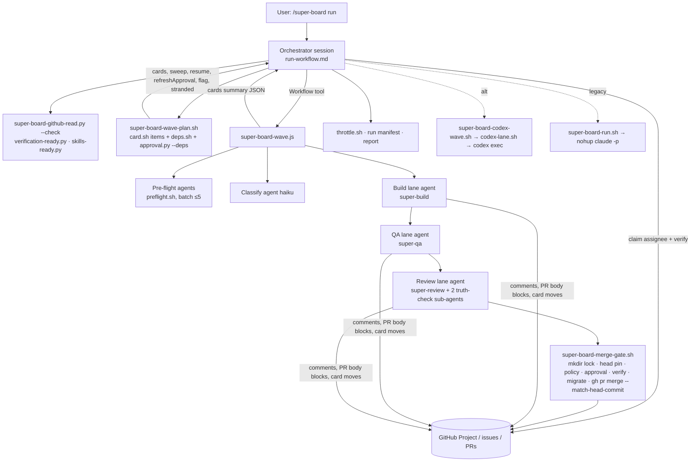

# Eric Tech — Super-Board: technical deep dive

> Repository: https://github.com/EricTechPro/super-board (repo root) · Evaluated commit: f014cfa8aa0ef4e807c132f502a520f1e4864a31 (2026-10-19 09:25:42 -0700) on main
> Other branches inspected: risk-door-blast-radius (c214f0cf, 2026-10-20; 3 commits ahead of main, docs/template only) · License: MIT (`LICENSE`; GitHub API also reports MIT)
> Accessed: 2026-10-22 · Method: read-only shallow clone; no code executed
> Legend: [F] verified fact · [I] inference · [C] unverified claim · [U] unknown · [F docs] fact from the official Claude Code docs at code.claude.com (cited with access date; not executed)

## 1. Summary

Super-Board is a Claude Code skill pack, also published as a Claude Code plugin, that turns a GitHub Projects (v2) kanban board into an unattended software factory. Cards move Backlog → Ready → Building → QA → Review → Done (plus Blocked), and three lane skills (`super-build`, `super-qa`, `super-review`) do the work: build in a per-issue git worktree, test with evidence, then review independently and merge through a deterministic merge gate. [F] (`CLAUDE.md:66-71`, `skills/super-board/references/run.md:77-108`). The README tagline is "Add tasks, walk away, get merged PRs with proof" [C] (`README.md:7`).

The default execution backend is a Claude Code **dynamic workflow** script (`workflows/super-board-wave.js`) that the interactive session launches one "wave" at a time. Each wave fans out sub-agents per card, with structured JSON outputs. An in-session orchestrator plans and reconciles each wave from board state [F] (`skills/super-board/references/run-workflow.md:133-295`). There are two alternative backends: a legacy `nohup` bash dispatcher of `claude -p` workers (`scripts/super-board-run.sh`), and a Codex backend that runs every lane as `codex exec` (`scripts/super-board-codex-wave.sh`, `scripts/super-board-codex-lane.sh`) [F].

The repo has a large deterministic safety layer of about 8,200 lines of bash and Python under `scripts/`: a lock-and-verify merge gate, a merge-policy classifier, head-pinned human approval, a bounded GitHub read helper that halts the run, dependency parsing, and pre-flight duplicate detection. It also has six Python guard hooks [F] (`wc -l scripts/*` = 8226; `hooks/`). There are 62 offline test suites run in CI on Linux and macOS, plus 7 paid behavioural eval cases for `claude plugin eval` [F].

Maturity: created 2026-05-24. Tags v1.2.0 → v3.1.2 (2026-10-12), with 35 commits on main after the v3.1.2 tag. 457 stars, 135 forks and 13 open issues/PRs at access time, and two committing accounts (EricTechPro, EricTechService) [F] (`gh api`). The repo dogfoods itself: PR #73 uses the pack's own `sb:` marker-block PR format [F] (`gh api repos/.../pulls/73`).

**Category:** board/issue-driven factory (primary) · hybrid execution (deterministic scripts + LLM lane agents in a scripted workflow) · skill/agent pack.

## 2. Architecture

Components [F]:

| Layer | Files | Role |
|---|---|---|
| Entry skill | `skills/super-board/SKILL.md` (47 lines) + `references/*.md` (≈4,000 lines) | Five verbs (`onboard`, `lint`, `status`, `run`, `stop`) routed to reference docs (`SKILL.md:8-37`) |
| Lane skills | `skills/super-build`, `skills/super-qa`, `skills/super-review` | Builder / Tester / Reviewer lifecycles; the canonical lifecycle text lives in `references/run.md:243-509` |
| Auxiliary skills | `super-collect`, `ui-refine-loop`, `visual`, `git-sync` | Intake from Sentry/PostHog/PRs/architecture; a UI polish loop; HTML visual pages; commit/sync |
| Workflow scripts | `workflows/super-board-wave.js` (359), `workflows/ui-refine-loop.js` (343) | Claude Code Workflow-tool scripts using `agent()`, `pipeline()`, `log()` |
| Deterministic helpers | `scripts/super-board-*.{sh,py}` (28 `super-board-*` scripts; 30 files under `scripts/` with `super-qa-file-bug.sh` and `super-review-file-refactor.sh`) | Planner, merge gate, policy, approval, GitHub reads, deps, preflight, card I/O, throttle, usage, host detection, setup, status |
| Guard hooks | `hooks/guard-*.py`, `hooks/cleanup-wt.py`, `hooks/settings-snippet.json` | PreToolUse/PostToolUse/SessionStart hooks installed into the target project |
| Dev-only hook | `hooks/dev/gate-skill-evals.py`, `.claude/settings.json` | A Stop hook that blocks ending a turn while an edited skill's eval is stale (this repo only) |
| Installer | `get.sh`, `install.sh`, `scripts/super-board-setup.py` | `curl \| bash` → tarball → install into `.agents/` with per-host symlinks |
| Tests / evals | `tests/` (36 `.sh` + 26 `.py`), `evals/` (7 cases) | Offline safety suites; paid `claude plugin eval` cases |
| Docs site | `diagrams/` (≈60 files, ≈30k lines of JSON/HTML) | GitHub Pages skill maps (skipped in depth) |

Tech stack: bash 3.2+ (macOS compatible), Python 3.9+ stdlib only, `jq`, `gh` CLI, `git`, Node 22 for workflow syntax checks and Playwright, and Claude Code ≥ the version that ships the Workflow tool. `docs/hosts.md:7` says it was tested on Claude Code 2.1.302 and codex-cli 0.160.0 [C]. There is no package manifest: there are no npm/pip runtime dependencies in the pack itself [F] (no `package.json`/`requirements.txt` in `git ls-files`).

External services: the GitHub REST and GraphQL APIs through `gh`, which hold all state (`CLAUDE.md:23-24`). Optional: Sentry and PostHog APIs for intake (`skills/super-collect/scripts/collect_sentry.py`, `collect_posthog.py`), the project's DB migrate commands, and the Codex CLI. External skills are required at runtime: `mattpocock/skills` (tdd, implement, code-review, codebase-design, diagnosing-bugs …). `ponytail`, `impeccable`, `humanizer`, `verification-before-completion`, `testing-strategy`, `vitest` and `playwright-best-practices` are required or conditional [F] (`scripts/super-board-skills-ready.py:19-41`).

Models [F]: the Claude ladders come from `workflows/super-board-wave.js:176-184`:

| Tier | Router | Low | Medium | High |
|---|---|---|---|---|
| low | haiku | haiku | sonnet | opus |
| medium (default) | haiku | sonnet | opus | session model |
| high | sonnet | opus | opus | opus |

The Reviewer always runs on the session model (`super-board-wave.js:335-337`). The Codex ladders use `gpt-6-luna` / `gpt-6.1-sol` / `gpt-6-astra` (`scripts/super-board-codex-lane.sh:65-69`; router `scripts/super-board-codex-wave.sh:132`). The model-quality rationale in a comment ("gpt-6.1-sol ties gpt-6-astra on DeepSWE v1.1", `codex-lane.sh:62-64`) is [C].

## 3. Agents

The repo has no `.claude/agents/*.md` files. All "agents" are Workflow-tool `agent()` calls with inline prompts, `claude -p` / `codex exec` processes, or sub-agents spawned by a lane skill [F] (`git ls-files` shows no agents directory).

| Agent / role | Defined in | Purpose | Tools / permissions | Model | Inputs → outputs |
|---|---|---|---|---|---|
| Orchestrator | `skills/super-board/SKILL.md:39-47`, `run-workflow.md:77-83`, `CLAUDE.md:9-26` | Preconditions, plan, claim, launch, reconcile, report. It must never do product work. | The interactive session's permissions. Lane agents "inherit the session allowlist and run in acceptEdits" [C] (`run-workflow.md:325`) | Session model | Board state → wave args; wave summary → manifest + report |
| Pre-flight agent | `super-board-wave.js:204-266` | Duplicate / in-progress / file-overlap / unclear / too-big check per batch of ≤5 Ready cards | Runs `super-board-preflight.sh`; writes Block comments and card moves | `haiku` on low tier, else `sonnet` (`:235`) | Batch cards → `PREFLIGHT_SCHEMA` verdicts `proceed/hold/sequence/skipped/halted` (`:214-233`) |
| Classifier (router) | `super-board-wave.js:290-307` | Grades complexity; may add a `feature`/`bug` label to untyped cards | gh read helper; `gh issue edit --add-label` | `haiku`, or `sonnet` on `--high` (`:184`) | Issue body + comments → `{kind, complexity, status}` (`:57-65`) |
| Builder | `skills/super-build/SKILL.md:230-303`, `run.md:298-329` | Worktree, smallest change (TDD), draft PR, PR body blocks, card → QA | Bash/git/gh. Never merges (`super-build/SKILL.md:299-300`) | Ladder by complexity | Issue + comments → branch `issue-<N>-<slug>`, draft PR, `[builder] [report]` comment; `STAGE_SCHEMA` result |
| Tester | `skills/super-qa/SKILL.md:618-699`, `run.md:331-376` | Test plan (one test per AC), test-gap check, evidence and screenshots, pass/fail | Playwright, test runners; may write tests, not app code (a High gap needing app code bounces, `super-qa/SKILL.md:507-511`) | Ladder by complexity | PR branch → committed tests + `docs/super-board/runs/issue-<N>-qa-v<V>/` evidence, `Local tests:` line |
| Reviewer | `skills/super-review/SKILL.md:291-451`, `run.md:378-440` | Independent hypotheses, prior-report check, test rerun, truth-check, classify findings, merge through gate | Bash/gh; merge only via `super-board-merge-gate.sh` | Always session model (`super-board-wave.js:335-337`) | PR + diff → one in-place `<!-- super-review:report -->` comment, merge or bounce |
| Code-grounder / Historian | `skills/super-review/SKILL.md:403-447` | Adversarial truth-check sub-agents run in parallel | ≤50 gh calls each, prefer local git (`run.md:410`) | Unspecified [U] | Fixed verbatim brief → findings + confidence 0-100. Aggregate = **minimum** (`super-review/SKILL.md:444`) |
| super-collect verifier | `skills/super-collect/SKILL.md:123-142` | One fresh verifier per intake candidate (real / still happening / already fixed / duplicate) | Read tools + collect scripts | Unspecified | Candidate → `{verdict: file \| drop-* \| duplicate \| needs-triage}` |
| ui-refine-loop checker / fixer / finish reviewer | `workflows/ui-refine-loop.js:1-11, 212-320` | Impeccable critique → fix → grade rounds | Edits limited to `scope` paths by prompt [C] | Unspecified | Screenshots + rubric → ranked P0-P3 problems, commits, final grade |
| Calibration learner | `skills/super-board/references/calibration.md` | Optional post-run edits to an allowlisted, already-installed external `calibrate` skill | Host delegation; edits to listed SKILL.md files only, not OS-enforced (`calibration.md`, step 4) | Host default | Bounded `completion.json` receipt → skill edits, reviewed by diff |
| Legacy `claude -p` workers | `scripts/super-board-run.sh:307-367` | One process per lane, at most 3 concurrent (one per lane) | No permission flags, so they rely on the project allowlist (`:352`) [F] | CLI default | Prompt naming the lifecycle → GitHub writes |
| Standalone super-build worker | `skills/super-build/scripts/super-build-dispatch.sh:140-145` | Legacy standalone `/super-build` | **`--dangerously-skip-permissions`**, `--max-turns 250` | CLI default | Preamble + raw issue body → commits on `loop/issue-N` |
| Codex lane | `scripts/super-board-codex-lane.sh:124-200` | Any lane as `codex exec` | `approval_policy="never"`, filesystem write to repo root + git dir + common dir + tmp, read elsewhere, network enabled (`:191-197`) | Codex ladder (`:65-71`) | Prompt → schema-validated JSON (`:147-170, 210-216`) |

## 4. Skills, commands and prompts

| Skill / command | File | Trigger | What it does / notable structure |
|---|---|---|---|
| `/super-board` | `skills/super-board/SKILL.md` | "super-board", "drain my GitHub project" (`:3`) | A thin router (47 lines) that sends each verb to its reference file (`:22-37`). Progressive disclosure: `run.md` (816 lines), `run-workflow.md` (420), `onboard.md` (505), `status.md` (441), `writing-standard.md` (394), `config-schema.json` (429, JSON5 reference, not machine-validated) |
| `onboard` | `references/onboard.md` | `/super-board onboard` | An 8-step wizard (Checks · GitHub · Board · Branch · AGENTS.md · Policies · Bug sources · Review, `README.md:65`). It silently auto-fixes must-haves, backs up first (`onboard.md:150-157`), and manages AGENTS.md through a deterministic script with a lossless "coverage" gate (`onboard.md:390-410`) |
| `lint` | `references/lint.md` | `/super-board lint` | Flags vague ACs. Criterion 15 is "too big" (`run.md:271`) |
| `status` | `references/status.md` + `scripts/super-board-status.py` (755) | `/super-board status` | A read-only 80-column board snapshot rendered by Python. The header says this replaced a ≈3-minute model-rendered view with ≈1.3 s [C] (`status.py:1-12`) |
| `run` | `references/run-workflow.md`, `references/run.md` | `/super-board run [--low\|--high\|--codex[=m]]` | The wave loop (§5) |
| `stop` | `references/stop.md`, `scripts/super-board-stop.sh` | `/super-board stop` | Graceful stop: "stopped mid-flight" comments, claim release, kill workers |
| `/super-build` | `skills/super-build/SKILL.md` (303) | "Super Build" | Lane mode follows `run.md`. Standalone legacy mode dispatches `claude -p` per Ready issue (`:92-125`). Has a PR size cap (`:250-261`) and a "Docs before outside-tool code" rule (`:274-290`) |
| `/super-qa` | `skills/super-qa/SKILL.md` (699) | "run super-qa", "bug bash" | Standalone: a BFS route crawler with Playwright that files issues. Lane mode: test-gap ledger, edge-case classes, "test the tests" mutation check (`:481-511`), screenshots at 3 viewports (`run.md:342`), optional runtime timing/heap comparison (`:654-663`, `scripts/runtime_compare.py`), optional project feature verifier (`:647-652`) |
| `/super-review` | `skills/super-review/SKILL.md` (451) | "Super Review", "PR review" | Hypotheses before the builder narrative, "Review remembers" (`:188-219`), fixed verbatim adversarial brief (`:415-436`), five finding classes, over-engineering never blocks |
| `/super-collect` | `skills/super-collect/SKILL.md` (197) + 6 scripts | "collect tickets", "what keeps breaking" | Sources: sentry, posthog, github, prs, architecture, custom. One fresh verifier per candidate. Dry-run by default. Exact-fingerprint dedupe and recurrence (`:123-175`) |
| `/ui-refine-loop` | `skills/ui-refine-loop/SKILL.md` + `workflows/ui-refine-loop.js` | `/ui-refine-loop <route>` | A grill of ≤10 questions to write a taste file, then bounded check → fix rounds with screenshots (light/dark, 1440/390) and a finish reviewer that grades every fix. Ends in a draft PR |
| `/visual` | `skills/visual/SKILL.md` + `scripts/visual.py` (905) | `/visual` | One self-contained HTML page (recap/plan/map). Has its own `THIRD_PARTY_NOTICES.md` |
| `/git-sync` | `skills/git-sync/SKILL.md` | "sync", "commit and push" | Commit per logical change, merge-pull, push without force |
| Lane prompt template | `workflows/super-board-wave.js:146-167` | Built per card per lane | Order: skill-readiness check → read-failure policy → lifecycle pointer → board I/O price rules → writing standard → (review: `REVIEW_MEMORY` 113-127) → structured exit contract |
| Worker preamble | `skills/super-build/references/worker-preamble.md` | Legacy standalone worker | "NEVER call AskUserQuestion" (`:25`). A decision ladder AC → repo precedent → smallest blast radius → human gate. `HUMAN GATE TRIPPED:` sentinel (`:27-31`). An issue-body `Skills:` line overrides skill routing (`:35-38`) |
| Writing standard | `skills/super-board/references/writing-standard.md` | All lanes | Commit / PR body / ticket / comment formats, enforced by `tests/test_writing_format.py` |

## 5. Orchestration and execution workflows

**Execution model: hybrid.** Control flow per card is deterministic JavaScript (`super-board-wave.js:288-341`). Each step is an LLM sub-agent with a JSON-schema output. Every safety-critical decision (merge, policy, approval, halt, dependency readiness) is a bash/Python script whose exit code the agent must route [F]. The orchestrator itself is an LLM session following prose (`run-workflow.md`), so wave planning and reconciliation depend on that session obeying the document [I].

**Concurrency** [F]:
- Workflow backend: the wave is "every Ready card whose `## Blocked by` list is fully closed, plus every card in QA/Review, minus claimed", with no width cap unless `max_workers` is set (`scripts/super-board-wave-plan.sh:6-27, 159-166`). The comment states that the runtime caps concurrent agents at `min(16, cpus-2)` [C] (`wave-plan.sh:16-17`). The official workflows page confirms the shape but not the formula: "Up to 16 concurrent agents by default, fewer when Claude Code has fewer CPUs available", adjustable through `CLAUDE_CODE_WORKFLOW_MAX_CONCURRENT_AGENTS` [F docs: code.claude.com/docs/en/workflows, accessed 2026-10-22]; the exact `cpus-2` rule is [U]. Pre-flight batches run with `Promise.all` (`super-board-wave.js:255`). Per-card lane chains run inside `pipeline()`.
- Merge serialization: an atomic `mkdir` lock at `.claude/super-board/inflight/merge.lock`, with a freshness proof **inside** the lock. A comment records that the earlier JS promise-chain mutex was removed on 2026-08-20 because it serialized the whole Review lane (`super-board-wave.js:94-108`; `scripts/super-board-merge-gate.sh:21-39, 165-195`).
- Codex backend: `ThreadPoolExecutor(max_workers = max_workers or max(1, min(16, cpus-2)))` (`super-board-codex-wave.sh:56, 266`).
- Legacy backend: at most one worker per lane (3 total), downstream-first (`run.md:119-129`).

**Retries, recovery, failure handling** [F]:
- Required GitHub reads get three attempts. Permanent errors (auth, query syntax, 40x) halt at once. Exhaustion writes `.claude/super-board/github-halt.json` (shared across worktrees through `git rev-parse --git-common-dir`) and exits 79. Mutations are never retried (`scripts/super-board-github-read.py:1-12, 47-73, 105-111, 295-344`). Resume rechecks the failed read before archiving the halt record (`:361-379`).
- A lost merge response is reconciled by re-reading PR state (`merge-gate.sh:361-372`).
- Rebuild cap: a deterministic `root-cause-hash` (lane | error class | first 3 file:line frames), so the same hash twice leads to Blocked (`run.md:719-735`). [U] Whether lanes compute the hash consistently is agent-dependent: no script computes it (grep found no implementation).
- Halt gates: 3 zero-progress waves, block-rate alert, user stop (`run-workflow.md:288-293`). Legacy: the landed-work signature `no_progress_cycles` (default 6) and `max_dispatches` (`super-board-run.sh:19-24, 420-447`).
- Crash recovery: stranded Building cards go back to Ready, keeping the branch (`wave-plan.sh:43-49`, `run-workflow.md:213-224`). Leaked bot assignees are stripped (`run-workflow.md:121-126`). Legacy zombie watchdog: SIGTERM/SIGKILL for lane PIDs whose card already left the lane (`run.md:798-816`).
- The throttle steps `max_workers` down (∞ → 3 → 2 → 1) after a wave that hits the GitHub hourly limit and writes it into the config (`scripts/super-board-throttle.sh:1-23`).
- Usage guard: reads Claude plan usage from a status-line snapshot and pauses new waves at `usage_pause_pct` (default 95). Fallback to Codex for build/QA only (`scripts/super-board-usage.sh:1-40`; `run-workflow.md:144-178`).

**Human approval gates** [F]:
- `merge_policy`: `default: "human"`, size above `auto_max_lines` (400), or category hits (money / auth / schema by label, path glob or added-line keyword) → exit 7 → Blocked 🙋 (`scripts/super-board-merge-policy.py:50-66, 125-170`).
- Migrations to envs outside `allowed_envs` (default `test, staging`), failed migrate commands, `needs-you:` lines → exit 8 (`merge-policy.py:172-193`).
- Approval is a pinned `approval-request:` JSON comment (repo, PR, 40-char head, sha256 scope of the policy plan). A later exact `done` comment from a `User` with write/maintain/admin permission approves it. Edited requests, ambiguous timestamps and head changes all void it (`scripts/super-board-approval.py:23-133`). Labels never authorize (`:1-6`).
- Production-merge guard: refuse `base_branch: main` with auto-merge when deploy markers exist (`run.md:72`).
- `human_approves_merge: true` is the legacy switch (`run-workflow.md:398`).

**Traced path 1 — default workflow run, one `feature` card from Ready to Done** [F unless tagged]:
1. The user types `/super-board run my-app`. `skills/super-board/SKILL.md:30` routes to `references/run-workflow.md`.
2. Host check `scripts/super-board-host.sh`: exit 65 or `opencode` halts (`run-workflow.md:28-30`). Preconditions: `super-board-verification-ready.py` (exit 9 if `verify_commands` is empty, `scripts/super-board-verification-ready.py:8-19`), production guard, worktree scan, `node --check` on a wrapped copy of the workflow (`run-workflow.md:98-101`), atomic `workflow-wave.lock` with `set -C`, then the legacy-process check (`:103-120`), crash sweep, DB reach checks.
3. Wave loop: `sb_gh_guard_check 200`, then the usage guard (`:137-178`).
4. Plan: `scripts/super-board-wave-plan.sh` → `super-board-card.sh items` (≈1 GraphQL point per 100 cards) + `super-board-deps.sh` (last `blocked-by:` comment line beats the body's `## Blocked by`, fail-safe on ambiguous lines, `deps.sh:1-60`) → jq builds `cards/sweep/resume/refreshApproval/flag/stranded` (`wave-plan.sh:135-197`).
5. Skill readiness: issue bodies are hydrated, then `super-board-skills-ready.py --cards` (exit 10 halts). The resolver accepts only real, non-empty `SKILL.md` files (`skills-ready.py:1-8`).
6. Claim: `gh issue edit --add-assignee <bot>`, re-read, and proceed only if assignees == `[bot]` (`run-workflow.md:239-247`).
7. Launch the Workflow tool with `scriptPath: .claude/workflows/super-board-wave.js` and args `{configPath, cards, humanApprovesMerge, tier}` (`:248-259`).
8. In `super-board-wave.js`: input validation (`:23-40`) → pre-flight agent batch (`:251-266`) → `pipeline` stage 1 classify (`:290-307`) → stage 2: `preflightGo` (`:270-276`) → `runLane('build')` (`:186-202`, prompt `:146-167`, schema `:67-86`) → on `advanced`, `runLane('qa')` → `runLane('review', card, undefined)`.
9. The Review agent follows `run.md:378-440`: Gate 1 thread scan, hypotheses, prior report, test rerun, truth-check, then merge protocol `run.md:442-509` → `scripts/super-board-merge-gate.sh --expect-head $HEAD`.
10. Merge gate: verification readiness → `--check` → mkdir lock (`:165-195`) → head read + `--expect-head` match or exit 6 (`:206-230`) → metadata and diff reads (diff validated hunk-by-hunk against counts, `github-read.py:138-173`) → `super-board-merge-policy.py` (`:241-243`) → approval check (`:245-267`) → scratch worktree at `HEAD_SHA`, `git merge origin/<base>` (exit 5 on conflict, `:269-279`) → `eval` each `verify_command` in the scratch tree (exit 2 on failure, `:281-290`) → migrations (`:294-322`) → approval re-read (`:324-338`) → `gh pr merge --squash --delete-branch --match-head-commit $HEAD_SHA` (`:349-351`) → `cleanup-wt.py --post-merge`.
11. The Reviewer confirms `MERGED <sha>` and `git merge-base --is-ancestor` before closing and moving to Done (`run.md:456-461`), then returns `{status:'advanced', column:'Done'}`.
12. The wave returns `{cards: summary, halted}` (`super-board-wave.js:343-359`). The orchestrator releases claims, appends to `docs/super-board/runs/<date>-<slug>.md`, runs `super-board-throttle.sh`, and reports (`run-workflow.md:260-287`).

**Traced path 2 — merge blocked by policy, then a human approves** [F]:
1. The Reviewer calls the gate. `merge-policy.py` returns `human:[{category:"auth", why:"path src/auth/x.ts (matches **/auth/**)"}]` (`merge-policy.py:159-170`).
2. The gate's `approval_check` runs `super-board-approval.py` with `--head --plan`. No trusted request exists yet, so it is not approved (`approval.py:97-100`). The gate prints `human-gate:` lines and the `approval-request: {...}` marker from `approval.py --request` (`:230-234`), then exits 7 (`merge-gate.sh:262-267`).
3. The Reviewer writes the 🙋 Block template with the request line and moves the card to Blocked (`run.md:482-499`). The lane returns `human-gate`.
4. A human comments `done` on the issue or PR. On the next wave the planner's deps step calls `approval.py --deps`, which reads comments, finds the newest trusted request, and calls `check()` with the head and issue link (`approval.py:235-256`). `needsYouDone=true` puts the card in `resume` (`wave-plan.sh:178-181`), and the orchestrator moves it to Review.
5. The Reviewer re-runs the gate. `approval_check` now validates the scope hash (same plan), the head, an unedited `done` from a `User` with write permission, created after the request (`approval.py:118-130`). The gate proceeds to verify and merge, and re-reads approval once more right before merging (`merge-gate.sh:324-338`).
6. If the code changed while the card was Blocked, `approvalRefresh` sends it to Review for a fresh request, not a merge (`wave-plan.sh:183-187`, `run.md:706-709`).

**Traced path 3 (short) — Codex backend:** `run-workflow.md:32-43` → `super-board-codex-wave.sh` (exclusive PID marker `:125`; Luna router grade `:132-176`; per-card lane chain, skill readiness checked again at each lane boundary `:177-215`) → `super-board-codex-lane.sh` (review refused without explicit `--codex`, `:47-48`; `codex exec` with an `--output-schema`, and the result validated by an in-script JSON-schema subset checker, `:147-216`) [F].

## 6. Context and state management

- **State lives on GitHub, not in the session** [F]: card columns, assignee claims, issue/PR comments, PR body marker blocks and labels. "Resume: just run again — board state is the only state" (`run-workflow.md:315-317`; `CLAUDE.md:23-24`).
- **Local state** [F]: `.claude/super-board/configs/<slug>.json` (committed), `active` pointer (gitignored), `inflight/` locks (wave lock, merge lock, per-issue PID locks), `github-halt.json` (+ archived `github-halt-<ns>.json`), `codex-wave.pid`, `upgrade.json`, `backup/<ts>/`, card id cache from `super-board-card.sh` "shared across worktrees" (`rate-limit-etiquette.md:27-30`).
- **Handoff artifacts** [F]: PR body blocks `sb:status/problem/solution/ac/history/visual/risk/redcheck`. Each lane owns specific blocks and rewrites them through `scripts/super-board-pr-body.sh --block <name> --expect-head <sha>`, which refuses (exit 6) when the head moved (`run.md:144-162`). Lane comments use the `[role] [label]` format with machine lines (`Local tests:`, `gh-quota-on-exit:`, `blocked-by:`, `root-cause-hash:`) (`run.md:511-531`). Review threads carry owner prefixes `[builder]`/`[qa]`/`[reviewer]` that route bounces (`run.md:222-241`). Evidence goes to `docs/super-board/runs/issue-<N>-qa-v<V>/`, committed to the branch, with SHA-pinned raw URLs (`run.md:342-364`).
- **Cross-round memory**: a single `<!-- super-review:report -->` comment is edited in place, with stable R-ids and statuses across rounds (`super-review/SKILL.md:188-219`; `run.md:423-439`). Verified offline: `tests/test-wave-review-memory.sh` [F]. Behaviourally evaluated by `evals/review-remembers` [F, not executed].
- **Context construction**: lane prompts are short pointers ("Read run.md → Builder lifecycle and follow it EXACTLY") plus fixed policy strings (`super-board-wave.js:146-167`). Each lane agent loads `run.md` and the skill on demand. Fresh sub-agents per lane, per pre-flight batch and per truth-check keep context isolated. Explicit "form hypotheses before reading the builder's account" ordering is used to reduce anchoring (`run.md:390`, `super-review/SKILL.md:423-424`) [F].
- **Compression**: none beyond fresh contexts and one-line lane results (`STAGE_SCHEMA.detail`). The orchestrator holds only the per-wave summary (`run-workflow.md:82-83`) [F].
- **Resumability**: a workflow stopped mid-wave can resume via `resumeFromRunId` with cached completed agent results [C] (`run-workflow.md:316-317`; depends on the Claude Code Workflow tool). The official workflows page confirms resume with cached results in the same session: a stopped run is relaunched with the same script, completed agents return saved results, and a failed agent reruns along with every agent started after it [F docs: code.claude.com/docs/en/workflows, accessed 2026-10-22]. The page does not name `resumeFromRunId` [U]. Stranded/swept/resume lists are recomputed from the board each wave [F].

## 7. Engineering practices and testing

- **Offline tests** [F]: 62 suites (`tests/test-*.sh` ×36, `tests/test_*.py` ×26), ≈9,860 lines, 286 Python `test_` functions, all run by `tests/run-safety.sh`. That script runs every suite and fails if any failed (`tests/run-safety.sh:1-32`). The suites use stubs (a `gh` stub on PATH, local bare `origin` repos, fixture HTTP). Examples:
  - `tests/test-merge-gate.sh` covers lock contention, stale reaping, the timeout/stale-after independence regression, head-pin scenarios 8-13 (`:1-60`).
  - `tests/test-wave-preflight.sh` executes `super-board-wave.js` under Node with `agent/pipeline/log` stubbed and scripted verdicts (`:12-33`). This is a deterministic test of the orchestration script itself.
  - Others: `test_approval.py`, `test_github_reads.py`, `test_run_allowlist.py` (fails when a lane calls a `.claude/bin` script missing from the allowlist, `run-workflow.md:352-354`), `test_writing_format.py`, `test_codex_lane_schema.py`, `test-guard-hooks.sh`, `test-install.sh`, `test-get.sh`.
- **CI** [F]: `.github/workflows/cross-platform.yml` runs a smoke matrix (ubuntu/macos/windows × py3.9/3.10/3.12) and the full safety suite (ubuntu/macos × py3.9/3.12, Node 22) on push to main/dev and PRs. `release.yml` reuses it and publishes only the tested SHA on `v*` tags. Actions are pinned by major tag (`actions/checkout@v4`, `setup-python@v5`, `setup-node@v4`, `upload-artifact@v4`), not SHA. `persist-credentials: false` is set and `permissions: contents: read` is the default. Recent runs on main succeeded (2026-10-19); three branch runs failed on 2026-10-20/22 (`fix/card-refuse-malformed-issue` 10-20, `rebrand-fork` 10-21, `codex/backup-before-pstack-only-20261022` 10-22) (`gh api actions/runs`).
- **Prompt/agent evals** [F]: 7 `claude plugin eval` cases (`evals/*/case.yaml`) with seed scripts, offline `gh`/Sentry/PostHog stubs, and graders. Deterministic graders: `tool_used` with regex, absence of `pr merge` in the stub log. LLM-judge `verdict` at weight 2 (`evals/README.md`). Stated cost ≈$0.25-0.45 per run [C]. Results are gitignored, so no pass-rate evidence is in the repo [F] (`.gitignore` `evals/results/`).
- **Eval gate for skill authors** [F]: `hooks/dev/gate-skill-evals.py` is a Stop hook that exits 2 (blocks the stop) when a changed skill with an eval case has a result older than the change. It warns only when the skill has no case and never loops (`:1-36`). It is wired in this repo's `.claude/settings.json:15-25`.
- **Verification of produced software** [F]: three layers, each in a different context:
  1. The Tester writes and runs tests and audits test gaps.
  2. The Reviewer reruns the Tester's `Local tests:` command (`run.md:402-406`) and runs a truth-check with two sub-agents.
  3. The merge gate runs the project's `verify_commands` against the **current base merged into the reviewed head**, inside the lock (`merge-gate.sh:269-290`).

  Merge landing is confirmed by ancestry (`run.md:456-461`). [I] Independence is partial: all lanes use the same model family (and the same session model for Review), and layers 1 and 2 are LLM instructions. Only layer 3 is deterministic code.
- **Linting/typing**: no linter or type-checker config for the pack's own bash/Python. `node --check` is used on workflow scripts (`run-workflow.md:98-101`) [F].
- **Docs-as-tests**: `tests/test_writing_format.py` pins templates to `writing-standard.md`. `sync_explore.py --check` keeps the docs site in step (`CLAUDE.md:89-100`) [F].

## 8. Security, isolation and observability

**Permission model** [F]:
- Workflow backend: lane agents "inherit the session allowlist and run in acceptEdits" [C] (`run-workflow.md:325`). The official workflows page confirms the first half: workflow subagents "use your permission rules" [F docs] (code.claude.com/docs/en/workflows, accessed 2026-10-22); the acceptEdits mode is not confirmed there [U]. The documented allowlist includes broad entries: `Bash(gh api:*)`, `Bash(git push:*)`, `Bash(git checkout:*)` (`:329-350`). Merge permissions (`gh pr merge`, the merge gate) are added only on boards with `merge_policy.default: "auto"` (`:369-381`).
- Headless runs: `claude -p "/super-board run" --permission-mode bypassPermissions` is documented "only in an isolated container or VM" (`run-workflow.md:356-367`).
- Legacy standalone `/super-build`: `claude -p --dangerously-skip-permissions --max-turns 250`, with the raw issue body concatenated into the prompt (`skills/super-build/scripts/super-build-dispatch.sh:98-123, 140-145`).
- Codex lanes: `approval_policy="never"`, write access to the repo root and git dirs, network enabled (`codex-lane.sh:188-198`). The comment explains that a custom profile is needed because `:workspace` makes `.git` read-only.

**Isolation** [F]: per-lane git worktrees under `.claude/worktrees/`. The `guard-worktree-path.py` hook enforces that location (`hooks/guard-worktree-path.py:1-13`). The merge gate verifies in a throwaway detached worktree and never pushes (`merge-gate.sh:199-204, 269-272`). There are no containers or VMs, and verify/migrate commands run on the host via `eval` of config strings (`merge-gate.sh:283, 307`). [I] The PR's own code (tests, build scripts) therefore executes with the user's privileges during the gate. The pack ships no network sandbox.

**Guard hooks** [F] (`hooks/settings-snippet.json`):
- `guard-secrets` (deny reading/piping `.env*`, keys, credentials; `.env.example` allowed; one sanctioned `super-board-env-check.sh` that prints presence only, `guard-secrets.py:15-36`).
- `guard-key-literals` (Pre and Post; 14 key regexes, never prints the value, `guard-key-literals.py:18-36`).
- `guard-delete-outside`, `guard-worktree-path`, and the opt-in `guard-protected-push`.

All guards **fail open** on internal errors (`guard-secrets.py:62-63`, and the others at their final `except Exception`). They are regex/tokenizer heuristics on command strings. `guard-delete-outside.py:6-9` states that it allows words whose value is unknown before execution, such as `$(...)` [F]. Open issue #72 reports Windows Git Bash false positives [F] (`gh api`).

**Secrets** [F]: the migrate DB URL resolves from the project's `.env`, never the session (`run-workflow.md:131`). Eval seeds write obviously fake tokens (`evals/_stubs/collect-seed.sh:180`: `sntrys_eval_offline_token`, `phx_eval_offline_key`, offline placeholders, not secrets). No real secret-shaped strings were found in tracked files: a regex scan matched only the guard's own pattern (`hooks/guard-key-literals.py:27`).

**Approval integrity** [I]: the approval gate checks that the approver is a GitHub `User` with write permission (`approval.py:125-128`). When `bot_identity` is the user's own account (an option for solo projects, `run.md:627`), lane agents act with the same `gh` token that can post a `done` comment as that user. The prose forbids self-approval ("Do not create or copy approval evidence", `run.md:702-703`), but no code distinguishes a human-typed `done` from an agent-posted one. A separate robot account is offered by onboard (`references/second-account.md`; `RELEASE-NOTES.md` v3.1.0) and would close this gap.

**Merge-policy coverage** [I]: category detection is label/path-glob/added-line-substring matching (`merge-policy.py:50-66, 159-170`). Code under different paths or with different identifiers passes as `auto` unless the size cap trips. The doc comment says "a policy the gate cannot evaluate must not default to merge", and unreadable metadata does fail safe to human (`merge-gate.sh:232-243`) [F].

**Supply chain** [F]:
- The install is `curl -fsSL …/get.sh | bash` (`README.md:31`). `get.sh` downloads the latest release tarball by tag, with no checksum or signature (`get.sh:104-126`), and falls back to `main` when no release is found (`:113`).
- `get.sh` and `super-board-setup.py` run `npx -y skills@latest add mattpocock/skills --skill '*'`: an unpinned CLI plus an unpinned third-party skill repo (`get.sh:162`; `scripts/super-board-setup.py:82`).
- Onboard may run OS package installs (`brew install node …`) behind Claude Code's permission prompt (`onboard.md:164-168`).
- Mitigations: get.sh refuses root (`:64-66`), and the script body is wrapped in `main()` so a truncated download runs nothing (`:19-20, 175`).

**Prompt-injection exposure** [F/I]:
- Lane agents read issue bodies, all issue comments, PR comments and review threads as their primary context (`super-build/SKILL.md:234-236`). Card titles are interpolated into prompts (`super-board-wave.js:149, 239`).
- An issue body's `Skills:` line selects the worker skills (`worker-preamble.md:35-38`; `skills-ready.py:62-90`). The resolver does reject interactive skills and invalid names (`:49-60`).
- `super-collect` turns third-party telemetry (Sentry events, PostHog data, PR comments) into Backlog tickets (`super-collect/SKILL.md:47-142`). Tickets land in Backlog, and the README/curation contract says a human moves cards to Ready (`super-build/SKILL.md:9`).
- A grep found no guidance that marks GitHub/Sentry content as untrusted data or warns about instructions embedded in it [F]. `SKILLS_CHECK` warns only against shell interpolation (`super-board-wave.js:141`).
- [I] An attacker who can write issue or PR comments on a board repo can address lane agents that hold push and (on auto boards) merge capability. The merge gate's policy, size cap and verify commands limit but do not prevent this.

**Observability** [F]:
- Run manifest `docs/super-board/runs/<date>-<slug>.md`, one line per card per wave (`run-workflow.md:267-269`). Legacy per-worker logs (`super-board-run.sh:105-110, 342-352`).
- `gh-quota-on-exit:` on every handoff. `super-board-status.py` live snapshot. PR body `history` table with time per lane.
- The wave report shows usage 5h % (`run-workflow.md:279-284`). Token cost or dollar reporting per card is not implemented [F: none found].

## 9. Efficiency

- **GitHub API economy (measured, then engineered)**: a measured 3-card wave spent ~2,850 of 5,000 GraphQL points/hr, mostly on `gh project item-list` and `field-list` [C] (`super-board-wave.js:129-132`; `rate-limit-etiquette.md:7-23`). `super-board-card.sh` with cached ids costs 1 point per move. The claimed result is "about 20x fewer GraphQL points" [C] (`RELEASE-NOTES.md` v3.1.0). Workers move REST-able work to the separate REST bucket [F] (`rate-limit-etiquette.md:24-30`). Pre-flight batches 5 cards per agent so the list calls are paid once per batch (`super-board-wave.js:207-208, 234`) [F].
- **Model routing**: a cheap router (haiku / gpt-6-luna) grades complexity and the ladder maps it to a model. Pre-flight uses haiku/sonnet. Review stays on the session model (§2) [F].
- **Wave width by dependency graph** instead of a fixed cap. The rationale is measured: 23 of 32 Ready cards were blocked on a real board [C] (`wave-plan.sh:19-24`).
- **Plan-usage guard** pauses before a wave the plan limit would cut off mid-lane (`run-workflow.md:144-178`) [F].
- **Avoided work**: the policy check runs before verification ("a card a human will merge does not need the gate's build proof", `merge-gate.sh:106-109`). `node --check` runs before launching a wave (`run-workflow.md:98-100`). `status.py` replaces model-rendered ASCII (`status.py:7-11`) [F].
- **Context economy**: a 47-line router skill and fresh agents per lane. However, each lane agent must read `run.md` (816 lines) plus a long lane skill (300-700 lines) [I: substantial per-lane fixed context cost; not measured].
- **Costs not controlled**: there is no token or dollar budget per card or per wave in the workflow backend. `max_dispatches` exists only in the legacy runner (`super-board-run.sh:86-89`) [F].

## 10. Continuous improvement

- **Optional post-run calibration** [F]: after a fully reconciled run (every selected card merged and ancestry-proven, nothing pending), the host writes a bounded `completion.json` receipt (≤64 KiB, ≤32 evidence files). `scripts/super-board-calibration.py` validates it and produces a brief for an **externally installed** `calibrate` skill. That skill may edit only an explicit allowlist of ≤20 existing canonical SKILL.md files, and the host inspects the diff and never commits automatically (`references/calibration.md`). The script refuses non-canonical targets (`super-board-calibration.py:50-57`). Default: disabled. The learning skill itself is not in the repo [F].
- **Correction prevention** [F]: `super-collect prs` groups recurring review findings by root-cause boundary and proposes structural fixes in a preference order (remove path → type/schema → guard → regression witness → prose), with historical-witness ACs (`skills/super-collect/references/correction-prevention.md`). Its scope note: "A skill, prompt or workflow whose reports keep missing the same thing → a `feature` to refine it" (`super-collect/SKILL.md:104`).
- **Incident-driven hardening (documented)** [F/C]: many mechanisms carry dated incident notes:
  - #381 worker storm, 7 racing workers (`run.md:629-642`)
  - zero commits in six hours because of draft PRs (`run.md:444-448`)
  - the 2026-08-20 stale-base typecheck failures that motivated the merge gate (`merge-gate.sh:5-30`)
  - the mutual-sequencing deadlock (`super-board-wave.js:267-269`)
  - the throttle after a bucket was drained in 40 minutes (`throttle.sh:4-7`)

  The incidents themselves are [C]; the resulting code is [F].
- **Eval-gated skill edits** in the authoring repo (`hooks/dev/gate-skill-evals.py`) [F].
- No automatic self-modification during runs. The orchestrator is forbidden to patch skills mid-run (`CLAUDE.md:22`) [F].

## 11. Reference-driven development and reverse engineering

Limited. There is no specification extraction or replication of an existing product. Related mechanisms:
- **Visual verification**: the Tester takes screenshots at 1920×1080 / 1024×768 / 375×667, commits them, and embeds them in comments via SHA-pinned raw URLs (`run.md:342-366`). The PR `visual` block holds Before | After (`run.md:160`). `ui-refine-loop` takes before/now shots (light/dark, 1440/390, section crops) and has a finish reviewer grade each fix against round-0 vs final shots (`workflows/ui-refine-loop.js:1-11`; `skills/ui-refine-loop/scripts/shoot.mjs`) [F].
- **Behavioural parity / regression**: `runtime_compare.py` runs alternating baseline vs changed app scenarios (≥5 samples each, tolerances 10% / 5 ms) and reports timing and heap; noisy results count as inconclusive (`skills/super-qa/scripts/runtime_compare.py:1-30`) [F].
- **Project feature verifier**: a per-app `verify-<app>` skill with a feature map of real source owners and witnesses (`skills/super-qa/references/project-verifier.md:1-30`) [F].
- **Docs-first rule**: for third-party APIs, upgrades and auth/billing, read current official docs for the installed version and cite them as `Docs:` bullets (`super-build/SKILL.md:274-290`) [F].
- External skill packs (mattpocock, ponytail, impeccable) are used as references and dependencies. The `diagrams/` site maps and compares those packs [F].

## 12. Innovations

1. **Board-as-state-machine with a deterministic wave script** — lane chains are plain JS over `agent()` calls with JSON-schema exits. The board is the only loop state, so "run" is also "resume". The orchestration script is unit-tested by stubbing `agent/pipeline/log` (`super-board-wave.js:288-341`; `tests/test-wave-preflight.sh:12-33`) [F].
2. **Merge gate with proof under the lock** — an atomic `mkdir` mutex, separate `--lock-timeout` and `--stale-after` with a 30-min floor (`merge-gate.sh:133-143`). The head is pinned via `--expect-head` and `--match-head-commit`. The current base is merged into the reviewed head in a scratch worktree and project checks run **inside** the lock. Exit codes route to distinct board actions (2/5 rebase pass, 4 retry, 6 re-review, 7/8 human, 9 config halt) (`merge-gate.sh:70-96, 165-372`) [F].
3. **Head- and scope-pinned human approval** — the request comment binds repo, PR, 40-char head and the sha256 of the policy plan. Approval requires a later, unedited, exact `done` from a write-permission `User`, it is re-read immediately before merge, and labels are explicitly non-authoritative (`super-board-approval.py:37-133`; `merge-gate.sh:324-338`) [F].
4. **Fail-closed evidence reader** — read-only command allowlisting (`github-read.py:76-102`). Diffs are validated against hunk headers and PR add/delete counts (`:138-173`), paginations against `totalCount` and cursors (`:193-227`). A shared halt file stops every worker across worktrees. Malformed agent reads exit 64 without halting the run (`:342-343`) [F].
5. **Dependency-graph-sized waves with fail-safe parsing** — the last `blocked-by:` line wins; "None but #26 first" and empty sections are unparseable, never free. A Blocked sweep frees cards whose blockers closed (`super-board-deps.sh:1-60`; `wave-plan.sh:6-57`) [F].
6. **Review remembers** — one in-place report with stable finding ids and a mandatory round-1 recheck of prior findings ("a resolved thread is not proof"), covered by an offline test and a paid eval (`super-review/SKILL.md:188-219`; `evals/review-remembers/`) [F].
7. **Bounded anti-anchoring and anti-over-blocking prompts** — the Reviewer forms hypotheses before reading the builder's account. A fixed verbatim truth-check brief takes the **minimum** of two scores, and over-engineering can never block on its own. That rule is re-applied by the Reviewer after collection (`super-review/SKILL.md:403-447`) [F].
8. **Skill-readiness resolver** — workers halt before claims unless real, non-empty host-visible `SKILL.md` files exist for the lane's dependency chain. Interactive skills (grilling, shape, clarify) are rejected for unattended workers (`skills-ready.py:1-60`) [F].
9. **Rate-limit price list with a cached card helper** — measured GraphQL point costs drive the API design, and a throttle writes a narrower `max_workers` back to the config after a limit hit (`rate-limit-etiquette.md:7-30`; `throttle.sh`) [F].
10. **Eval-staleness Stop hook** for skill authoring (`hooks/dev/gate-skill-evals.py`) [F].

## 13. Reusable components

| Component | Path | Kind | Dependencies | License | Security notes | Reuse class | Limits and compatibility constraints |
|---|---|---|---|---|---|---|---|
| Merge gate | `scripts/super-board-merge-gate.sh` | script | bash 3.2, jq, gh, git, python3, `super-board-github-read.py`, `-merge-policy.py`, `-approval.py`, `-verification-ready.py` | MIT | `eval`s config commands on the host; runs PR code | needs adaptation | GitHub-only. Squash-merge only. Expects super-board config shape. Lock is local-filesystem only |
| Merge policy classifier | `scripts/super-board-merge-policy.py` | script/library | python3 stdlib | MIT | Heuristic detection; bypassable by naming | directly reusable | Input is `gh pr view --json` + diff. Default categories are opinionated |
| Head-pinned approval | `scripts/super-board-approval.py` | library | python3, gh via read helper | MIT | Cannot tell an agent-posted `done` from a human one on a shared token | needs adaptation | GitHub issue comments + collaborator permission API |
| Bounded GitHub read helper | `scripts/super-board-github-read.py` | library/CLI | python3, gh | MIT | Read-only allowlist; never retries mutations | directly reusable | The shape validators are specific to the kinds it knows |
| Wave workflow | `workflows/super-board-wave.js` | workflow | Claude Code Workflow tool (`agent`, `pipeline`, `log`) | MIT | Interpolates titles into prompts | reimplement the idea | Bound to the Claude Code Workflow runtime and super-board's lifecycle docs |
| Workflow stub-test harness | `tests/test-wave-preflight.sh` (pattern) | pattern | node | MIT | none | reimplement the idea | Requires workflow scripts written as a function body over injected primitives |
| Wave planner + deps | `scripts/super-board-wave-plan.sh`, `scripts/super-board-deps.sh` | script | bash, jq, gh | MIT | Read-only | needs adaptation | GitHub Projects v2 columns, `## Blocked by` convention |
| Pre-flight duplicate/overlap check | `scripts/super-board-preflight.sh` + pre-flight prompt | script + pattern | bash, gh, jq | MIT | Read-only | needs adaptation | Title Jaccard (0.6) + file overlap; needs the semantic agent half |
| Card I/O cache | `scripts/super-board-card.sh` | script | bash, gh GraphQL | MIT | Writes card moves | needs adaptation | GitHub Projects v2 only |
| PR body block editor | `scripts/super-board-pr-body.sh` | script | bash, gh | MIT | `--expect-head` guard | directly reusable | Marker-block convention `<!-- sb:NAME -->` |
| Skill-readiness resolver | `scripts/super-board-skills-ready.py` | library | python3 | MIT | Rejects interactive skills; validates names | needs adaptation | Registry hardcodes lane → skill chains (`:19-41`) |
| Guard hooks | `hooks/guard-*.py`, `hooks/settings-snippet.json` | hooks | python3 stdlib | MIT (two credit an "ai-builder-starter-kit" / "BookKeepingApp" origin by the same author) | Fail open; regex heuristics | directly reusable | Claude Code hook JSON contract; Windows path issues open (#72) |
| Worktree cleanup hook | `hooks/cleanup-wt.py` | hook | python3, git | MIT | Deletes merged worktrees/branches (with recovery file) | needs adaptation | Expects `.claude/worktrees/` layout |
| Eval-staleness Stop hook | `hooks/dev/gate-skill-evals.py` | hook | python3, git | MIT | Blocks turn end (exit 2); fails open | directly reusable | Assumes `claude plugin eval` result locations |
| Usage guard | `scripts/super-board-usage.sh` | script | bash, jq | MIT | Reads the status-line JSON snapshot | directly reusable | Pro/Max only; needs a status-line hook to record |
| Throttle | `scripts/super-board-throttle.sh` | script | bash, jq, gh | MIT | Writes config | needs adaptation | `max_workers` key semantics |
| Codex lane launcher | `scripts/super-board-codex-lane.sh` | script | python3, codex CLI | MIT | `approval_policy=never`, network on, repo write | reference only | Codex config keys and model names are version-specific [C] |
| Review-remembers protocol | `skills/super-review/SKILL.md:188-219` | pattern | gh | MIT | none | reimplement the idea | Needs a stable comment marker + edit-in-place |
| Fixed adversarial brief + min aggregation | `skills/super-review/SKILL.md:403-447` | prompt/pattern | sub-agents | MIT | none | reimplement the idea | Confidence scores are LLM self-reports |
| Test-gap check | `skills/super-qa/SKILL.md:481-511` | prompt/pattern | test runner, tdd skill | MIT | none | directly reusable (as prompt text) | Relies on an external `tdd` skill for test writing |
| Writing standard + format tests | `skills/super-board/references/writing-standard.md`, `tests/test_writing_format.py` | spec + test | python3 | MIT | none | needs adaptation | Opinionated emoji/commit format |
| Runtime compare | `skills/super-qa/scripts/runtime_compare.py` | script | python3, Playwright scenario | MIT | Runs argv commands | directly reusable | Needs project-owned scenarios |
| Calibration receipt validator | `scripts/super-board-calibration.py` | script | python3, git | MIT | Read-only; does not OS-enforce learner writes | reference only | Depends on an external `calibrate` skill not in the repo |

## 14. Evidence against the value dimensions

**Engineering quality** — Demonstrated: 62 offline suites with stubs (`tests/`), CI on Linux and macOS (plus a Windows smoke job), and a release gated on the tested SHA (§7). Fail-closed validators (`github-read.py`, `approval.py`), bash 3.2 portability noted inline (`merge-gate.sh:151-152`), and incident-dated rationale comments throughout (§10). The orchestration script is unit-tested by stubbing (§12.1). Weaknesses: doc/code drift exists. `run-workflow.md:254` says `humanApprovesMerge` makes the workflow serialize Review, but the script ignores that argument and documents the guard's removal (`super-board-wave.js:94-108`; separately, the repo's own `diagrams/skill-map.json:5361` flags the wave.js `humanApprovesMerge` arg as stale because onboard migrates it into `merge_policy`, without mentioning serialisation). `wave-plan.sh:131-134` still says the lock lives "inside the wave workflow". `run.md:611-612` says a competing assignee add returns 422, which `run-workflow.md:241-244` contradicts. Behavioural eval pass rates are claimed, not in the repo (§7).

**Autonomy and orchestration** — Demonstrated: an end-to-end loop from board to merged PR with deterministic routing of every gate exit code (§5 paths 1-2). Also demonstrated: dependency-sized waves, crash/stranded recovery, sweep/resume of Blocked cards, three backends (workflow, Codex, legacy). Claimed, not verified here: unattended overnight operation at scale ("walk away"), and Workflow runtime behaviour (`resumeFromRunId`, concurrency cap). Those depend on the Claude Code Workflow tool and were not executed.

**Development productivity** — Demonstrated in design: one-line install, an 8-step onboard that auto-fixes, a PR size cap with split proposals, rebase passes instead of human blocks for mechanical conflicts (`run.md:657-686`), and super-collect intake from Sentry/PostHog/PRs. Indicative usage: the repo's own PRs use the pack's format (PR #73), and a second account contributes 21 of the last 100 commits (`gh api`). No throughput or merge-rate metrics are published in the repo [C/U].

**Security and reliability** — Demonstrated: the merge mutex with proof-under-lock, head pinning, head/scope-pinned approval, policy fail-safe to human, read halts that never retry mutations, guard hooks, and worktree confinement (§8, §12). Gaps (from code reading): `--dangerously-skip-permissions` in the legacy standalone builder, Codex lanes with `approval_policy=never` and network, verify/migrate `eval` of PR code on the host without a sandbox, fail-open regex guards, `curl | bash` without checksums plus unpinned `npx skills@latest`, no untrusted-content handling for issue/PR/Sentry text, and approval that is only as strong as token separation between agent and human (§8).

**Maintainability and adaptability** — Demonstrated: lifecycles centralized in `run.md` and shared by all backends, a skill registry in one place (`skills-ready.py:19-41`), install into a shared `.agents/` tree with per-host links (`install.sh:1-30`), host detection (`docs/hosts.md`), and a README table generated from `families.json`. Costs: very large prose contracts (`run.md` 816, `super-qa` 699, `run-workflow.md` 420 lines) that agents must follow exactly, label routing duplicated across three places (`CLAUDE.md:70-71` says to change them together), and GitHub Projects v2 lock-in (issues #49 Jira and #76 GitLab are open requests).

**Resource efficiency** — Demonstrated: GraphQL point accounting and a cached card helper (§9), pre-flight batching, complexity-based model ladders, the plan-usage pause, the throttle, and dependency-filtered waves. Claimed: "about 20x fewer GraphQL points" and the 2,850-points-per-wave measurement (`RELEASE-NOTES.md` v3.1.0). Not present: per-card token or dollar accounting, or a budget cap in the default backend.

## 15. Strengths and limitations

Strengths:
- Merge safety is code, not prose: lock, head pin, base-merge verification inside the lock, policy and approval, all exit-code routed (`merge-gate.sh:165-372`).
- Done means "on the base branch": ancestry is checked before Done (`run.md:456-461, 506-509`). This was born from a measured zero-landing incident (`run.md:444-448`).
- Fail-closed GitHub evidence with a shared halt file and no mutation retries (`github-read.py`).
- Deterministic, testable orchestration over LLM steps (`super-board-wave.js` + `tests/test-wave-*.sh`).
- Independent-review techniques: hypotheses first, prior-finding recheck, test rerun, minimum-score truth-check (§12.6-7).
- Strong operational learning: dated incident notes tied to specific mechanisms (§10).
- Good install hygiene for a `curl | bash`: `main()` wrapper, refusal to run as root, settings backup, idempotent merges (`get.sh:19-20, 64-66`; `install.sh:284-306`).

Limitations:
- No sandbox: verify commands, migrations and lane agents run on the developer's machine with the developer's credentials (§8).
- Prompt-injection surface: issue/PR/comment text and telemetry-derived tickets are read by agents with push/merge capability, with no untrusted-content rules (§8).
- Human approval can be spoofed in principle when the bot and human share a GitHub account (§8, [I]).
- Heavy prose contracts drive correctness of claims, bounces, comments and PR blocks. Only part of this is enforced by scripts. Several doc/code contradictions exist (§14).
- GitHub Projects v2 only. The Claude path depends on the Claude Code Workflow tool. The OpenCode backend is not implemented (`docs/hosts.md:9`).
- Unpinned external skill dependencies (`npx skills@latest`, mattpocock/skills HEAD) define much of the lane behaviour (`skills-ready.py:19-41`; `get.sh:162`).
- No token or dollar budget controls in the default backend (§9).
- Eval results are not versioned, so prompt-quality claims are unverifiable from the repo (§7).

## 16. Claims vs verified ledger

| Claim (source) | Status | Evidence |
|---|---|---|
| "8 skills (5 you type, 3 the board runs) · 9 commands · 6 guard hooks" (`README.md:9`) | partly | 8 skill dirs [F]. Hooks: 5 guard scripts + cleanup-wt = 6 if cleanup counts. The README "Guards" table lists 8 rows including README sync and merge gate (`README.md:126-135`) |
| "Add tasks, walk away, get merged PRs with proof" (`README.md:7`) | not executable | Loop + merge gate exist (§5). Unattended outcome not executed |
| Merge only after current base + `verify_commands` pass, pinned to reviewed commit (`README.md:135`) | verified | `merge-gate.sh:206-290, 349-351` |
| Missing verify commands halt setup (`README.md:135`) | verified | `verification-ready.py:8-19`; exit 9 in planner/gate/lanes |
| Router grades easy/medium/hard; flags pick ladder (`README.md:139-150`) | verified (Claude), partly (Codex model names) | `super-board-wave.js:176-184, 290-307`; `codex-lane.sh:65-71`. Model availability [U] |
| README model names "Sonnet 5.5 / Opus 5.5 / Haiku 4.5" (`README.md:143-145`) | partly | Code passes aliases `haiku`/`sonnet`/`opus`. The concrete version depends on the host [I] |
| Workflow backend is default; legacy refuses without opt-in (`CLAUDE.md:14-16`) | verified | `super-board-run.sh:80-98` (exit 78) |
| Lane agents run in acceptEdits and inherit session allowlist (`run-workflow.md:325`) | partly | Official docs: workflow subagents "use your permission rules" [F docs] (code.claude.com/docs/en/workflows, accessed 2026-10-22); the permission mode (acceptEdits) is not confirmed there [U]; not executed |
| Runtime caps concurrent agents at min(16, cpus-2) (`wave-plan.sh:16-17`) | partly | True for the Codex backend (`codex-wave.sh:56`). For Claude Workflow, the official docs state "Up to 16 concurrent agents by default, fewer when Claude Code has fewer CPUs available" [F docs] (code.claude.com/docs/en/workflows, accessed 2026-10-22); the exact `cpus-2` formula is not stated there [U] |
| `humanApprovesMerge` serializes Review agents (`run-workflow.md:254`) | contradicted | `super-board-wave.js:94-108, 334-338`; the arg is never read |
| Assignee add returns 422 when someone else claimed (`run.md:611-612`) | contradicted | `run-workflow.md:241-244` says the add does not fail. The legacy `try_claim_assignee` relies on non-zero exit (`super-board-run.sh:290-305`) |
| ≈20x fewer GraphQL points (`RELEASE-NOTES.md` v3.1.0) | not executable | Mechanism present (`super-board-card.sh`, `rate-limit-etiquette.md:12-23`); numbers not reproduced |
| Guards block reading dotenv/keys and writing key literals (`README.md:129-130`) | verified (heuristic) | `guard-secrets.py:15-36`, `guard-key-literals.py:18-36`; fail open |
| Protected-push guard opt-in (`README.md:132`) | verified | `hooks/settings-protect-main.json`; `guard-protected-push.py:1-16` |
| Approval requires trusted human `done` for the current head; labels never authorize (`run.md:699-705`) | verified (code) / partly (security) | `approval.py:90-133`; agent-vs-human indistinguishable on a shared token [I] |
| Reviewer always reruns Tester tests (`run.md:402-406`) | not executable | Prose instruction. Eval `ponytail-overengineering` grades `reran-tests` [F, not run] |
| Review remembers prior findings (`super-review/SKILL.md:188-219`) | partly | Offline test of prompt wiring (`tests/test-wave-review-memory.sh`). Paid eval exists, results not in repo |
| Evals cost ≈$0.25-0.45/run (`evals/README.md`) | not executable | — |
| `resumeFromRunId` resumes with cached lane results (`run-workflow.md:316-317`) | not executable | Workflow-tool feature |
| Codex host detection via `CODEX_THREAD_ID`/`CODEX_SESSION_ID` (`docs/hosts.md:25-27`) | verified (code) | `scripts/super-board-host.sh` (60 lines); `tests/test-host.sh` |
| OpenCode supported | contradicted for execution / verified as halt | `docs/hosts.md:9`: "Not supported yet"; run halts (`run-workflow.md:28-30`) |
| Calibration edits only allowlisted existing skill files (`calibration.md`) | partly | Validator refuses non-canonical targets (`super-board-calibration.py:50-57`). The doc itself says the write limit is not OS-enforced |
| "Self-improving software factory" (README video title, `README.md:77-78`) | partly | Optional, external, disabled-by-default calibration plus collect-driven tickets. No built-in self-modification (§10) |
| Status renders in ≈1.3 s vs ≈3 min model-rendered (`status.py:7-11`) | not executable | — |

## 17. Uncertainties and research completeness

Could not check (and why):
- Any runtime behaviour: no code, tests, evals, workflows or installers were executed (brief rule 1). Workflow-tool semantics (`agent`, `pipeline` concurrency, `resumeFromRunId`, permission inheritance) are Claude Code internals not present in the repo. The official workflows page (code.claude.com/docs/en/workflows, accessed 2026-10-22) settles part of this [F docs]: up to 16 concurrent agents by default, fewer with fewer CPUs; workflow subagents "use your permission rules"; a stopped run is resumed by asking Claude to relaunch it with the same script in the same session, with completed agents returning saved results. The page does not name `resumeFromRunId` [U].
- Eval pass rates and costs: results are gitignored.
- The existence and quality of external dependencies (`mattpocock/skills`, `ponytail`, `impeccable`, `humanizer`, the `calibrate` skill) and the Codex model names. These were not fetched.
- Whether the root-cause hash is computed consistently: it is prose-only, with no script implementation found.
- Real-world throughput, merge rate and incident numbers: only narrated in comments and release notes.

Read vs skipped (approximate): ≈50 of 333 tracked files read in full or in large part. Read: all 8 SKILL.md frontmatters, the full super-board SKILL.md, `run.md`, `run-workflow.md`, `super-board-wave.js`, the merge gate, merge policy, approval, GitHub read helper, wave planner, the head of deps, the Codex lane and wave scripts, the core parts of the legacy runner, `super-build-dispatch.sh`, worker preamble, super-review key sections, super-qa key sections, super-collect verify/filing, calibration, all guard-hook headers, the eval README and one case, CI workflows, `get.sh`, the install header, and parts of config-schema/onboard/rate-limit/hosts/RELEASE-NOTES. Skimmed: `ui-refine-loop.js`, status/usage/throttle/preflight headers, `skills-ready.py` registry, tests (structure plus two harnesses). Skipped: `diagrams/` (≈60 files, the docs site), `visual.py`, `super-board-setup.py` body (1,030 lines), `cleanup-wt.py` body, `super-board-status.py` body, most of `onboard.md`/`status.md`/`writing-standard.md`, most test bodies, collect fetcher internals, the `ui-refine-loop` references.

Branch `risk-door-blast-radius` (open PR #75): only template and documentation changes. It adds `Door` (two-way/one-way) and `Blast radius` lines to the PR Risk block, a "one-way door is never 🟢" rule, a Reviewer check of the Risk block against the diff, and a format test (`diff` of 6 files: `run.md`, `writing-standard.md`, `super-build/SKILL.md`, `iteration-preamble.md`, `super-review/SKILL.md`, `tests/test_writing_format.py`). No behavioural code changed.

Open issue #79 is a third-party promotional message (a link to an external "star" community). It is not prompt injection aimed at agents, but it is untrusted text sitting in the issue tracker that a `super-collect github` run could read.

### Changes since the 2026-10-14 evaluation

The earlier evaluation (`docs/evaluations/2026-10-14-software-factory-architecture-evaluation.md` §2, rows 63-73; §4 rows 3, 7, 9, 15) examined `7d848f7` (`VERSION` 3.1.2; 27 commits after the v3.1.2 tag, `gh api compare v3.1.2...7d848f7`). Main is now 8 commits ahead at `f014cfa`, with 42 files changed and no new release tag; `VERSION` is still 3.1.2 [F] (`gh api compare 7d848f7...f014cfa`).

What changed [F]:
- **Hosts.** Unknown hosts now halt instead of defaulting to Claude. OpenCode is detected (and refused), the config gains a `host` key, and `docs/hosts.md` is new (#73). Files: `super-board-host.sh`, `run-workflow.md`, `tests/test-host.sh`, `tests/test-hosts-doc.sh`.
- **Install layout.** Installs now go into a shared `.agents/` tree with per-host symlinks (#71; `install.sh` +162/-55, `tests/test-install.sh` +119).
- **Codex lanes.** Codex lane results are now fully validated against the schema, and the wave summary keys are pinned (#70; `codex-lane.sh:147-216`, new `tests/test_codex_lane_schema.py`, `tests/test-codex-wave-contract.sh`, `tests/fixtures/fake_codex.py`).
- **Security fixes.** A `guard-secrets` env-check bypass was closed, and the run read helper is now allowed (#66).
- **GitHub reads and approval.** Diff splitting on `\n` only (`github-read.py:144-146`), and non-default-base PRs take their closing links from the body (`approval.py:166-204`, #67).
- **Windows.** The collect filer now runs on Windows (#68, new `tests/test_collect_windows.py`).
- **Allowlist test.** `tests/test_run_allowlist.py` was added.
- **Docs site.** Skill-map updates.
- **Open docs-only PR #75** (branch `risk-door-blast-radius`) adds Door and Blast-radius fields to the PR Risk block.

Earlier statements checked against this evidence:
- "Reviewer self-merges: `merge_policy.default: "auto"`" — **still accurate.** The default is `"auto"` (now `config-schema.json:135`). The Reviewer is "the only lane that merges" (`run.md:141`), so a model-run lane merges on its own review when no policy category, size cap or migration triggers (`merge-policy.py:131-170`).
- "contradicted by its own `run.md:141`" — **citation misattached; the underlying finding (draft-PR delivery contradicted by Reviewer auto-merge) still stands.** `run.md` did not change between the two revisions. Its line 141 describes the Reviewer squash-merging, which is consistent with auto-merge, so it supports the auto-merge finding rather than contradicting the auto-merge default; the earlier evaluation's own verdict cell reads "Draft-PR delivery is contradicted: it auto-merges". Draft PRs are explicitly marked ready by the Reviewer before merging (`run.md:444-451`). The tension is with marketing and lane descriptions ("opens a draft PR"), not with `run.md`.
- "Legacy path uses `--dangerously-skip-permissions` (`super-build-dispatch.sh:143`)" — **still accurate** (same line).
- "Rebuild cap resets on a new failure hash" — **still accurate** (`run.md:735`). Note also that no script computes the hash; lanes compute it by prose.
- "59 offline suites" — **count differs.** At `7d848f7` the `tests/test[-_]*` files numbered 57 (`gh api contents/tests?ref=7d848f7`). Five were added since, giving 62 now.
- "There is no scheduler service; the 'runtime' is GitHub Projects" — **incomplete rather than wrong.** GitHub Projects is the state store. The runtime is the in-session Claude Code Workflow script (`workflows/super-board-wave.js`) driven by an orchestrator session, with alternative Codex and legacy `nohup` backends (§5). There is still no long-running service.
- Strongest assets (merge gate, fail-safe dependency parser, review remembers), and super-collect's fresh verifier plus fingerprint dedupe — **confirmed** at `f014cfa` (§12).

Completeness rating: **mostly** — the factory core (orchestration, gates, state, security surface, tests and CI) was read at the code level, with at least two execution paths traced end to end. Auxiliary skills, the docs site and long reference documents were sampled rather than read in full, and nothing was executed.

### Verification corrections (2026-10-22)

- V3-1: §2 — `scripts/` holds 30 tracked files: 28 `super-board-*` scripts plus `super-qa-file-bug.sh` and `super-review-file-refactor.sh` (was "31 files"); the 8,226-line total covers all 30.
- V3-2: "Changes since" — `7d848f7` is `VERSION` 3.1.2 but 27 commits after the v3.1.2 tag (was "(v3.1.2)").
- V3-3: "Changes since" — the `run.md:141` item now reads as a misattached citation; the auto-merge finding it was attached to still stands.
- V3-4: §7 — three branch runs failed on 2026-10-20/22, not two (branches named).
- V3-5: §14 — `diagrams/skill-map.json:5361` flags the `humanApprovesMerge` arg as stale (migrated into `merge_policy`); it does not mention serialisation. The contradiction itself rests on `run-workflow.md:254` vs `super-board-wave.js:94-108`.
- Context (optional item): official workflows page facts added to §16 (concurrency row) and §17 (concurrency, permission rules, relaunch-based resume).
- C-3 (corrector finding): §5 concurrency (the `min(16, cpus-2)` line) and §6 resumability — the [C] claims now carry the official workflows page facts as [F docs] with citation and access date (16-agent default cap, fewer with fewer CPUs; same-session relaunch with cached results); the `cpus-2` formula and the `resumeFromRunId` name stay [U].
- N3-1 (verifier, closure pass): §8 and the §16 row on lane permissions now cite the official workflows page
  (subagents "use your permission rules"); the acceptEdits mode stays unconfirmed [U]; the §16 status is "partly".
- N3-2 (verifier, closure pass): the legend now defines [F docs], and the two official-docs facts in §16 and §17 use it.
