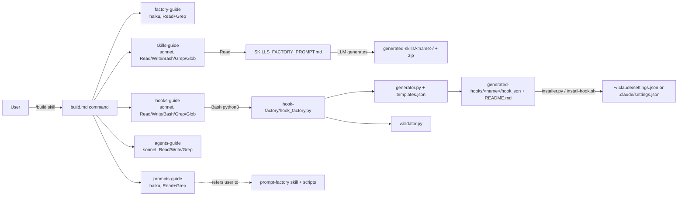

# Alireza Rezvani — Claude Code Skills & Agents Factory: technical deep dive

> Repository: https://github.com/alirezarezvani/claude-code-skill-factory (whole repository) · Evaluated commit: ba18b31703542d9d7eda5f9ba94f0df65a59dddf (2025-11-12) on `dev` (the GitHub default branch)
> Other branches inspected: `main` (HEAD 61135a053f00d5f56504bac3699fc56aac5ffb5f, 2025-11-12), compared through the GitHub compare API; no clone was needed because `main` is a strict ancestor of `dev` (see §2.4) · License: MIT (`LICENSE`; GitHub API `license.spdx_id = MIT`)
> Accessed: 2026-10-22 · Method: read-only shallow clone; no code executed (one inline `python3 -I` of my own was used only to `json.load` committed `hook.json` data files and print their top-level keys; `unzip -l` was used to list ZIP contents)
> Legend: [F] verified fact · [I] inference · [C] unverified claim · [U] unknown · [F docs] fact from the official Claude Code docs at code.claude.com (cited with access date; not executed)

All paths are relative to the repository root at the evaluated commit. Line numbers come from `cat -n` of that commit.

Claude Code behaviour is checked against the official docs, fetched 2026-10-22:
`https://code.claude.com/docs/en/hooks` and `https://code.claude.com/docs/en/sub-agents`. The repo also ships a copy of the
hooks docs as it stood when it was copied (`documentation/references/claude-hooks-instructions.md`). Where the two agree, the
repo's own copy is cited, so the finding stands on the repo's own evidence.

---

## 1. Summary

This is a **prompt-template and example repository for producing Claude Code artifacts**: Claude Skills, subagent
definitions, slash commands, hooks, and "mega-prompts" for other LLMs. The heart of it is five long Markdown "factory
prompts" (`documentation/templates/*_FACTORY_PROMPT.md`, 857–1,152 lines each), five "guide" subagents
(`.claude/agents/*-guide.md`) that ask the user questions and fill those prompts, and a `/build` slash command that sends
the user to the guides. Python helper scripts back four of the generators: hooks, prompts, slash commands, and a small
agent YAML writer. On top of that sit 14 "generated" domain skills (AWS architect, M365 admin, TDD guide, ASO, and others),
11 ZIPs of those skills, and a 19-workflow GitHub Actions layer for the repo's own issue/PR governance. Several of those
workflows run `anthropics/claude-code-action`.
**Category: skill/agent generator** (primary) **+ skill/agent pack** (secondary). The GitHub workflow layer has a
board/issue-driven shape (plan issue → task issues → sub-tasks), but it only manages this repository and generates no
software, so it is not a factory in the software sense. **Execution model: LLM-driven.** Code runs deterministically
only inside the hook-factory, prompt-factory and slash-command-factory Python scripts.
**Maturity:** about three weeks of intense activity (repo created 2025-10-21; last commit 2025-11-12), then nothing. It
has **no tests**. Its CI is a syntax check. The docs make many unverified claims ("Enterprise-Ready", "production-ready").
I found concrete defects in the one code-heavy generator (hook-factory) that make its default output a hook format Claude
Code does not document (§5, §7). **Maintenance status: dormant.** The project has had no commits for about 11 months. Seven
community PRs (Dec 2025–Jun 2026) have no review. Issue #1030 ("Ongoing development?", 2026-01-14) has 0 replies. The
owner is still active on a different repo (`alirezarezvani/claude-skills`, pushes on 2026-10-21/22) (§2.4).

## 2. Architecture

### 2.1 Components

| Layer | Files | Role |
|---|---|---|
| Entry command | `.claude/commands/build.md` (222 lines, no frontmatter) | `/build [skill\|prompt\|agent\|hook]`: tells the main session to use `factory-guide` or one of the specialist guides [F] `build.md:21-32` |
| Guide subagents | `.claude/agents/{factory,skills,agents,prompts,hooks}-guide.md` | Question-and-answer flows that fill a factory prompt or call a Python script [F] |
| Factory prompts | `documentation/templates/{SKILLS,AGENTS,HOOKS,PROMPTS}_FACTORY_PROMPT.md`, `MASTER_SLASH_COMMANDS_PROMPT.md` | Long instruction templates with `BUSINESS_TYPE`/`USE_CASES`-style variables and a "Final Validation Checklist" [F] `SKILLS_FACTORY_PROMPT.md:909-921,953-992` |
| Generator skills | `generated-skills/{agent,hook,prompt,slash-command}-factory/` | `SKILL.md` + Python helpers + presets/templates [F] |
| Domain skills | `generated-skills/{aws-solution-architect,ms365-tenant-manager,tdd-guide,tech-stack-evaluator,scrum-master-agent,app-store-optimization,content-trend-researcher,social-media-analyzer,claude-md-enhancer,codex-cli-bridge}/` + 11 `*.zip` | Example outputs and a skill pack [F] |
| Other outputs | `generated-agents/claude-md-guardian/`, `generated-commands/`, `generated-hooks/` (5), `generated-prompts/` (8) | Sample outputs of the factories [F] |
| Utility commands | `.claude/commands/{validate-output,install-skill,install-hook,test-factory,factory-status,sync-agents-md,codex-exec,sync-todos-to-github}.md`, `git/*.md`, `review.md`, `security-scan.md`, `run-release.md`, `ci-guard.md`, `sync-branch.md` | Prose procedures for the main session; only the governance commands have frontmatter [F] |
| Repo governance | `.github/workflows/*.yml` (19 files, 4,208 lines), `.github/actions/*` (3 composite actions), `.github/WORKFLOW_KILLSWITCH`, `.github/EMERGENCY_CLEANUP.sh` | Branch/commit guard, Claude PR review, Claude issue triage, plan→task→subtask issue automation, release gates [F] |
| Reference docs | `documentation/references/*` | Copies of Anthropic/OpenAI docs and community hook examples [F] |

### 2.2 Tech stack and dependencies

- **Runtime for helpers:** Python 3 standard library only, by the repo's own claim [C] `generated-skills/prompt-factory/requirements.txt:3-6`.
  The `scrum-master-agent` notifier optionally imports `yaml` (`notify_channels.py:38`) and uses `urllib.request` to post to webhooks
  (`notify_channels.py:9,63-64`) [F]. `install-hook.sh` needs `jq` (`install-hook.sh:35-36`) [F].
- **No package manifest** (`package.json`, `pyproject.toml`), **no plugin manifest** (`.claude-plugin/`). You install by
  `cp -r` (`README.md:23-24`, `.claude/commands/install-skill.md:59`) [F]. Issue #1024 ("where is the marketplace?", 2025-11-25)
  has no reply [F, gh api].
- **Models:** subagent `model:` values are `haiku` (factory-guide, prompts-guide, claude-md-guardian) and `sonnet` (skills, agents and hooks guides) [F].
  `agent_generator.py` defaults the generated agents to `opus` for "Strategic" and "Coordination" types and `sonnet` for the others
  (`generated-skills/agent-factory/agent_generator.py:31-36`) [F]. `codex-cli-bridge` calls the OpenAI Codex CLI with `gpt-5` and
  `gpt-5-codex` models (`codex_executor.py:100-120,208-229`) [F].
- **External services:** GitHub Actions + `anthropics/claude-code-action@v1` (tag, not SHA) with `CLAUDE_CODE_OAUTH_TOKEN` and a
  `PROJECTS_TOKEN` secret (`.github/workflows/issue-triage.yml:40-43`, `plan-to-tasks.yml:93-96`) [F]. Optional Slack/Teams
  webhooks (scrum-master-agent) [F]. `npx --yes markdown-link-check@3.12.2` in CI (`ci-quality-gate.yml:87`) [F].

### 2.3 Size

401 tracked files. Of these, 262 are under `generated-skills/` (69 are prompt presets), 65 are `.py`, 6 are committed
`.pyc` bytecode files, 12 are `.zip`, and 4 are `.sh` [F] (`git ls-files`).

### 2.4 Branches, `main` vs `dev`, and maintenance

- GitHub compare `main...dev`: `status: ahead`, `ahead_by: 6`, `behind_by: 0`, 12 files changed [F, gh api]. So **`main` is a
  strict ancestor of `dev`**. The 6 extra commits (all on 2025-11-12) add only governance material:
  `.github/{BRANCH_PROTECTION_CONFIG,GITHUB_SETTINGS_QUICK_GUIDE,WORKFLOW_IMPLEMENTATION_TRACKER}.md`, three composite actions
  (`.github/actions/{branch-cleanup,fork-safety,quality-gates}/action.yml`), three workflows (`create-branch-on-issue.yml`,
  `dev-to-main.yml`, `pr-into-dev.yml`), a +30/−4 change to `ci-commit-branch-guard.yml`, and `WORKFLOW_ADAPTATION_PLAN.md` [F].
  **None of the factory, guide, template or skill files differ between the branches** [F].
- Last commit on either branch: 2025-11-12 [F]. GitHub `pushed_at` 2025-11-12T15:30:27Z [F].
- Open items: 27 open issues + PRs [F]. Among them are 7 unmerged community PRs (#1028 Dec 2025; #1049–#1053 Apr 2026;
  #1054 Jun 2026). Some fix defects this report also finds: a hardcoded developer path in `hooks-guide.md` (#1050, #1053)
  and missing frontmatter on 9 commands (#1049, #1052). Thirteen "Feedback on your X skill" issues opened on 2026-01-24 have
  0 maintainer replies. #1027 and #1026 (feature PRs) were closed unmerged on 2025-12-29 [F, gh api].
- The only Actions runs since then are the weekly scheduled `Git Governance Audit` (success, latest 2026-10-19) and
  `Issue Auto-Triage` runs, which fire on every outside issue and now **fail** (e.g. 2026-04-17, 2026-03-29, 2026-03-24) [F, gh api].
- The owner's public events show pushes to `alirezarezvani/claude-skills` on 2026-10-21/22 [F, gh api]. The README
  points to that repo as the "Skills Library" (`README.md:323-326`) [F]. **Assessment:** this project is unmaintained
  and the author's effort has moved to `claude-skills` [I].

## 3. Agents

All subagent files use extra frontmatter keys: `field`, `expertise`, and on some `mcp_tools`. The official sub-agents
reference does not document these keys; Claude Code ignores unknown fields without reporting an error (docs, fetched
2026-10-22) [F docs]. So these keys are only labels.

| Agent | File | Purpose | Tools | Model | Inputs → outputs |
|---|---|---|---|---|---|
| factory-guide | `.claude/agents/factory-guide.md` | Asks "what do you want to build" and hands off to a specialist | `Read, Grep` (`:4`) | haiku (`:5`) | User choice → text that says "[Invoke skills-guide agent]" (`:97,106,115,124`). It **has no `Agent`/Task tool**, so it cannot do the delegation itself. The current docs allow a subagent to spawn subagents only if it has the `Agent` tool [F docs]. The "delegation" therefore has to be done by the main session reading this text [I] |
| skills-guide | `.claude/agents/skills-guide.md` | 5-question Q&A, fills SKILLS_FACTORY_PROMPT, writes the skill, zips it | `Read, Write, Bash, Grep, Glob` (`:4`) | sonnet (`:5`) | Q1–Q5 (`:37-121`) → `generated-skills/<name>/` + `<name>.zip` (`:197-218`) |
| agents-guide | `.claude/agents/agents-guide.md` | Q&A → agent `.md` with "enhanced YAML" | `Read, Write, Grep` (`:4`) | sonnet | Answers → agent file. It has no `Bash`, so it cannot `cp` to `~/.claude/agents/`, though `Write` can create the file directly [I] |
| hooks-guide | `.claude/agents/hooks-guide.md` | Q&A → runs `hook_factory.py` → validates | `Read, Write, Bash, Grep, Glob` (`:4`) | sonnet | It runs `cd /Users/rezarezvani/projects/claude-code-skills-factory && python3 generated-skills/hook-factory/hook_factory.py …` (**hardcoded author path**, `:253,259`) and then `validator.py` (`:265`) |
| prompts-guide | `.claude/agents/prompts-guide.md` | Points the user to prompt-factory presets/custom flow | `Read, Grep` (`:4`) | haiku (`:5`) | Advice only; it cannot write files [F] |
| claude-md-guardian | `generated-agents/claude-md-guardian/claude-md-guardian.md` | "Background agent" that keeps CLAUDE.md up to date "at session start and after major milestones" | `Bash, Read, Write, Edit, Grep, Glob, Skill` (`:4`) | haiku (`:5`) | Edits CLAUDE.md files. Nothing in the repo runs it automatically; the description alone cannot schedule it [I] |

**Interactive Q&A inside a subagent.** Every guide is written as a turn-by-turn conversation ("**Wait for answer**, then
continue", `skills-guide.md:53,71,87,103,121`). The official docs say `AskUserQuestion` is removed from every subagent and
a subagent runs to completion before it returns [F docs]. So as written, a guide cannot hold a multi-turn conversation
with the user. In practice the flow works only if the main session reads the guide file and runs the Q&A itself, or if the
user restarts the subagent with each answer [I]. I could not test this (not executed).

## 4. Skills, commands and prompts

### 4.1 Factory prompts (`documentation/templates/`)

| File | Lines | Structure | Notes |
|---|---|---|---|
| `SKILLS_FACTORY_PROMPT.md` | 1,012 | Role → "CRITICAL FORMATTING RULES" (file cleanliness, kebab-case name, SKILL.md section layout, Python class template with `safe_divide`, sample JSON, HOW_TO_USE) → 4 generation rules → 2 full worked examples → "Your Task" with `{NUMBER_OF_SKILLS}` → template variables → "Final Validation Checklist (MANDATORY)" | Variables are `BUSINESS_TYPE, USE_CASES, NUMBER_OF_SKILLS, ADDITIONAL_CONTEXT` (`:914-920`). `skills-guide.md:146-151` also fills `IMPLEMENTATION_TYPE`, **which the template never declares** (0 occurrences) [F]. The checklist (`:953-992`) is self-attested by the LLM; nothing runs it |
| `AGENTS_FACTORY_PROMPT.md` | 1,123 | Frontmatter rules, colour/field/expertise taxonomies, 4 agent "types" with tool sets, MCP guide, 5 rules, 3 full examples, decision matrix, "Performance & Safety Guidelines" | It cites "rr- agent system baselines" for process counts and says parallel quality agents "cause system crashes" (`:911-958`). No evidence is given [C] |
| `HOOKS_FACTORY_PROMPT.md` | 857 | hook.json structure, "The 7 Hook Event Types" table (`:125-137`), safety patterns, 4 templates, rules, validation rules | It lists **`PrePush`** as a Claude Code event (`:137`). That is wrong: neither the repo's own docs copy nor the current official list (33 events) has it [F docs] |
| `PROMPTS_FACTORY_PROMPT.md` | 1,152 | Meta-prompt for domain prompt builders | Not read in full (skimmed headings) |
| `MASTER_SLASH_COMMANDS_PROMPT.md` | 1,031 | Simple / Multi-Phase / Agent-Style command patterns | Not read in full (skimmed headings) |

### 4.2 Generator skills

| Skill | Trigger (description) | What it does | Notable structure |
|---|---|---|---|
| `agent-factory` | "Claude Code agent generation system…" (`SKILL.md:3`) | Templates and a taxonomy for agents. `agent_generator.py` builds frontmatter with kebab-case checks (`:84`) | Nothing in `SKILL.md` refers to `agent_generator.py`; the only reference is the catalogue `generated-skills/CLAUDE.md:198` [F]. The YAML is written with f-strings and no quoting (`:138-158`), so a description containing `: ` produces invalid YAML [I]. The name regex `^[a-z]+(-[a-z]+)*$` rejects digits [F] |
| `hook-factory` (v2.0) | "Generate production-ready Claude Code hooks…" (`SKILL.md:3`) | 3 modes: interactive `-i`, natural language `-r`, template `-t` (`hook_factory.py:610-683`); 10 templates (`templates.json`); validator; Python and Bash installers | Most of the repo's real code is here (687 + 535 + 813 + 541 + 169 lines). Defects are in §5.3 and §7 |
| `prompt-factory` | 599-character description (`SKILL.md:3`) | 69 presets (`templates/presets/**`, 69 files [F]), 7-question flow, 4 output formats, "7-point quality gates" (`SKILL.md:341-365`), scripts `generate_prompt.py`, `validator.py`, `optimizer.py`, `batch_generator.py` | It sets a clear scope limit: "generates PROMPTS only … does NOT implement" (`SKILL.md:12-48`). The token estimator is inverted: `estimated_tokens = int(word_count * 0.75)` (`scripts/validator.py:216-218`) gives about 56% of the usual ~1.33 tokens/word estimate. The other gates are keyword counts (`:249-303`) [F] |
| `slash-command-factory` | 347-character description | 17 presets (`presets.json`), `command_generator.py`, `validator.py` | Builds narrow `allowed-tools` (`command_generator.py:319-344`) and rejects a bare `Bash` (`validator.py:182-183`) [F]. The allowlist includes `find:*`, `sed:*`, `awk:*`, which still permit `find -delete/-exec`, `sed -i` and `awk system()` [I] |
| `codex-cli-bridge` | CLAUDE.md → AGENTS.md translation + Codex exec wrapper | `claude_parser.py`, `agents_md_generator.py`, `codex_executor.py`, `safety_mechanism.py` | `subprocess.run` with list arguments (no shell) and a 300 s timeout (`codex_executor.py:259-264`). `exec_edit` defaults to `--full-auto` + `workspace-write` (`:100-120`) and always adds `--skip-git-repo-check` (`:221-222`) [F] |
| `claude-md-enhancer` | CLAUDE.md analysis/generation | `analyzer.py` heuristic 0–100 quality score (`:225-302`), `validator.py` (`MAX_RECOMMENDED_LINES = 300`, `:16`), `template_selector.py`, `workflow.py`, 6 example CLAUDE.md files | Its `name` contains "claude", which issue #1029 reports the claude.ai upload UI rejects [F, gh api; not verified against Anthropic docs] |

### 4.3 Domain skills (pack)

`aws-solution-architect`, `ms365-tenant-manager`, `tdd-guide`, `tech-stack-evaluator`, `scrum-master-agent`,
`app-store-optimization`, `content-trend-researcher`, `social-media-analyzer`. Each follows the template's layout: a
`SKILL.md`, 3–8 Python modules of 300–800 lines each, a `HOW_TO_USE.md`, sample input and expected output JSON, and
usually a `README.md` [F]. I read their frontmatter and file lists only, not their logic (§17). Issue #1048 notes that the
pack is Python-centric [F, gh api].

### 4.4 Slash commands

- Factory commands (`build`, `build-hook`, `validate-output`, `install-skill`, `install-hook`, `test-factory`,
  `factory-status`, `sync-agents-md`, `codex-exec`) have **no frontmatter**, so no `description`, `argument-hint` or
  `allowed-tools` [F]. Open PRs #1049/#1052 propose adding it [F].
- `/validate-output` describes checks for the LLM to perform. For hooks it tells the LLM to run
  `python3 generated-skills/hook-factory/validator.py generated-hooks/my-hook/hook.json` (`validate-output.md:293-294`) [F].
  For skills it zips with `-x "*.pyc" "*__pycache__*"` (`:80`) [F].
- `/test-factory` is a manual checklist ("Just do a task that matches description / Watch for auto-delegation",
  `test-factory.md:265-266`). It does not compare `sample_input.json` with `expected_output.json` [F].
- `/install-hook` tells the LLM to edit `settings.json` by hand with a single non-timestamped `.backup`
  (`install-hook.md:43,211-220`). That differs from `installer.py`, which keeps timestamped backups and rotates them [F].
- Governance commands (`git/cm|cp|pr|rv|sc`, `review`, `security-scan`, `run-release`, `ci-guard`, `sync-branch`) have
  `description` frontmatter and run gitleaks, `safety` and `yamllint` locally (`git/sc.md:1-8`, `security-scan.md:1-8`) [F].

## 5. Orchestration and execution workflows

### 5.1 Execution model

The model is **LLM-driven**, with deterministic islands. `/build` → guide subagent → (a) the LLM itself generates from a
Markdown template (skills, agents, prompts), or (b) the LLM runs a Python generator (hooks; optionally prompts and slash
commands). There is no orchestrator code, state machine, retry loop or parallelism. "Retry" exists only as prose
("Let me fix these and regenerate…", `skills-guide.md:275-282`) [F]. The human approval gates are the Q&A itself, the
hook-factory confirm prompt (`hook_factory.py:308-311`), and installer prompts (`installer.py:284`) [F].

### 5.2 Trace 1: `/build skill` → generated skill package

1. User runs `/build skill`. `.claude/commands/build.md:27-32` says to delegate to **skills-guide** [F]. The command has no
   `$ARGUMENTS` handling; the main model reads the prose and acts on it [I].
2. `skills-guide` (`.claude/agents/skills-guide.md`) asks Q1–Q5 (domain, use cases, Python-or-prompts, number of skills,
   constraints) (`:37-121`) [F]. A subagent cannot ask questions mid-run (§3), so these turns in practice happen in the
   main session or across re-invocations [I].
3. "Step 1: Read Template": `Read documentation/templates/SKILLS_FACTORY_PROMPT.md` (`:129-140`) [F].
4. "Step 2: Fill Template Variables": five variables, including `IMPLEMENTATION_TYPE`, which is absent from the template
   (`:144-151` vs template `:914-920`) [F].
5. "Step 3": "Use the filled template as a prompt to generate the complete skill package" (`:164`). Generation is the
   model's own completion; no script is involved [F].
6. "Step 4: Validate": the LLM checks YAML frontmatter, kebab-case and file presence (`:166-195`) [F]. No script runs.
7. "Step 5/6": `mkdir -p generated-skills/[skill-name]/`, Write files, then `cd generated-skills && zip -r [skill-name].zip [skill-name]/`
   (`:197-218`) [F]. **This zip has no exclusions**, unlike `/validate-output` (`validate-output.md:80`) [F].
8. "Step 7": installation instructions are `cp -r generated-skills/[skill-name] ~/.claude/skills/` or a drag-and-drop of the ZIP (`:220-254`) [F].
9. **Outputs and state:** files in `generated-skills/<name>/` and the ZIP; nothing else persists [F]. The repo's own outputs
   show the template's cleanliness rule was not enforced: `aws-solution-architect/__pycache__/*.pyc` and
   `ms365-tenant-manager/__pycache__/*.pyc` are committed, and `aws-solution-architect.zip` contains three `.pyc` files
   (`unzip -l`) [F], despite `SKILLS_FACTORY_PROMPT.md:36-62` ("NEVER leave __pycache__/ in deliverables").

### 5.3 Trace 2: `/build hook` → hook.json → settings.json

1. `/build hook` → **hooks-guide** asks about purpose/event/language etc., then "Step 2: Invoke Hook Factory" with the Bash
   tool: `cd /Users/rezarezvani/projects/claude-code-skills-factory && python3 generated-skills/hook-factory/hook_factory.py -t [template_name] -l [language]`
   or `-r "[natural language]"` (`hooks-guide.md:248-260`) [F]. **The hardcoded absolute path fails on any other machine** [I].
2. `hook_factory.py:main()` parses arguments (`:636-654`) → `HookFactory.__init__` sets `project_root` to two levels above
   the script and `mkdir`s `generated-hooks/` (`:28-39`) [F].
3. `-t`: `create_hook_from_template()` → `HookGenerator.generate_hook(HookRequirements)` (`:68-104`; `generator.py:88-150`) [F].
   `-r`: `generate_hook_from_request()` does keyword matching on substrings (`generator.py:457-506`). Language detection
   tests `'py'` first (`:488`), so any request containing those letters (e.g. "happy", "copy") becomes Python, and `'go'`
   (`:496`) matches "good" or "google" [F/I].
4. `generate_hook()` loads `templates.json` (`generator.py:53-69`), substitutes `{{VAR}}` placeholders with per-language
   options/patterns (`:187-249`), and **wraps** the result as `{ "<EventType>": [hook_config], "_metadata": {...} }` (`:120-133`) [F].
5. `HookFactory._process_package()` validates the **unwrapped** `package.hook_config` (`hook_factory.py:118`), which has no
   event key and no `_metadata`. The event-specific rules in `HookValidator.validate_hook()` are chosen by
   `if event_type in str(hook_config)` (`validator.py:105-108`), so they fire only when the event name happens to appear
   in the command text [F/I].
6. `_save_package()` checks the name for path traversal (`hook_factory.py:172-185,209-236`) and writes `hook.json` (the
   wrapped JSON) and `README.md` to `generated-hooks/<name>/` (`:191-201`) [F].
7. Install: `installer.py install_hook()` → `load_hook_config()` requires a top-level event key (`installer.py:213-224`) →
   timestamped backup with keep-5 rotation (`:50-85`) → merge into `settings['hooks'][event]` with a duplicate prompt
   (`:276-300`) → **atomic save** (temp file in the same dir, re-parse, `replace`) (`:147-189`) → rollback from backup on
   exception (`:310-319`) [F].

**Where this path breaks (static reading, not executed):**

- **Hook format does not match Claude Code.** Every template uses `"matcher": {"tool_names": [...]}` (an object)
  (`templates.json:17-19` and others) and reads `$CLAUDE_TOOL_FILE_PATH` (`templates.json:42-46`). That variable appears
  103 times across the repo (`git grep -o | wc -l`) [F]. The repo's own copy of
  the hooks docs says the matcher is a string pattern (`documentation/references/claude-hooks-instructions.md:27,40-45`)
  and that hook input arrives as **JSON on stdin** (`:274-276`). The current official docs agree: the matcher is a string,
  and the documented env vars are `CLAUDE_PROJECT_DIR`, `CLAUDE_PLUGIN_ROOT`, etc., not `CLAUDE_TOOL_FILE_PATH`
  [F docs]. The generated formatter/git-add hooks would therefore get an empty file path and exit 0 silently through their
  own `|| exit 0` guards [I, not executed]. How Claude Code treats an object-typed matcher in `settings.json` is
  **Unverified (not executed)**.
- **The interactive answers are discarded.** `interactive_mode()` collects matcher, command and timeout (Q3–Q5) and passes
  them as `additional_options` (`hook_factory.py:320-325`). `_substitute_template()` never reads `additional_options`; it
  uses the template's matcher, command and timeout (`generator.py:163-183`) [F].
- **SessionStart in interactive mode fails.** `_get_template_for_event('SessionStart')` returns
  `'session_start_load_context'` (`hook_factory.py:601`), but the template key is `session_start_context_loader`
  (`templates.json:154`), so `generate_hook` raises "Template not found" (`generator.py:102-103`) [F].
- **The "blocking" validation hooks do not block.** The `pre_tool_use_validation` (PreToolUse) and `pre_push_validation`
  templates try to block by running `exit 1` (`templates.json:242-245,380-383`). The repo's own docs copy says only
  **exit code 2** blocks and other codes are non-blocking errors (`claude-hooks-instructions.md:429-431`) [F]. So these
  checks warn but never stop the tool call [I, not executed]. This holds for these templates as written; current Claude
  Code hooks docs also offer `"onFailure": "block"` (v2.1.295+), which makes other non-zero exits block, but no template
  sets it [F docs] (code.claude.com/docs/en/hooks, accessed 2026-10-22).
- **`PrePush` is not a Claude Code event** but is offered as choice 7 (`hook_factory.py:387,396`) with a template
  (`templates.json:342`) [F docs].
- **Validator and installer disagree on format.** The CLI validator (`validator.py:710-772`) requires top-level
  `matcher`/`hooks` (`:144-161`), so it rejects the wrapped files the current generator writes. The installer requires a
  top-level event key (`installer.py:213-224`), so it rejects the 8 committed hook.json files that are unwrapped (4 in
  `generated-hooks/`; 4 in `hook-factory/examples/`: `auto-format-python`, `git-auto-add`, `load-context`, `test-runner`)
  plus `generated-hooks/auto-sync-plan-to-github/hook.json`, which has no event key either: 9 of the 15 committed files,
  including all 5 in `generated-hooks/` [F] (top-level keys listed with `json.load`).
- **`interactive_mode` uses `input()`**, and `hooks-guide` invokes the script only with `-t`/`-r`. Claude Code's Bash tool
  has no stdin for interactive answers, so `-i` is a human-terminal-only mode [I].
- `install-hook.sh` rotates backups with `head -n -5` (`install-hook.sh:110`), a GNU-only flag that fails on macOS/BSD
  `head`, even though the SKILL claims "macOS/Linux Support" [F/I].

### 5.4 GitHub governance automation (repo-internal)

`plan` issue → `plan-validator.yml` → label `plan-validated` → `plan-to-tasks.yml` runs `claude-code-action` with
`Bash(gh api:*),Bash(gh issue:*),Bash(gh project:*)…` (`plan-to-tasks.yml:14,93-96,209`) to create TASK issues →
`task-to-subtasks.yml` → `smart-sync.yml` keeps a Projects v2 board in sync → `plan-auto-close.yml` and
`pr-issue-auto-close.yml` [F]. The intended safeguards are a file-based kill switch (`.github/WORKFLOW_KILLSWITCH`), a
REST/GraphQL rate-limit circuit breaker (`plan-to-tasks.yml:37-64`, which gates the Claude job through
`needs`/`if: …can_proceed == 'true'` at `:68-69`), and concurrency groups [F]. **The kill switch does not work in most of
the workflows that check it.** The check reads `.github/WORKFLOW_KILLSWITCH` *before* `actions/checkout` in
`issue-triage.yml` (check `:27`, checkout `:35`), `claude-code-review.yml` (`:33` vs `:86`), `smart-sync.yml` (`:31` vs
`:139`), `security-audit.yml` (`:21` vs `:30`) and `pr-issue-auto-close.yml` (`:21` vs `:29`). In `plan-to-tasks.yml` the
check runs in a job with no checkout at all (`:13-64`). At that point the file does not exist on the runner, so the
check always passes [F/I]. Even if the file existed, the kill switch could not stop `plan-to-tasks.yml`: its step (id
`killswitch`, `:27-37`) writes `can_proceed` to its own output, but the job output reads
`steps.check.outputs.can_proceed` (`:24`), which only the circuit-breaker step (id `check`, `:38-64`) sets [F]. Also, in `issue-triage.yml` and `claude-code-review.yml` the check's `exit 0` ends only that
step; later steps are not made conditional on it (`claude-code-review.yml:31-39,84-93`) [F]. Only `plan-validator.yml`
checks after checkout (`:26` vs `:33`) [F]. `.github/EMERGENCY_CLEANUP.sh` exists to close "spam issues created by workflows" after a cutoff of
2025-10-24 (`:1-30`). That is evidence the automation once ran away and created issues in bulk [F/I].

## 6. Context and state management

- **Context building:** the guides read a whole factory prompt (about 1,000 lines) into context, plus the user's answers
  (`skills-guide.md:137-151`) [F]. Nothing is compressed or summarised.
- **Modular CLAUDE.md:** root `CLAUDE.md` points to `.github/CLAUDE.md`, `claude-skills-examples/CLAUDE.md`,
  `generated-skills/CLAUDE.md` and `documentation/CLAUDE.md`, and says "Claude automatically loads the appropriate file
  based on your working directory" (`CLAUDE.md:15-28`) [C]. Its footer says "~155 lines" (`:235`), but the file has 235 lines [F].
- **Persistent state:** files only (`generated-*/`, ZIPs, `settings.json` backups). There is no run log, manifest or
  resumable state. `hook.json` carries `_metadata` (generator, timestamp, template) (`generator.py:126-133`), the only
  provenance record [F].
- **Handoff artefacts:** `sample_input.json` / `expected_output.json` per skill. They are never compared automatically (§4.4) [F].
- **Resumability:** none. A Q&A that is cut off has to start over [I].

## 7. Engineering practices and testing

- **Tests: none.** The only `test*`-named files are product features (`tdd-guide/test_generator.py`,
  `app-store-optimization/ab_test_planner.py`) [F]. `requirements.txt` lists pytest only as a commented-out option
  (`prompt-factory/requirements.txt:9`) [F].
- **CI:** `ci-quality-gate.yml` runs `python -m compileall` (syntax only) (`:68-70`), `safety check` on
  `**/requirements*.txt` (without `globstar`, `**` matches only one directory level, `:75`), and `markdown-link-check` on
  `README.md` only (`:87`) [F]. YAML lint and workflow-schema checks are **commented out** "because of false positives"
  (`:59-66`) [F]. `claude-code-review.yml` has `continue-on-error: true` (`:94`) and can be bypassed with a PR title or
  label (`:40-63`) [F].
- **Linting/typing:** type hints in the Python files. There is no mypy/ruff/flake8 config. `.commitlintrc.cjs` and
  `ci-commit-branch-guard.yml` enforce Conventional Commits and branch names [F].
- **Evals for prompts/agents:** none. The "7-point quality gates" (prompt-factory) and the "Final Validation Checklist"
  (skills) are either self-attested by the LLM or keyword heuristics (`prompt-factory/scripts/validator.py:195-303`) [F].
- **Verification of produced software:** none independent. A generated skill's `expected_output.json` is written by the
  same LLM run that writes the code, and nothing executes it [F].
- **Repo hygiene vs its own rules:** `.gitignore` ignores `.vscode/`, `.archive/` and `__pycache__/` (`:15,40,42`), but
  `.vscode/settings.json`, `.archive/*` and six `.pyc` files are tracked [F]. `claude-skills-examples/` is gitignored except
  its CLAUDE.md (`.gitignore:5-8`). As a result the "three fully-functional example skills" (`README.md:277-285`) and the
  examples that `claude-skills-examples/CLAUDE.md` (470 lines) describes **are not in the repository** [F]. `skills-guide.md`
  cites `generated-skills/psychology-advisor/` as a reference example (`:33,331`), but that path is gitignored
  (`.gitignore:9`) [F]. Versions disagree: README says 1.4.0 (`README.md:363`), CHANGELOG's latest is 1.5.0 above an older
  2.2.0 (`CHANGELOG.md:10,89`), and `project-status.md` says 2.1.0 [F]. README says "10 slash commands and 5 interactive
  agents" (`:34`) and also "8 slash commands" (`:197`) [F].

## 8. Security, isolation and observability

- **Permission model for factory use:** the guides declare `tools:` (§3), but the factory slash commands have no
  `allowed-tools` (§4.4). Nothing uses `--dangerously-skip-permissions` [F]. Generated agents get
  `Read, Write, Edit, Bash, Grep, Glob` by default for "Implementation" and "Quality" types (`agent_generator.py:22-28`) [F].
- **Sandboxing/isolation:** none. No containers, worktrees or sandbox settings [F]. `architecture.md:206-232` claims a
  "Four-Layer Security Model" with "Sandboxed execution", "Resource limits", "Audit logging" and "Encryption at rest". **No
  code implements any of it** [F: not found].
- **Hook-factory safety checks (positive):** a destructive-pattern list (`validator.py:47-56`), a tool-presence check
  (`:497-506`), a silent-failure check (`:508-518`), a secret detector with about 20 regexes (`:520-579`), path-traversal
  guards on output and on validator input (`hook_factory.py:172-236`; `validator.py:726-750`), and an atomic, backed-up
  settings write (`installer.py:50-189`) [F]. Limits: the generic 40-char base64 regex (`validator.py:550`) will produce
  false positives on hashes [I]. The dangerous-command list in interactive mode has four entries (`hook_factory.py:516`) [F].
- **GitHub Actions exposure:**
  - `issue-triage.yml` runs on **every** `issues: opened` with no `author_association` filter (`:15-17`). It puts the
    untrusted `${{ github.event.issue.title }}` and `${{ github.event.issue.body }}` straight into the Claude prompt
    (`:59-62`), with `GH_TOKEN: ${{ secrets.PROJECTS_TOKEN }}` (a separate token, likely a PAT) (`:42`) and tools
    `Bash(gh issue:*),Bash(gh search:*),Bash(gh project:*)` (`:187`) [F]. This is a **prompt-injection surface**: any
    GitHub user can file an issue that steers an agent holding a write-capable token. Writes stay within `gh issue|search|project` [I].
    The workflow is `active` and has been firing (failing) on outside issues in 2026 [F, gh api].
  - `claude-code-review.yml:43` interpolates `${{ github.event.pull_request.title }}` into a `run:` shell script, a classic
    script-injection pattern. Impact is lower because `pull_request` runs from forks get a read-only token and no secrets [I].
  - `ci-quality-gate.yml:30-35` interpolates `github.event.inputs.ref` and `client_payload.ref` into `run:`. Only users with
    write access can trigger those events [F/I].
  - `claude.yml` correctly limits callers to OWNER/MEMBER/COLLABORATOR (`:20-31`), but allows `Bash(npm install:*)`
    (`:61-63`), which runs package lifecycle scripts [F/I].
  - `anthropics/claude-code-action@v1`, `actions/checkout@v4` and `actions/github-script@v7` are pinned by tag, not SHA [F].
- **Supply chain of the pack:** ZIPs ship compiled `.pyc` bytecode that cannot be reviewed as source (§5.2) [F]. ZIPs may
  differ from their folders; I did not diff them all [U]. Installation is `cp -r` with no integrity check [F].
  `generated-hooks/auto-sync-plan-to-github/hook.json` uses a made-up schema (`"event": "ExitPlanMode"`, `triggers`,
  `permissions`) and hardcodes `"repository": "alirezarezvani/claude-code-skill-factory"` [F]. `sync-plan.sh` calls
  `gh issue create` (`:146`) [F].
- **Secrets:** no real secrets found. `generated-skills/hook-factory/examples/security-scan/README.md:162,170` contains
  AWS-docs-style example key material (contains `EXAMPLE`) and a PEM header as test fixtures (kind: example AWS access-key
  ID, private-key header; values not reproduced) [F].
- **Prompt-injection content in repo files:** I found no text addressed to an AI that tries to override the user or the
  evaluator. A scan for "ignore previous", "disregard", hidden HTML comments and similar found only PR-template comments
  [F]. The guides and factory prompts are imperative instructions for Claude ("MUST", "CRITICAL"), as expected for this
  kind of repo. Note that `CLAUDE.md:11` tells Claude "This is NOT a development project itself", which shapes how an
  agent behaves in this repo [F].
- **Observability:** the Python scripts print to the console. `notify-factory-guide-completion` appends to
  `~/.claude/agent-notifications.log` (hook.json command) [F]. There is no cost, token or run telemetry. The workflows post
  bypass/fallback comments and a `workflow-health.yml` exists (not read in full) [F/U].

## 9. Efficiency

- **Context cost:** high. Every guide-driven generation loads a factory prompt of about 1,000 lines (§4.1). The
  `prompt-factory` SKILL.md is 1,109 lines with a 599-character description; the `slash-command-factory` SKILL.md is
  1,006 lines [F]. Neither uses progressive disclosure: `prompt-factory` has `references/`, but it keeps the main body inline [F].
- **Model routing:** fixed per agent in frontmatter (haiku for triage/advice, sonnet for generation) (§3) [F]. Generated
  agents default to opus for "Strategic" and "Coordination" (`agent_generator.py:31-36`), which is a cost-raising default [I].
- **Token accounting:** the prompt-factory estimator undercounts by about 44% (§4.2) [F]. There are no cost controls [F].
- **CI cost controls:** a rate-limit circuit breaker and concurrency groups in the issue automation (§5.4) [F]. The kill
  switch meant to halt spending does not work in most workflows (§5.4) [F/I].
- **Operational overhead:** 19 workflows plus a kill switch plus an emergency cleanup script for a repo whose product is
  Markdown templates (§5.4) [F/I].

## 10. Continuous improvement

None implemented. There is no feedback capture, no eval loop, no lessons file, and no refinement of templates from
outcomes [F]. `roadmap.md` lists "AI-Powered Skill Generation", a "Visual Skill Builder", a marketplace and an enterprise
tier as 2025 quarterly goals. It is dated "2024 Q4" for the current quarter (`roadmap.md:28`), and none of these exist [C/F].
`claude-md-guardian` is designed to keep CLAUDE.md current, but its upkeep logic lives in the prompt only [F].

## 11. Reference-driven development and reverse engineering

Partly applicable, and only for **format conformance**. `CLAUDE.md:57-68` sets a "Critical Validation Rule": "Always
validate your output against official native examples before declaring complete", pointing at
`documentation/references/` (copies of Anthropic Skills, Agents and Hooks docs, the OpenAI Codex CLI docs, slash-command
examples, and community hook JSON) [F]. The check is a manual LLM comparison; no tool diffs output against the references
[F]. As §5.3 shows, the hook generator departs from the hooks reference shipped in the same repo, so the rule was not
followed for that generator [F]. There is no UI reconstruction, screenshot verification or feature-parity measurement.

## 12. Innovations

Modest. These mechanisms have some real technical value:

1. **Question-flow + template filling as a "factory" UX.** Ask a few targeted questions, then fill a long, opinionated
   generation template with a built-in "Final Validation Checklist" (`SKILLS_FACTORY_PROMPT.md:831-1012`;
   `skills-guide.md:37-164`). It is easy to copy, but the checklist is self-attested.
2. **Safe settings.json mutation** in `hook-factory/installer.py`: timestamped backup with keep-N rotation, a temp file in
   the same directory, re-parse before replace, and rollback on exception (`:50-189,226-322`). This is a solid, reusable
   pattern.
3. **Hook safety linting:** destructive-pattern, tool-detection, silent-failure and secret-regex checks on hook commands
   (`validator.py:47-56,486-579`).
4. **Least-privilege `allowed-tools` synthesis** for slash commands by command type, plus a rule that rejects bare `Bash`
   (`slash-command-factory/command_generator.py:319-344`; `validator.py:162-203`).
5. **Prompt scope limit:** prompt-factory's "generates PROMPTS only … STOP" contract (`prompt-factory/SKILL.md:12-48`) is
   a clear guard against scope creep for generator skills.
6. **Rate-limit circuit breaker as a gating job** for agentic GitHub Actions: a cheap pre-job checks `gh api rate_limit`
   and gates the Claude job through `needs`/`if` (`plan-to-tasks.yml:37-69`). The companion kill-switch file is a sound
   idea, but its implementation here is a no-op in most workflows (§5.4).

## 13. Reusable components

| Component | Path | Kind | Dependencies | License | Security notes | Reuse class | Limits and compatibility constraints |
|---|---|---|---|---|---|---|---|
| Settings installer (backup/rotate/atomic/rollback) | `generated-skills/hook-factory/installer.py:24-322` | library | Python 3 stdlib | MIT | Writes `~/.claude/settings.json`; prompts with `input()` on duplicates (`:284`) | needs adaptation | Assumes a wrapped `{Event:[…]}` hook file; event list is hardcoded and includes the nonexistent `PrePush` (`:213`); interactive prompt blocks agent use |
| Hook command safety linter | `generated-skills/hook-factory/validator.py:47-56,486-579` | library | stdlib `re` | MIT | Regex heuristics; 40-char base64 rule causes false positives | reimplement the idea | Structural checks assume an object matcher and a top-level `matcher` key (`:139-161,248-294`), both wrong for current Claude Code |
| Hook templates | `generated-skills/hook-factory/templates.json` | data | — | MIT | Commands are wrapped in `|| exit 0` | reference only | Object matcher and `$CLAUDE_TOOL_FILE_PATH` do not match the documented hook contract (stdin JSON) |
| Hook generator / CLI | `generated-skills/hook-factory/{hook_factory,generator}.py` | script | stdlib | MIT | Path-traversal guards present | reference only | Interactive answers ignored; SessionStart key mismatch; keyword-substring NL parsing (§5.3) |
| Skills factory prompt | `documentation/templates/SKILLS_FACTORY_PROMPT.md` | prompt template | — | MIT | None | needs adaptation | Python-centric; mandates HOW_TO_USE/sample JSON layout; variable set does not match skills-guide |
| Agents/hooks/prompts/slash factory prompts | `documentation/templates/*.md` | prompt template | — | MIT | Hook prompt has a wrong event table | reference only | Non-standard frontmatter keys; uncited "crash" claims |
| Guide subagents | `.claude/agents/*-guide.md` | agent | the templates and scripts above | MIT | hooks-guide has a hardcoded `/Users/rezarezvani/...` path | reimplement the idea | Multi-turn Q&A inside subagents conflicts with subagent semantics; factory-guide lacks the `Agent` tool needed to delegate |
| Slash-command allowed-tools generator + validator | `generated-skills/slash-command-factory/{command_generator,validator}.py` | library | stdlib | MIT | Allowlisted `find`/`sed`/`awk` still allow writes or exec | needs adaptation | Command whitelist is static |
| Prompt-factory presets | `generated-skills/prompt-factory/templates/presets/**` (69 files) | prompt library | — | MIT | None | directly reusable (as content) | Role prompts for general LLM use, not Claude Code workflows; quality unevaluated |
| Prompt validator | `generated-skills/prompt-factory/scripts/validator.py` | script | stdlib | MIT | — | reimplement the idea | Inverted token estimate; keyword-count gates |
| Codex CLI wrapper | `generated-skills/codex-cli-bridge/codex_executor.py` | library | Codex CLI | MIT | `exec_edit` defaults to `--full-auto` + `workspace-write`; always `--skip-git-repo-check` | needs adaptation | Model names `gpt-5`/`gpt-5-codex` hardcoded; Codex CLI flags may have changed since 2025-11 [U] |
| CLAUDE.md quality scorer | `generated-skills/claude-md-enhancer/{analyzer,validator}.py` | library | stdlib | MIT | — | reference only | Heuristic score; 300-line cap is an opinion; skill name contains "claude" (issue #1029) |
| Workflow kill switch + rate-limit breaker | `.github/WORKFLOW_KILLSWITCH`; `.github/workflows/plan-to-tasks.yml:26-69` | pattern | `gh` CLI | MIT | The kill switch is checked before checkout (no-op), and in `plan-to-tasks.yml` its output is not wired to the job output; see §5.4 | reimplement the idea | The kill switch must be read after checkout (or from a repo variable) and must gate later steps or jobs; `grep STATUS:` parsing is fragile |
| Agentic issue automation | `.github/workflows/{issue-triage,plan-to-tasks,task-to-subtasks,smart-sync}.yml` | workflow | `claude-code-action@v1`, a PAT | MIT | Untrusted issue text in prompts; no author filter on triage | reference only | Tied to this repo's labels and project board |
| Domain skill pack | `generated-skills/{aws-solution-architect,…}` | skill | Python 3 | MIT | ZIPs contain `.pyc`; scrum notifier posts to webhooks | reference only | Unevaluated; Python-only; not reviewed in depth (§17) |

## 14. Evidence against the value dimensions

**Engineering quality.** The repo demonstrates typed, readable Python in the hook, prompt and slash-command generators,
plus careful file-safety code (path traversal, atomic writes) (§8, §12). Against that: no tests, CI is a syntax check with
lint turned off (§7), and static reading finds functional defects in the main code generator. The interactive answers are
dropped, an event key is wrong, the format disagrees with the repo's own reference docs, and the validator and installer
reject each other's formats (§5.3). The docs contradict the tree (§7). "Production-ready" and "Enterprise-Ready" are
claims, not demonstrated (§16).

**Autonomy and orchestration.** The factory is a set of human-in-the-loop Q&A prompts; the repo contains no autonomous
pipeline, parallelism, retries or state (§5.1). The "orchestrator" agent cannot delegate with its declared tools (§3).
The only autonomous behaviour is in the repo's GitHub workflows (plan → tasks → subtasks), which manage issues, not
software (§5.4).

**Development productivity.** The repo demonstrates ready-made templates, 69 prompt presets and example skills that can
be copied by hand (§4). It claims "Build a Skill in 2 Minutes" (`README.md:134`); that is not verified, and the hook path
has a hardcoded developer directory (§5.3). Nothing measures productivity.

**Security and reliability.** Demonstrated: safety linting and backup/rollback in the hook installer (§8, §12). Shown
weak: generated hooks rely on an undocumented env var and a non-string matcher (§5.3). An agentic triage workflow puts
untrusted issue text in front of a token-bearing agent with no author filter (§8). Compiled `.pyc` files ship in ZIPs
(§8). Actions are pinned by tag (§8). The "Four-Layer Security Model" exists only in docs (§8).

**Maintainability and adaptability.** MIT licence, plain Markdown and stdlib Python make adaptation easy (§2.2). Against
that: large monolithic prompt files (about 1,000 lines each), inconsistent versions and counts, missing example
directories, and dormancy with unreviewed fix PRs (§2.4, §7).

**Resource efficiency.** Large always-loaded prompts and SKILL bodies (§9); opus defaults in the agent generator (§9); an
undercounting token estimator (§4.2). The rate-limit breaker in CI is the only demonstrated cost-aware mechanism (§5.4).

## 15. Strengths and limitations

**Strengths**
- Broad coverage of Claude Code artifact types (skills, agents, commands, hooks, prompts) from one entry point (`/build`) (`build.md:9-32`).
- A good reusable pattern for safely editing `settings.json` (`installer.py:50-189`).
- Hook safety heuristics and secret detection (`validator.py:47-56,520-579`).
- Least-privilege `allowed-tools` generation for commands (`command_generator.py:319-344`).
- A clear "prompt only, then stop" scope rule for a generator skill (`prompt-factory/SKILL.md:12-48`).
- Rate-limit circuit breaker that gates the agentic job (`plan-to-tasks.yml:37-69`).
- MIT licence and stdlib-only Python (`LICENSE`; `requirements.txt:3-6`).

**Limitations**
- Dormant since 2025-11-12, with unreviewed PRs and issues (§2.4).
- No tests or evals; CI is `compileall` only (`ci-quality-gate.yml:68-70`).
- Hook generator output does not match the documented hook contract (`templates.json:17-19,42`, versus the repo's own `claude-hooks-instructions.md:27,40-45,274-276`).
- Generator, validator and installer have inconsistent formats; interactive inputs are discarded; the SessionStart template key mismatches (§5.3).
- Subagent Q&A design conflicts with subagent semantics; factory-guide cannot delegate (§3).
- Hardcoded developer path in hooks-guide (`hooks-guide.md:253,259`).
- Non-standard frontmatter keys presented as features (`field`, `expertise`, `mcp_tools`) (§3).
- Docs promise examples and features that are absent (`README.md:277-285`; `architecture.md:206-232`).
- Untrusted-input exposure in Claude-driven issue workflows (`issue-triage.yml:15-17,59-62`).
- Repo hygiene contradicts its own rules (committed `.pyc`, ZIPs with bytecode) (§5.2, §7).

## 16. Claims vs verified ledger

| Claim (source) | Status | Evidence |
|---|---|---|
| "factory-guide agent asks what you need and delegates to specialist guides" (`README.md:11`) | partly | Asks, yes (`factory-guide.md:62-86`); delegation impossible with `tools: Read, Grep` (`:4`) and the docs rule that spawning needs the `Agent` tool [F docs] |
| "Build a Skill in 2 Minutes" (`README.md:134`) | not executable | Needs a live session; not run |
| Hook Factory "10 production templates … 7 event types" (`README.md:262-265`; `SKILL.md:3`) | partly / contradicted | 10 templates exist (`templates.json`); one of the 7 events (`PrePush`) is not a Claude Code event [F docs] |
| "Automated installer (Python + Bash) … backup/rollback" (`hook-factory/SKILL.md:24`) | verified (code) / not executed | `installer.py:50-189,226-322`; `install-hook.sh:98-155`; `head -n -5` GNU-only (`:110`) |
| "Interactive Q&A – 7 questions with validation and smart defaults" (`hook-factory/SKILL.md:23`) | partly | Questions exist (`hook_factory.py:375-593`); answers to Q3–Q5 are not applied (`generator.py:163-183`) |
| "Safety Features: tool detection, silent failure, no destructive ops" (generated README, `generator.py:355-359`) | partly | Present in templates; but the file path variable is not the documented input channel, so formatters may never act [I] |
| "69 professional presets across 15 domains" (`README.md:90`) | verified (count) | 69 files under `templates/presets/` [F]; quality not evaluated |
| "7-point quality validation" (prompt-factory) | partly | Implemented as heuristics; token estimator inverted (`validator.py:216-218`) |
| "Comprehensive 4-layer validation" (slash commands, `README.md:114`) | partly | `validator.py` has frontmatter/arguments/allowed-tools/name checks; the allowed-tools format check is permissive (`:89-120`) |
| "Three fully-functional example skills" (`README.md:277-285`) | contradicted | `claude-skills-examples/` gitignored except CLAUDE.md (`.gitignore:5-8`) |
| "AGENTS.md (auto-generated)" in repo tree (`README.md:188`) | not found | No `AGENTS.md` tracked [F] |
| "Production-Ready Output … type-annotated Python, error handling" (`README.md:291`) | partly | Type hints present; no tests; defects in §5.3 |
| "Enterprise-Ready" (`documentation/foundation/project-status.md:5`) | not found | No tests, no release tags, dormant |
| "Four-Layer Security Model … Sandboxed execution … Audit logging" (`architecture.md:206-232`) | not found | No implementing code |
| "Template caching … Parallel file generation" (`architecture.md:258-296`) | not found | No implementing code |
| "Claude loads the most relevant CLAUDE.md based on your current task context" (`CLAUDE.md:28`) | partly [I] | Claude Code loads nested CLAUDE.md for files it reads in those directories; "task context" selection is overstated; not executed |
| "Quality agents in parallel … Causes system crashes" (`AGENTS_FACTORY_PROMPT.md:950-955`) | not found | No evidence or citation |
| "Never leave __pycache__/ in deliverables" (`SKILLS_FACTORY_PROMPT.md:62`) | contradicted (own outputs) | Six `.pyc` tracked; `aws-solution-architect.zip` contains three `.pyc` (`unzip -l`) |
| Generated agents "auto-invocation capabilities" with `field`/`expertise`/`mcp_tools` (`README.md:80-83`) | partly | `description` drives auto-delegation; the other keys are undocumented and ignored [F docs] |
| "~155 lines (down from 665)" (`CLAUDE.md:235`) | contradicted | 235 lines [F] |
| PreToolUse/PrePush validation hooks "block" unsafe actions (`templates.json:242-245,380-383`; "Tests failed - push blocked") | contradicted | They use `exit 1`; only exit code 2 blocks per the repo's own docs copy (`claude-hooks-instructions.md:429-431`); current docs' `"onFailure": "block"` (v2.1.295+) is not set by any template |
| "All workflows check this file before executing" (`.github/WORKFLOW_KILLSWITCH:10`) | contradicted | 7 of 19 workflows reference it; 6 of those check it before checkout or with no checkout, and in `plan-to-tasks.yml` its output is not wired to the job output; absent from the other 12 (§5.4) |

## 17. Uncertainties and research completeness

**Could not check, and why**
- Any runtime behaviour: hook generation and installation, subagent delegation, Q&A turn-taking, how Claude Code handles an
  object matcher, and the ZIP install into claude.ai. All are **Unverified (not executed)** under the read-only rule.
- Whether ZIP contents match their folders, except the two ZIPs I listed (§8) [U].
- Behaviour of the domain skills' Python logic (about 25 modules, about 11k lines). I read only their frontmatter and file lists.
- `PROMPTS_FACTORY_PROMPT.md`, `MASTER_SLASH_COMMANDS_PROMPT.md`, `prompt-factory/SKILL.md` beyond the parts cited,
  `slash-command-factory/SKILL.md`, the codex-cli-bridge parser/generator, and most of the 19 workflows (I read
  `ci-quality-gate`, `claude`, `claude-code-review` and `issue-triage` in full; `plan-to-tasks` partly; the others only for
  triggers and untrusted-input interpolation).
- Whether `PROJECTS_TOKEN` is a fine-grained or classic PAT, and its scopes [U].
- Current Codex CLI flag compatibility [U].

**Completeness rating: mostly.** The factory core is covered in depth: entry command, all five guides, the skills factory
prompt, the agent and hook generator code, and the hook validator and installer. So are both traced paths, the repo
governance security surface, branch differences and maintenance status. The domain skill pack and two of the five
factory prompts were sampled, not read.

**Files read vs skipped (approximate):** about 55 files read in full or in large part (root docs, all `.claude/agents`,
about 12 of 23 command files, SKILLS/AGENTS/HOOKS prompt sections, all hook-factory code, agent_generator, the prompt and
slash validators, codex_executor sections, 6 workflows, `.gitignore`, foundation docs). About 60 more were inspected by
grep or heads. About 285 were skipped: 69 prompt presets, most domain-skill modules and docs, examples, 13 workflows in
detail, ZIP binaries, and `.pyc`.

### Changes since the 2026-10-14 evaluation

I drafted this report independently and only then read the parts of
`docs/evaluations/2026-10-14-software-factory-architecture-evaluation.md` that mention this repo. That evaluation has a
comparison column (`:63-73`), adoption-matrix rows 1, 10 and 17 (`:103,112,119`), and the "Avoid" list (`:292`).

- **Repository state: unchanged.** Both reviews evaluate `ba18b31` on `dev` (2025-11-12). The 2026-10-14 table already
  called it "~11 months stale" (`:65`). Nothing has been pushed since. The new evidence here: issue #1030 ("Ongoing
  development?") is unanswered, 7 community PRs are unreviewed, `Issue Auto-Triage` has been failing on outside issues in
  2026, and the owner is pushing to `alirezarezvani/claude-skills` instead (§2.4).
- **Confirmed, and found independently:**
  - No tests; CI is compileall, safety and a link check (`:66`; here §7).
  - The strongest asset is `hook-factory/installer.py` (backup, atomic write, duplicate detection) (`:70`; here §12–13).
  - The hook schema is wrong: object matchers, the nonexistent `$CLAUDE_TOOL_FILE_PATH`, and the invented `PrePush`
    event (`:71`; here §5.3, with the 103-use count re-checked).
  - Issue-triage puts the untrusted issue body into a Claude prompt with write tools (`:71`; here §8).
  - "Covers only Generate" (`:73`; here §1, §5.1).
- **Findings the earlier review had that this draft initially missed, now verified and added:**
  - The kill switch is read before checkout (`:71`). I had first listed the kill switch as a positive pattern. Verified at
    `issue-triage.yml:27/35` and five other workflows, so §5.4, §9, §12, §13 and §15 are corrected.
  - "Blocking with `exit 1`" (`:71`). Verified at `templates.json:242-245,380-383` against the repo's own docs copy
    (`claude-hooks-instructions.md:429-431`); added to §5.3 and §16.
- **New in this deep dive (not in the 2026-10-14 text):**
  - `main` is a strict ancestor of `dev`; the 6 extra commits are governance-only (§2.4).
  - Interactive hook answers (matcher, command, timeout) are discarded by the generator; the SessionStart template key
    mismatches; the validator CLI and the installer reject each other's file formats (§5.3).
  - `factory-guide` cannot delegate with `tools: Read, Grep`, and the multi-turn Q&A design conflicts with subagent
    semantics (§3).
  - The hardcoded `/Users/rezarezvani/...` path in `hooks-guide` (§3, §5.3).
  - Committed `.pyc` files, and ZIPs that ship bytecode against the repo's own cleanliness rule (§5.2, §8).
  - The promised example skills are absent because they are gitignored; the security and performance architecture docs
    have no implementing code (§7, §16).
  - The inverted prompt-factory token estimator (§4.2).
  - Two further patterns are noted as ideas only: least-privilege `allowed-tools` synthesis and the "prompt only, then
    stop" scope contract (§12).
- **Classification:** consistent with the earlier REJECT of the generators, Hook Factory and GitHub automations (`:119`),
  and with keeping the installer's backup/atomic-write pattern as an idea (`:112`). This report gives reuse classes
  generically (§13) and makes no adopter-specific recommendation, per the brief.

### Verification corrections (2026-10-22)

- V4-1: §1, §2.1, §9, §16, §17 — 19 workflow files (was 18; the 4,208 lines cover all 19); the kill switch is referenced in 7 and absent from 12 (was "absent from 11 others"); skipped-workflow count in §17 adjusted to 13.
- V4-2: §5.3 — the installer rejects 8 unwrapped hook.json files (4 in `generated-hooks/`, 4 in `hook-factory/examples/`) plus `auto-sync-plan-to-github/hook.json` (no event key): 9 of 15 (was "7 … including 4 of the 5").
- V4-3: §1, §2.4, "Changes since" — 7 open unmerged community PRs (#1028, #1049–#1053, #1054), not 6.
- V4-4: §5.4, §13, §16 — in `plan-to-tasks.yml` the kill-switch step's output is never read; the job output comes from the circuit breaker (`steps.check`), so the kill switch has no effect there even if the file existed.
- V4-5: §5.3, §16 — qualifier added: current hooks docs offer `"onFailure": "block"` (v2.1.295+) to make other failures block; no template sets it.
- V4-6: "Changes since" subsection kept; checked that it states facts about the earlier evaluation and makes no adopter recommendation (no change needed beyond the V4-3 count).
- N3-2 (verifier, closure pass): the legend now defines the [F docs] tag used in this report.
