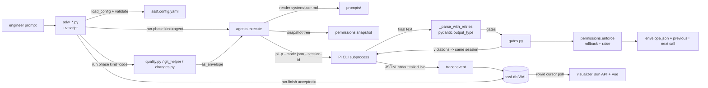

# IndyDevDan — Super Simple Software Factory (SSSF): technical deep dive

> Repository: https://github.com/disler/super-simple-software-factory (whole repo; the product is the `.claude/skills/sssf/` subfolder) · Evaluated commit: de31374882e7a4e3e5b7bb9bd09e69dc2f779356 (2026-08-02 12:57:38 -0500) on main
> Other branches inspected: `example` @ b2dcb8e436db9b10f7580d7568b3e251609eb36b (2026-08-04) · License: MIT (`LICENSE`, "Copyright (c) 2026 IndyDevDan")
> Accessed: 2026-10-22 · Method: read-only shallow clone; no code executed
> Legend: [F] verified fact · [I] inference · [C] unverified claim · [U] unknown

Path abbreviations used in citations (all relative to the repo root at the evaluated commit):

- `S/` = `.claude/skills/sssf/`
- `M/` = `.claude/skills/sssf/templates/adws/adw_modules/`
- `A/` = `.claude/skills/sssf/templates/adws/` (the stamped ADW scripts)
- `P/` = `.claude/skills/sssf/templates/prompt_engineering/`
- `ex:` prefix = a path on the `example` branch

---

## 1. Summary

SSSF is a single Claude Code skill (`sssf`) that "stamps" a small Python workflow framework into any target repository [F] (`S/scripts/install.py:69-82`). Its central thesis is "code owns sequencing, retries and acceptance; the agent owns only the work inside one bounded phase" (`README.md:33`). Every run is an **ADW** (AI Developer Workflow), a thin `uv` single-file Python script that opens phases with a context manager, calls coding agents for typed JSON "envelopes", verifies those envelopes with post-hoc "gates", runs known commands (tests/lint) as deterministic code phases, and commits with git [F] (`A/adw_simple_sdlc.py:61-174`, `M/runner.py:72-111`). Every event is written live to a WAL SQLite trace database that a bundled Vue/Bun visualizer polls [F] (`M/tracer.py:17-113`, `S/apps/visualizer/server/index.ts:113-199`). The v1 coding agent is the third-party **Pi** CLI only; the Claude Code adapter is a stub that raises `NotImplementedError` [F] (`M/agent_cc.py:11-15`). The audience is engineers who want repeatable, observable agent pipelines inside their own repo and are willing to edit Python; the README explicitly calls it "a starting point, not a product" (`README.md:375`).

Maturity: a squashed single-commit repo per branch (main 2026-08-02, example 2026-08-04), no tags/releases, no CI workflows, no automated tests for the factory itself, 12 issues/PRs open of 20 (GitHub API, accessed 2026-10-22: 999 stars, 264 forks) [F]. Several internal inconsistencies show the code moved faster than its generators and docs (§7, §16).

**Category:** deterministic orchestration pipeline (primary) · skill/agent pack (secondary — one skill plus five agent prompt pairs) · skill/agent generator (minor — `make_adw.py`, `make_config.py`).

---

## 2. Architecture

### Components

| Layer | What | Where |
|---|---|---|
| Distribution | One Claude Code skill: `SKILL.md` (hard rules + routing), 9 cookbooks, 3 references, 3 scripts, templates, visualizer app | `S/` |
| Installer | Copies templates into cwd, idempotent unless `--force`, appends `.gitignore` entries | `S/scripts/install.py:23-97` |
| Workflow scripts (12) | `adw_*.py` — sequencing + acceptance only | `A/adw_*.py` |
| Core library | `runner.py` (Run, phase CM, finish), `agents.py` (config, validate, execute, parse/gate loops), `agent_pi.py` (Pi subprocess adapter), `permissions.py` (write-boundary enforcement), `gates.py`, `quality.py`, `changes.py`, `git_helper.py`, `tracer.py`, `console.py`, `session.py`, `prompts.py`, `data_types.py`, `utils.py` | `M/` |
| Agent roster | YAML: defaults + 5 agents (model, thinking, tools, writes, prompt paths, Pi extensions) | `S/templates/sssf.config.yaml:1-143` |
| Prompts | `system.md` + `user.md` per agent (planner, builder, scout, reviewer, documenter) | `P/*/` |
| Harness extensions | Pi TypeScript extension that registers `subagent_create/_continue/_list/_remove`; theme helper | `S/templates/harness_engineering/subagents.ts`, `themeMap.ts` |
| Observability | SQLite (7 tables) + per-session JSONL; Bun JSON API (:4600) + Vite/Vue UI (:4601) | `M/tracer.py`, `S/apps/visualizer/` |

### Data flow

### Tech stack and dependencies

- Python 3 via `uv run` PEP 723 inline-script metadata; dependencies `pydantic`, `python-dotenv`, `pyyaml`, `rich` — **unpinned** (no versions) [F] (`A/adw_simple_sdlc.py:2-4`).
- External CLIs: `pi` (Pi coding agent, `@mariozechner/pi-coding-agent`), `git`, `sqlite3`, optional `just`, optional `bun` [F] (`README.md:61`, `M/agent_pi.py:22`).
- Visualizer: Vue `^3.5.13`, Vite `^7`, `lucide-vue-next ^1.0.0`, `@fontsource/play ^5.3.0`, oxlint `^1`, vue-tsc `^3`; a `bun.lock` is committed, so a `bun install` against the lock is reproducible [F] (`S/apps/visualizer/package.json:16-28`, `S/apps/visualizer/bun.lock`). `just obs` runs `bun install` (not `--frozen-lockfile`) [F] (`S/templates/justfile:88-89`).
- Models (starter roster): `google/gemini-3.6-flash` default (served via OpenRouter), `fireworks/.../kimi-k3` planner, `openai/gpt-5.6-terra` reviewer, `openai/gpt-5.6-luna` documenter [F] (`S/templates/sssf.config.yaml:5,41,107,125`). Example branch adds a "frontier" roster with `anthropic/claude-opus-5` default [F] (`ex:adws/adw_sssf_config/sssf.frontier.config.yaml:15`).
- External services: whichever LLM providers Pi resolves; keys come from `.env` / Pi's `~/.pi/agent/models.json` [F] (`S/templates/env.sample:1-23`).

---

## 3. Agents

All five are Pi sessions spawned by `M/agent_pi.py:run` with `--system-prompt`, `--tools`, `-e <extension>` and `--session-id` [F] (`M/agent_pi.py:218-230`). Write boundaries (`writes:`) are enforced post-hoc by `M/permissions.py` (§8). Output types are bound at call sites, not in config [F] (`S/cookbooks/update_config.md:101`).

| Agent | Prompt files | Model / thinking (starter) | Tools | `writes` | Output type | Purpose |
|---|---|---|---|---|---|---|
| planner | `P/planner/system.md`, `user.md` | kimi-k3 / high | read, grep, find, ls, bash, write, subagent_* (4) | `specs/` | `PlanOutput` (`commit_message`) | Write `plan.md` to `context_handoff/`, copy to `specs/<adw_id>_<slug>.md`; may fan out subagents (`P/planner/system.md:17-21`, `P/planner/user.md:21-29`) |
| builder | `P/builder/*` | gemini-3.6-flash / medium (inherited) | all seven builtins | none (unrestricted except `protected_files`) | `BuildOutput` (`changed_files`, `commit_message`) | Implement plan or fix failures (`P/builder/system.md:9-13`) |
| scout | `P/scout/*` | inherited | read, grep, find, ls, bash, write, subagent_* | `[]` (repo read-only) | `ScoutOutput` (`findings[]`) | Read-only recon; writes `scout_findings.md` to handoff dir (`P/scout/system.md:9-14`) |
| reviewer | `P/reviewer/*` | gpt-5.6-terra / high | read, grep, find, ls, bash, write | `[]` | `ReviewOutput` (`approved`, `findings[{requirement,met,evidence}]`, `blocking[]`) | Rule on each requirement vs `plan.md` or prompt, from code on disk (`P/reviewer/system.md:9-14`) |
| documenter | `P/documenter/*` | gpt-5.6-luna / (inherited medium) | read, grep, find, ls, bash, write, edit | `app_docs/`, `docs/`, `**/*.md`, `*.md` | `DocumentOutput` (`document_path`, `documented_files`, `commit_message`) | Write-up from captured diff; copy to `app_docs/` (`P/documenter/user.md:19-30`) |

Config sources: `S/templates/sssf.config.yaml:40-143`. There is deliberately **no tester agent**: running the suite is a `kind="code"` phase (`S/templates/sssf.config.yaml:103-104`, `S/SKILL.md:70`) [F].

**Subagents (inside planner and scout).** `subagents.ts` spawns background `pi --mode json -p --no-extensions --tools read,bash,grep,find,ls` children with persistent session files under `~/.pi/agent/sessions/subagents/`, defaulting to the parent's model (fallback `openrouter/google/gemini-3.5-flash`), and returns results to the parent as a follow-up message truncated at 8,000 chars [F] (`S/templates/harness_engineering/subagents.ts:27,122-126,216-241,283-287`). These children are not recorded in the `processes` table and their tool calls are not traced into `sssf.db` [F] (no tracer call in `subagents.ts`; `processes` rows are written only from `M/session.py:46` and `M/agents.py:130-133`). Subagents get `bash`, so the scout's "read-only" contract for them rests on the prompt plus the parent-phase permission snapshot [I] (`P/scout/system.md:18`).

**Orchestrator role (not an ADW agent).** The skill itself makes the host agent (Claude Code, or Pi via the example `justfile`) an *orchestrator* that must "do no ADW work yourself", only launch, observe via SQL, and report [F] (`S/SKILL.md:36-43`, `S/cookbooks/run_adw.md:9-11`).

---

## 4. Skills, commands and prompts

| Item | File | Trigger | What it does / notable structure |
|---|---|---|---|
| `sssf` skill | `S/SKILL.md` | `/sssf install`, create/run/update ADW, roster, observe (frontmatter `description`, `S/SKILL.md:3`) | Startup is three steps then STOP: read overview, `ls adws/adw_*.py` + `Phases:` lines, print table, wait (`S/SKILL.md:11-34`). Includes an explicit anti-pattern story about an orchestrator that invented a `runs` table (`S/SKILL.md:28`). Routing table to 9 lazily loaded cookbooks (`S/SKILL.md:45-58`). 10 hard rules (`S/SKILL.md:60-72`). |
| `sssf_overview.md` | `S/cookbooks/` | read at startup | System map + "do not survey anything else" (`S/cookbooks/sssf_overview.md:67-71`) |
| `install.md` | `S/cookbooks/` | install | Run `install.py`, post-install checklist (`:36-56`) |
| `create_adw.md` / `update_adw.md` | `S/cookbooks/` | compose/modify chains | Four design questions, ownership rules, canonical skeleton, bounded fix-loop pattern (`create_adw.md:5-104`, `update_adw.md:47-80`) |
| `create_config.md` / `update_config.md` | `S/cookbooks/` | roster | Schema, tool resolution, "extension tools must be named in `tools`" (`update_config.md:59,70-85`) |
| `update_modules.md` | `S/cookbooks/` | extend library | Module ownership table, four-param rule, gate authoring rules (`:9-96`) |
| `how_to_prompt_for_the_eng.md` | `S/cookbooks/` | read **before every launch** | Translate the engineer's ask into a 4-line prompt (ask / Where / Done means / Out of scope); chain-selection heuristic "the more complex the ask, the more complete the chain" (`:29-38,57-83`) |
| `run_adw.md` | `S/cookbooks/` | run/monitor | Launch in background, poll SQL on a rowid cursor, stuck-run procedure, roster selection rules (`:13-122`) |
| References | `S/references/config.md`, `handoff.md`, `observability.md` | lazy | Full schema, envelope/session layout, event/table/polling contract |
| Generators | `S/scripts/make_adw.py`, `make_config.py` | `uv run` | `make_adw` emits a linear chain of agent phases from `--agents a,b`; `make_config` copies the starter roster |
| Agent prompt pairs | `P/<agent>/system.md` + `user.md` | rendered per call | `system.md` = Purpose + Instructions (static identity); `user.md` = `### prompt`, `### previous_envelope`, `### context_handoff_dir`, `## Task`, `## Report` (exact JSON) (`S/references/handoff.md:90-129`). Placeholders replaced by plain string substitution (`M/prompts.py:8-12`). |
| `/prime` command (example only) | `ex:.claude/commands/prime.md` | `/prime` | Orientation walk-through of the stamped repo (`:9-23`) |

Notable prompt-engineering details [F]:
- "Copy it, do not retype it": the planner and documenter are told to `cp` the handoff file into the repo instead of re-emitting it, explicitly to save output tokens (`P/planner/user.md:26-28`, `P/documenter/user.md:27-29`).
- Collision-safe naming: "List `specs/` before you pick the name … `_v2`, `_v3`" (`P/planner/user.md:23-25`).
- "Judge any command by its exit status, never by scanning output for words" (`P/planner/system.md:14`, `P/reviewer/system.md:16`).
- The reviewer distinguishes `status` (review ran) from `approved` (verdict) (`P/reviewer/user.md:44`).

---

## 5. Orchestration and execution workflows

**Execution model: deterministic code-driven.** Each ADW is straight-line Python with explicit `for` loops; the LLM never chooses the next step [F] (`A/adw_simple_sdlc.py:78-174`). LLM judgement is confined to inside agent phases. The *orchestrator* (Claude Code running the skill) is LLM-driven but only selects which ADW to launch and writes the prompt (`S/cookbooks/how_to_prompt_for_the_eng.md:57-83`) — so the overall system is hybrid at the outermost layer, deterministic below it [I].

**Phase primitive.** `Run.phase(PhaseParams)` is one context manager for `engineer`/`agent`/`code` kinds; status starts `fail`, flips to `success` only on clean exit; any exception records `error`+`phase_end`, finalizes the session as failed, and re-raises (aborting the ADW) [F] (`M/runner.py:72-111`, `M/data_types.py:63`). `PhaseParams` rejects blank descriptions or ones that merely restate the name at construction time [F] (`M/data_types.py:31-53`).

**Two-criteria completion.** `run.finish(accepted=..., reason=...)` returns exit code 0 only if all phases succeeded **and** the ADW's acceptance predicate holds, and writes db status + banner in one call [F] (`M/runner.py:114-142`). The docstring records the bug it replaced (a `succeeded` property that marked red-suite runs green in the db) (`M/runner.py:122-129`).

**Retries and recovery** [F]:
- JSON repair: up to `JSON_FIX_ATTEMPTS = 2` re-prompts into the *same* Pi session, naming the required fields (`M/agents.py:24,267-287`).
- Gate corrections: violations sent back into the same session, bounded by `PhaseParams.retries` (default 0) (`M/agents.py:147-173`, `M/data_types.py:29`).
- Bounded fix/revise loops are written in each ADW: `MAX_FIX_LOOPS = 3`, `MAX_REVISION_LOOPS = 2` or `3` (`A/adw_simple_sdlc.py:53-54`, `A/adw_build_review.py:30`).
- Permission breaches are *not* retried: rollback then raise (`M/permissions.py:23-25,163-185`).
- No timeout on the Pi subprocess; a hung agent must be killed manually via the `processes` table [F] (`M/agent_pi.py:243-281`; `S/cookbooks/run_adw.md:104-116`). Signals SIGTERM/SIGINT are converted to `SystemExit` so the trace finalizes as `fail` [F] (`M/session.py:21-35`).
- No budget/cost/turn ceiling anywhere [F] (grep for `budget|max_cost|max_tokens` in `A/` returns nothing; usage is only accumulated, `M/agents.py:134-135`, `M/runner.py:66-69`). Issue #13 (community, [C]) reports a single run spending 30,026,269 tokens / $182.83.

**Concurrency.** Phases run strictly sequentially in one process [F]. The only parallelism is Pi subagents inside planner/scout phases (fire-and-forget background processes, `S/templates/harness_engineering/subagents.ts:335-337`). Multiple ADWs may write the same db concurrently (WAL + `busy_timeout=5000`, `M/tracer.py:109-111`), but they share one working tree, so the permission snapshot would attribute another run's edits to the current agent [I].

**Human approval gates.** None. The `engineer` lane is input capture only; README states "no human-in-the-loop approval phase" [F] (`README.md:390`, `A/adw_simple_sdlc.py:78-80`). The orchestrator may ask "at most one question" before launch (`S/cookbooks/how_to_prompt_for_the_eng.md:91`).

### Traced path 1 — `adw_prompt.py` (smoke test)

1. `uv run adws/adw_prompt.py "<prompt>" --agent scout` → `utils.resolve_prompt` returns file contents if the arg is a path, else the text (`A/adw_prompt.py:37-44`, `M/utils.py:55-63`).
2. `agents.load_config` merges defaults into each agent (`coding_agent, model, thinking, color, tools, writes`, plus `harness_engineering`) and builds `SSSFConfig` (`M/agents.py:33-41`).
3. `agents.validate(cfg, ["scout"])`: agent exists, `coding_agent == "pi"`, both prompt files exist, model resolves uniquely in `pi --list-models` (`M/agents.py:52-73`, `M/agent_pi.py:43-90`). Note `resolve_model` shells out to `pi` during validation.
4. `session.ensure`: mint 8-hex `adw_id`, open `Tracer` (WAL, schema, additive migrations), insert `sessions` row, record the ADW pid in `processes`, install signal handlers (`M/session.py:38-50`, `M/tracer.py:103-120`).
5. `run.phase(request, engineer)` → `ph.log(input=...)` writes a `log` event and `sessions.request` (`M/runner.py:27-34`).
6. `run.phase(prompt, agent, owner=scout)` → `ph.call(AgentCall(GenericOutput))` → `agents.execute` (`M/runner.py:36-39`, `M/agents.py:78`):
   - render `system.md`/`user.md` with `{{prompt}}`, `{{previous_envelope}}="(none)"`, `{{context_handoff_dir}}`; save copies to `sessions/<id>/scout/prompts/` (`M/agents.py:84-92`);
   - session id from `agent_map.json` if the model matches, else `sssf-<adw>-scout-<4hex>` (`M/agents.py:228-232`);
   - `permissions.snapshot` (git diff HEAD --numstat + untracked) (`M/permissions.py:50-68`);
   - `agent_pi.run`: spawn `pi -p --mode json --provider … --model … --thinking … --session-id … --session-dir … --system-prompt … --tools … [-e ext] <prompt>` with `stdin=DEVNULL`, cwd = repo root, env = operator env minus the uv venv; tail stdout line by line into `raw_output.jsonl` and `ToolCallTracker` → one `tool_call` event per completed call; last assistant text and usage/cost accumulated (`M/agent_pi.py:208-286`, `M/agents.py:235-250`, `M/utils.py:16-38`);
   - `_parse_with_retries` → `GenericOutput.model_validate` (`M/agents.py:267-287`); no gates for this ADW;
   - `permissions.enforce` (scout `writes: []` → any repo change is rolled back and raises) (`M/agents.py:178-186`);
   - persist `envelope.json` + `envelopes` row, `agent_sessions` row, `agent_map.json`, `handoff` + `agent_end` events; raise if `status != "success"` (`M/agents.py:192-216`).
7. `run.finish()` → exit 0/1; db status and banner set together (`M/runner.py:114-142`).

Outputs: `adws/adw_data/sessions/<adw_id>/{agent_map.json, events.jsonl, context_handoff/, scout/{prompts/, pi_sessions/, raw_output.jsonl, envelope.json}}` and rows in 7 tables (`S/references/handoff.md:131-142`).

### Traced path 2 — `adw_simple_sdlc.py` (full chain)

1. Validate `planner, builder, reviewer, documenter`; ensure session; pin `baseline = git rev-parse HEAD` before any commit (`A/adw_simple_sdlc.py:52,62-65`).
2. `plan` (agent/planner): `PlanOutput` with gates `artifacts_exist`, `files_non_empty` (`:82-85`; `M/gates.py:27-44`).
3. `commit_plan` (code/git): `git add -A`, raise if nothing to commit, `git commit -m <planner's commit_message or fallback>` (`:87-89`; `M/git_helper.py:43-53`).
4. `build` (agent/builder), `previous=plan` → the plan envelope JSON is injected into `{{previous_envelope}}`; gate `diff_matches_claims` (`:91-94`).
5. Loop `i=1..3`: `test_i` (code/quality) runs `quality.run_tests` → subprocess argv with timeout, log to `context_handoff/quality/<seq>_test/command.log`, `tool_call` event; on red, `fix_i` (agent/builder, `retries=1`) with `previous=quality.as_envelope(test)` carrying the verbatim output tail (≤4,000 chars) (`:96-112`; `M/quality.py:62-132,177-211`). Note: after `fix_3` the loop ends without a fourth test, so `fix_3` is not tested directly; it is checked only if a review rejects, a revision follows and a later approval triggers `retest` (`:133-138`), which can set `test.passed` and so `verified` true; otherwise `verified` stays false [F] (`:97-112,133-138,143-144`).
6. Loop `i=1..2`: `review_i` (agent/reviewer) with gates `artifacts_exist`, `verdict_consistent` (approval cannot coexist with blocking items or unmet findings; rejection must name a problem); if rejected and loops remain, `revise_i` (builder, `previous=review`) (`:114-129`; `M/gates.py:71-95`).
7. If a revision happened and review approved → `retest` (`:133-138`).
8. `verified = test.passed and review.approved`; only then `commit_build` → `changes.capture(base=baseline)` writes `context_handoff/changes.diff` (truncated at 2,000 lines, untracked files listed) → `document` (agent/documenter, `previous=changes.as_envelope`) → `commit_docs` (`:143-171`; `M/changes.py:24-103`).
9. `run.finish(accepted=verified)` (`:173-174`). A failed verification leaves the plan committed and code uncommitted, by design (`:33-37`).

---

## 6. Context and state management

- **Context construction.** Per call: system prompt file + user template with three placeholders (`M/agents.py:84-90`). Cross-agent context moves through (a) the previous envelope JSON inlined into the next prompt and (b) files in a single per-session `context_handoff/` directory referenced by path [F] (`S/references/handoff.md:5-12`). Code-produced results are adapted into the same envelope shape (`VerifyOutput`, `ChangesOutput`) so consumers cannot tell code from agent output [F] (`M/data_types.py:222-247`, `M/quality.py:193-211`, `M/changes.py:87-103`).
- **Compression/bounding.** Diff truncated at `max_diff_lines=2000` (`M/data_types.py:181`, `M/changes.py:60-66`); quality output tail 4,000 chars (`M/quality.py:46`); tool args/results clipped at 20,000 chars in traces (`M/agent_pi.py:26-27`); subagent results truncated at 8,000 chars (`subagents.ts:285`). No summarisation or compaction is done by SSSF itself; Pi's own auto-compaction is acknowledged (`S/references/observability.md:36-38`) [F].
- **Agent memory across calls.** Same `--session-id` = same Pi context window ("create-or-continue") [C — Pi behaviour, not verifiable here] (`M/agent_pi.py:3-6`). `agent_map.json` maps agent → session id + model, so a later ADW run with `--adw-id` resumes each agent's conversation; a model change forces a fresh session [F] (`M/agents.py:228-232`, `M/runner.py:56-63`).
- **Persistent state.** Files are the raw record (`raw_output.jsonl`, `envelope.json`, `prompts/`, `agent_map.json`, per-session `events.jsonl`); SQLite is the queryable mirror [F] (`M/tracer.py:123-136`). The docs claim the db can be rebuilt from files (`S/references/handoff.md:161`) — no rebuild tool exists in the repo [F: not found].
- **Resumability.** Joining a session continues the phase sequence (`max_phase_seq`) and the agents' contexts (`M/tracer.py:206-216`, `M/runner.py:52`), but there is no phase-level checkpoint/skip: re-running an ADW re-executes from its first phase [F]. Chaining is manual: `adw_plan.py` then `adw_build_test.py --adw-id X` (`README.md:333-336`).
- **Handoff artifacts in the repo.** `specs/<adw_id>_<slug>.md` (plan) and `app_docs/<adw_id>_<slug>.md` (write-up), committed by the chain [F] (`P/planner/user.md:22-28`, `P/documenter/user.md:23-28`; examples in `ex:specs/`, `ex:app_docs/`).
- **Orchestrator context economy.** The skill forbids preloading state at startup and lazy-loads one cookbook per request (`S/SKILL.md:26-32`, `S/cookbooks/sssf_overview.md:67-71`).

---

## 7. Engineering practices and testing

- **Factory tests: none.** No `test_*.py`, no pytest config, no CI workflows (GitHub API: 0 workflows) [F]. The visualizer has `typecheck` (vue-tsc) and `lint` (oxlint) npm scripts, not wired to CI [F] (`S/apps/visualizer/package.json:7-14`, `.oxlintrc.json`).
- **Typing.** Pydantic models for every data contract (config, envelopes, calls, events, usage) [F] (`M/data_types.py`). Config models use Pydantic defaults (no `extra="forbid"`), so unknown config keys are silently ignored [F] (`M/data_types.py:304-349`; corroborated by issue #13 [C]).
- **Conventions enforced in code.** Four-param rule (documented, not linted) (`S/SKILL.md:66`); phase descriptions validated (`M/data_types.py:31-53`); "never `print()`" — all console output also becomes a `log` event via one `_emit` (`M/console.py:40-46`).
- **Eval suites for prompts/agents: none.** There is no scenario suite, golden set or LLM-judge for the five agents [F: not found].
- **Verification applied to produced software** [F]:
  - deterministic tests/lint/typecheck/build via `quality.py` — but they ship as `echo` placeholders that exit 0, so a fresh install's test phase is always green until the user edits them (`M/quality.py:49-52,138-174`; acknowledged `README.md:356,383`);
  - post-hoc gates on envelope claims (`M/gates.py`), notably `diff_matches_claims` only checks that claimed files **exist**, not that they changed (`M/gates.py:61-68`; issue #6 [C] reports a 3-file claim passing on a 5,222-file commit);
  - an independent **reviewer agent** (different model from the builder in the starter roster) that judges code on disk against the plan (`P/reviewer/system.md:9-14`) — independent model, but no independent execution;
  - `verdict_consistent` makes the review envelope internally coherent (`M/gates.py:71-95`).
- **Defects found by static reading** (not executed):
  1. `make_adw.py`'s template ends with `return 0 if run.succeeded else 1` (`S/scripts/make_adw.py:55`), but `Run.succeeded` no longer exists (`M/runner.py:122-129` documents its replacement). Generated ADWs would raise `AttributeError` at the end [F/I].
  2. `make_adw.py` emits `dependencies = ["pydantic", "python-dotenv", "pyyaml"]` (`S/scripts/make_adw.py:25`) while `console.py` imports `rich` (`M/console.py:10-13`) → generated scripts likely fail at import under `uv run` isolation [I].
  3. On the `example` branch, `quality.py` renames `run_tests`/`run_quality` to `run_inkwell_tests`/`run_inkwell_quality` (`ex:adws/adw_modules/quality.py:198,223`) while the stamped ADWs still call `quality.run_tests` / `quality.run_quality` (`ex:adws/adw_simple_sdlc.py:101,137`, `ex:adws/adw_quality.py:33`, `ex:adws/adw_build_test.py:56`, `ex:adws/adw_plan_build_test.py:56`, `ex:adws/adw_plan_build_test_quality.py:58`) → those five ADWs would raise `AttributeError` on the example branch as committed [F/I].
  4. `context_window()` reads `~/.pi/agent/models.json` unconditionally before its catalog fallback (`M/agent_pi.py:108-117`) → `FileNotFoundError` on installs without that file [F/I]; matches issue #5 / PR #4 [C].
  5. Design limitation rather than a defect: `adw_plan_build_test_quality.py` breaks at `i == MAX_FIX_LOOPS` before a fix, so 3 verifies and only 2 fixes run despite `MAX_FIX_LOOPS = 3`, which ensures every fix gets verified; and it sets `test_result = quality_result`, deliberately folding tests into the quality run as the comment explains (`run_quality()` "already includes the test block", `:61-62`), which leaves the separate test branch unused (`A/adw_plan_build_test_quality.py:55-78`) [F].
  6. `gates.tests_pass` uses `shell=True` with no cwd (`M/gates.py:101`), contradicting the "argv list, never a shell string" rule in `M/quality.py:23` [F].
  7. `agent_pi.run` reads stderr only after stdout closes (`M/agent_pi.py:251,280`), a classic pipe-deadlock pattern if a child writes more than the pipe buffer to stderr [I].
- **Doc drift** [F]: `S/SKILL.md:76` says the visualizer "ships in a later pass" (it ships); `S/SKILL.md:65` still describes gates as returning `list[str]` (now `GateReport`, `M/gates.py:3`); `install.py:10-11` says "4 starter agents" (5 ship); `create_adw.md:9` says "starter six"; `install.md:38` says only `OPENROUTER_API_KEY` is needed while the starter roster needs three keys (`README.md:91-97`); `observability.md:28,134` documents `parent_id` span nesting and a `queued` status that no producer ever writes (grep: `parent_id` is only defaulted to `""`, `M/data_types.py:362`; `queued` appears only in the type literal, `M/data_types.py:17`); `run_adw.md:30,111` references `just rosters` / `just kill`, which exist only in the example branch's justfile (`ex:justfile:88,122`), not the stamped starter (`S/templates/justfile:5`).

---

## 8. Security, isolation and observability

**Permission model.**
- `tools:` maps to `pi --tools` (capability allowlist) [F] (`M/agent_pi.py:226-227`). Every starter agent has `bash` [F] (`S/templates/sssf.config.yaml:52-142`).
- `writes:` + `defaults.protected_files` are enforced **after** the agent finishes, by diffing `git diff HEAD --numstat` + untracked files before vs after, rolling back introduced unauthorized changes (`git checkout --` / unlink) and raising `PermissionBreach` [F] (`M/permissions.py:50-185`). Protected by default: `adws/adw_modules/`, `adws/adw_sssf_config/`, `adws/adw_*.py` — "an agent must not be able to edit the machinery that grades it" (`M/data_types.py:332-337`). This was motivated by an observed builder running `git checkout adws/` (`M/permissions.py:6-8`).
- Limits of that enforcement [I, from the algorithm]: it sees only paths git reports, so (a) gitignored paths — including `.env`, which `install.py` gitignores (`S/scripts/install.py:26`) — and anything outside the repo (e.g. `~`) are invisible; (b) an agent that runs `git commit`/`git stash` moves the change out of `git diff HEAD`, so before/after look identical; (c) an edit to an already-dirty file that leaves numstat counts unchanged is not detected; (d) detection is after the fact — network calls, secret reads and external side effects are not prevented. The README names the gap: "no sandbox, no branch per run, no merge step" (`README.md:367,390`).
- Commit phases use `git add -A`, committing the **entire** working tree, including any pre-existing uncommitted operator work [F] (`M/git_helper.py:49`; issue #6 [C] makes the same point).
- Agents inherit the operator's full environment ("their PATH, toolchains and credentials are already live") [F] (`M/utils.py:16-38`, `P/builder/system.md:12`).
- The example branch's `just cc` launches the orchestrator with `claude --dangerously-skip-permissions` [F] (`ex:justfile:30-31`), and its recipes run through an interactive `zsh -ic` (`ex:justfile:15`).

**Sandboxing/containers/worktrees.** None; runs on the current branch in the live checkout [F] (`README.md:367`).

**Network and secrets.** Keys in `.env` loaded by `python-dotenv` at import (`M/utils.py:11-13`) and by `just` (`S/templates/justfile:8`); `.env` gitignored by the installer (`S/scripts/install.py:26`) [F]. The Bun API binds with `Bun.serve({port})` and no `hostname` (`S/apps/visualizer/server/index.ts:113-115`) — Bun's default listen address is typically all interfaces, which would expose prompts, envelopes and the archive POST on the LAN [I, Unverified (not executed)]. The server validates path segments with `^[A-Za-z0-9._-]+$` and a resolved-prefix check before reading prompt files (`server/index.ts:63-67,167-179`) and opens the db read-only except a lazy writer for `archived` (`server/db.ts:77,143`) [F]. UI rendering escapes all input before producing HTML, links restricted to http(s) (`src/lib/markdown.ts:1-29`) [F].

**Supply chain.** Unpinned Python deps in every ADW header (`A/*.py:3`); Pi is an external npm CLI with no pinned version in the repo; the subagent extension spawns bare `pi` from `PATH` regardless of `PI_PATH` (`subagents.ts:229`); oxlint pinned to `1.36.0` only on the example branch (`ex:adws/adw_modules/quality.py:22`); visualizer deps caret-ranged but lockfile committed [F]. No `curl | sh` installers [F].

**Prompt-injection exposure.** Agents read arbitrary repo content with `bash` and full operator credentials, and envelopes from one agent are inlined verbatim into the next agent's prompt (`M/agents.py:84-90`) — a poisoned file or envelope can steer downstream agents; the only structural mitigations are post-hoc write boundaries and typed parsing [I]. Repository content addressed to an AI: `S/SKILL.md`, the cookbooks, `ex:.claude/commands/prime.md` and the justfile prompt "Read and Execute .claude/skills/sssf/SKILL.md" (`ex:justfile:31`) are operating instructions for an orchestrator agent, consistent with the stated purpose; none attempt to override safety rules, exfiltrate data or hide behaviour. No prompt-injection content found [F, by reading all `.md` files on main and the example additions listed in §17].

**Secrets in the repo.** None found; `S/templates/env.sample` has empty values (`:21-23`); a regex sweep for common key formats found only a false positive in a comment (`themeMap.ts:38`) [F].

**Observability (strong point)** [F]:
- 7 tables (`sessions, phases, events, envelopes, gate_results, processes, agent_sessions`) with additive migrations (`M/tracer.py:17-120`).
- 10 event types; tool calls folded from Pi's three raw events into one row with real start/end span (`M/agent_pi.py:141-205`).
- Gates record evidence per item (`checks_json`), not just pass/fail (`M/data_types.py:252-283`, `M/tracer.py:241-249`).
- Per-phase cost/usage itemised (input/output/cache read/cache write/reasoning), summed across retries; context *occupancy* tracked separately from spend (`M/data_types.py:388-433`, `M/agents.py:106-111,204-212`).
- Process registry (adw → pids) for killing hung runs; signal-finalized traces (`M/tracer.py:173-203`, `M/session.py:21-35`).
- Polling-only transport: `select … where rowid > ?` (`S/references/observability.md:148-158`); UI = `S/apps/visualizer/`.
- Exact prompts saved before execution (`M/prompts.py:15-21`, `M/agents.py:91-92`).

---

## 9. Efficiency

- **Code instead of agents for known commands** — the central efficiency rule: tests, lint, typecheck, build, git diff, commit are code phases (`S/SKILL.md:70`, `M/quality.py:1-6`). The example's comment records "An agent rediscovering `bun test` on every run cost ~1M tokens and 85s" (`ex:adws/adw_modules/quality.py:186-187`) [C].
- **Per-agent model routing** — each agent has its own model and thinking level; ADWs name agents, never models; whole-roster swap with `--config` (`README.md:145-181`, `ex:adws/adw_sssf_config/sssf.frontier.config.yaml:1-12`) [F].
- **Correction over restart** — JSON/gate failures continue the same session rather than cold-starting (`M/agents.py:106-173`) [F]. Counter-evidence: each send is a fresh `pi -p` process replaying the stored session, and issue #13 [C] reports full-history cache rewrites per turn and billed retries into an exhausted session.
- **Output-token savings in prompts** — `cp` handoff files instead of rewriting (`P/planner/user.md:26-28`).
- **Bounded evidence** — diff/output/arg truncation (§6).
- **Orchestrator context economy** — lazy cookbooks, no startup survey (`S/SKILL.md:26-32`).
- **Cost controls: none enforced** — usage is measured and displayed only (§5). No caching layer of its own.
- **Operational overhead** — requires `uv`, Pi + provider keys, `git`, `sqlite3`; `bun` and `just` optional; `resolve_model` shells out to `pi --list-models` (cached per process, `M/agent_pi.py:43-64`) [F].

---

## 10. Continuous improvement

- No automated self-improvement, eval-driven refinement, or learning loop for prompts or agents [F: not found].
- Improvement is designed to be **manual and evidence-driven**: the trace exposes per-phase cost, gate evidence, envelopes and exact prompts, and the README's stated loop is observe → edit one file (prompt, roster, gate, chain) → re-run (`README.md:108-114,377-388`) [F/C].
- Lessons are captured as **code comments** that narrate the incident that motivated each rule — e.g. the stdin hang (`M/agent_pi.py:237-242`), the `git checkout adws/` breach (`M/permissions.py:6-8`), committed `.pyc` files (`S/scripts/install.py:27-30`), the green-but-failed run (`M/runner.py:122-129`), the invented `runs` table (`S/SKILL.md:28`) [F]. This is a lessons-as-documentation practice, not a memory system.
- Same-db side-by-side comparison of cheap vs frontier roster runs is suggested (`ex:VALUE.md:60-61`) [C].

---

## 11. Reference-driven development and reverse engineering

Not applicable — SSSF has no mechanism for using existing projects as references, extracting specifications from other codebases, reconstructing UI, or measuring feature parity. The closest elements: the orchestrator's request-translation cookbook (`S/cookbooks/how_to_prompt_for_the_eng.md`) and the example README's claim that the demo app was "browser-validated through the factory" (`ex:README.md:462`) — there is no browser or screenshot tooling in the factory code; screenshots (`ex:images/07_inkwell_validated.png`, `ex:apps/inkwell/validation.png`) are referenced only as optional artefacts in a spec (`ex:specs/d140d7dd_inkwell-split-view-modes.md:424-425`) [F].

---

## 12. Innovations

1. **"Success must be earned" phase primitive with separate run acceptance.** Phases default to `fail`; the run's exit code, db status and banner come from one `finish(accepted=…)` call, separating "the runner worked" from "the result is acceptable" (`M/runner.py:72-142`). A red test suite is a *successful* test phase but an unaccepted run — a clean way to model verification steps.
2. **Code results adapted into agent envelopes.** `quality.as_envelope` / `changes.as_envelope` let deterministic output re-enter the agent repair loop through the same typed door (`M/quality.py:193-211`, `M/changes.py:87-103`), which makes swapping an agent step for a code step a local edit.
3. **Post-hoc write-boundary enforcement by change-set diff with selective rollback.** Detects reversions (a `git checkout` of dirty files) as modifications and refuses to roll back pre-existing operator work (`M/permissions.py:18-21,138-160`). A cheap, harness-agnostic guard against agents editing their own grader (`protected_files`).
4. **Evidence-carrying gates.** `GateReport.check(item, ok, note)` records what was verified on passes as well as failures; violations are derived and fed back as corrections into the same session (`M/data_types.py:252-283`, `M/agents.py:147-173`).
5. **Phase-description validator.** Rejects descriptions that restate the phase name, at construction time, so the trace always carries intent (`M/data_types.py:31-53`).
6. **Live, polling-only trace with tool-call folding and occupancy vs spend.** One cursor query serves live and historical views; three raw Pi events become one spanned `tool_call`; context occupancy is computed the way Pi computes it (`M/agent_pi.py:93-205`, `S/references/observability.md:34-46,148-158`).
7. **Per-agent commit authorship.** Plan, code and docs are committed separately, each with the producing agent's own `commit_message`, with fallbacks (`A/adw_simple_sdlc.py:16-20,67-70`).
8. **Orchestrator discipline in the skill.** Explicit "do nothing until asked", lazy cookbook routing, and a prompt-translation contract (`S/SKILL.md:11-43`, `S/cookbooks/how_to_prompt_for_the_eng.md:9-38`).

---

## 13. Reusable components

All MIT (`LICENSE`). Python components depend on Pydantic; agent execution depends on the Pi CLI.

| Component | Path | Kind | Dependencies | License | Security notes | Reuse class | Limits and compatibility constraints |
|---|---|---|---|---|---|---|---|
| Phase context manager + `finish(accepted)` | `M/runner.py` | library/pattern | pydantic, tracer, console | MIT | none specific | needs adaptation | Coupled to `Tracer`/`Console`/`agents`; sequential only |
| Typed envelope contracts + `PhaseParams` validator | `M/data_types.py` | library | pydantic | MIT | config models ignore unknown keys | directly reusable (types) / needs adaptation (Pi-specific `PiRequest`, `UsageBreakdown`) | Pi usage shape mirrored 1:1 |
| Parse-and-correct loop in same session | `M/agents.py:253-287` | pattern | a resumable agent CLI | MIT | re-prompts can bill no-op turns (issue #13 [C]) | reimplement the idea | Assumes "create-or-continue" session semantics |
| Evidence-carrying gates (`GateReport`) | `M/gates.py`, `M/data_types.py:252-283` | library/pattern | pydantic | MIT | `tests_pass` uses `shell=True`; `diff_matches_claims` checks existence only | needs adaptation | Relative paths resolved against process cwd |
| Post-hoc write-boundary enforcement | `M/permissions.py` | library | git | MIT | blind to gitignored/outside-repo paths and to agent `git commit`/`stash` | needs adaptation | Requires a git repo; not a sandbox |
| Deterministic quality blocks + `as_envelope` adapter | `M/quality.py` | library/pattern | subprocess | MIT | placeholders exit 0 until replaced | needs adaptation | Commands must be filled per repo |
| Change capture with reasoned base | `M/changes.py`, `M/git_helper.py` | library | git | MIT | none | directly reusable | Diff truncation at 2,000 lines |
| SQLite WAL tracer + schema + additive migrations | `M/tracer.py` | library | sqlite3 | MIT | stores full prompts/tool args (may contain secrets) | directly reusable | Single-writer-per-run assumptions |
| Pi JSONL stream adapter + `ToolCallTracker` | `M/agent_pi.py` | library | Pi CLI | MIT | no subprocess timeout; inherits full env | needs adaptation | Pi event names (`message_end`, `tool_execution_*`) |
| Operator-env helper (strip uv venv) | `M/utils.py:16-38` | library | — | MIT | passes all credentials to children | directly reusable | Assumes `uv`'s `VIRTUAL_ENV` convention |
| Twelve ADW chain templates | `A/adw_*.py` | workflow | adw_modules | MIT | `git add -A` commits whole tree | needs adaptation | See §7 defects |
| Agent prompt pairs (5) | `P/*/` | prompt | — | MIT | none | needs adaptation | Report JSON must match the output type (synced triad) |
| Orchestrator skill + cookbooks | `S/SKILL.md`, `S/cookbooks/` | skill | the stamped factory | MIT | none | reference only / needs adaptation | Written for Pi v1; drift noted in §7 |
| Request-translation contract (4-line prompt) | `S/cookbooks/how_to_prompt_for_the_eng.md:29-55` | pattern | — | MIT | none | reimplement the idea | Minor internal tension (§16) |
| Subagent fan-out extension | `S/templates/harness_engineering/subagents.ts` | script (Pi extension) | Pi extension API, `@sinclair/typebox` | MIT | children get `bash`, untraced, not in process registry | reference only | Pi-specific API |
| Trace visualizer | `S/apps/visualizer/` | app | Bun, Vue 3, Vite 7 | MIT | default bind address [I]; archive POST unauthenticated | needs adaptation | Schema-coupled to `tracer.py` |
| Installer (idempotent stamp + drift report) | `S/scripts/install.py` | script | — | MIT | `--force` overwrites user prompts/config | directly reusable (pattern) | Copies into cwd |

---

## 14. Evidence against the value dimensions

**Engineering quality.** Demonstrated: a small, readable, strongly-typed core (≈2,500 lines of Python across the 15 modules in `M/`) with consistent conventions and unusually explanatory comments (§2, §7). Also demonstrated: no automated tests or CI for the factory, unpinned Python deps, generator and doc drift, and at least three code paths that would fail as committed (`make_adw.py`, example-branch `quality` renames, `context_window` without `models.json`) (§7). Claimed but not shown: the "honest edges" table is accurate for what it lists (`README.md:350-369`).

**Autonomy and orchestration.** Demonstrated: deterministic, code-owned chains with bounded fix/revise loops, same-session corrections, typed handoffs and a clear acceptance model (§5). Not present: parallel phases, branch/worktree isolation, budget limits, timeouts on agent calls, phase-level resume, or human approval phases (§5, §8). Orchestration autonomy is intentionally limited — the LLM orchestrator only launches and observes.

**Development productivity.** Demonstrated: twelve ready chains, a one-command installer, generators, justfile recipes and a trace UI (§2, §4). Claimed: the example branch's demo app was planned, built, tested, reviewed and documented by the factory (`ex:README.md:462`); supporting artefacts exist (10 specs, 9 app_docs, 4 request files, a 30-test suite in `ex:apps/inkwell/server.test.ts`) but the traces and per-agent commit history are not in git (sessions/db are gitignored, each branch is a single squashed commit), so the claim is only partly verifiable (§11, §16). The out-of-box test phase is a placeholder that always passes (§7).

**Security and reliability.** Demonstrated: post-hoc write boundaries with rollback, protected grader files, signal-safe trace finalization, path-segment validation and escaping in the UI (§8). Demonstrated gaps: no sandbox, full credential inheritance, `bash` for every agent, `git add -A` commits, enforcement blind spots, no subprocess timeout, no spend ceiling (§5, §8). Community issue #13 [C] reports a $182.83 single-run spend.

**Maintainability and adaptability.** Demonstrated: separation of identity (config/prompts) from use (call site), one-file changes for roster/prompt/gate/chain, harness swap point (`coding_agent`), additive db migrations (§3, §4, §8). Constraints: hard dependency on Pi in v1 (Claude Code adapter stubbed, `M/agent_cc.py`), the "synced triad" must be kept consistent by hand (`S/SKILL.md:64`), and stamped copies diverge from the skill once edited (`--force` overwrites everything, `S/cookbooks/install.md:34`).

**Resource efficiency.** Demonstrated: code phases for known commands, per-agent model routing, truncation of evidence, copy-not-retype prompts, per-phase cost/occupancy accounting (§9). Not demonstrated: any enforcement — budgets, caps or caching are absent; the efficiency claims about avoided tokens are anecdotal comments (§9).

---

## 15. Strengths and limitations

Strengths
- Clear control-plane split: code owns order, retries and acceptance; agents are typed nodes (`A/adw_simple_sdlc.py`, `M/runner.py`).
- Acceptance is modelled explicitly and consistently across db, console and exit code (`M/runner.py:114-142`).
- Deterministic steps reuse the agent envelope interface, making code/agent substitution cheap (`M/quality.py:193-211`).
- Strong, low-tech observability: WAL SQLite, polling cursor, folded tool calls, gate evidence, cost and occupancy per phase (§8).
- Graders protected from the graded agent by default (`M/data_types.py:332-337`, `M/permissions.py`).
- Orchestrator skill is disciplined about context: no startup survey, lazy cookbook loading (`S/SKILL.md:11-34`).
- Small enough to read in one sitting, as intended (`README.md:390`).

Limitations
- Pi-only in v1; Claude Code adapter is a stub (`M/agent_cc.py:11-15`).
- No sandbox, branch-per-run or merge step; runs in the live checkout with operator credentials (`README.md:367,390`; `M/utils.py:16-38`).
- No spend/timeout limits on agent calls (§5).
- `diff_matches_claims` does not look at the diff; commits stage the whole tree (`M/gates.py:61-68`, `M/git_helper.py:49`).
- No tests/CI for the factory; generators and example branch contain breaking inconsistencies (§7).
- Test phase is green by default until placeholders are replaced (`M/quality.py:49-52`).
- Subagents are untraced and outside the process registry (§3).
- Docs drift from code in several places (§7).

---

## 16. Claims vs verified ledger

| Claim (source) | Status | Evidence |
|---|---|---|
| "Deterministic Python owns the graph" (`README.md:4`) | verified | ADWs are straight-line Python; LLM never selects the next phase (`A/adw_simple_sdlc.py:78-174`) |
| "Agent proposes, code disposes" — commits done by code, not agents (`README.md:215`) | verified | `commit_all` in code phases (`A/adw_plan_build.py:41-44`); agents could still run `git commit` via bash, not prevented (§8) |
| Parse failures / gate violations re-prompt the same session, never restart (`README.md:245`) | verified (code) / not executable (Pi semantics) | `M/agents.py:147-173,267-287`; "create-or-continue" is Pi behaviour [C] |
| "Every phase defaults to fail" (`README.md:217`) | verified | `M/data_types.py:63`, `M/runner.py:88-111` |
| Unauthorized changes rolled back and the phase fails (`README.md:179,362`) | partly | Implemented for git-visible paths (`M/permissions.py:163-185`); blind to ignored/outside paths and agent commits [I] |
| Ten event types across seven tables (`README.md:259`) | verified | `M/tracer.py:17-90`; event types in `M/data_types.py:359` |
| "`parent_id` nests spans, so an agent phase expands into its own tool calls" (`README.md:259`) | not found | No producer sets `parent_id` (`M/data_types.py:362` default `""`) |
| Phase `queued` status for manifest-declared phases (`S/references/observability.md:134`) | not found | Only in the type literal (`M/data_types.py:17`); no manifest exists |
| "Losing the db loses nothing you cannot rebuild" (`README.md:269`) | partly | Raw files exist; no rebuild tool in repo |
| "Re-running install.py is safe … doubles as a drift check" (`README.md:83`) | verified | Skips existing files and reports them (`S/scripts/install.py:43-45,88-89`) |
| Twelve starter workflows; nine cookbooks (`README.md:131,289`) | verified | 12 `A/adw_*.py`; 9 files in `S/cookbooks/` |
| `make_adw.py` generates a runnable ADW (`S/cookbooks/create_adw.md:42-48`) | contradicted | Template uses removed `run.succeeded` and omits `rich` (`S/scripts/make_adw.py:25,55`) |
| `agents.validate()` fails fast on a bad config (`S/SKILL.md:62`) | verified | `M/agents.py:52-73`; does not check keys (acknowledged `README.md:101`) |
| "The visualizer app ships in a later pass" (`S/SKILL.md:76`) | contradicted | Visualizer is present (`S/apps/visualizer/`) |
| `just kill` verifies the recorded command still matches the pid (`S/references/observability.md:130`) | partly | Example justfile only checks the live command contains `pi`, `adw_` or `python` (`ex:justfile:131-133`); absent from starter justfile |
| `adw_simple_sdlc` lands three commits from three authors (`README.md:329`) | verified (code) / not executable | Three commit phases with per-agent messages (`A/adw_simple_sdlc.py:87-171`); git history squashed, cannot confirm a real run |
| Example branch: demo app "planned, built, tested, reviewed and documented" with "real traces" (`README.md:21,398`) | partly | Specs, app_docs, requests, app + 30 tests present; traces gitignored and absent (`ex:.gitignore:149-153`); history squashed |
| Example branch default roster is "Gemini 3.6 Flash across the board" (`ex:VALUE.md:57`) | contradicted | Default config uses kimi-k3, gpt-5.6-terra, gpt-5.6-luna for three agents (`ex:adws/adw_sssf_config/sssf.config.yaml`, identical to `S/templates/sssf.config.yaml:41,107,125`) |
| Example ADWs run against the Inkwell quality blocks | contradicted | ADWs call `quality.run_tests`/`run_quality`; example module defines `run_inkwell_*` (§7 item 3) |
| An agent rediscovering `bun test` cost ~1M tokens and 85s (`ex:adws/adw_modules/quality.py:186-187`) | not executable | Anecdote in a comment |
| "Browser-validated through the factory" (`ex:README.md:462`) | not found | No browser tooling in factory code; screenshot files only |
| Orchestrator: "Research the codebase for exact file names" is forbidden (`S/cookbooks/how_to_prompt_for_the_eng.md:17`) vs "Verify before you write. Every path … must exist — check it" (`:88`) | contradicted (internal) | Both instructions in the same cookbook |
| Tools `grep/find/ls` are off by default in Pi (`S/references/config.md:118-120`) | not executable | Pi behaviour, not in this repo |

---

## 17. Uncertainties and research completeness

Could not check (and why):
- Any runtime behaviour: Pi session "create-or-continue" semantics, tool filtering, actual token costs, the visualizer's runtime binding — no code executed by rule.
- Whether the example-branch artefacts were really produced by factory runs: traces are gitignored and both branches are single squashed commits (GitHub API commits list returns one commit per branch).
- Pi's own source (external dependency) and its default tool set.
- Community issue/PR content (#1, #5, #6, #13 read via API) is treated as [C] corroboration only; open PRs #4, #8, #15, #18 were not reviewed.

Completeness rating: **complete** for the factory core and **mostly** overall. Reason: every Python module, every ADW script, the config, all prompts, `SKILL.md`, all 9 cookbooks, all 3 references, all 3 scripts, the starter justfile, `subagents.ts`, and the visualizer server/db/markdown safety code were read in full or in the relevant parts; the Vue UI components were only spot-checked.

Files and areas read vs skipped (approx.): main branch 104 tracked files — read ~62 (all non-image, non-lock text outside `apps/visualizer/src/components`), spot-checked ~8 visualizer files, skipped ~13 Vue component bodies, `style.css`, 5 model PNGs, 8 SVGs, `bun.lock`. Example branch 188 files — diffed all stamped `adws/` and prompt files against main templates (only `quality.py` and two config comments differ), read `justfile`, `VALUE.md` (first 80 lines), `README.md` section headers + key sections, `.claude/commands/prime.md`, frontier config header, one app_doc, one request; skipped the Inkwell app source bodies, most specs/app_docs bodies, and images.

### What the `example` branch adds

Relative to `main`, the `example` branch (2026-08-04) is the skill plus a repo it has been stamped into [F]:
- a populated `adws/` (identical to the templates except `quality.py`, which wires real Bun/oxlint@1.36.0 commands for the Inkwell app — but renames the entry points, breaking five ADWs as committed, §7);
- a second roster `sssf.frontier.config.yaml` (Opus 5 default/planner, Kimi K3 builder, GPT-5.6 Sol scout, thinking high);
- a demo app `apps/inkwell/` (Bun + `bun:sqlite`; `server.ts` 330 lines, `server.test.ts` 715 lines / 30 `test(` calls, static frontend) with screenshots;
- factory output: 10 `specs/`, 9 `app_docs/`, 4 `requests/` prompt files in the 4-line format;
- a richer `justfile`: orchestrator launchers (`cc` with `--dangerously-skip-permissions`, `pi`, `ipi`), `ask`, `build-test`, `build-review`, `document`, `rosters`, `kill`, and an interactive-zsh shell setting;
- `VALUE.md` (value narrative with images) and `.claude/commands/prime.md`;
- a longer README with "Folder structure", "Commands" and "Run it end to end" sections.

### Verification corrections (2026-10-22)

- V9-1: §5 traced path 2 — `fix_3` is not tested directly, but it is checked if the revise-then-retest path runs (`adw_simple_sdlc.py:133-138`), which can make `verified` true (`:143-144`); was "the last fix is never verified and `verified` stays false".
- V9-2: §14 — the example branch holds 10 `specs/` files (was "9 specs"), matching §17.
- V9-3: §7 item 5 — reframed as a design limitation: 3 verifies and 2 fixes so every fix is verified, and `test_result = quality_result` is deliberate per the comment at `:61-62`.
