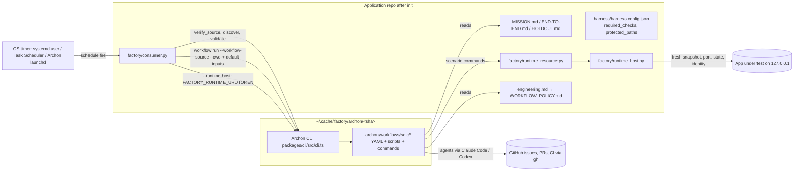

# Cole Medin — AI Software Factory: technical deep dive

> Repository: https://github.com/coleam00/ai-software-factory (repo root) · Evaluated commit: d2b0fcda82eb672b01fee1535c8fb2715b5af001 (2026-10-22 07:00 -0500, "Pin Archon 4eb7bd77") on `main`
> Other branches inspected: `tested-plus-pins` (shallow clone, e23ff048, 2026-09-08, the pre-refactor "dark factory" design); every other remote branch compared against `main` through `gh api` metadata only (see §1.1) · License: none found (no LICENSE file; GitHub reports `license: null`; open issues #32 and #61 ask for one)
> Accessed: 2026-10-22 · Method: read-only shallow clone; no code executed
> Legend: [F] verified fact · [I] inference · [C] unverified claim · [U] unknown

---

## 1. Summary

AI Software Factory is a **thin installer and consumer** that wires a GitHub application repository to a
pinned revision of Cole Medin's Archon workflow engine, specifically its "SDLC pack" of shared workflows
(`archon-backlog`, `-triage`, `-ship`, `-deliver`, `-review`, `-validate`, `-verify-runtime`,
`-merge-queue`, `-lifecycle`, `-loop`, `-manager`, and others) [F `template/factory/pack.json:17-33`].
The repo itself contains **no agents, no prompts and no workflow definitions**. Its own auditor
exits non-zero if the template ships any `.yaml`/`.yml` or `SKILL.md`, but only when someone runs it;
there is no CI or build that runs it [F `bin/audit.py:17-21,46-49`]. What it does
ship: (a) an installer that copies templates into the target repo, clones Archon at an exact SHA and
verifies the clone "byte for byte" (the repo's wording, `consumer.py:95`; the code checks that HEAD equals
the SHA, that `git status --porcelain --untracked-files=all` is clean, and that `.archon` and
`packages/cli/src` hold no untracked, ignored or symlinked files; ignored files elsewhere, including
`node_modules` contents, are not checked [F `consumer.py:83-109`]); (b) `consumer.py`, a CLI that forwards commands to the pinned Archon CLI,
adds project merge-policy inputs, and handles scheduling (OS timer, launch brake, pause, and a
board-aware launch gate); (c) a **runtime host** that starts fresh, identity-bound copies of the app under
test for Archon's runtime verifier; (d) a deterministic mutation/defect-injection harness; and (e)
governance templates (`MISSION.md`, `END-TO-END.md`, `HOLDOUT.md`, `FACTORY_RULES.md`,
`WORKFLOW_POLICY.md`).

The intended audience is a solo developer or small team. They write a PRD or file issues, and the factory
(through Archon) turns issues into independently reviewed, runtime-verified, merged PRs while the human
keeps two jobs: deciding scope and judging the result in staging [C `README.md:3-19`].

**Maturity:** young and changing fast. The repo was created 2026-09-01, has 265 commits on `main`, and
has pushed several Archon pin bumps a day for the past week [F gh api commits]. It has 0 releases, 0
tags, no CI (no `.github/` directory, 0 Actions runs), and no license [F]. It has 83 unittest methods
across three suites [F]. 18 issues and 5 PRs are open [F]. The docs themselves say live end-to-end
validation is still required [C `docs/first-hour.md:21-22`, `docs/derivation.md:12-13`].

**Category:** board/issue-driven factory (GitHub issues in, merged PRs out), delivered as an
installer/consumer over an external engine, plus a spec/planning methodology (mission, journeys, holdout
templates) and a small sandbox-like runtime host (process and identity ownership, not a security
sandbox). All AI orchestration (autonomous multi-agent work, hybrid execution) is delegated to Archon
and is outside this repository.

### 1.1 Branches: merged vs not

| Branch | Status vs `main` (gh compare) | Merged? | Evidence |
|---|---|---|---|
| `feat/protected-paths` | diverged +3/−46 | **Merged** as PR #20 (2026-10-09). The branch tip 1be4052e equals the PR head; diverged only because of the merge style | `protected_paths` present at `template/harness/harness.config.json:6`, `consumer.py:222` |
| `feat/pin-agent-json`, `feat/pin-seal-digest`, `feat/pin-blocked-criteria`, `feat/pin-process-safety`, `feat/pin-holds-clear` | diverged, +1–3 ahead | **Merged** as PRs #21, #22, #23, #24, #25 (2026-10-09/10); each branch tip equals its PR head SHA. Each is a 2–4 line Archon pin bump plus README text | gh api pulls; superseded by later pins (now 4eb7bd77) |
| `feat/large-tier-sonnet` | diverged +3/−48 | **Merged** as PR #18, but the branch's own last commit reverts the Sonnet default ("Keep Archon's default large tier (Opus): revert the Sonnet default", d2c4773a). Net effect: a pin bump only (+2/−2). **Sonnet-for-large was not adopted** | gh api compare commits 0f215c9f → d2c4773a |
| `feat/skip-ticks-hidden-timer` | diverged +1/−48 | **Merged** as PR #19 | `single_flight`, `overlap: "skip"`, hidden Task XML at `consumer.py:434,442-475,512-532` |
| `feat/archon-only-consumer` | behind 108, ahead 0 | **Merged** as PR #3 (2026-09-08, +2681/−17385, 64 files): the refactor that deleted the factory-local workflows and skills | gh api pulls/3 |
| `feat/sdlc-pack-migration`, `fix/candidate-binding-calibration`, `fix/codex-astra-and-runtime-root`, `fix/general-workflow-consumer`, `fix/shared-harness-reliability-adoption`, `fix/workflow-only-adoption`, `video-2026-09-08` | behind, ahead 0 | Fully contained in `main` | gh api compare |
| `tested-plus-pins` | diverged +2/−149 | **Not merged**, and superseded. Two commits on the pre-refactor design (Archon include-deny pin; "holdout: wall it off from the builder's checkout"; bootstrap installs Codex). The Codex bootstrap part exists independently on `main` (`bin/bootstrap-ubuntu.sh:80-84`) | shallow clone inspected |

Open, unmerged community PRs that matter: **#58** (lap budgeting `max_laps_per_hour/day`, a CI matrix, an
MIT LICENSE, removal of the dead ledger fixture, port recycling; +478/−72, from fork `thebkpup`);
**#9** (fixes foreground runtime credentials and macOS path containment); **#60** (browser driver);
**#12/#13** (drafts) [F gh api]. Open owner-filed issues #55–#57 plan to **retire `consumer.py`** by moving
its scheduling, pause and precondition logic into Archon trigger features [F gh api issues].

---

## 2. Architecture

### 2.1 Components

| Component | Path | Lines | Role |
|---|---|---|---|
| Installer CLI | `bin/factory.py` | 48 | `init` → `install.sync` + `install_source` + `configure`; any other verb is forwarded to `consumer.main` [F `bin/factory.py:12-44`] |
| Installer library | `bin/install.py` | 133 | Copies `template/` into the app repo, preserves "personal" files, backs up changed machinery, appends a policy pointer to `engineering.md` and entries to `.gitignore`, clones Archon at the SHA, runs `bun install --frozen-lockfile` [F `bin/install.py:16-18,73-125`] |
| Upgrade helper | `bin/sync-to.py` | 12 | Runs `sync(dest, --dry-run)` [F] |
| Consumer | `template/factory/consumer.py` | 810 | Verifies the pinned source, discovers and validates workflows, forwards native commands, injects default inputs, handles halt/pause/schedule/launch gate [F] |
| Pack manifest | `template/factory/pack.json` | 65 | Archon repo URL, pinned SHA, source dir `.archon/workflows/sdlc`, required entries, default inputs, launch gates, required CLI capabilities [F] |
| Runtime host | `template/factory/runtime_host.py` | 466 | Loopback HTTP control server with a bearer token. Fresh per-slot snapshot, state dir, port, identity; health and identity probes [F] |
| Process owner | `template/factory/runtime_process.py` | 100 | Process-tree ownership: a Windows Job Object (kill-on-close) or a Unix session/process group [F] |
| Resource materializer | `template/factory/runtime_resource.py` | 227 | `git archive` of the configured include paths at the delivering HEAD into an owned root, with a digest marker [F] |
| Ordinary checks | `template/harness/ci.py` | 153 | Runs the configured static/unit commands with marker lines; "zero tests is not a pass" [F] |
| App driver (legacy) | `template/harness/appproc.py` | 378 | http/cli/library drivers from the earlier design. Referenced only by a test (`bin/test_consumer.py:1097-1104`), not by `ci.py` [F] |
| Mutation tool | `template/harness/mutations/run.py` | 229 | `list`/`apply` a uniquely anchored defect; score a gate log or a typed runtime return as CAUGHT/ESCAPED/INCONCLUSIVE [F] |
| Consumer self-check | `bin/selfcheck-mutations.py` | 44 | Injects 5 defects into `consumer.py` copies and requires the named test to fail [F] |
| Consumer auditor | `bin/audit.py` | 49 | AST parse; bans shipped YAML/SKILL.md; bans provider/consumer imports in runtime helpers; bans `shell=` in the runtime host [F] |
| Tests | `bin/test_consumer.py`, `bin/test_runtime_host.py`, `bin/test_runtime_resource.py` (+4 one-line wrapper entrypoints) | 1142/360/176 | 65 + 13 + 5 test methods [F] |
| Docs | `README.md`, `docs/*.md`, `template/factory/RUNTIME_HOST.md`, `MIGRATION.md`, `WORKFLOW_POLICY.md` | ~2.9k | Setup, a server runbook, 65 incident write-ups [F] |
| Server bootstrap | `bin/bootstrap-ubuntu.sh` | 122 | apt + curl-pipe installers for gh, caddy, bun, uv, Claude Code and Codex [F] |

**Stack:** Python ≥ 3.10, stdlib only. No Python dependencies are declared, and there is no
`requirements`/`pyproject` [F: none in `git ls-files`]. External tools: git, `gh` (with `workflow`
scope), bun, uv, and a coding-agent CLI (Claude Code or Codex) [C `README.md:45-48`]. Archon is
TypeScript run from source with bun (`bun <source>/packages/cli/src/cli.ts`) [F `consumer.py:19,118-120`].

### 2.2 The Archon dependency (from the code)

- **Pin.** `pack.json` names `https://github.com/coleam00/Archon` at
  `4eb7bd77391e0f5d2dd6c7dae05cd20638dd8f42` [F `pack.json:2-3`]. Metadata check only: that commit is
  dated 2026-10-22 and is the tip of Archon branch `factory/sdlc-on-dev`. That branch has diverged from
  Archon's default `dev`: 92 commits ahead and 575 behind (`gh api compare dev...factory/sdlc-on-dev`), so the factory runs **unmerged upstream Archon work** [F gh api;
  consistent with `README.md:53-55,247-249`]. Archon's license is MIT [F gh api].
- **Install.** The installer clones into `~/.cache/factory/archon/<sha>` with `--no-hardlinks
  --no-checkout`, checks out `--detach <sha>`, refuses a cache at the wrong SHA or a dirty cache, then
  runs `bun install --frozen-lockfile` [F `bin/install.py:103-125`].
- **Calls the factory makes into Archon:** `workflow list|run|get|status|runs|approve|reject|respond|cancel|resume|abandon|wake`,
  `validate workflows <name>`, `trigger whoami|fire|list|schedule install|remove`, and the `--help`
  capability probes [F `consumer.py:180,191,204-209,283-284,365,562,638,715-716,758,766,777,786`].
- **Archon source the factory executes directly:** the launch-gate script
  `.archon/workflows/sdlc/loop/scripts/workable.ts`, run under bun [F `pack.json:34-36`,
  `consumer.py:624-646`]. The conformance test also imports the pinned
  `triage/scripts/validate-contract.py` and `lifecycle/scripts/select-target.py` when an env var
  points at a checkout [F `bin/test_consumer.py:839-866`].
- **Archon state the factory reads:** `$ARCHON_HOME/logs/trigger-run-<id>.log` (default `~/.archon`)
  [F `consumer.py:541-552`]. The model configuration lives in `~/.archon/config.yaml`, written by the
  setup agent, not by this code [C `docs/server-cheat-sheet.md:203-232`].

### 2.3 Architectural history

The `tested-plus-pins` branch (2026-09-08) holds the previous design: ~21k lines, including
factory-local Archon workflows (`template/.archon/workflows/factory/{triage,implement,validate,fix,regress}`),
nine Claude skills (`template/.claude/skills/factory-*/SKILL.md`), a deterministic dispatcher with "NO
MODEL IS CONSULTED" (`template/factory/dispatch.py:1-25`), `gate.py`, `state.py`, `merge.py`,
`watchdog.py`, `ledger.py` and `agentcheck.py` [F branch clone]. PR #3 deleted 17,385 lines and moved
all of that into Archon's shared SDLC pack [F gh api]. `docs/derivation.md:7-10` records this ownership
decision. Most of `docs/incidents.md` describes failures of that earlier machinery. Several of the
mechanisms it cites (for example `check_agent_rungs_wired` in `bin/audit.py`, `agentcheck.py`,
`guard.py`) **no longer exist in this repo** [F: absent from `bin/audit.py` and `git ls-files`]. The
lessons now apply to Archon-side code that was not inspected [U].

---

## 3. Agents

**This repository defines no agents, subagents or roles** [F `bin/audit.py:20-21` forbids them;
`git ls-files` contains none]. It forbids factory-local agent subprocesses:
"Do not add direct coding-agent subprocesses to factory scripts or create factory-local workflow
copies" [C `README.md:106-107`]. `audit.py` enforces part of that: it bans imports of `subprocess`,
`consumer`, `sdlc`, `anthropic` and `openai` in `harness/mutations/run.py`, and bans
`consumer/sdlc/anthropic/openai` imports and any `shell=` keyword in the runtime host files
[F `bin/audit.py:22-40`].

The agent roles a user actually gets come from Archon workflows. This repo names them but does not
implement them [C `pack.json:17-33`, `README.md:222-237`]:

| Archon workflow (external) | Described purpose (claim) |
|---|---|
| `archon-backlog` | Slice a PRD into an ordered, dependency-linked issue backlog; first ticket makes the product runnable |
| `archon-triage` | Assess one request against repo evidence, apply state labels |
| `archon-ship` | Issue → plan → implement → review → PR (runs its own triage) |
| `archon-deliver` | Implement an existing plan or repair a PR (`--adopt <run>`) |
| `archon-review`, `archon-validate` | Independent review; project checks |
| `archon-verify-runtime`, `archon-verify-runtime-suite` | Drive the running app against scenarios; baseline and mutation controls |
| `archon-regress`, `archon-discoveries` | Regression re-test; revalidate and optionally publish findings |
| `archon-merge-queue` | Check PRs/CI, apply `required_checks`/`protected_paths`, merge per `merge_mode` |
| `archon-deploy` | Roll the default branch onto a service, read the revision back |
| `archon-lifecycle` | Composition: ship → runtime/holdout → bounded repair → discoveries → merge → deploy |
| `archon-loop` | One "move" per lap; parallel laps claim items |
| `archon-manager` | Slower cadence: steer backlog, unstick work, record metrics |

**Model/tools:** these are not set in this repo. The README suggests "Sonnet for small/medium and Opus
for large" for Claude Code [C `README.md:103-104`]. The cheat sheet shows `~/.archon/config.yaml` tiers
and a Codex option [C `docs/server-cheat-sheet.md:197-232`]. A Sonnet-for-large default was tried and
reverted (§1.1). Tool permissions for agents are Archon's concern [U]. One historical incident records
that an earlier factory shipped the e2e agent with `claude -p --permission-mode acceptEdits`, which could
not run Bash, and that `--allowedTools Bash,Read,Write` plus `acceptEdits` was "measured working" [C
`docs/incidents.md:1314-1340`].

---

## 4. Skills, commands and prompts

No skills or prompt templates are shipped [F]. The only AI-facing content is markdown that the Archon
workflows or a setup agent read:

| File | Trigger / reader | What it does | Notable structure |
|---|---|---|---|
| `README.md` §"Instructions for the agent" (lines 64-192) | A user pastes the setup prompt (`README.md:31-40`) telling *their* coding agent to read this section | Six steps: install, configure Archon, write the three files with ≤4 questions each with a proposed answer, run doctor/list, pick existing-codebase or PRD path, stop before scheduling | Explicitly addressed to an AI: "This section is addressed to the coding agent. Run the setup for the user." (`README.md:66`). Content, not followed; benign setup instructions, see §8 |
| `template/MISSION.md` | Archon workflows via `WORKFLOW_POLICY.md:9-11` | Product scope; **"Out of scope -- the factory must never build this"** (≥5 entries); hard invariants (governance files and judge files immutable to the factory); open questions vs irreversible decisions; definition of done (3 gates) | HTML comments explain the intent of each section; "NEVER, NOT 'NOT YET'" (`MISSION.md:53-56`); open questions may be proposed but merges are held (`MISSION.md:124-135`) |
| `template/factory/WORKFLOW_POLICY.md` | Pointer appended to the root `engineering.md` by the installer (`install.py:22-23,46-70`) | First-ticket bootstrap contract (start argv with port placeholder, health, build-id, state path, test, CI check), state-label mapping, runtime evidence and independent-review evidence requirements | "Stale, ambiguous, or self-attested evidence holds" (`WORKFLOW_POLICY.md:52-56`) |
| `template/FACTORY_RULES.md` | Project guidance | Irreversible actions (identity, auth, data migration/deletion) are never decided by an agent (`FACTORY_RULES.md:14-16`) | 16 lines (the earlier design had 323) |
| `template/harness/END-TO-END.md` | Converted by the setup agent into runtime scenario JSON | Example journeys with a "What would make this fail" section | Placeholder task-service data |
| `template/.factory/holdout/HOLDOUT.md` | Holdout verifier | Composed edge-case scenarios | States: "No factory Python helper enforces a private holdout boundary" (`HOLDOUT.md:5`) |
| `docs/server-cheat-sheet.md` | User pastes prompts to their agent | 12-step VPS runbook (Hostinger MCP example) from SSH key to timer | Ready-made prompts include root SSH, a key with no passphrase, merge mode `auto` at the timer step (§8) |

**Consumer CLI commands** (`consumer.py:283-284,790-800`): `run`, `list`, `get`, `status`, `runs`,
`abandon`, `approve`, `reject`, `respond`, `cancel`, `resume`, `doctor`, `halt`/`unhalt` (STOP file),
`pause`/`unpause` (PAUSE file), `schedule install|fire|remove|status` [F].

---

## 5. Orchestration and execution workflows

### 5.1 Execution model

- **Inside this repo it is deterministic code.** No model is invoked by any factory file [F; `audit.py`
  ban list]. The consumer forwards native output and exit codes unchanged and never retries: "No
  subprocess deadline or retry can guess whether a native run is alive" [F `consumer.py:344-352`].
  Native runs have no timeout (`timeout=None`) [F].
- **Stage composition, retries, approval gates and the merge decision belong to Archon** [C
  `docs/derivation.md:3-5`, `MIGRATION.md:18-21`]. Whether those stages are LLM-driven or script-driven
  cannot be verified here [U].
- **Scheduling is a hybrid.** Admission (capacity, overlap skip, durable queue) is delegated to Archon's
  trigger binding [F `consumer.py:390-439`]. Before firing, though, the consumer runs its **own launch
  gate** with policy heuristics (a 30-minute "choosing" window, empty-lap detection by board signature,
  an idle bookkeeping lap) [F `consumer.py:584-687`]. This sits uneasily with the module docstring "No
  stage policy lives here" (`consumer.py:1`), and issues #55–#57 propose moving it into Archon [I].

### 5.2 Concurrency

- Up to `parallel` laps (1–8, default 1) per repository+workflow resource. Resource id:
  `github:<slug>:<workflow>[:x<N>]`, `capacity=parallel`, `overlap: "skip"` [F `consumer.py:410-416,432-434`].
- Ticks can run concurrently (Windows `MultipleInstancesPolicy=Parallel`), so the launch phase and the
  wake phase each take a non-blocking OS file lock (`fcntl.flock`/`msvcrt.locking`). A tick that finds
  a phase busy skips that phase [F `consumer.py:512-532,754-769`].
- Parallel laps avoiding each other's work (claims by comment, oldest claim wins) is an
  `archon-loop` property [C `README.md:296-300`]. The consumer only reads `claims` from the gate's board
  JSON [F `consumer.py:660,668`].
- The runtime host serializes requests (single-threaded `handle_request` loop) and requires distinct
  slots for concurrent cases [F `runtime_host.py:367-368`; C `RUNTIME_HOST.md:161-162`].

### 5.3 Failure handling and recovery

- **Fail-closed source checks:** a wrong SHA, a dirty tree, untracked or ignored authoring files under
  `.archon` or `packages/cli/src`, symlinks under those two roots (`consumer.py:102-107`), a missing entry/lockfile/`node_modules`, duplicate or
  shadowing workflows, missing `command|script|include` targets or values that are neither inline script
  nor a literal `[a-zA-Z0-9_./-]+` path (a `script:` value with inline-script characters is skipped as
  inline code, not refused, `consumer.py:157-160`), a failed capability
  probe, or a failed `validate workflows` all raise `ValueError` → "Factory refused" exit 1
  [F `consumer.py:76-115,131-175,198-218,802-806`].
- **Fail-open launch gate:** if the trigger binding, the gate script or the board cannot be read, the
  tick launches ("as before the gate existed") [F `consumer.py:607-627,650-651`].
- **Stuck-run sweeper:** a `pending` run whose Archon trigger log is older than 600 s and ends with
  `Error:` is abandoned through `workflow abandon` [F `consumer.py:537-568`].
- **Durable waits:** every tick runs `archon workflow wake` to resume runs paused on CI or provider
  usage limits [F `consumer.py:762-769`; C `README.md:301`].
- **Runtime host:** any authenticated malformed or failed request tears down **all** active slots and
  returns a generic 400. A start always tears down its slot first. Parent-pipe EOF, SIGINT or SIGTERM
  stop the owner, and cleanup removes the temp tree [F `runtime_host.py:135-147,153-154,264-266,340-344,355-372`].

### 5.4 Human approval gates (as exposed by this repo)

- `merge_mode` input (`preview`/`approve`/`auto`), `publish`, `publish_holds`,
  `discovery_publication`. These are passed through as Archon inputs; the README recommends `approve`
  and `preview` first [C `README.md:168-170,340-377`]. The cheat sheet's timer step uses
  `merge mode auto` [C `docs/server-cheat-sheet.md:300`].
- `consumer.py approve|reject|respond <run-id>` forwards to the native gates [F `consumer.py:283-284`].
- **Local STOP brake** (`halt`) blocks `run/resume/approve/respond` and `schedule fire`. `cancel`
  stays available [F `consumer.py:286-296,315-316,735-737`]. **PAUSE** blocks only scheduled
  launches, and wakes continue [F `consumer.py:297-311,749-750`].
- "Leave scheduling off until we have watched one issue go through" is a documentation rule, not a
  code gate. `schedule install` writes the timer files only with `--apply`
  [F `consumer.py:717-732`; C `README.md:192`].

### 5.5 Traced path A — manual run of a shared workflow

`python factory/consumer.py run archon-lifecycle --input target=<issue-url>` from the app repo:

1. `consumer.main` (`consumer.py:790-806`) → `project_root()` (`git rev-parse --show-toplevel`, :56-57) →
   `invoke(root, "run", args)` (:259).
2. `invoke` checks for `--runtime-host` (none), rejects unknown actions (:283-285), refuses caller
   `--cwd`/`--workflow-source` (:312-314), refuses if `.factory/STOP` exists (:315-316).
3. `read_settings` reads `<git-common-dir>/../.factory/consumer.json`. Worktrees therefore share
   settings (:60-73).
4. `verify_source` (:76-115): 40-hex SHA, directory named after the SHA, HEAD equals the SHA, clean
   `git status --untracked-files=all`, no untracked/ignored file or symlink under `.archon` and
   `packages/cli/src`, required files present, `node_modules` present.
5. `discover` (:178-187): `source_workflows` builds a provenance index of `name:` across
   `.archon/workflows/sdlc/**.yaml`, rejecting duplicates and shadowing definitions elsewhere under
   `.archon/workflows`, and requiring every literal `command:`/`script:`/`include:` target to exist
   inside the pin (:131-175). It intersects that index with native `workflow list --json`.
6. `validate` (:190-195) → native `validate workflows archon-lifecycle --json`. It must return all
   `valid: true` and 0 errors.
7. Not resuming, so `--workflow-source <source>` is added and `with_default_inputs` (:246-256) injects
   `state_labels` from `pack.json:13-15` plus `required_checks`/`protected_paths` from
   `harness/harness.config.json` (merging workflows only, :221-243), unless the caller supplied them.
   Defaults are placed right after the workflow name, so they precede any caller `--` (:326-327, 256).
8. `execute([bun, <source>/packages/cli/src/cli.ts, "workflow", "run", "--cwd", root, ...])` with
   `capture=False, timeout=None` (:351-352). Exit code returned as is.
9. **Outputs/state:** owned by Archon (run records, worktrees, GitHub PRs, labels and comments through
   `gh`) [C `README.md:243-245`]. Inspect with `get <run-id> --json --events` [F passthrough].

### 5.6 Traced path B — scheduled lap with the launch gate

`schedule install --apply` then a periodic `schedule fire`:

1. `schedule("install")` (`consumer.py:690-733`) → `trigger_config` (:390-439): reads
   `.factory/schedule.json` (workflow default `archon-lifecycle`, `inputs` object), refuses a
   `runtime_host` key (:399-402), requires the workflow in `discover` (:403-404), validates input names,
   merges `workflow_defaults` with schedule inputs (:408-409), validates `parallel` 1–8 (:410-412), takes
   `runAsUserId` from `archon trigger whoami` by parsing the last JSON object (:363-373, 428), sets
   `isolation: {kind: worktree, baseOverride: <base_branch>}` (:419-420), and writes `.factory/trigger.json`.
2. `timer_commands` (:478-509): Linux writes `~/.config/systemd/user/archonfactory-<repo>.{service,timer}`
   (`Type=oneshot`, a captured `PATH`, `IS_SANDBOX=1`, `EnvironmentFile=-%h/.factory-env`,
   `OnUnitInactiveSec=<interval>`) and runs `systemctl --user enable --now`. Windows writes a hidden
   Task XML that runs `pythonw` while the user is logged on. macOS calls Archon's own
   `trigger schedule install` and `workflow wake schedule install` (:714-716).
3. Each tick runs `schedule("fire")` (:734-773): STOP → exit 0. PAUSE → skip launch. Otherwise, under
   `fire.lock`, `launch_decision` (:607-687):
   - looks up `launch_gates[workflow]` (only `archon-loop` → `loop/scripts/workable.ts`). If there is no
     gate, it launches (:624-627).
   - native `workflow runs --limit 100 --json`, filtered to this workflow (:638-639); `sweep_stuck` (:640).
   - runs the gate script under bun with `INPUTS_CLAIM_HOURS` and `INPUTS_ENDED_RUNS`, and parses the
     last stdout line as board JSON `{workable, claims, ended, waiting}` (:643-649).
   - rules, in order: all slots busy → no (:670-672); same board signature as the last launch and that
     lap ended in < 300 s → no (:673-676); workable and no lap "choosing" (active, < 30 min old, not yet
     holding a claim) → launch (:679-680); nothing workable, no active lap and `idle_pick_minutes`
     (default 60) elapsed → bookkeeping launch (:681-685); otherwise no.
   - `tick_state` keeps `last_launch` and `last_launch_board` in `.factory/gate.json` (:571-581, 632-635).
4. On launch: `archon trigger fire --config .factory/trigger.json` (:758-759). Then, under `wake.lock`,
   `archon workflow wake` (:764-767). The return code is `fired or woken`.
5. **Outputs/state:** Archon trigger receipts (`schedule status` → `trigger list`), `.factory/gate.json`,
   and `.factory/schedule.log` on windowless Windows (:741-747).

### 5.7 Traced path C — runtime verification with the runtime host

`consumer.py run archon-verify-runtime --runtime-host /private/runtime.json --input scenario=...`:

1. `invoke` extracts `--runtime-host`, refusing it with detach/resume (:263-280) and for scheduled
   triggers (:399-402).
2. `RuntimeHost.__enter__` (`runtime_host.py:375-390`) spawns `runtime_host.py _serve <cfg>`. `serve`
   (:310-372) binds `127.0.0.1:0`, makes a 32-byte url-safe token, and prints `{url, token}` on the pipe.
3. The Archon run gets `FACTORY_RUNTIME_URL`/`FACTORY_RUNTIME_TOKEN` in its env (`consumer.py:346-350`).
4. Archon's scenario `environment` commands [C `RUNTIME_HOST.md:104-113`] call
   `runtime_resource.py prepare`. `delivery()` requires the helper and the cwd to be the same checkout,
   HEAD equal to `--expected-revision`, and no modified tracked files (`runtime_resource.py:69-88`).
   `committed_files` rejects symlinks, non-regular modes and forbidden names (:108-134). `git archive`
   of the includes is extracted to a staging dir with zip-slip checks, and a `.factory-resource.json`
   marker (revision, tree, digest) is atomically swapped in (:153-194).
5. `runtime_resource.py start` → `runtime_host.py start --expected-revision <HEAD>` → POST `/start` →
   `Environments.start` (`runtime_host.py:149-266`): teardown of the slot; field allowlist (callers
   cannot pass commands/paths, :155-156); binding re-check of revision and digest (:161-169); copy of the
   includes into `<tmp>/<random>/source`, re-digested (:177-189); optional unique-anchor mutation
   (:190-201); loopback port lease (:202-210); a minimal env with HOME/TMP pointed at fresh `state`
   (:213-217); optional setup argv (Python/Node only, :95-109, 227-234); identity =
   `factory-v1:sha256(source digest, argv, env)` (:236-239); source files chmodded read-only (:240-242);
   `ProcessTree` start (:243); readiness polling of `health_path` and `identity_path`, where the body
   must equal the candidate (:247-258, 274-288).
6. Archon's verifier probes the app. `identity`/`describe` re-hash the snapshot and re-probe (:290-307).
7. `RuntimeHost.__exit__` closes stdin. The owner sees EOF, stops, and tears down all slots. A non-zero
   owner exit raises "runtime owner cleanup failed" (:396-401).
8. Mutation scoring: `harness/mutations/run.py score-runtime --result <native return> --candidate <id>`
   returns CAUGHT only for a `verdict == "failed"` with `verified is False` and a matching candidate
   (`run.py:127-145`).

---

## 6. Context and state management

- **Project context for agents** is plain files in the app repo: `MISSION.md`, `engineering.md` →
  `factory/WORKFLOW_POLICY.md`, `FACTORY_RULES.md`, the journeys and the holdout. The installer
  appends a single pointer line to `engineering.md` atomically (temp file, fsync, `os.replace`) and only
  once [F `install.py:46-70`]. How Archon loads or compresses that context is not visible here [U].
- **Consumer persistent state:** `.factory/consumer.json` (pin settings, in the git common dir so all
  worktrees share it), `.factory/trigger.json`, `.factory/schedule.json`, `.factory/gate.json`,
  `.factory/STOP`, `.factory/PAUSE`, `.factory/*.lock`, and `.factory/backup/` (all gitignored via
  `template/gitignore-additions.txt:5-15`) [F].
- **Run state, memory and handoffs** (run records, worktrees, claims, evidence files, discoveries) are
  Archon's [C]. The consumer only reads `workflow runs` JSON and the trigger logs [F `consumer.py:552,638`].
- **Resumability:** native `--resume` and `--adopt` pass through. A resume omits `--workflow-source`
  and default inputs so native continuation semantics apply [F `consumer.py:336-340`]. Runtime-host
  mode cannot be resumed or detached: "no public durable ownership contract" [F `consumer.py:267-268`].
- **Upgrade state:** `sync` never overwrites `PERSONAL` files, and backs up changed machinery files to
  `.factory/backup/<path>[.n]` before replacing them [F `install.py:16-18,32-43,77-91`]. It never
  deletes files that disappeared from the template, so stale machinery from older installs remains in
  app repos [I from `sync` copying only].
- **Committed artifact:** `.factory/ledger.jsonl` in this repo contains 20 fabricated "settle"
  lines with run id `11111111-2222-3333-4444-555555555555`. That is exactly the self-test pollution
  described in `docs/incidents.md:940-972`, still committed and unused by current code [F; PR #58 removes it].

---

## 7. Engineering practices and testing

- **Tests:** stdlib `unittest`. 83 test methods: `bin/test_consumer.py` (65 across `ConsumerTests`,
  `LaunchGateTests`, `SourceConformanceTests`, `InstallTests`, `HarnessTests`),
  `bin/test_runtime_host.py` (13), `bin/test_runtime_resource.py` (5) [F grep]. Four files
  (`_test_install.py`, `test-merge-bookkeeping.py`, `test-mutation-outcomes.py`, `test-sync-settings.py`)
  are 6-line re-exports of those classes [F]. **Not executed.**
  - The consumer tests build real git repos in temp dirs with spaces in their names and swap the Archon
    CLI for a **fake Python CLI** that records argv and answers `workflow list`, `validate`,
    `trigger whoami` and `--help` [F `bin/test_consumer.py:30-66,69-123`]. They set
    `FACTORY_AGENT_CMD=provider-must-never-run` as a sentinel [F :112-113].
  - The runtime host tests use real subprocess HTTP fixture apps. They assert fresh state per start,
    different candidates, mutation isolation, the token never appearing in output, descendants killed,
    an unrelated listener surviving, and parent-death cleanup [F `bin/test_runtime_host.py:112-165,296-360`].
  - `SourceConformanceTests` against the real pinned Archon is **skipped unless**
    `FACTORY_ARCHON_CONFORMANCE_SOURCE` is set [F `bin/test_consumer.py:843-845`]. In practice the
    consumer/Archon contract is checked only by `doctor` at install/run time [I].
- **Mutation self-check of the factory's own guards:** `bin/selfcheck-mutations.py` copies
  `bin/`+`template/` into a temp dir, applies 5 one-line sabotage edits to `consumer.py` (missing-workflow
  check disabled, SHA check disabled, required_checks dropped, protected_paths dropped, state-label
  defaults skipped), and requires the named test to report `FAIL:` [F `bin/selfcheck-mutations.py:9-41`].
- **Static audit:** `bin/audit.py` (AST parse, ownership bans) [F].
- **CI:** none. No `.github/`, and 0 Actions runs [F]. Open PR #58 proposes a matrix (Ubuntu 3.10/3.12,
  Windows 3.12) plus a pin-conformance job [C gh api PR body].
- **Linting/typing:** none configured. Type hints are used throughout [F].
- **Verification applied to the produced software** (the factory's product, not this repo):
  - Ordinary gate `harness/ci.py`: configured static/unit commands. Missing commands print a loud
    `*_SKIPPED`. Neither configured → `GATE_FAILED: configuration`. A timeout counts as failure (rc 124).
    With `unit_count_pattern`, **0 tests fails** [F `ci.py:62-150`].
  - Runtime and holdout verification by Archon against the runtime host, with calibration: the
    baseline must verify, a relevant mutation must fail, and a wrong-identity check must be
    inconclusive [C `RUNTIME_HOST.md:194-244`, `README.md:148-152`].
  - Defect-injection catalogue `harness/mutations/defects.json`, with guidance on aiming defects at
    specific rungs and checking which rung actually caught them [F `defects.json:19-67`]. It ships
    with `defects: []` [F :48].
  - Independent review: the merge requires review evidence that is "independent of the implementer" and
    names the current head [C `WORKFLOW_POLICY.md:52-56`]. Enforcement is in Archon [U].
- **Engineering-history artifact:** `docs/incidents.md` (1,706 lines, 65 headings) is a post-mortem log
  in which each rule is tied to an observed failure [F].

---

## 8. Security, isolation and observability

**Permission model.** The repo sets no Claude Code permission flags itself [F: no occurrence of
`--dangerously-skip-permissions`/`bypassPermissions` in code]. Agent permissions are configured in
Archon [U]. The systemd unit sets `IS_SANDBOX=1` because "Claude Code refuses to run unattended as root
without it" [F `consumer.py:498-504`; C `README.md:402`]. The server runbook runs everything **as root**
on a VPS [C `docs/server-cheat-sheet.md:197`, `bootstrap-ubuntu.sh:31-34`].

**Isolation.**
- Laps run in Archon worktrees (`isolation.kind = worktree`) [F `consumer.py:420`]. Worktree semantics
  are Archon's [U].
- The runtime host is explicitly **not a sandbox**: "This is not a filesystem sandbox for a same-user
  agent… Do not claim host-machine-loss recovery or hostile-process containment"
  [C `RUNTIME_HOST.md:285-291`]. What it does enforce [F `runtime_host.py`]: loopback-only control with
  `hmac.compare_digest` bearer auth (:320-322, 408-409); a 16 KiB request cap (:325-326); no redirects
  and no proxies (:27-32); a caller field allowlist (:155-156); Python/Node-only executables with no
  shell (:95-109); a stripped environment where provider credentials are not inherited (:213-217);
  forbidden include names `.git .factory .archon .claude .env holdout.md node_modules .venv __pycache__`
  (`runtime_resource.py:19-20`); symlink/junction refusal (:33-47); generic error bodies (:340-344);
  process-group/Job-Object kill (`runtime_process.py`). The connection file is created
  `O_EXCL` with mode 0600 (:441).
- The **holdout is not hidden from the builder by code**. "A directory called 'holdout' does not make
  it private" [C `README.md:131-133`; `HOLDOUT.md:5`]. The runtime snapshot excludes `holdout.md`
  [F `runtime_resource.py:19-20`]. The earlier design had a `holdoutwall.py` [F branch], which is gone.
- **Protected paths:** declared in `harness.config.json` (default `MISSION.md,FACTORY.md,FACTORY_RULES.md,harness/**,.factory/**,factory/**`)
  and injected into merging workflows only [F `harness.config.json:6`, `consumer.py:221-243`]. The
  `path-policy` hold is implemented in Archon [C `README.md:318-328`]. Note that `engineering.md`, the
  file the incident cites as rewritten by an agent (`README.md:318-320`), is **not** in the default list
  [F]. Existing installs never get the key automatically (PERSONAL file) [F `install.py:16`; C README:327-328].

**Secrets.** No secret-shaped values in the repo [F grep for common key patterns]. The Claude token
is placed in `~/.factory-env` (mode 600) and loaded with `EnvironmentFile` [C
`bootstrap-ubuntu.sh:115-118`; F `consumer.py:503`]. The systemd unit embeds the installing shell's full
`PATH` [F `consumer.py:502`]. Runtime tokens never go into scenario JSON, by documented rule [C
`RUNTIME_HOST.md:39-40`]. `mutations/run.py` sanitizes and bounds quoted log text (`run.py:41-52`) [F].

**Supply chain.**
- Archon is pinned by full SHA and verified clean, and `bun install --frozen-lockfile` uses the pin's
  lockfile [F]. `node_modules` is gitignored inside the pin, so it is outside the clean-tree check;
  only presence is verified [F `consumer.py:113-114`; I].
- The pin points at an **unmerged Archon branch** that is bumped daily, sometimes by direct push to
  `main` without a PR [F gh api commits].
- `bin/bootstrap-ubuntu.sh` is meant to run as `curl … /main/bin/bootstrap-ubuntu.sh | bash` as root
  (:4). It pipes `bun.sh/install`, `astral.sh/uv/install.sh` and `claude.ai/install.sh` to a shell, and
  runs `npm install -g @openai/codex`, all **unversioned** (:65-84). Apt repos are added with signed
  keyrings (:42-63) [F].
- The cheat sheet asks the agent to create an ed25519 key with **no passphrase** and to drive the VPS
  provider via an MCP plugin [C `docs/server-cheat-sheet.md:67-89`].

**Prompt-injection exposure.** GitHub issue text, PR content and discoveries reach Archon agents [I].
This repo's mitigations are policy inputs (MISSION scope, protected paths, merge modes, required checks)
and are enforced by Archon [C]. **AI-addressed content in this repo:** `README.md:64-192` ("This section
is addressed to the coding agent. Run the setup for the user.") and the prompts in
`docs/server-cheat-sheet.md`. Both are overt setup instructions aimed at the user's own agent. They
instruct running the installer (cloning Archon, `bun install`), configuring providers, SSH as root, and
creating cloud resources. No hidden or deceptive injection was found (grep for override phrasing found
nothing) [F]. They are still a high-trust instruction channel: an agent that follows them executes
remote code [I].

**Observability.** `status`/`runs`/`get --events` pass through to Archon. The consumer prints
`source`, `revision` and `local_STOP` on `status` (:342-343). Launch decisions are written with reasons
("No launch: all N slot(s) busy; workable #…") to stderr, the journal, or `.factory/schedule.log` [F
`consumer.py:633,653,671,675,686,741-747`]. There are **no metrics, token or cost reporting, or traces
in this repo** [F]. The README says "Instrument your tokens on day one" but ships no instrument [C
`README.md:436-440`]. `archon-manager` "record metrics" is an external claim [C `pack.json:32`].

**Known open defects (reported, consistent with code):**
- Issue #59: the systemd service lacks `KillMode=process`, so laps die with the oneshot unit. The
  generated unit has no `KillMode` line [F `consumer.py:501-504`]; the impact is [C].
- Issue #4: on macOS every runtime snapshot is refused. `Environments.base` is an unresolved
  `mkdtemp()` path (`runtime_host.py:131`), while `safe_path` compares a resolved child against that
  root (:40). `/var` → `/private/var` therefore fails `is_relative_to` [I, not executed]. Fix PR #9 is
  open.
- **Doc contradiction:** `README.md:292-295` says a tick during a busy lap is **skipped**, and code sets
  `overlap: "skip"` [F `consumer.py:434`], but `docs/server-cheat-sheet.md:294` says Archon **queues**
  it.
- `appproc._free_the_port` kills **any** process listening on the port (`kill -9`/`taskkill`)
  [F `template/harness/appproc.py:134-182`]. That contradicts the runtime host's "never kills an
  unrelated listener" guarantee (`RUNTIME_HOST.md:267-268`). The module is shipped but unused by `ci.py` [F].

---

## 9. Efficiency

- **Avoids wasted laps:** a lap launches only when the board shows workable work, no lap is still
  choosing, and the board changed since a lap found nothing. One bookkeeping lap runs per idle period
  [F `consumer.py:584-687`]. Every rule carries a "seen live" justification in comments (:655-678).
  Commit history shows tuning ("a lap is still choosing only in its first 30 minutes", "a failed lap is
  not an empty lap") [F gh api commits 7ca52913, ce369bcc].
- **Overlap skip and capacity** stop ticks from piling up [F :432-434].
- **Model routing** is configured in Archon tiers (small/medium/large). This repo only documents
  suggestions [C `README.md:103-104,438-440`]. Recent pin messages claim efficiency changes in the
  engine ("cheap no-change laps", "verification proportional to risk", "default-branch results reused")
  [C commit subjects ac38cb48, 88c18b92, 35b4e1d9].
- **No cost ceilings** in this repo [F]. PR #58 (unmerged) proposes `max_laps_per_hour/day` [C].
- **Operational overhead:** the user installs bun, uv, gh and an agent CLI, then writes three
  governance files, the runtime JSON config, scenario JSON and a calibration manifest. The runtime
  calibration alone is a multi-step procedure [C `RUNTIME_HOST.md:194-248`]. `doctor` spawns about
  2 + |capabilities| + |workflows| CLI processes per call, and `run` repeats discovery and validation each
  time [F `consumer.py:198-218,332-335`] [I: several seconds per command].

---

## 10. Continuous improvement

- **Lesson capture:** `docs/incidents.md` is a structured failure log ("What happened / The cause / The
  rule"), with an explicit warning: "Read it if you are about to 'simplify' something. Most of what
  looks like paranoia here is a scar" [F `incidents.md:1-8`]. Code comments repeat the lesson at the
  point of use (e.g. `ci.py:15-35` on the quoted-import check that could not fail, `run.py:148-168` on
  ambiguous anchors) [F].
- **Mutation testing of the checkers:** for the product (`harness/mutations`) and for the consumer
  (`bin/selfcheck-mutations.py`). The principle: "a fixture that has never been shown to fail is a
  fixture that proves nothing" [C `incidents.md:1621-1622`; F implementation].
- **Engine-side improvement loop:** `archon-manager` and discoveries publication are claimed
  [C `pack.json:31-32`, `README.md:231-237`]. Feedback from staging re-enters as new issues filed by the
  human [C `README.md:9-11`].
- **No automated self-modification or eval-driven prompt refinement** in this repo [F]. Improvements
  arrive as Archon pin bumps; the pin commit messages work as a changelog [F gh api].

---

## 11. Reference-driven development and reverse engineering

Mostly not applicable. The factory works forward from a PRD or issues and does not extract specs from
existing products, reconstruct UIs or measure parity. Related mechanisms that do exist:
- **PRD → backlog** via `archon-backlog`. The first ticket must declare a start argv, health,
  build-id, state path, tests and CI [C `README.md:172-190`, `WORKFLOW_POLICY.md:13-21`].
- **Existing-codebase mode:** the setup agent reads the repo first to answer stack/command/entry-point
  questions before asking the user (≤4 questions with proposed answers) [C `README.md:111-118`].
- **Visual/browser verification:** not in `main`. `appproc.py` covers http/cli/library only and says a
  rendered UI must sit behind a headless surface [F `appproc.py:1-30`]. `defects.json` suggests
  CSS/visibility defects (:28-33). Open PR #60 adds a browser driver [F gh api].

---

## 12. Innovations

1. **"Byte-verified" (the repo's wording) engine pin with provenance indexing.** The factory refuses to run on anything but an
   exact, clean, per-SHA Archon checkout. It checks for untracked and *ignored* authoring files under
   `.archon` and `packages/cli/src` (an ignored YAML could shadow a committed workflow), symlinks there,
   duplicate or shadowing workflow names, and missing `command/script/include` targets or values that are
   neither inline script (skipped, `:157-160`) nor a literal path. It probes required CLI flags against
   `--help` before use [F `consumer.py:76-115,131-175,198-218`]. A clear advantage over ambient
   `archon`/`$PATH` resolution: "Never use an ambient archon binary or provider command override" (:119).
2. **Candidate identity binding for runtime verification.** The app under test must return
   `FACTORY_RUNTIME_CANDIDATE`, a hash of frozen source, argv and env, at its build-id path. Every probe
   re-checks liveness, identity and source digest. Bound roots tie the snapshot to the delivered git
   revision with `git archive` and a digest marker, so a stale `main` copy cannot be "verified" in place
   of the PR [F `runtime_host.py:236-307`, `runtime_resource.py:153-194`; C motivation
   `server-cheat-sheet.md:247-256`].
3. **Three-valued mutation scoring.** A defect counts as CAUGHT only when a product rung judged it
   (assertion lines required for e2e/holdout). Timeouts, import failures, harness/infra rungs, missing
   markers and mismatched runtime returns are INCONCLUSIVE, never a catch. Anchors must be unique or
   the defect is NOT_INJECTED [F `run.py:73-187`].
4. **Mutation self-check of the factory's own guards**, with each guard paired to the test that must go
   red [F `bin/selfcheck-mutations.py`].
5. **Board-aware launch gate with empty-lap dedupe**: one pick at a time, signature-based repeat
   suppression, an idle bookkeeping lap, and a stuck-pending sweeper reading engine logs. It fails open
   so the gate cannot halt the factory [F `consumer.py:545-687`].
6. **Merge policy as declared facts**, separate from agent judgment: `required_checks` (for free
   private repos where branch protection is unreadable) and `protected_paths` go only to merging
   workflows [F `consumer.py:221-243`; C `README.md:311-328`].
7. **Governance template design:** MISSION's "never" list ("never, not 'not yet'"), open questions
   (propose, build, hold the merge) separated from irreversible decisions (stop), "the factory cannot
   modify its own judge" [F `template/MISSION.md:45-83,111-138`].
8. **Two-level brake:** STOP (block launches *and* continuations) vs PAUSE (block launches, keep
   waking), so in-flight laps are not stranded [F `consumer.py:286-311,734-773`].
9. **Honest-failure gate markers:** loud `*_SKIPPED`, "ZERO IS NOT A PASS", last-marker-wins rung
   attribution, timeout = failure [F `ci.py:77-150`, `run.py:55-66`].

---

## 13. Reusable components

All rows: License = **none (all rights reserved by default)** for this repo; reuse of code needs
permission. Archon is MIT. Ideas and patterns can be reimplemented.

| Component | Path | Kind | Dependencies | License | Security notes | Reuse class | Limits and compatibility constraints |
|---|---|---|---|---|---|---|---|
| Pinned-source verifier (`verify_source`, `source_workflows`, `doctor`) | `template/factory/consumer.py:76-218` | library/pattern | git, Archon CLI shape | none | Strong integrity checks; `node_modules` only presence-checked | reimplement the idea | Hard-wired to Archon paths (`packages/cli/src/cli.ts`, `.archon/workflows/sdlc`) and its JSON output |
| Default-input injection with caller override | `consumer.py:221-256` | pattern | none | none | Keeps policy facts out of agent discretion | reimplement the idea | Assumes `--input k=v` CLI grammar |
| Launch gate (board signature, choosing window, idle lap, stuck sweep) | `consumer.py:535-687` | script/pattern | Archon `runs` JSON, gate script | none | Fails open by design | reimplement the idea | Tuned constants (300 s, 1800 s, 600 s); depends on Archon trigger log format |
| Single-flight OS lock | `consumer.py:512-532` | library | stdlib | none | Lock dies with the process | reimplement the idea (trivial) | Advisory locks only |
| Cross-platform timer generation (systemd user unit, hidden Task XML) | `consumer.py:442-509` | script | systemd / schtasks | none | Embeds full PATH; `IS_SANDBOX=1`; no `KillMode` (issue #59) | reimplement the idea (no licence) | Fix KillMode; Windows runs only while logged on |
| STOP/PAUSE brake files | `consumer.py:286-311,734-773` | pattern | none | none | Local only, not remote-safe | reimplement the idea | Per-checkout shared root |
| Runtime host (fresh snapshot, port, state, identity, loopback token API) | `template/factory/runtime_host.py`, `runtime_process.py` | library | Python stdlib; Windows ctypes | none | Not a sandbox (documented); stripped env; generic errors | reimplement the idea (no licence) | Python/Node executables only; no containers/remote DBs; macOS path bug (issue #4) |
| Revision-bound resource materializer | `template/factory/runtime_resource.py` | script | git | none | Zip-slip and symlink checks; refuses unowned dirs | reimplement the idea (no licence) | Requires helper and cwd in the same delivering checkout |
| Mutation apply/score tool | `template/harness/mutations/run.py` | script | stdlib | none | Sanitized output | reimplement the idea (no licence) | Marker vocabulary tied to `ci.py` output |
| Defect-catalogue guidance | `template/harness/mutations/defects.json` | pattern/doc | none | none | File meant to be protected | reimplement the idea | Ships empty |
| Ordinary gate runner | `template/harness/ci.py` | script | stdlib | none | Windows quoting fix | reimplement the idea (no licence) | Static/unit only |
| Guard self-mutation check | `bin/selfcheck-mutations.py` | script/pattern | unittest | none | Runs tests in temp copies | reimplement the idea | Anchors are literal source lines |
| Ownership auditor (ban YAML/skills/provider imports) | `bin/audit.py` | script/pattern | ast | none | Static only | reimplement the idea | Repo-specific lists |
| MISSION / WORKFLOW_POLICY / FACTORY_RULES / HOLDOUT templates | `template/*.md`, `template/factory/WORKFLOW_POLICY.md` | pattern/template | none | none | Governance only by convention plus protected_paths | reimplement the idea (no licence) | Archon state-label vocabulary |
| Incident log | `docs/incidents.md` | reference | none | none | Describes mostly removed code | reference only | Historical; mechanisms now live in Archon |
| Ubuntu bootstrap | `bin/bootstrap-ubuntu.sh` | script | apt, curl | none | curl-pipe installers unpinned; root | reference only | Ubuntu, root |

---

## 14. Evidence against the value dimensions

**Engineering quality.** *Demonstrated:* small, stdlib-only, defensive code with fail-closed checks
(§5.3); 83 unittest methods using real git and subprocess fixtures; a mutation self-check of its own
guards; an AST ownership audit (§7); rationale comments tied to incidents. *Gaps:* no CI and no license
(§1, §7); the conformance test against real Archon is skipped by default; a dead fixture ledger and an
unused `appproc.py` remain (§6, §8); docs contradict each other on overlap (§8); the macOS runtime host
bug is open (§8). *Claimed, not verified here:* test pass status (not executed).

**Autonomy and orchestration.** *Demonstrated in this repo:* deterministic scheduling with a
board-aware launch gate, parallel-lap capacity, a durable wake, and stuck-run sweeping (§5.6).
*Claimed (Archon-owned):* triage, planning, implementation, independent review, runtime and holdout
verification, bounded repair, merge queue, deploy, manager loop (§3, §5.1). The repo's own docs say
the integration "stays supervised" and "still needs live end-to-end validation" (§1).

**Development productivity.** *Claimed:* a pasted setup prompt installs the factory, and after that
"filing an issue is the only input" [C `server-cheat-sheet.md:303`]. *Demonstrated:* a one-command
`init`, a preserving upgrade with backups, and `doctor`/`list` (§2, §6). Setup still needs substantial
manual or agent configuration (runtime JSON, calibration, journeys, mission) (§9).

**Security and reliability.** *Demonstrated:* SHA-pinned engine with a clean-tree and authoring-root check (the repo calls it "byte for byte"; ignored files outside the authoring roots are not checked) (§12.1); runtime host
with authenticated loopback control, stripped env and identity binding (§8, §12.2); halt/pause brakes;
protected paths and required checks forwarded to merging workflows. *Risks evidenced:* root execution
with `IS_SANDBOX=1`; unpinned curl-pipe bootstrap; a pin to an unmerged, daily-moving engine branch;
the holdout not isolated by code; `engineering.md` not protected by default; an open systemd KillMode
defect (§8). Merge-gate enforcement itself is not verifiable here (§3).

**Maintainability and adaptability.** *Demonstrated:* a clear ownership boundary (factory = install
plus context; Archon = all AI work) enforced by audit (§2.3, §3); a manifest-driven workflow list and
defaults (`pack.json`); personal/machinery file separation on upgrade (§6). *Constraints:* tight
coupling to Archon CLI flags, JSON shapes, log paths and directory layout (§2.2); a planned retirement
of `consumer.py` (issues #55–57); no deletion of removed template files on upgrade (§6).

**Resource efficiency.** *Demonstrated:* launch-gate rules that suppress empty or duplicate laps and
skip overlap (§9). *Claimed:* engine-side cost reductions in pin commit messages; tiered models.
*Absent:* any token or cost accounting or ceilings in this repo (§8, §9). PR #58's lap ceilings are
unmerged.

---

## 15. Strengths and limitations

**Strengths**
- Strict pinned-engine integrity: SHA, clean tree, ignored-file shadowing and symlinks (under `.archon` and
  `packages/cli/src`), provenance of
  referenced commands and scripts, capability probes (`consumer.py:76-218`).
- Runtime verification bound to the actual candidate bytes and revision, with fresh state and port per
  attempt and cleanup verified by tests (`runtime_host.py`, `runtime_resource.py`,
  `bin/test_runtime_host.py:112-165`).
- An evaluation philosophy that treats "a check never shown to fail" as unproven, implemented in both
  the product harness and the factory's own guards (`run.py`, `selfcheck-mutations.py`).
- Clear separation of human-owned governance (mission "never" list, judge files, irreversible
  decisions) from agent-executable work, with protected-path defaults (`MISSION.md`,
  `harness.config.json:6`).
- Operational detail for unattended Linux/Windows/macOS scheduling, including the windowless-console
  and logged-on-session cases (`consumer.py:442-509`), and brakes that do not strand in-flight runs.
- Unusually candid documentation of failure modes and limits (`incidents.md`, `RUNTIME_HOST.md:277-291`).

**Limitations**
- Almost all of the advertised factory behaviour lives in Archon at an unmerged branch pin. This repo
  cannot demonstrate review independence, merge-gate correctness or agent behaviour (§3).
- No license, so code reuse is not legally clear (issues #32, #61).
- No CI. The real-engine conformance test is skipped by default (§7).
- Fast churn: several direct-to-main pin bumps per day, 0 releases or tags (§1).
- Security posture leans on documentation: root plus `IS_SANDBOX=1`, curl-pipe installers, holdout
  privacy left to the operator, no cost ceilings (§8, §9).
- Known defects and doc drift: systemd KillMode (#59), macOS snapshot refusal (#4), overlap
  skip-vs-queue contradiction, a leftover fabricated ledger, an unused port-killing `appproc.py` (§8).
- `consumer.py` is slated for retirement (#55–57), so its scheduling layer is transitional.

---

## 16. Claims vs verified ledger

| Claim (source) | Status | Evidence |
|---|---|---|
| "All AI work runs through Archon's SDLC pack"; the factory writes no AI steps (README:21-23, 217-220) | verified (for this repo) | No YAML/skills/prompts in `git ls-files`; `audit.py:20-21` bans them; `consumer.py` only forwards to the Archon CLI |
| Installer pins an exact Archon revision; pin and pack.json must match (README:53-60) | verified | `pack.json:3`; `install.py:103-125`; README names the same SHA at line 54 |
| "Two reviewers that did not write it decide whether it merges" (README:9) | not executable / not found here | Archon-side; `WORKFLOW_POLICY.md:52-56` states the requirement only |
| Deterministic merge gate that "seals its plan by script" (README:55-57) | not found here | Archon-side (pin commit subjects only) |
| `halt` blocks new launches and continuations; cancel still allowed (README:272-273) | verified | `consumer.py:286-296,315-316,735-737` |
| `pause` stops only timer launches; wakes continue (README:274-276) | verified | `consumer.py:297-311,749-769` |
| A tick during busy laps is skipped (README:292-295) | verified (config) / contradicted by cheat sheet:294 ("queues") | `consumer.py:434` `overlap: "skip"`; Archon behaviour not executed |
| `parallel` 1–8, default 1 (README:292-294) | verified | `consumer.py:410-412` |
| `schedule install` refuses `runtime_host` (README:307-309) | verified | `consumer.py:399-402` |
| `required_checks` passed to lifecycle and merge-queue (README:311-316) | verified (forwarding) | `consumer.py:24,221-243`; test at `bin/test_consumer.py:383` |
| Protected paths hold any PR touching a match (README:318-328) | partly | Forwarding verified (`consumer.py:222`); the hold itself is Archon's `path-policy` [U] |
| New installs protect MISSION/FACTORY/FACTORY_RULES/harness/.factory/factory (README:325-327) | verified | `harness.config.json:6` |
| Installer preserves project files and backs up changed factory files (README:90-92, MIGRATION:8-12) | verified | `install.py:16-18,32-43,77-91` |
| Installer adds one pointer to `engineering.md` without replacing guidance (README:93-97) | verified | `install.py:46-70` (idempotent, atomic) |
| Runtime host: fresh environment per attempt, identity binding, cleanup on parent exit (RUNTIME_HOST.md) | verified in code; not executed | `runtime_host.py:149-307,355-401`; tests listed in §7 |
| Runtime host never kills an unrelated listener (RUNTIME_HOST.md:267-268) | verified for `runtime_host`; contradicted by shipped `appproc.py` | `runtime_host.py` has no port-kill; `appproc.py:134-182` kills any listener |
| Provider credentials not inherited by the app (RUNTIME_HOST.md:131-132) | verified | `runtime_host.py:213-217` |
| Holdout private from the builder | not found (explicitly disclaimed) | `HOLDOUT.md:5`; README:131-133; only snapshot exclusion `runtime_resource.py:19-20` |
| Deployment rolls default branch and reads revision back (README:413-417) | not executable / not found here | `archon-deploy` external |
| Doctor checks installation and workflows, not live sign-in (README:161-162) | verified | `consumer.py:198-218` returns `"authentication not live-tested"` |
| Tests: "88 passing" (PR #58 body, for the PR branch) | not executable | Not executed; `main` has 83 methods |
| Systemd timer kills laps without `KillMode=process` (issue #59) | partly (code shape verified) | `consumer.py:501-504` lacks KillMode; runtime effect not executed |
| macOS snapshots always refused (issue #4) | partly (consistent by reading) | `runtime_host.py:40,131` |
| "Instrument your tokens on day one" (README:438) | not found (no instrument shipped) | No cost/token code in repo |

---

## 17. Uncertainties and research completeness

**Could not check:**
- Anything inside Archon. The brief excluded researching Archon, so its agents, prompts, permission
  modes, merge-gate scripts, `path-policy`, review independence, claims, worktree handling and model
  tier routing were not inspected. All are marked [C]/[U].
- Runtime behaviour of any code (tests, self-check, doctor, timers): **Unverified (not executed)**.
- The open community PRs (#58, #9, #60, #12, #13) were assessed from gh api metadata, file lists and
  PR descriptions only. Their code was not read.
- Whether production users run with `merge_mode=auto`, and real cost or throughput numbers.

**Completeness rating:** **mostly complete**. Every tracked file on `main` (41 files, ~7.9k lines) was
read in full, except `docs/incidents.md` (structure plus ~10 sections read of 65) and
`docs/server-cheat-sheet.md` (≈70% read), the middle of `appproc.py` (driver classes skimmed) and the
bodies of `bin/test_consumer.py` (test names and fixtures read, ~20% of bodies). Branch analysis covered
all 18 branches through gh compare and PR mapping, plus one shallow clone (`tested-plus-pins`; README,
file list and `dispatch.py` header read, the rest skipped). The rating is not "complete" because the
functional core (agents, gates) sits in the external Archon dependency.

**Prompt-injection or secret findings:** no secret-shaped values. AI-addressed setup instructions exist
in `README.md:64-192` and `docs/server-cheat-sheet.md`. They are overt and match the repo's purpose, not
covert injection, but they direct an agent to execute remote installers and act as root on servers. The
committed `.factory/ledger.jsonl` holds fabricated self-test data (placeholder run id), not secrets.

### Verification corrections (2026-10-22)

- V10-1: §13 — `harness/mutations/run.py` and `harness/ci.py` reclassed from "directly reusable (with permission)" to "reimplement the idea (no licence)", since the repo has no licence.
- V10-2: §2.2 — `compare dev...factory/sdlc-on-dev` is diverged: 92 ahead and 575 behind (was "92 commits ahead").
- V10-3: §1, §12.1, §14 — "byte for byte" is the repo's wording (`consumer.py:95`); the code checks HEAD = SHA, a clean `git status --porcelain --untracked-files=all`, and no untracked/ignored files or symlinks under `.archon` and `packages/cli/src` only (`consumer.py:83-109`); ignored files elsewhere, including `node_modules` contents, are not checked.
- V10-4: §5.3, §12.1 — a `script:` value with inline-script characters is skipped as inline code, not refused (`consumer.py:157-160`); only values that are neither inline nor a literal `[a-zA-Z0-9_./-]+` path raise.
- V10-5: §1 — there is no CI or build; `bin/audit.py` returns non-zero only when someone runs it (was "auditor fails the build").
- C-4 (corrector finding): §5.3 — the symlink check is limited to `.archon` and `packages/cli/src` (`consumer.py:102-107`), not the whole pinned tree.
- N10-1 (verifier, closure pass): the §15 strengths bullet now limits the ignored-file and symlink checks to `.archon`
  and `packages/cli/src`, matching §1, §5.3, §12.1 and §14.
- E1 (phase 2 erratum): §13 — the four remaining "needs adaptation" rows (cross-platform timer generation, runtime host,
  revision-bound resource materializer, MISSION/WORKFLOW_POLICY/FACTORY_RULES/HOLDOUT templates) reclassed to
  "reimplement the idea (no licence)", completing V10-1, since the repo has no licence.
