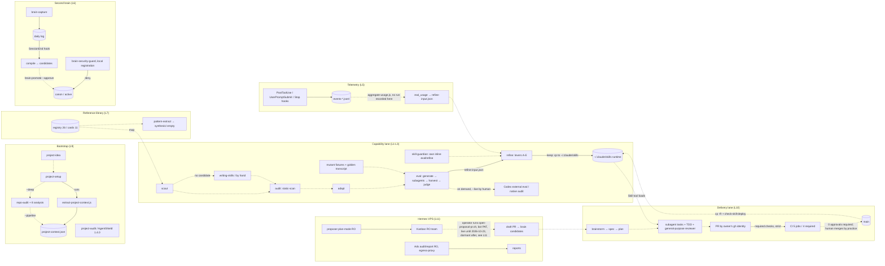

# S1 — Current Architecture & Gap Analysis
> Phase 3 of the Software Factory evaluation campaign · Date: 2026-10-22 · Status: proposal for owner approval; nothing implemented
> Inputs: phase 1 (docs/evaluations/2026-10-22-factory-research/), phase 2 (docs/evaluations/2026-10-22-factory-comparison/), claude_code at b8ed8a7
> Legend: [Ver] verified in claude_code · [Res] research finding · [Exp] expected benefit · [Asm] assumption · [Unk] unknown

## 0. Scope and method

- **What this is.** The factual base for the other phase 3 deliverables (S2–S6). It describes what `claude_code` is
  today, what is proven, what is weak or open, and where it stands against the value definition and against the
  strongest approaches shown in phase 2. It recommends nothing on its own except owner decisions that the facts force
  (§ Decisions).
- **How it was verified.** Everything tagged [Ver] was re-read in the repository at `b8ed8a7` on 2026-10-22 with
  read-only commands: `ls`, `grep`, `git log`, `node -e` reads of JSON files, and four kinds of read-only `gh` call
  (the `main-protection` ruleset, `gh auth status` with the token masked, the bodies and merger of recent PRs, and,
  in the correction pass, `gh run list` for the CI result on b8ed8a7). One
  read-only script also ran: `node scripts/check-skill-deploy.js`, which compares files and prints names only.
  Gitignored eval and telemetry artifacts under `evals/` were counted, not quoted. No tests, evals, installers or
  writers were run.
- **Machine-local facts.** `.claude/settings.local.json` is gitignored (`.gitignore:2`), and `~/.claude/` is the
  owner's user configuration. Facts about them are tagged **[Ver, machine-local]**. They describe how the factory is
  *operated* on the development laptop, not what `install.sh` *ships*.
- **Delegation.** Two read-only sub-searches collected the facts on the Hermes control plane and on the brain and
  reference library. I re-checked each load-bearing claim before using it: the guard's fail-open path and its exit
  codes, `brain-promote` refusing without `--approve`, the registry count and install policy, the guard registration,
  Hermes `--allowedTools`/plan mode, the egress allow-list, and the internal network.
- **Citations.** `[Rnn §x]` refers to a phase 1 report. `[P2-Dn §x]` refers to a phase 2 deliverable: D1 matrix,
  D2 capability matrix, D3 best practice, D4 reuse matrix, D5 intelligence report. `[S1 §x]` refers to this document.
  Where P2-D2 and P2-D4 disagree on a candidate verdict, P2-D4 governs.

---

## 1. Current architecture (verified now)

### 1.1 Inventory, counted dynamically

| Item | Count at b8ed8a7 | How counted |
|---|---|---|
| Pipeline skills in `skills/` | **30** | `find skills -mindepth 1 -maxdepth 1 -type d \| wc -l` [Ver] |
| Repo-only skills in `.claude/skills/` | 1 (`codex-eval`; `install.sh` does not copy it) | `find .claude/skills -name SKILL.md`; README "Directory Structure" [Ver] |
| Runtime sub-agents in `.claude/agents/` | **16** (8 are `repo-audit-*` layer analysts) | `ls .claude/agents/*.md`, excluding `*-EVAL.md` [Ver] |
| Hermes skills (`infra/hermes-agent/skills/`) | 6, each a single SKILL.md | `ls` [Ver] |
| Domain-pack skills (`packs/*/skills/`) | 3 (ga-report, gads-manage, wp-manage) | `find packs -name SKILL.md` [Ver] |
| Node test suites found by `run-all-tests.js` | **42** (39 `*.test.js` + 3 named) | `scripts/run-all-tests.js:4,17-19`; `find` [Ver] |
| Hermes Python suites | 61 in `bin/` (`run-bin-tests.sh` globs `bin/` only) + 5 in `deploy/` | `find`; `.github/workflows/ci.yml:79,100-107,120-122` [Ver] |
| Reference registry entries | 26, all `install_policy: do-not-install-directly`; 11 source cards | `reference-repositories/registry.json`; `ls sources/` [Ver] |
| Superpowers specs / plans in git | 38 / 51 entries (the 51 include an `archive/` folder) | `ls docs/superpowers/{specs,plans}` [Ver] |
| Commits / merges | 1,316 commits in all; 1,075 commits and 174 merges since 2026-08-01 | `git log` [Ver] |

### 1.2 Capability layers

**L1. Capability lane, skills.** The chain is `skill-scout → skill-audit → skill-adapt → skill-eval → skill-refine`
(`CLAUDE.md:26-40`) [Ver].
- *Scout.* Scores candidates on 7 weighted dimensions. "Provenance" is repo age plus stars, and "Source reputation"
  favours trusted orgs (`skills/skill-scout/SKILL.md:84-96`).
- *Audit.* `skill-audit` is a static pattern scanner (`skills/skill-audit/scripts/static-scan.js`). Its known limits
  are accepted, for example S11, which reads only the first `rm` target (active decision 2026-10-21 S11).
- *Adapt.* Writes a provenance block with `source_url`, the 40-character `source_commit` and `license`
  (`skills/skill-adapt/SKILL.md:58-66`).
- *No candidate fits.* `superpowers:writing-skills` if installed, otherwise by hand. Either way the result goes back
  through audit → eval, and `validate-skills.js` enforces that references to other skills resolve
  (`docs/evaluations/2026-10-14-phase3-implementation.md:14,22-30`).
- *Supporting agents* [Ver]:
  - `skill-scout-agent`: WebFetch, WebSearch, Write, Bash, Agent (`.claude/agents/skill-scout-agent.md:32`)
  - `skill-synthesizer-agent` (opus): Read, Write
  - `skill-needs-analysis-agent` (haiku): Read, Bash
- *Supporting skill:* `skill-discovery` (log mining)

**L2. Capability lane, agents and teams.**
- `agent-scout → agent-audit → agent-adapt → agent-eval → agent-refine` mirrors the skill chain. In agent-refine,
  Lever E (frontmatter) triggers an agent-audit re-run (`CLAUDE.md:40`) [Ver].
- `team-eval` evaluates an orchestrator plus its members from a `team.json`. Its metrics are Dispatch-Chain Accuracy
  ≥ 85% and Handoff Integrity ≥ 90% (`skills/team-eval/SKILL.md:85-91`). Failures go to the orchestrator's refine
  track; there is no team-refine (`:102-104`) [Ver].

**L3. Eval and refine loops, and their metrics.**
- *Scenarios.* `generate-seed-evals.js` writes 9 scenario types with `--context`
  (`skills/skill-eval/SKILL.md:29-46`).
- *Baseline.* The baseline is "no skill loaded", `baseline_method none` (`:53`). This is E12, effective 2026-10-20
  (active decision 2026-10-21).
- *Repetitions.* Each scenario runs 3 times (`:77`). `total_tokens` and `duration_ms` go to `timing.json` (`:77`).
- *Evidence.* `harvest-evidence.js` derives `skill_loaded`, workflow steps and artifact hashes from the filesystem and
  the transcript, never from a self-reported header (`:79-85`). The LLM judge scores only the `expected.judgment`
  items and the output quality (`:85`).
- *Integrity.* `run-manifest.js` records the scenario states and pins the subject's sha256 and commit (`:57-65,87-91`).
- *Five metrics and their thresholds* (`:93-98`):
  - pass rate ≥ 80%
  - trigger or dispatch accuracy ≥ 85%
  - context footprint: lines × 4 tokens, informational
  - project fit ≥ 7/10
  - resilience ≥ 8/10
  - The `critical` tier raises every threshold (`CLAUDE.md:53-56`).
- *Analyst pass* (`:100-105`).
- *Refine.*
  - One lever per iteration (A–E).
  - Keep above baseline + 2, revert below baseline − 5. A neutral edit is kept only if it makes SKILL.md shorter.
  - Default budget 10 iterations (`skills/skill-refine/SKILL.md:17-22,59-67`).
  - Training and validation split: the failing scenarios are the training set. Project-native, project-workflow and
    multi-turn are held out until final validation (`:45-49,72`).
  - A KEEP **syncs the skill to `~/.claude/skills/`** (`:60`).
  - Calibration [Ver]:
    - Two mutant fixtures with 4 documented defects each: `fixtures/mutant-*`, `fixtures/GATE-RUNBOOK.md:131-136`.
    - A golden transcript for blind grader calibration (`scripts/run-grader-calibration.js`; `CLAUDE.md:10`).

**L4. Codex external eval.**
- Codex CLI acts as a second-model evaluator.
- It is dry-run by default; `--live` must be typed by a human (`scripts/codex/run-external-skill-eval.js:4,20,36`).
- It runs `--sandbox read-only` (`:199`).
- Native-audit mode re-judges a finished native run's transcripts.
- Disagreement matrix: a split verdict goes to manual review (README "Codex External Eval Layer"; `CLAUDE.md:89-107`)
  [Ver].

**L5. Telemetry.**
- `log-invocation.js` runs on PostToolUse `Skill|Task`. `log-outcome.js` runs on UserPromptSubmit, Stop and
  SessionEnd (`.claude/settings.json` hooks block) [Ver].
- The correction signal is a heuristic: the prompt names an artifact plus revision words
  (`scripts/telemetry/log-outcome.js:12-16`).
- `aggregate-usage.js` flags REFINE_RECOMMENDED at ≥ 10 invocations in 30 days and (correction > 0.3 or
  rejection > 0.2), advisory only (`scripts/telemetry/aggregate-usage.js:8-9,31-32`) [Ver].
- Telemetry never stores prompt text (`CLAUDE.md:87`) [Ver].

**L6. Second brain.**
- *Structure.* `.project-brain/` holds:
  - canon: 27
  - active decisions: 9
  - candidates: 2
  - superseded: 23
  - lesson memories: 7, all `candidate`
  - synthesis: empty
- *Scripts.* `scripts/brain/*.js` handle capture, compile, promote, search, context-pack, lint and verify. There is
  also a retrieval benchmark with a sealed answer key (`secondbrainbench-*`) [Ver].
- *Canon gate.* `brain-promote.js` refuses without `--approve` (exit 2, `scripts/brain/brain-promote.js:28-31`), and
  the brain-promote skill cannot be invoked by the model (`disable-model-invocation: true`).
- *Hooks.* `hooks/brain/*.sh`: four of them always exit 0. Only `brain-security-guard.sh` can deny.
  - It denies with `permissionDecision` and exit 0.
  - It fails **open** with exit 1 if node cannot run it, and on a timeout
    (`hooks/brain/brain-security-guard.sh:12-18,415-424`).
  - It is registered with a 30 s timeout, but **only in the gitignored `.claude/settings.local.json:106-111`**
    [Ver, machine-local].

**L7. Reference-repository library.**
- *Registry and cards.* `reference-repositories/` holds a registry of 26 entries and 11 source cards.
- *Scripts.* `brain-reference-repo-{add,audit,map,refresh}.js`:
  - `audit` exits 3 on a wrong install policy, an executable file or sensitive content.
  - `map` hands off to skill-scout.
- *Skills.* `reference-repo-add`, `-audit` and `-pattern-extract`, plus `gstack-pattern-audit`.
- *Gaps.*
  - **There is no structured licence field and no commit-SHA provenance field** in the registry, the card template
    or any card. Three of the 11 cards mention licences in prose: `anthropic-skills/source-card.md:31-35`,
    `anthropic-claude-code/source-card.md:16`, `claude-code-ultimate-guide/source-card.md:32`.
  - Pattern extraction has never written output: `synthesis/` is empty.
  - The guard denies a direct copy from `reference-repositories/sources/` into `.claude/skills`
    (`brain-security-guard.sh:411-413`) [Ver].

**L8. Repository analysis.**
- `repo-audit` packs a public repository with `npx repomix`. If Repomix fails it falls back to
  `pip install gitingest` (`skills/repo-audit/SKILL.md:35,55,61`).
- It then dispatches 8 layer analysts with tools `Read, Bash` (`.claude/agents/repo-audit-*.md:4`).
- Optionally it injects `ref_signals` into `evals/project-context.json` (`--pipeline`, `:206-218`) [Ver].

**L9. Project bootstrap and security.**
- `project-idea` interviews the user and writes PROJECT-BRIEF.md.
- `project-setup` writes CLAUDE.md and `project-context.json`. Its Phase 0 takes up to 3 reference URLs, fetched
  lightly or, with `--deep`, through repo-audit (`skills/project-setup/SKILL.md:21-41`). It runs
  `extract-project-context.js` (`:137-139`).
- `project-audit` wraps AgentShield, pinned at `@1.4.0` (`skills/project-audit/SKILL.md:46-58,168`) [Ver].

**L10. Delivery lane: software actually built.**
- *Method.* Superpowers brainstorm → spec → plan → subagent-driven tasks, TDD and finishing-a-branch. Superpowers is
  a user-level plugin (`~/.claude/settings.json` `enabledPlugins`, superpowers 7.0.0) [Ver, machine-local].
- *Task reviewers.* The task reviewer and re-reviewer are `general-purpose` subagents
  (`…/superpowers/7.0.0/skills/subagent-driven-development/task-reviewer-prompt.md:11`) [Ver, machine-local].
- *Review protocol.* `docs/REVIEW_PROTOCOL.md`:
  - The reviewer reads the intent first, re-runs the checks at a named SHA and numbers the findings.
  - Only the reviewer closes a finding.
  - "Approve, don't merge. Merging is a human action" (`:8-22`) [Ver].
- *PR template.* `.github/pull_request_template.md` [Ver].
- *CI.* `.github/workflows/ci.yml` has 5 jobs: frontmatter, security gate, tests (node + Hermes + deploy), bind
  agreement, and static scan of skills [Ver].
- *Ruleset `main-protection`.* Read by `gh api` on 2026-10-22 [Ver]:
  - active, with no bypass actors
  - 4 required checks (bind agreement, test suites, frontmatter, security gate)
  - `strict: true`
  - non-fast-forward and deletion blocked
  - review threads must be resolved
  - `require_extra_approval_for_unattributed_changes: true` (what it means with 0 required approvals is [Unk])
  - **`required_approving_review_count: 0`**
  - "Static scan all skills" is not required

**L11. Hermes control plane (VPS).**
- *Runtime.* Nous Hermes Agent, digest-pinned v0.21.5 (`infra/hermes-agent/Dockerfile:12`). The control-plane model
  is DeepSeek through OpenRouter, and the executor is Claude (`infra/hermes-agent/README.md:10-13`) [Ver].
- *Track A, proposals.*
  - The proposer runs `claude -p --allowedTools 'Read,Grep,Glob' --permission-mode plan`
    (`skills/claude-code-proposer/SKILL.md:42`).
  - A Kanban review team (`bin/make-review-board.py`).
  - Operator-run draft-PR delivery (`open-proposal-pr.sh`) through the separate `dentaledge-bot` PAT into
    `.project-brain/decisions/candidates` (`registry/projects.yaml:37-40`). Round 2 note: dormant from 2026-10-23.
    The owner decided on 2026-10-14 to let `dentaledge-bot-pat` expire on 2026-10-23, not renewed
    (`.project-brain/sessions/daily/2026-10-14.md:35-37`), and on 2026-10-23 chose `dentaledge-bot` as the laptop
    agent's account (S6 §7, OC-1); restoring delivery is a separate Track A decision with its own identity.
- *Track B.1, read-execute.*
  - Ads audit and report jobs run plan-mode `claude -p` with Read/Grep/Glob pre-approved, Bash not removed (`run-ads-audit.sh:25`;
    `bin/run-client-audit.py:82`).
  - The drafter's only egress is `api.anthropic.com:443` on an `internal: true` network (`docker-compose.yml:188-207`).
  - The gateway model never sees audit content (`skills/ads-audits/SKILL.md:8`).
  - Parsers treat their input as hostile and use closed key sets (`bin/app_lib.py:7`) [Ver].
- *Mutation tier.* The code is present but parked. There is no write credential (canon
  `2026-09-29-d3-2-decided-hermes-runs-read-only-no-write-credential.md:12`;
  `infra/hermes-agent/registry/projects.yaml:110-118`) [Ver].
- *Security reviews.* 11 numbered reviews; the latest, #11, PASSED 38/38 on checklist v1.22. CI refuses a checklist
  change without a version bump (`ci.yml:84-92`) [Ver].

**L12. Install, uninstall and deploy check.**
- `install.sh` copies the skills and agents into a target and syncs them to `~/.claude/skills/`. It merges the
  telemetry hooks into the target's settings and refuses a file it cannot parse (`install.sh:3-4,88,228-281`).
- `uninstall.sh` mirrors it, with an `rm -rf` target guard (P9).
- `scripts/check-skill-deploy.js` compares every skill with its installed copy (`:2-6`). Run on 2026-10-22, it
  reported **30 checked, all match**, exit 0 [Ver]. It is a manual step outside CI (`CLAUDE.md:15,75`).

**L13. Domain packs.**
- `packs/` holds google-analytics (read-only), google-ads (hitl) and wordpress (staging-autonomous).
- `scripts/packs/pack-audit.js` exits 3 on policy violations. Its unit tests run in CI; the audit itself is not run
  against the real packs in CI [Ver].

**Governance spine shared by all lanes** [Ver]:
- the brain promotion gate;
- `docs/REVIEW_PROTOCOL.md`;
- `docs/CLAUDE_CODE_KNOWLEDGE.md` (official docs first);
- the rule to verify against primary sources (`CLAUDE.md:76-78`);
- the CI ruleset;
- owner approval for push, PRs, merges, branch deletion, skill deploys, and changes under `~/.claude` or in GitHub
  settings (value definition, working rule 1).

### 1.3 How the layers connect today

Solid arrows are automated: code, a hook, CI or a script call. Dashed arrows are manual: a human acts, or a model
follows prose.

**Link automation (what moves without a human)** [Ver]:

| Link | Mechanism | Automated? |
|---|---|---|
| PR → CI required checks → merge eligibility | ruleset + `ci.yml` | **Yes (code)**. The merge click is a human practice: 0 approvals required, and the author and merger are one account (`gh pr list`: #164–#173 authored and merged by `dentaledgesolutions`) |
| eval → refine handoff | `refine-input.json` written by the model per `skill-eval/SKILL.md:109` | Prose-driven model action |
| adapt / refine KEEP → runtime deploy | `cp -r skills/<name> ~/.claude/skills/` in `skill-adapt/SKILL.md:84`, `skill-refine/SKILL.md:60` and `skill-refine-agent.md:124`; sanctioned by `CLAUDE.md:75` | Model action, with no gate besides the session permission prompt |
| merged skill → runtime deploy | `CLAUDE.md:75` + `check-skill-deploy.js` | **Manual** (the check is outside CI) |
| telemetry → refine | `aggregate-usage.js` merges `real_usage` | Manual. No `usage-summary.json` exists under `evals/telemetry/` [Ver], so it has probably never been run here [Inf] |
| session log → candidates | `brain-session-end.sh` on SessionEnd | **Yes (hook)** |
| candidate → canon | `brain-promote.js --approve` | Manual by design. The flag is typed text, not a separate identity (§3, L-08) |
| reference → scout | `brain-reference-repo-map.js` | Manual |
| Hermes proposal → claude_code | operator runs `open-proposal-pr.sh` → draft PR | Manual (operator), separate bot identity |
| Codex eval | `--live` typed by a human | Manual by rule (`CLAUDE.md:100`) |
| skill references resolve | `validate-skills.js` in the required frontmatter job | **Yes (CI)** |

---

## 2. Strengths, with evidence

| # | Strength | Evidence |
|---|---|---|
| ST-1 | **Factory self-testing in required CI** | 42 node suites, 61 Hermes `bin` suites, 5 deploy suites. Linux integration runs as root, and any skip is a failure (`HERMES_REQUIRE_LINUX_INTEGRATION=1`, `ci.yml:103-122`). The ruleset requires the test job [Ver] |
| ST-2 | **Head-bound, code-enforced merge eligibility, natively** | Required checks + `strict: true` + no bypass actors + non-fast-forward + required thread resolution (ruleset read 2026-10-22). This is the GitHub-native equivalent of R03's "verify on the current base, match the head" [Ver config; equivalence Inf]. It matches the [P2-D5 §4 P1/P3] mechanism without R03's `auto` self-merge default [Res P2-D4 §2.1] |
| ST-3 | **Behavioural evals of skills, agents and teams against a no-skill baseline** | 9 scenario types; 5 metrics; evidence harvested from the filesystem, not self-report (`skill-eval/SKILL.md:77-85`); analyst pass; team-eval chain metrics; E12 baseline (decision 2026-10-21). No researched repository has a standing equivalent on its main branch: R05's is unmerged, R03's is paid and gitignored, and R07's agent-experience eval (scored on real transcripts) is not in CI [Res P2-D2 C4, §5.11] |
| ST-4 | **Checker validation** (the checks have been shown to fail) | Calibration PASS 4/4 on each mutant fixture (`evals/fixtures/CALIBRATION-REPORT-mutant-*.md`, 2026-07-08). In the brief-writer fixture the native layer missed 2 defects and caught 1 only partly, and the Codex audit layer caught them, which shows the second layer earns its place. Grader calibration PASS (`GRADER-CALIBRATION-REPORT.md`, 2026-07-08). Mutation checks are used in reviews (triage P13 "reverting `cwd: WORK` makes the guard fail again"; PR #170 "every behaviour-changing mutant is caught") [Ver]. Only R10 is Strong on this in the research [Res P2-D2 C5] |
| ST-5 | **Independent second-model evaluator** | Codex is read-only sandboxed and dry-run by default, with a disagreement matrix (`run-external-skill-eval.js:4,199`). In the research, LLM reviewers are the builder's model family except R09 and R02 [Res P2-D5 §1 item 4] |
| ST-6 | **No autonomous merge path, by decision** | 2026-10-14 approved evaluation §4 items 15–19; REVIEW_PROTOCOL "Approve, don't merge" (`:22`) [Ver] |
| ST-7 | **Hermes: structural least privilege and untrusted-input containment** | No write credential (canon D3.2). Proposer and audits run plan-mode `claude -p` with `--allowedTools 'Read,Grep,Glob'` (`claude-code-proposer/SKILL.md:42`; `run-ads-audit.sh:25`); per the official CLI docs that flag pre-approves tools but does not remove Bash (use `--tools`), so they are read-only by mode, `:ro` mounts and missing credentials, not by tool list [Docs, via S4 V-S4-12; hardening is S5 P1-16]. The gateway never sees content, and parsers use closed key sets (`ads-audits/SKILL.md:8`; `app_lib.py:7`). Egress is allow-listed to one host (`docker-compose.yml:188-207`), the image is digest-pinned, and 11 numbered security reviews have been run with a CI-versioned checklist [Ver]. Its read-only property rests on mode, mounts and missing credentials rather than on a tool restriction; a tool-enforced read-only agent is something [P2-D5 §1 item 4] found on no researched default branch, and P1-16 would add it for the proposer |
| ST-8 | **Governed memory and decisions** | Canon only through `--approve` (`brain-promote.js:28-31`). Active decisions, superseded records, lessons as candidates, lint for staleness, a retrieval benchmark [Ver]. The research has nothing comparable (R03 correction tickets, R10 incident log) [Res P2-D2 F1] |
| ST-9 | **Review protocol with reviewer-only closure, practised** | `REVIEW_PROTOCOL.md:14-22`. PR #170 records "four rounds, findings C1–C15 all closed by the reviewer" plus mutant runs. The triage record shows many numbered rounds (`docs/evaluations/2026-10-15-pr4-hermes-proposal-triage.md`) [Ver] |
| ST-10 | **Provenance and supply-chain discipline in sourcing** | Every registry entry is `do-not-install-directly`, with an audit exit 3 on executables. Adapt pins `source_commit`. AgentShield is pinned `@1.4.0`, the Hermes image by digest. The guard blocks copying from sources into `.claude/skills` [Ver] |
| ST-11 | **Measured context footprint** | The listing overflow was measured (154 skills, 45,657 > 30,000 chars). It was fixed by `skillListingBudgetFraction: 0.02` plus GSD name-only (decision 2026-10-15 D3; `~/.claude/settings.json:254`) [Ver, machine-local] |
| ST-12 | **Secrets never in telemetry; read-deny rules** | Project deny rules (`.claude/settings.json` permissions), user-level deny for `.env*`, `~/.ssh/id_*`, `~/.aws` and the Hermes key files [Ver, machine-local]. A shared secret-pattern module (triage P1). Telemetry stores only `context_hash` (`CLAUDE.md:87`) [Ver] |
| ST-13 | **Verify-before-decide culture recorded** | `CLAUDE.md:76-78`; `docs/evaluations/` dated records with sources; decisions cite their evidence [Ver] |

---

## 3. Limitations, redundancies and open debts

### 3.1 Known open items from the brief, re-verified

| Item | Status now | Evidence |
|---|---|---|
| P8: Hermes skills have no evals | **Open, verified.** 6 skills, 0 SKILL-EVAL.md and 0 evals.json. Also not scanned by any CI static scan: `ci-scan-skills.js` scans `skills/` only (`:5,25`), and AgentShield scans `.claude/` (`ci.yml:32`) | `find`; `grep -rn hermes-agent/skills scripts .github` returns no scanner [Ver] |
| Brain guard gaps G1–G5 | **Open, verified.** G1 (any mention of `brain-promote … --approve` exempts the whole command) is visible in code at `brain-security-guard.sh:90-111`. `decisions/active/` has no write or edit protection: the write rules match canon only. The capsule-wide delete rule (`brain-security-guard.sh:4-6,112ff`) still covers deleting it. The guard is registered only in the gitignored local settings | triage `:820-842`; `SECOND_BRAIN_SECURITY.md:14,80,162-172`; `.claude/settings.local.json:106-111` [Ver] |
| RR4: `onFailure: block` with a recovery path | **Open (owner).** The guard fails open on a node failure (exit 1) and on a timeout. `guard-failures.log` holds 50 fail-open entries, all on 2026-10-15 | triage `:853`; `brain-security-guard.sh:415-424` [Ver] |
| Installers rewrite settings with nothing added | **Open, verified.** `fs.writeFileSync` runs even when `added === 0` | `install.sh:274-281` [Ver] |
| S11 research follow-up | **Open; limit accepted** (tripwire, not boundary) | active decision 2026-10-21 S11 [Ver] |
| E16: refine snapshot/revert never exercised by an LLM run | **Open.** No `SKILL.md.baseline` exists anywhere in the repo or `evals/`. 4 skills have a SKILL-REFINE-LOG.md (skill-adapt, skill-discovery, skill-eval, skill-scout), all from before E12 | `find`; decision 2026-10-21 [Ver] |
| uninstall.sh crashes on bash 3.2 when there are no agents | **Open, verified.** `set -euo pipefail` (`:10`) plus `${AGENT_FILES[*]}` on an empty array (`:67`) | triage `:721` (line 48 there is on an older commit) [Ver] |
| Weekly brain review overdue | **Overdue.** `BRAIN.md:4` "Last reviewed: 2026-10-12" (10 days ago) | [Ver] |
| Two old candidates | **Both > 30 days.** `2026-08-05-hermes-post-p6-backlog.md` (untracked in git) and `2026-08-16-hermes-credential-locus-vs-project-autonomy.md` | `ls`; git status [Ver] |
| Five stale canon entries | **5 in `.project-brain/reports/lint/2026-10-22.md`**: second-brain v1, AI OS charter, Hermes local-first, adopt Nous Hermes, Hermes memory corrections (rule: not superseded or retired, and the later of `timestamp` and `reviewed_at` is older than 90 days, `brain-lint.js:16-17,37-45`; none of these entries has a `reviewed_at`). The charter body still says "Status: candidate" although it is in `canon/` (`canon/2026-07-17-ai-os-charter.md`, first blockquote) | [Ver] |
| Guard false positive on "rm" | **Documented as G3** (the canon mutation check matches the word `rm` anywhere) | triage `:822` [Ver] |
| gstack-pattern-audit retirement | **Undecided.** The only record is a [note] in `sessions/daily/2026-10-22.md:3-5`; both skills' `evals.json` have uncommitted edits (git status) | [Ver] |
| Hermes key rotation | **Open, owner.** The records disagree on whether the key was exposed: `docs/superpowers/handoffs/2026-10-14-software-factory-phase3-merged.md:92` vs HR1 `2026-10-19-hr1-secret-read-controls.md:168-170,190` | [Ver] |
| GSD second delivery framework | **Still installed user-level**: 72 skills name-only, 2 hooks kept (`gsd-secret-read-guard`, `gsd-read-injection-scanner`), `~/.claude/settings.json` hooks. Option C (uninstall) waits on HR1, whose layers A–C are done | decision 2026-10-15 D3 [Ver, machine-local] |

### 3.2 Further findings (this pass)

**L-01. Untrusted text reaches write-capable agents with no guard** [Ver]. Mandatory-criterion bearing.
- **No skill, agent or the codex-eval skill contains any untrusted-input or "data, not instructions" rule.** A
  case-insensitive grep over `skills/*/SKILL.md`, `skills/*/REFERENCE.md`, `.claude/agents/*.md` and
  `.claude/skills/*/SKILL.md` returns 0 files.
- **Scout.** `skill-scout-agent` WebFetches arbitrary GitHub SKILL.md bodies (`skill-scout/SKILL.md:49`) and holds
  Write, Bash and Agent (`skill-scout-agent.md:32`).
- **Guardian.** `skill-guardian` holds WebFetch with Write, Edit and Bash (`skill-guardian.md:5`).
- **repo-audit.** Its analysts read packed third-party repositories with Bash (`repo-audit-*.md:4`).
- **The static audit runs after scout reads the content, not before.** Its known misses include injection phrasings
  inside code blocks (decision 2026-10-21, "smaller limits").
- The Hermes B.1 split (ST-7) is an internal precedent for doing better.
- Track A's Kanban workers also have no framing (`infra/hermes-agent/skills/claude-code-reviewer/SKILL.md:31-40`).
  They are **not** counted as a breach:
  - They are read-only by prose (`:30`).
  - Their toolsets are confined to `[file, skills]` (`bin/setup-review-team.sh:34`).
  - The project mounts are `:ro` (`docker-compose.yml:40-41`).
  - Whether the Hermes `file` toolset can write anywhere consequential is [Unk]. The terminal backend is local
    (`config.yaml.example:25-29`).

**L-02. Unpinned code in a shipped skill's default path** [Ver]. Mandatory-criterion bearing.
- `repo-audit` runs `npx repomix` with no version (`skills/repo-audit/SKILL.md:35,55`).
- On fallback it runs `pip install gitingest` with no version (`:61`).
- It ships through `install.sh`. By contrast `project-audit` pins AgentShield (`:46`).

**L-03. The approval identity is shared, and push/PR are pre-approved locally** [Ver, machine-local + Ver].
- `gh auth status`: Claude Code sessions use the owner's `dentaledgesolutions` login with `repo` and `workflow`
  scopes.
- PRs #164–#173 were authored and merged by the same account.
- `.claude/settings.local.json` pre-approves:
  - `Bash(git push *)` (`:10`)
  - `Bash(git *)` (`:63`)
  - `Bash(gh pr *)` (`:68`), which includes `gh pr merge`
  - `Bash(python3 *)` (`:59`)
  - `Agent` (`:28`)
- The ruleset requires 0 approvals.
- **Consequence [Inf]:** "Merging is a human action" (`REVIEW_PROTOCOL.md:22`) rests on prose and on auto mode's
  classifier (`~/.claude/settings.json:13` `defaultMode: auto`). Its effectiveness here is [Unk]. GitHub cannot
  distinguish an agent merge from a human one. This is the P2-D4 §2.1 pattern ("weak when agent and human share a
  token"). Hermes already uses a separate bot identity for its PRs.

**L-04. The judged party can change its judge.**
- **CI workflow [Ver config; Inf behaviour].** A same-repo PR can edit `.github/workflows/ci.yml`, the tests,
  `.github/skill-scan-baseline.json` or `scripts/ci-*.js`. The token has the `workflow` scope, and the ruleset has no
  code-owner review and 0 approvals. GitHub matches required checks by job name.
  [Asm, GitHub docs, not re-verified here] For a same-repo `pull_request` event, the workflow definition comes from
  the PR's merge ref, so a weakened job with the same name would satisfy the gate.
- **Refine on the evaluator itself [Ver path; Inf].** When the refine subject is `skill-eval`, Lever E edits
  `skills/<name>/scripts/`, which includes `skills/skill-eval/scripts/harvest-evidence.js`. That file is the
  harvester the re-eval itself runs (`skill-eval/SKILL.md:81`; `skill-refine/SKILL.md:55`).
- **E6 [Ver].** `skill_loaded` comes from a marker the subagent is told to write. It is disclosed, and kept by owner
  decision (decision 2026-10-21).

**L-05. Delivery acceptance is authored by the builder** [Ver; Res]. Correctness-bearing.
- In the delivery lane, the tests that CI runs are written in the same PR by the same model session that implements.
- There is no held-out or independently authored acceptance check, and no false-completion measure.
- Showing a new check fails first is required in prose for bug fixes only ("the failure captured **before** the
  fix", `REVIEW_PROTOCOL.md:28`). It is not enforced, and it is not required for features (`:29`). TDD "red first" is
  prose in the Superpowers skill.
- Reviewers are `general-purpose` subagents with all tools, prompted to review (L10). Context separation is not tool
  restriction [Res P2-D5 §1 item 4, P6].

**L-06. The owner's outcome measures are unmeasured, and the telemetry proxy is unvalidated** [Ver].
- **What the events show.** In `evals/telemetry/events-2026-0{7..10}.jsonl` (gitignored), counted on 2026-10-22 at
  about 19:55. The files are appended live, and a later count by the verifier found 1,199 / 769 / 511:
  - 1,197 invocation events, 767 session_end, 510 outcome events.
  - All 510 outcomes are "revised" corrections; there are **0 rejection events**.
  - Top targets, with how many of their invocations were flagged as corrected (table as of about 19:55):

    | Target | Invocations | Flagged |
    |---|---:|---:|
    | general-purpose agent | 1,018 | 501 |
    | superpowers:writing-plans | 29 | 0 |
    | superpowers:brainstorming | 27 | 0 |
    | superpowers:subagent-driven-development | 25 | 0 |
    | skill-eval-agent | 22 | 3 |
    | brain-capture | 19 | 0 |
    | codex-rescue | 14 | 2 |
    | superpowers:finishing-a-development-branch | 11 | 0 |

  - The pipeline skills scout, audit, adapt and refine have **0** Skill-tool invocations.
- **Interpretation [Asm].** A 49% correction flag on general-purpose agents is more likely the keyword heuristic
  (`log-outcome.js:12-16`) than real rework. Invocations from slash commands may not pass the `Skill|Task` matcher.
- **Not measured.** Per the value definition's own coverage note (working rule 3) and confirmed here: first-pass
  acceptance, human interventions per task, time from spec to verified delivery, cost per accepted deliverable,
  recovery success and reuse effectiveness.

**L-07. Evaluation currency** [Ver].
- Of the 30 skills, **25 have a measured SKILL-EVAL.md**. 4 are placeholders with PENDING metrics: repo-audit,
  agent-scout, agent-audit, agent-adapt (each `SKILL-EVAL.md:4,7-14`). `team-eval` has none.
- All are dated 2026-06-19 to 2026-07-16, before E12, so none can be compared with new runs (decision 2026-10-21).
- Only 1 of 16 agents has an eval (`.claude/agents/skill-eval-agent-EVAL.md`, 2026-06-30).
- The latest Codex `CODEX-EVAL-SUMMARY.md` files date from 2026-06-30/07-01. The calibration reports date from
  2026-07-08.
- Behavioural evals are not a regression gate: they are not in CI and their results are gitignored.

**L-08. Approval channels the model can type into** [Ver].
- *Canon promotion.* `--approve` is a CLI flag that any Bash call can pass, and the guard exempts such commands (G1).
  The model-invocation block applies only to the skill, not to the script.
- *Skill deploys: a rule conflict.*
  - The project rule **sanctions** self-deployment: "skill-adapt and skill-refine sync their own result to
    `~/.claude/skills/`" (`CLAUDE.md:75`).
  - Three paths deploy with no separate gate:
    - `skill-adapt/SKILL.md:84` (step 10 "Sync to runtime");
    - skill-refine's KEEP (`skill-refine/SKILL.md:60`);
    - skill-refine-agent's KEEP (`.claude/agents/skill-refine-agent.md:124`).
  - The campaign's value definition (working rule 1) treats a skill deploy as a consequential change that needs owner
    approval.
  - So the two rules conflict. The standing project rule allows what the campaign rule requires approval for.

**L-09. No reuse-decision step and no licence gate** [Ver].
- Licence is recorded, not gated. Scout notes `license` (`skill-scout/SKILL.md:49,61`), and adapt writes it or
  "unknown" (`skill-adapt/REFERENCE.md:84`; `SKILL.md:66` says "omit if unknown", an inconsistency).
- Scout's provenance score rewards stars (`:92`). Stars are flagged as an untrustworthy signal by:
  - the 10-14 evaluation (REA, "237k stars in 6 months, an anomaly not trusted as a signal",
    `2026-10-14-software-factory-architecture-evaluation.md:71`);
  - [R07 §16] (365k stars, "organic nature unknown"; R07 §1 marks organic popularity U);
  - [P2-D4 §5.1] (R07 row).
- REUSE/ADAPT/… verdicts exist only in evaluation documents. The registry has no structured licence field.
- **0 of 30 skills and 0 of 16 agents carry an external provenance block.** `source_url:` appears only in the two
  adapt templates. In this repository the sourcing lane has never produced an installed, sourced definition
  [Ver for this repo; Unk for target projects].

**L-10. Redundant or divergent paths** [Ver].
- **skill-guardian (agent).** It reimplements eval and refine inline (`skill-guardian.md:153-271`):
  - no `harvest-evidence.js`, no `run-manifest.js`, no no-skill baseline (grep: no hits);
  - it reuses a SKILL-EVAL.md under 7 days old (`:161`) and caps refine at 3 iterations (`:240`);
  - it says "never `~/.claude/skills/`" (`:340`), against `CLAUDE.md:75`;
  - its report `PROJECT-SKILL-HEALTH.md` dates from 2026-06-23 and describes 10 skills.
  It is a second evaluation methodology, weaker than E12 and evidence-first grading.
- **gstack-pattern-audit vs reference-repo-pattern-extract.** Near-total overlap; the generic skill already covers
  gstack, and its audit gate is stricter (sub-search; both SKILL.md workflows).
- **Three "analyse an external repo" paths:**
  - `repo-audit`: stack signals, external packers;
  - `project-setup` Phase 0: a light WebFetch of up to 3 URLs (`:60`);
  - `reference-repo-pattern-extract`: governed, card-driven.
  Only the third is governed by the registry and its audit. The first two write into `project-context.json` or
  `docs/audits/` without a registry entry or licence field.
- **GSD alongside Superpowers.** A second delivery framework stays installed user-level (§3.1).

**L-11. Cost control** [Ver].
- The only bounds are attempt counts in prose: refine 10 iterations, guardian 3, eval 3 reps.
- A full skill-eval is "18–42 subagents per skill" (phase3-implementation `:50`). There is no per-run or per-task
  token or dollar ceiling in `claude_code`.
- Hermes caps spend only at the provider: $20/month Anthropic workspace and $10/month OpenRouter key
  (`docs/security-reviews/2026-10-14-review-11.md:46,73`).
- `timing.json` records `total_tokens` per scenario, but nothing aggregates it into cost per accepted result.

**L-12. Local isolation** [Ver].
- Eval subagents and delivery tasks run on the host. Eval workspaces are a prose instruction
  (`skill-eval/SKILL.md:73-74`), and worktrees are a Superpowers prose step.
- Only Codex (read-only sandbox) and Hermes (containers) are isolated by code.

**L-13. Traceability** [Ver]. Nothing links a spec or plan requirement to the test that verifies it and to the review
finding. Plans list tasks, PR bodies list checks, and the link is by convention only.

**L-14. Doc and description drift** [Ver].
- `skill-eval`'s description (its trigger text) says "Produces three metrics" (`skills/skill-eval/SKILL.md:3`); the
  workflow computes five.
- `docs/REFERENCE_REPOSITORY_LIBRARY.md:42,63` says "16 seeded entries" and "only gstack has a card"; there are 26
  entries and 11 cards.
- Hermes `README.md:1032` says nothing has run on a real VPS, contradicted by review #11.
- Template drift between `skill-eval/REFERENCE.md` and `assets/` (phase3-implementation `:77`).

**L-15. Static-scan scope and gate** [Ver].
- The CI skill scan covers `skills/` only, and the "Static scan all skills" job is **not** a required check (ruleset).
- `packs/` are not audited in CI.
- The scanner is a tripwire (S11), with known PASSes on injection inside code blocks.

**L-16. App-type verification breadth** [Ver: absent].
- There is no visual, UI, runtime or deploy verification capability, and no app-type-specific acceptance.
- Delivered software so far is this toolkit and the Hermes infrastructure (specs and plans list Hermes, brain and
  eval work). There is no client application [Ver from the `docs/superpowers/plans` titles; Asm that none exists
  outside the repo].

---

## 4. Gap analysis against the value definition and phase 2

### 4.1 Ratings on the P2-D1 dimensions (same scale; not ranked against the 11 repositories)

Scale [P2-D1 §4]:
- **Strong:** enforced in code or config, and evidenced by tests or a traced path.
- **Adequate:** present and partly enforced, or enforced with material gaps.
- **Weak:** prose only, or serious evidenced gaps.
- **Absent:** not present.
- **Unknown:** lives outside the evaluated code.

`claude_code` mixes three execution models: a prose capability pack, a host-native delivery workflow and a coded
runtime (Hermes). So a cell can split by lane.

| Dim | Rating | Basis (claude_code) | Strongest demonstrated in the research |
|---|---|---|---|
| D1 Control-plane enforcement | **Adequate** | Eval bookkeeping is in code: `run-manifest.js` with status exit codes and refusal to re-init (`skill-eval/SKILL.md:65,87-91`). Hermes broker and allow-lists are code. Skill and delivery stage order is prose | R03 per-card coded lanes; R05 coded loop [P2-D1 §4a] |
| D2 Recovery and resume | **Adequate** | Manifest resume (`skill-eval/SKILL.md:55`); per-iteration snapshot and restore (`skill-refine/SKILL.md:53-66`, tested `scripts/refine-snapshot.test.js`, but never exercised by an LLM run, E16); Hermes spool quarantine; delivery has no crash re-entry beyond git | R03 board-only state and stranded sweep (Strong) |
| D3 Factory self-testing | **Strong** | ST-1 | R03, R05, R08 Strong |
| D4 Independent verification of produced work | **Adequate** | CI on the up-to-date head (code). Fresh-context reviewer (prose; same model family; all tools). Codex for evals only. No held-out acceptance (L-05) | R03 base-merged head inside a lock (Strong); R05 held-out grader (unmerged, no licence) |
| D5 Enforced approval gates | **Adequate** | Ruleset gate is code, with no bypass. Human approval is not enforced: 0 approvals, shared identity, local `gh pr *` (L-03). Canon and deploy approvals can be typed (L-08). D3.2 credential absence is a strong structural gate for Ads | R03 head- and scope-pinned approval (Strong mechanism, `auto` default) [P2-D4 §2.1]; nobody separates identities |
| D6 Permission model | **Adequate (shipped) / Weak (as operated)** | Shipped: deny-only `.claude/settings.json`; agents tool-scoped in frontmatter (`repo-audit-*` Read+Bash; synthesizer Read+Write). Operated: `Bash(python3 *)`, `Bash(git *)`, `Agent`, `Read(//Users/ericksicard/**)` pre-approved (L-03), with auto mode as the remaining check | R05 fail-closed allowlist (Adequate; Bash open) |
| D7 Isolation | **Adequate** (Hermes Strong; local factory Weak) | Hermes: containers, `cap_drop ALL`, internal net, egress proxy, systemd hardening tested as root in CI. Local: host execution; workspaces and worktrees by prose (L-12) | R08 container/VM per run (Adequate) |
| D8 Untrusted-input handling | **Weak** (Hermes B.1 Adequate) | L-01. Hermes B.1 closed key sets and gateway-never-sees-content are structural | R07 marker, R08 privilege split (Adequate); BUILD NEW for every intake path [P2-D4 §2.11] |
| D9 Supply-chain hygiene | **Adequate** | Pins: AgentShield `@1.4.0`, Hermes digest, `source_commit`, `do-not-install-directly`. But L-02 (repomix, gitingest unpinned), and Actions tag-pinned `@v5` not SHA (`ci.yml:14-15`) | R06 exact pins + SHA actions (Strong, but unpinned install); R10 `verify_source` |
| D10 Observability | **Adequate** | Telemetry events (tested `test-telemetry.js`), `timing.json` tokens, run manifests, Hermes run records and audit logs. No workflow trace, no cost; no aggregator run recorded (L-06) | R09 SQLite trace with per-phase cost (Strong) |
| D11 Cost / token control | **Adequate** | Footprint metric and listing budget measured and fixed (ST-11); attempt bounds (prose); Hermes provider caps. No per-task ceiling (L-11) | R07 token-first measured checkpoints (Strong incl. footprint); spend caps Absent everywhere [P2-D5 P9] |
| D12 Continuous improvement | **Adequate** | Eval → refine loop with keep/revert and a held-out validation set; telemetry flag; capture-learning; brain. Not exercised recently (L-07, E16); no aggregator run recorded [Inf] | R05 frozen-baseline one-change discipline (Strong, unmerged); R03, R10 Adequate |
| D13 Reference-driven / parity | **Weak** | Governed registry + audit + provenance pin (code). No structured licence field, no reuse decision, extraction never run, no spec extraction or parity (L-09, L-10) | R07 artifact-level ledger (Strong); R11 product ledger (Adequate) |
| D14 Maintenance and maturity | **Adequate** | Active (174 merges since August), required CI, decisions and canon. One maintainer; doc drift (L-14); stale health report | R03, R08 Strong |
| D15 Secret handling | **Adequate** | Deny rules at two levels, shared pattern module, capture refusal, Hermes masks and env-as-data parsing (ST-12). Open: PAT `/proc` window (`open-proposal-pr.sh:7-15`; live until 2026-10-23; dormant after, see L11), key rotation | R10 stripped env, R08 env allow-list (Adequate) |

**Capabilities P2-D2 rates that P2-D1 does not:**

| Cap | Rating | Basis |
|---|---|---|
| C4 Behavioural evals of skills and agents | **Adequate** (mechanism Strong, operation stale) | ST-3 vs L-07 |
| C5 Checker validation | **Adequate** | ST-4. Implemented and measured, run on demand, last on 2026-07-08 (before E12) |
| D6 Protection of the judge or grader | **Weak** | L-04. `harvest-evidence.js` ignores self-reports (Strong idea), but CI and the harvester can be edited by the judged party |
| E3 Model routing | **Adequate** | Static tiers in frontmatter (haiku, sonnet, opus); Hermes DeepSeek control plane with Opus audits. Unmeasured |
| E4 Invocation control and context footprint | **Adequate** | ST-11; `disable-model-invocation` on brain-promote; footprint metric. Headroom ~14k chars at 2% (decision D3) |
| F2 Spec and planning artifacts | **Adequate** | 38 specs, 51 plans (Superpowers, prose-driven) |
| F3 Requirement traceability | **Weak** | L-13 |
| G1 Reuse decisions | **Weak** | L-09 |
| G5 Visual verification | **Absent** | L-16 |
| H1 Installation | **Adequate** | Dry-run, settings-merge refusal, guarded `rm -rf`, tests (`scripts/install-hooks-merge.test.js`, `uninstall.test.js`). Open: bash 3.2 crash, settings rewrite |

### 4.2 Mandatory criteria (P2-D1 §5.7 definitions applied to claude_code)

**Security: Not met.** As for every one of the 11 repositories, there is at least one evidenced default-path
violation. The violations are bounded and known:
- **(b)** Untrusted text reaches write-capable agents with no guard: skill-scout-agent, skill-guardian, repo-audit
  (L-01).
- **(d)** Unpinned code in a shipped skill's path: repo-audit `npx repomix` and `pip install gitingest` (L-02).
- **(c)** Partly: merge is code-gated, but the human-approval component, skill deploys and canon promotion are typed or
  prose-gated (L-03, L-08).
- **(a)** Met *as shipped*: there is no bypass and nothing pre-approved in committed settings. **Not met *as operated***
  on the development laptop: `Bash(python3 *)` and `Bash(git *)` are pre-approved without isolation, and auto mode is
  the only check (L-03) [Ver, machine-local].
- Hermes, scored on its own scope, has no evidenced violation found in this pass. Its residuals are the PAT `/proc`
  window (live until 2026-10-23; dormant after, see L11), F62, and the key rotation.

**C1, own code correct: Met, as far as the evidence shows, with exceptions.**
- For: required CI with 108 suites in total, strict, no bypass, and numbered independent reviews.
- Exceptions: uninstall bash 3.2 crash; the intermittent `brain-hooks.test.js` failure F1 (decision 2026-10-21);
  scanner limits S11 and injection inside code blocks; guard G1–G5; the description/workflow mismatch in skill-eval.

**C2, produced-work assurance: Met for the merge-path floor; not demonstrated above it.**
- The floor is the same one P2-D1 §5.7 counted as "Met for the merge path" for R03. The required checks must pass,
  under `strict`, on the up-to-date head. CI on `b8ed8a7` passed (`gh run list --commit b8ed8a7`: CI, push,
  success).
- Above the floor it is not demonstrated:
  - The checks are written by the builder. There is no held-out acceptance, and false completions are unmeasured
    (L-05).
  - The judge can be edited by the judged party (L-04).
- Capability lane: the mechanism is strong (evidence harvesting, calibration), but every current report predates the
  E12 methodology (L-07).

### 4.3 By value dimension

| Dimension (weight) | Where claude_code stands [Ver] | Strongest demonstrated approach in the research [Res] | Gap |
|---|---|---|---|
| **Engineering quality (30)** | Self-testing Strong (ST-1); code CI gate on the head (ST-2); evidence-first evals and calibration (ST-3, ST-4). Weak points: builder-authored acceptance (L-05), mutable judge (L-04), stale evals (L-07), no traceability (L-13) | Code-owned, fail-closed acceptance whose checks are shown to fail and cannot be edited by the judged agent [P2-D5 §5a; P1, P4, P5]. Held-out grader plus false-completion metric (R05, unmerged, no licence: REIMPLEMENT idea) [P2-D5 O5]. Three-valued routing (R05, R10, R03) [P2-D5 P10] | Held-out acceptance; judge protection; standing eval regression; IDs from requirement to test |
| **Autonomy and orchestration (20)** | Parallel fan-out exists (eval subagents, 8 repo-audit analysts, Hermes Kanban); the delivery loop is prose (Superpowers); handoffs are manual (§1.3). No failure-recovery or intervention measure | Only measurement: orchestration ≈ prompted session with a reviewer subagent (30/36 vs 29/36), with scripted control buying records and deadline safety [P2-D5 §1 item 2, P2]. External durable state re-planned each run (R03) [P2-D5 P12] | Measure before adding orchestration; recovery and intervention metrics (O11 absent everywhere) |
| **Development productivity (15)** | High throughput (174 merges since August); spec → plan → task flow used (telemetry: writing-plans 29, brainstorming 27, subagent-driven-development 25). Time from spec to delivery unmeasured. The capability lane is barely used (L-06: 0 scout/adapt invocations) | Nothing measured on real work anywhere [P2-D5 §1 item 6] | Baseline the time from spec to verified delivery from git and PR data [Exp: measurable from plan date to merge commit] |
| **Security and reliability (15)** | Hermes strong (ST-7); deny rules (ST-12); merge gate (ST-2). Weak: untrusted input (L-01), shared identity (L-03), fail-open local guard (§3.1), unpinned repo-audit (L-02), local permissions (L-03) | Privilege split between readers and writers (R08, Implemented) [P2-D5 P7]; guards that exit 2 on internal error plus `onFailure: "block"` [Docs] [P2-D5 O4]; separate identities: BUILD NEW [P2-D5 O7]; pinned install path (R10 `verify_source`) [O19] | Close (b) and (d); decide the identity and approval design; make the guard fail closed and commit it |
| **Maintainability and adaptability (10)** | Modular skills and agents, dynamic discovery, decisions and canon. Redundancies (L-10); doc drift (L-14); GSD dual framework | Small explicit footprint, opt-in consequential workflows (R06, R03 `skills-ready.py`) [P2-D5 P13]; bounded self-improvement with the evaluator out of reach [O20] | Retire or realign duplicates; drift checks |
| **Resource efficiency (10)** | Footprint measured (ST-11); attempt bounds; Hermes provider caps. No per-task ceiling; no cost per accepted deliverable (L-11) | Per-phase cost trace (R09, MIT, ADAPT) [P2-D4 §2.6]; cost per accepted result (R05 unmerged) [P2-D5 O10]. Spend caps absent everywhere [P2-D5 P9] | Measure cost per accepted eval and delivery task; a cap is BUILD NEW |

**Specific approaches named in the brief:**

| Approach | claude_code | Research reference |
|---|---|---|
| Code-owned acceptance | **Partial.** CI is code-owned; the acceptance content is builder-authored | P2-D5 P1 |
| Head-pinned merge gate | **Present natively** (strict + required checks) | R03 [P2-D4 §2.1] |
| Untrusted-input separation | **Absent locally**; present in Hermes B.1 | R08 explore split [P2-D4 §2.11] |
| Least-privilege reviewers | **Absent** in delivery (general-purpose); partial in Hermes (plan mode with Read/Grep/Glob pre-approved; Bash not removed); repo-audit analysts restricted to Read+Bash | O1 [P2-D5]; no researched default branch has it |
| Cost/token budgets | **Absent** (attempt bounds only) | P9; BUILD NEW cap [P2-D5 §5a] |
| Observability and tracing | **Partial** (events and timing; no trace or cost) | R09 tracer [P2-D4 §2.6] |
| Held-out acceptance tests | **Partial in the capability lane only** (refine's held-out validation scenarios, `skill-refine/SKILL.md:45-49`); **absent in delivery** | R05 grader (no licence) [P2-D4 §2.10] |
| Self-mutation of guards | **Unprotected** (L-04); no self-mutation test of the guards | R10 guard self-mutation (idea only) [P2-D4 §2.10] |
| Outcome measurement of the owner's metrics | **Absent**, except proxies (L-06) | R05 synthetic only [P2-D5 §1 item 6] |
| Reuse-decision step | **Absent** (scout scoring is skill-only and star-weighted) | none anywhere; BUILD NEW [P2-D5 O14] |
| Reference-driven parity | **Absent** | R07 lattice, R11 ledger; neither independent [P2-D5 §1 item 7] |

---

## 5. Gap list

Severity: **MC** = mandatory-criterion breach · **H** high · **M** medium · **L** low.
Dimensions: EQ, AO, DP, SR, MA, RE.
"Research" says whether a proven approach exists (cite, with P2-D4 governing the verdict) or whether the gap is BUILD
NEW.

| ID | Gap | Evidence | Dims | Sev | Research approach |
|---|---|---|---|---|---|
| GAP-01 | Untrusted text reaches write-capable agents (scout, guardian, repo-audit), with no framing and no privilege split. Track A Kanban workers also lack framing but are read-only by prose and confined toolsets, so they need framing text, not a breach fix; their write capability is [Unk] (L-01) | L-01 | SR | **MC** | Partial. R08 privilege-split explore job (MIT, ADAPT pattern) and R07 untrusted marker (MIT) [P2-D4 §2.11]. Structural separation on every intake path is **BUILD NEW** [P2-D4 §2.11]. Internal precedent: the Hermes B.1 split (ST-7) |
| GAP-02 | Unpinned packers in repo-audit's default path | L-02 | SR | **MC** | Proven: exact pins (R06, R07) and R10 `verify_source` (idea only) [P2-D5 O19]. Internal precedent: AgentShield `@1.4.0` |
| GAP-03 | Human approval is not enforced: 0 required approvals; agent and human share one GitHub identity with `repo` and `workflow` scopes; local `git push *` and `gh pr *` pre-approved | L-03; ruleset | SR, AO | **MC** (criterion (c) as operated) | **BUILD NEW** [P2-D4 §2.1; P2-D5 O7]. R03 head- and scope-pinned approval (MIT) is a partial mechanism. Internal precedent: `dentaledge-bot` for Hermes PRs |
| GAP-04 | Approval channels the model can type into: canon `--approve` (guard G1 exemption); skill-adapt, skill-refine and skill-refine-agent auto-deploy to `~/.claude/skills`, sanctioned by `CLAUDE.md:75` but in conflict with campaign working rule 1 | L-08 | SR, MA | H | **BUILD NEW** (same root as GAP-03). R06 "authority only by explicit invocation" is a prose pattern [P2-D4 §2.1] |
| GAP-05 | The judged party can edit its judge: CI workflow, tests and scan baseline in the same PR; harvester under refine Lever E | L-04 | EQ, SR | H (C-bearing) | Partial. R05 grader copies only the product and hashes suites (unmerged, no licence: REIMPLEMENT); R09 post-hoc write boundary (MIT, ADAPT); R10 guard self-mutation (idea only) [P2-D4 §2.9-2.10; P2-D5 P5] |
| GAP-06 | No held-out or independent acceptance in delivery; false completions unmeasured | L-05 | EQ | H (C2) | Proven, unmerged and synthetic: R05 held-out grader and false-completion metric, no licence, so REIMPLEMENT the idea [P2-D5 O5; P2-D4 §2.10] |
| GAP-07 | Brain guard fails open (node failure, timeout), is registered only in gitignored local settings, has the G1 bypass, and gives `decisions/active/` no write or edit protection (deletes are covered) | §3.1; L-08 | SR | H | Proven parts: exit 2 on internal error plus `onFailure: "block"` for crashes and timeouts [Docs via P2-D4 §1.3 correction P4-1]; R03 `test-guard-hooks.sh` (MIT) [P2-D5 O4]. RR4's recovery path is a local design |
| GAP-08 | Reviewers are not least-privileged (general-purpose subagents with all tools; same model family) | L-05; L10 | EQ, SR | H | No researched default branch has it [P2-D5 §1 item 4]. Mechanism: [Docs] tool-restricted agents and deny rules [P2-D4 §2.9]; internal precedent: Hermes plan-mode Read/Grep/Glob (pre-approved, not restricted; `--tools` restricts). Effectively **ADAPT internal** |
| GAP-09 | The owner's outcome measures are absent (first-pass acceptance, interventions per task, spec → delivery time, cost per accepted deliverable, recovery, reuse effectiveness); the telemetry correction proxy is unvalidated; no aggregator run is recorded (no `usage-summary.json`) [Inf] | L-06 | AO, DP, RE, EQ | H | Partial. R05 cost per accepted result (unmerged, no licence, REIMPLEMENT) and R09 per-phase cost trace (MIT, ADAPT) [P2-D4 §2.6]. Interventions and recovery are measured nowhere: **BUILD NEW** [P2-D5 O11] |
| GAP-10 | Eval currency: all reports pre-E12 (25 measured, 4 PENDING placeholders), 1 of 16 agents evaluated, no team-eval report, 6 Hermes skills without evals (P8), Codex last live in July; evals are not a regression gate | L-07; §3.1 | EQ, MA | H | Partial. R03 eval-staleness Stop hook (MIT, ADAPT; fails open) [P2-D4 §2.10; P2-D5 O13]. Matched-baseline method (R05) [O12] |
| GAP-11 | The refine loop is unproven end to end (E16) and its KEEP deploys without a gate; no `SKILL.md.baseline` exists | §3.1; L-08 | MA, EQ | M | R05 frozen-baseline, one-change discipline (unmerged) [P2-D5 P11, O20]. Owner plan already set: first refine one iteration at a time, first revert checked by hand |
| GAP-12 | No reuse-decision step (REUSE … REJECT) and no licence gate; licence "unknown" accepted; stars used as provenance | L-09 | MA, DP | H (the value definition requires it) | **BUILD NEW** [P2-D5 O14]. P2-D4 §0 decision rules (licence first, then the S and C filters) give a procedure, not code |
| GAP-13 | The reference library is disconnected from implementation: 15 of 26 entries have no card; extraction never run; no structured licence or commit field (licence prose in 3 cards); doc stale | §1 L7; L-14 | DP, MA | M | Internal (cards, map). The provenance fields pattern exists in R11 `reviews.py` and R07 evidence records (MIT) [P2-D1 §5.8] |
| GAP-14 | Redundant paths: skill-guardian's divergent eval and refine; gstack-pattern-audit vs generic; three external-repo analysis paths; GSD next to Superpowers | L-10 | MA, RE | M | No external approach needed: consolidation and retirement are owner decisions [P2-D5 P13] |
| GAP-15 | No per-task or per-run spend ceiling; eval fan-out cost not aggregated | L-11 | RE | M | Attempt bounds are proven (R05, R08) [P2-D5 P9]. Spend cap: **BUILD NEW** [P2-D5 §5a] |
| GAP-16 | Static-scan scope and gate: `skills/` only; job not required; packs and Hermes skills unscanned; tripwire limits | L-15; §3.1 | SR | M | Internal: extend scope and require the job. R03 `test_run_allowlist.py` conformance pattern (MIT) [P2-D5 O18] |
| GAP-17 | No mechanical traceability from requirement to test to review | L-13 | EQ, DP | M | Partial. R07 obligation owners (MIT), R06 IDs (prompt-only), composition S10 [P2-D5 O9] |
| GAP-18 | Local factory runs are not isolated (host execution, prose workspaces) | L-12 | SR | M | R08 sandbox providers (MIT, ADAPT; fast-churning, pre-1.0) [P2-D4 §2.7]. Native Claude Code options: [Unk], to verify per `CLAUDE_CODE_KNOWLEDGE.md` |
| GAP-19 | No visual, runtime or app-type verification (matters only if a general app factory is chosen) | L-16 | EQ | M (conditional) | Partial. R11 `imgdiff.py` (MIT, ADAPT), R02 evidence capture (MIT), R10 runtime binding (idea only) [P2-D5 O16; §6.2] |
| GAP-20 | Hermes residuals: PAT `/proc` window (relevant only if draft-PR delivery is restored; dormant from 2026-10-23, see L11), Track A Kanban without framing, key rotation, stale README lines, 8-day journal | sub-search: `open-proposal-pr.sh:7-15`; `review-11.md:13,83,96` | SR | M | Internal (one-shot no-shell container already designed in the README) |
| GAP-21 | Installer debts: bash 3.2 crash; settings rewritten with nothing to add | §3.1 | MA | L | Internal; R04 `installer.py` backup and atomic-write pattern (MIT) (10-14 eval item 10) |
| GAP-22 | Doc and description drift (skill-eval trigger text "three metrics"; library doc; adapt licence wording; health report) | L-14; L-09 | MA | L | Internal; R03 `test_run_allowlist.py`-style conformance tests [P2-D5 O18] |
| GAP-23 | Brain hygiene: review overdue, 2 candidates > 30 days (one untracked), 5 stale canon entries, charter body still says "candidate" | §3.1 | MA | L | Internal (weekly review) |

**Verified vs assumed.**
- Every gap's evidence is [Ver], except three inferences, stated where they appear:
  - GAP-05: GitHub's choice of workflow ref for same-repo PRs is [Asm/Docs, not re-verified].
  - GAP-03: auto mode's effectiveness against a merge is [Unk].
  - GAP-09: the meaning of the 49% correction flag is [Asm].
- Severity is my classification against P2-D1 §5.7.

---

## 6. Where claude_code is already stronger than the researched projects (preserve)

Comparisons are per capability, not across categories [P2-D1 §4 rule].

1. **Behavioural evaluation of the factory's own skills and agents.**
   - No-skill baseline, evidence harvested from the filesystem, five metrics including resilience and project fit,
     analyst pass, team-level dispatch-chain and handoff metrics (ST-3).
   - No researched repository has this as a standing gate on its main branch: R05's is unmerged, R03's evals are
     paid with gitignored results, and R07's agent-experience eval is not in CI [P2-D2 C4, §5.11].
   - *Preserve:* the methodology (E12, `harvest-evidence.js`, run manifests). Do not replace it with an external
     harness.
2. **Checker validation with known-defect fixtures and blind grader calibration** (ST-4). Only R10 does comparable
   work, and its code has no licence [P2-D4 §2.10].
3. **A second-model evaluator with a disagreement policy** (ST-5). Independence by model family is rare in the set
   [P2-D5 §1 item 4].
4. **No autonomous merge path, plus a native head-bound gate with no bypass** (ST-2, ST-6). R03's mechanism ships an
   `auto` default; `claude_code` reaches the same head binding natively, with no self-merge [P2-D4 §2.1].
5. **Hermes runtime security posture** (ST-7):
   - credential absence by decision;
   - plan-mode agents with pre-approved read tools (Bash not removed; see ST-7);
   - content never shown to the gateway model;
   - closed-key-set parsers;
   - single-host egress;
   - digest pin;
   - 11 independent security reviews with a version-checked checklist in CI.

   No researched default branch shows a tool-enforced read-only agent [P2-D5 §1 item 4]. The only structural
   untrusted-input split in the research covers one workflow (R08) [P2-D4 §2.11].
6. **Governed knowledge and decisions** (ST-8, ST-13). Human-gated canon, decisions that cite evidence, and
   verify-before-decide. Nothing comparable exists in the set [P2-D2 F1].
7. **Factory self-testing under required CI, including root Linux integration** (ST-1). This is comparable to the
   strongest (R03, R05, R08), and unlike R07 the main branch is green-gated [P2-D1 §4a].
8. **Sourcing governance:** `do-not-install-directly` enforced by audit and guard, and adapt pins `source_commit`
   (ST-10). Every researched skill-pack installer pulls unpinned `main` [P2-D5 O19].
9. **A measured context footprint** (ST-11), consistent with [P2-D5 P13].

**Implication for S2–S6** [Inf]:
- The strategy should *connect and harden* these components, not replace them.
- Most gaps (GAP-01, -02, -07, -08, -16) have internal precedents (Hermes, AgentShield pin, plan mode) that can be
  generalised.
- The BUILD NEW items are GAP-03/-04 (identity-separated approval), the spend cap in GAP-15, the measurement part of
  GAP-09, and GAP-12 (reuse decision). These match the gaps phase 2 found that no repository fills
  [P2-D5 §5, §5a].

---

## Limits

- **Not executed.** No tests, evals, installers or refine runs. The test counts are file counts, not pass results.
  The CI pass state was not re-read for the HEAD commit beyond the ruleset configuration.
- **Machine-local facts** (`settings.local.json`, `~/.claude/settings.json`, the Superpowers plugin cache, `gh` login)
  describe the owner's laptop on 2026-10-22. Other operators or target projects may differ.
- **Telemetry counts** come from gitignored event files. The `Skill|Task` matcher may miss slash-command invocations
  [Asm], and the correction heuristic has never been validated.
- **Hermes.** The facts come from repository code and docs, plus review #11's measurements of the live box. The box
  itself was not inspected.
- **GitHub behaviour** for same-repo `pull_request` workflow refs (GAP-05) was not re-verified against GitHub's docs
  in this pass.
- **Ratings** use P2-D1's scale but are my judgement over three mixed execution models. A cell split by lane is
  shown where one rating would mislead.
- **Sub-searches.** Two delegated read-only searches supplied the Hermes and brain/library facts. The load-bearing
  ones were re-checked (§0); the rest are cited as reported, with their path:line.

## Decisions requiring approval (from this deliverable)

These are factual consequences only. S2–S6 own the strategy and roadmap. Numbering is local to S1.

- **DECISION-S1-1: approval identity and merge enforcement (GAP-03).**
  - *Options:* (a) keep as is; (b) give agent sessions a separate GitHub identity and require 1 approval from the owner's account (superseded in
    detail by DECISION-S2-1 (c) and DECISION-S3-1: a separate machine account with a token minted from it, since an
    owner-minted token acts as the owner and a write role can merge; owner-only approval via CODEOWNERS; round 2: the
    owner chose `dentaledge-bot` as that account on 2026-10-23, S6 §7 OC-1); (c) keep one identity, but remove `gh pr *` and
    `git push *` from local pre-approval and require 1 approval.
  - **Correction (S2):** option (c) cannot work. GitHub does not let a pull request's author approve it, so with one
    identity a required approval could never be given (docs.github.com, as cited in S2 §0 and its sources).
  - *Recommendation:* (b). DECISION-S2-1 replaces (c) as the smaller first step: native `ask` rules for push, merge,
    promotion and deploys, plus removing `git push *` and `gh pr *` from the local allow list.
  - *Evidence:* ruleset `required_approving_review_count: 0`; `gh auth status`; `settings.local.json:10,63,68`;
    P2-D4 §2.1.
  - Changing GitHub settings and `~/.claude`/local settings is an owner action.
- **DECISION-S1-2: brain guard posture (GAP-07, RR4).**
  - *Options:* (a) keep fail-open and local-only; (b) commit the registration to the tracked
    `.claude/settings.json`, and make internal errors exit 2 with a documented recovery path for a broken node
    (`onFailure: "block"` for crash and timeout); (c) as (b), and also protect `decisions/active/` and close G1.
  - *Recommendation:* (c).
  - *Evidence:* `brain-security-guard.sh:415-424`; `settings.local.json:106-111`; triage `:820,853`;
    P2-D5 O4.
- **DECISION-S1-3: skill-guardian (GAP-14).**
  - *Options:* (a) keep; (b) realign it to call skill-eval-agent and skill-refine-agent (one methodology);
    (c) retire it and `PROJECT-SKILL-HEALTH.md`.
  - *Recommendation:* (b) or (c). Its inline method predates E12 and skips evidence harvesting.
  - *Evidence:* `skill-guardian.md:153-271,340`.
- **DECISION-S1-4: gstack-pattern-audit retirement (GAP-14).**
  - Already on the campaign list (`sessions/daily/2026-10-22.md:3-5`).
  - *Recommendation:* retire, after the planned check that the generic skill handles a gstack request.
- **DECISION-S1-5: self-deploy by adapt and refine (GAP-04, GAP-11).**
  - This resolves the conflict between `CLAUDE.md:75`, which sanctions self-sync, and value definition working
    rule 1, which requires owner approval for skill deploys.
  - *Options:*
    - (a) keep the automatic sync in skill-adapt, skill-refine and skill-refine-agent, and record the exception to
      rule 1;
    - (b) all three stage the change, and deployment to `~/.claude/skills` waits for owner approval plus
      `check-skill-deploy.js`. `CLAUDE.md:75` is amended to match.
  - *Recommendation:* (b), at least for the campaign's first refine runs, consistent with the owner's
    one-iteration-at-a-time plan.
  - *Evidence:* `skill-adapt/SKILL.md:84`; `skill-refine/SKILL.md:60`; `.claude/agents/skill-refine-agent.md:124`;
    `CLAUDE.md:75`; value definition working rule 1.

## Verification corrections (2026-10-22)

Each finding was re-checked in the repository before it was applied. All were applied, and none was disputed.

- **V-S1-1** (L-07, GAP-10): the eval count is now "25 measured, 4 PENDING placeholders (repo-audit, agent-scout,
  agent-audit, agent-adapt), team-eval none". Confirmed in each `SKILL-EVAL.md:4,7-14`.
- **V-S1-2** (L-08, §1.3 link table, GAP-04, DECISION-S1-5): self-deploy is now shown as a conflict between
  `CLAUDE.md:75`, which sanctions it, and campaign working rule 1. `skill-adapt/SKILL.md:84` and
  `skill-refine-agent.md:124` are added, and DECISION-S1-5 is widened to all three paths. Confirmed.
- **V-S1-3** (§4.2): C2 is now "Met for the merge-path floor; not demonstrated above it", on the same reading as R03
  in P2-D1 §5.7. CI on b8ed8a7 passed (`gh run list`).
- **V-S1-4** (L-05): fail-first is now "required in prose for bug fixes only" (`REVIEW_PROTOCOL.md:28`); it is not
  enforced and not required for features. Confirmed.
- **V-S1-5** (L-01, GAP-01): Track A Kanban workers are removed from the breach list. They are read-only by prose, run
  in `[file, skills]` toolsets, and the project mounts are `:ro`. Their write capability is [Unk]; they need framing
  text only.
- **V-S1-6** (§3.1, GAP-07): `decisions/active/` is now described as having "no write or edit protection". The
  capsule-wide delete rule covers it (`brain-security-guard.sh:4-6,112ff`). Confirmed.
- **V-S1-7** (§1.1): 1,316 commits in all; 1,075 since 2026-08-01. Confirmed with `git log`.
- **V-S1-8** (L-09): the stars citation now points to `2026-10-14-…evaluation.md:71`, [R07 §16] (see V-S1-16) and
  [P2-D4 §5.1];
  P2-D5 §2.8 is no longer cited. Confirmed.
- **V-S1-9** (§3.1): the stale-canon rule is now "the later of `timestamp` and `reviewed_at` is older than 90 days"
  (`brain-lint.js:37-45`). Confirmed.
- **V-S1-10** (§1.3, D10, D12, GAP-09): "aggregator never run" is now [Inf], because it is inferred from the absence
  of `usage-summary.json`.
- **V-S1-11** (L10 ruleset): `require_extra_approval_for_unattributed_changes: true` is added, with its meaning
  marked [Unk]. Confirmed in the `gh api` output.
- **V-S1-12** (§3.1): the key-rotation citation is now
  `docs/superpowers/handoffs/2026-10-14-software-factory-phase3-merged.md:92`. Confirmed.
- **V-S1-13** (L7, L-09, D13, GAP-13): the wording is now "no structured licence field". Licence prose exists in
  3 of 11 cards. Confirmed.
- **V-S1-14** (L1): `skill-discovery` moved from the agents list to its own "supporting skill" line.
- **V-S1-15** (ST-3, §6 item 1): R07's agent-experience eval, which is not in CI, is added. Confirmed in P2-D2 C4.
- **Telemetry note** (L-06): the counts are stated as of 2026-10-22 at about 19:55, with the verifier's later count
  (1,199 / 769 / 511) quoted. The files are appended live.
- **V-S1-16** (L-09): the "organic nature unknown" quote is now cited to [R07 §16] (`07-morluto-rea.md:568`, in the
  §16 ledger), with §1 noted as marking organic popularity U (`:35`). Confirmed.
- **V-S1-17** (L-06): the target table is now labelled "as of about 19:55", so its counts match the stated time and
  not the verifier's later totals.
- **S2 cross-check** (DECISION-S1-1): option (c) is recorded as unworkable, because GitHub does not let a PR's author
  approve it (per S2's [Docs] citation; I did not re-read the docs myself). The pointer to DECISION-S2-1 is added.
- Coordinator, after the S2/S3 corrections: DECISION-S1-1 option (b) now points to DECISION-S2-1 (c) / DECISION-S3-1 for the corrected identity design.
- Coordinator, after S6 consistency note: ST-7, GAP-08 and §6 item 5 no longer call the Hermes proposer and audits "tool-restricted"; `--allowedTools` pre-approves but does not remove Bash (official CLI docs, via S4 V-S4-12); hardening is S5 P1-16.
- Coordinator, after V-S6-2: L11 (Ads audit jobs), the ST-7 closing sentence and the least-privilege rating row no longer describe Hermes agents as tool-restricted; Bash is not removed by `--allowedTools`.
- V-S6-16 (coordinator): the ST-7 closing sentence now says P1-16 would add tool restriction for the proposer (the Ads audits are only considered).

### Round 2 (2026-10-23)

- OC-1: L11 (Track A delivery bullet) now notes that draft-PR delivery is dormant from 2026-10-23 (owner decision of 2026-10-14 to let `dentaledge-bot-pat` expire, not renewed, daily note `2026-10-14.md:35-37`) and that `dentaledge-bot` is now the laptop agent's account; GAP-20's PAT `/proc` item is marked relevant only if delivery is restored; DECISION-S1-1 option (b) points to the owner's account choice. The 2026-10-22 snapshot facts are otherwise unchanged.

### Round 3 (2026-10-23)

- V2-ID-6: the §1.3 diagram's delivery edge (L11 subgraph), the §4.1 D15 secret-handling rating row and the Hermes residual sentence in §4.2 now add "live until 2026-10-23; dormant after, see L11" to the PAT `/proc` window (2026-10-22 snapshot otherwise unchanged).
