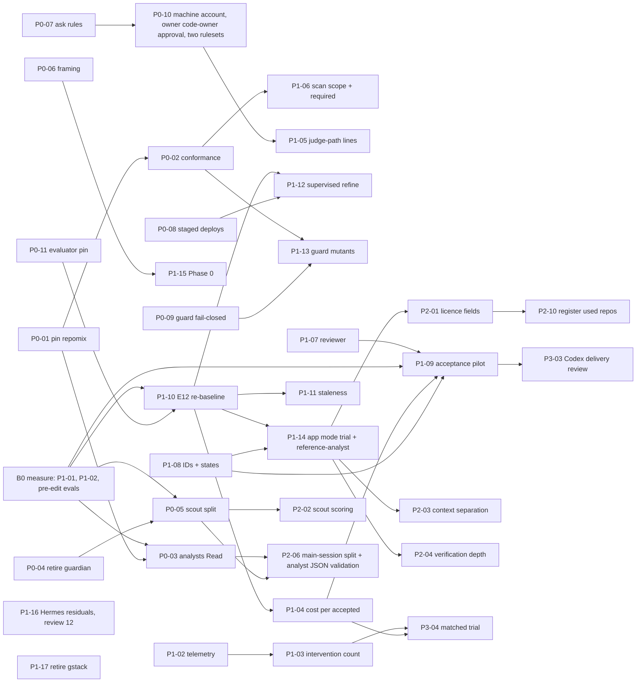

# S5 — Prioritized P0–P3 Implementation Roadmap
> Phase 3 of the Software Factory evaluation campaign · Date: 2026-10-22 · Status: proposal for owner approval; nothing implemented
> Inputs: phase 1 (docs/evaluations/2026-10-22-factory-research/), phase 2 (docs/evaluations/2026-10-22-factory-comparison/), claude_code at b8ed8a7
> Legend: [Ver] verified in claude_code · [Res] research finding · [Exp] expected benefit · [Asm] assumption · [Unk] unknown · [Inf] inference from verified facts · [Docs] official documentation, as read by the cited deliverable on 2026-10-22

Companion of S3 (target architecture); the IDs below are the ones S3 uses. Every S2 row (OPP-01 … OPP-41), every S4
increment, every S1 decision and the open items from the brief map to at least one roadmap item, a deferral or a
rejection; OPP-01, -02, -20 and -26 map to several (§1.6 coverage table). New decisions: DECISION-S5-1 …
DECISION-S5-4. S4's decisions are cited as DECISION-S4-1 … 8. Verifier findings are cited as V-S1-n, V-S2-n,
V-S4-n and V-S5-n. This version follows the corrected S1, S2 and S4.

## 0. Summary

- **11 P0 items** address the three mandatory-criterion breaches [S1 §4.2; S2 §0], to the extent S3 §3.1 states:
  - (b) untrusted text to write-capable agents → P0-03, P0-04, P0-05, P0-06: **narrowed, not closed**. No named agent
    keeps both untrusted input and write tools; orchestrators still receive derived text (residual).
  - (c) approval not enforced → P0-07, P0-08, P0-09, P0-10: closed at the GitHub boundary as far as every path to
    the owner's GitHub authority stays out of the agent's reach [Asm until P0-10 step 3 and probe (g) measure it];
    merging an approved head is restricted by GitHub: step 1b found that candidate B refuses every agent-account
    merge on a probe branch, and step 5a puts it on `main` (OC-6); the owner-accepted exception (OC-2) applies only if
    B is removed; local actions are only prompted.
  - (d) unpinned code → P0-01, P0-02: closed for the known cases, held for `skills/`, `.claude/agents/`, `packs/`
    and `infra/hermes-agent/skills/` by the required "Test suites" job through `ci-scan-skills.test.js` from P0-02
    (B1); no ruleset change needed (owner choice OC-3, revised 2026-10-23).
  - (a) pre-approved local shell stays open beyond the owner's allow-list trim (isolation is DEFER).
  - P0-11 keeps the evaluator out of the optimizer's reach before any refine or post-edit eval.
  - Efforts: P0-05, P0-09 and P0-10 are M, P0-02 and P0-04 are S-M, the other six are S.
  - Owner choices of 2026-10-23 (OC-1 … OC-4, S6 §7) are applied: the agent account is `dentaledge-bot` (OC-1), the
    merge residual is checked first (OC-2), P0-02 holds breach (d) for every scope and D-15/P1-06 stays before P1
    (OC-3, revised), and D-11 states the failure-policy reversal
    (OC-4).
  - Owner choices of 2026-10-29, after the P0-10 step-1b record (OC-5 … OC-8, S6 §7), are applied: the agent token
    is a classic PAT with `public_repo` only (OC-5), candidate B is the step-5a merge restriction, with guards (OC-6),
    and probes (d) and (a) are reworded (OC-7, OC-8).
- **17 P1 items**: measurement first (P1-01 … P1-04, read-only or count-only), judge and scan gates, the reviewer
  agent, requirement IDs and the independent-acceptance pilot, E12 re-baseline, the first supervised refine, the
  reference-driven trial (S4 Increment 1, corrected, with the `reference-analyst` agent), Hermes residuals, gstack
  retirement.
- **10 P2 items** (licence and provenance fields, scout scoring, context separation, consolidation, installer and
  doc debts, brain hygiene, the structural split for main-session intake paths) and **3 P3 experiments** (P3-02 was
  withdrawn: OPP-41 is DEFER in the corrected S2).
- **The first PRs are small and safe:** pin repomix and add the conformance check (P0-01 + P0-02), preceded by
  a read-only measurement batch (B0) so later phases can show change against a baseline.
- **The owner must act personally** on: the agent account's token (`dentaledge-bot`, OC-1; after proving the expired
  `dentaledge-bot-pat` dead and removing its value from `infra/hermes-agent/.env.pr`) and its credential placement, the ruleset edits
  (review ruleset with its role- or team-based bypass, last-push and stale-review flags, code-owner review, the
  required scan check), the local allow-list trim, the browser and desktop channels signed in to github.com, Hermes key rotation, every skill deploy (from B1), the telemetry
  label sample, the weekly brain review and each reference gate G1 approval (§2.3).

---

## 1. Roadmap items

Field key: **Changes** (files/components) · **Trace** (OPP / GAP / decision) · **Deps** · **Effort** S/M/L
(judgement, not hours) · **Risk** · **Acceptance** (measurable) · **Baseline** · **Testing** · **Rollback** ·
**Approval**. Every PR item carries the common testing floor below; only additions are listed per item.

**Common testing floor (every PR).** TDD for code (failing test first, then the fix); `node scripts/run-all-tests.js`
green; `infra/hermes-agent/bin/run-bin-tests.sh` when `infra/hermes-agent/bin/` changes; independent review per
`docs/REVIEW_PROTOCOL.md` (reviewer reads intent first, re-runs the checks at a named SHA, numbers findings, only the
reviewer closes them); a changed agent or skill definition gets an agent-audit or skill-audit re-run by normal
practice (`CLAUDE.md:40` mandates it only for agent-refine's Lever E); regex
security changes need a differential and a timing check (active decision 2026-10-15); a skill change is deployed
only by the owner after merge, then `node scripts/check-skill-deploy.js`. Evals use the no-skill/no-agent baseline
(E12) and never compare with pre-2026-10-20 reports (active decision 2026-10-21).

### 1.1 P0 — critical correctness, security, reliability

**P0-01 — Pin repomix; remove the gitingest runtime fallback; pin the AgentShield advice**
- Changes: `skills/repo-audit/SKILL.md:35,55` → `npx -y repomix@<x.y.z>` (version from the official release notes,
  source and access date recorded per `CLAUDE.md:76`); `:61` `pip install gitingest` removed; on Repomix failure the
  skill stops with a message. `skills/project-audit/SKILL.md:180` tells the user to run unpinned
  `npx ecc-agentshield scan --fix` [Ver]; pin it to `@1.4.0` like the skill's own calls (`:46,52,58,168`) (V-S5-6).
- Trace: OPP-03 · GAP-02 · breach (d) · DECISION-S4-6 (A).
- Deps: none. Effort: S. Risk: low; repo-audit loses its fallback (accepted trade-off [S2 OPP-03]).
- Acceptance: P0-02's check passes on the tree and fails on a fixture with the old lines; every case its first
  differential lists is pinned or baselined with a reason.
- Baseline: **measure first** with P0-02's differential; at least 3 known cases (`repo-audit/SKILL.md:35-61`,
  `project-audit/SKILL.md:180`) [Ver]. repo-audit's SKILL-EVAL is a PENDING placeholder (V-S1-1), so its first E12
  eval (P1-10) is its baseline; judge against absolute thresholds.
- Testing: P0-02 fixture; skill-eval of repo-audit and team-eval of `fixtures/teams/repo-audit-ensemble/` in P1-10.
  That part of the acceptance is measured in P1-10 (B6), so P0 is declared done only after those runs (R-A-19).
- Rollback: revert the PR; owner redeploys the previous copy.
- Approval: PR merge; skill deploy (owner, from B1, then `node scripts/check-skill-deploy.js`).

**P0-02 — CI conformance check against unpinned installs**
- Changes: a new BLOCK-severity rule in `skills/skill-audit/scripts/static-scan.js` flagging
  `npx <pkg>` without an exact version, `pip install <pkg>` without `==`, `@latest`, curl/wget piped to a shell.
  **PR-1, B1 (owner choice OC-3, revised 2026-10-23):** `scripts/ci-scan-skills.js` gains a separate conformance pass
  over `.claude/agents/*.md`, `packs/*/skills/`, `packs/*/tools/` and `infra/hermes-agent/skills/` that keeps only the
  conformance check id, with findings keyed by repo-relative path; the general scan stays at `skills/*/` until P1-06
  (today the script scans only `skills/*/`, `ci-scan-skills.js:25,65-77`; `.claude/agents` is scanned only by the
  conditional fallback, `ci.yml:49-56`). `scripts/ci-scan-skills.test.js` asserts the existing full diff for `skills/`
  (`:104-110`) and the conformance-pass findings for the four extra scopes against `.github/skill-scan-baseline.json`;
  new conformance findings in those scopes are triaged into the baseline in this PR. Each baseline entry records its
  pass (`general` or `conformance`) and a repo-relative path, and each pass diffs and checks for staleness only against
  its own entries, so P1-06 can later add general-scan entries for packs and Hermes skills to the same
  `.github/skill-scan-baseline.json` without conformance entries turning stale, or the reverse (today's key is
  `skill file check`, `ci-scan-skills.js:48-49`, and any entry a run does not produce fails as stale); the 3 existing
  entries are migrated to the repo-relative key in this PR (V5-RS-1). The non-required "Static scan all
  skills" job runs the same passes, so it does not go red on untriaged general findings (V4-RS-1). So breach (d) is
  held for all four scopes by the required "Test suites" job (`ci.yml:71` runs `run-all-tests.js`); no ruleset change
  is needed. P1-06
  separately widens the **general** static scan (injection, secrets, permissions) to packs and Hermes skills and
  makes that job required (V-S5-6, D-15). The scope does not include `.claude/skills/` (no hits there today) (R-A-19).
- Trace: OPP-04 · GAP-02, GAP-16.
- Deps: none. Effort: S-M (two passes, a regex differential and timing sweep, fixtures in four scopes, baseline key
  migration and triage) (V5-RS-2). Risk: false positives on docs; triage of new-scope findings.
- Acceptance: the test fails on a fixture with an unpinned install in each extra scope (`.claude/agents/`, `packs/`,
  `infra/hermes-agent/skills/`) as well as in `skills/`; fixtures for each pattern fail, pinned forms pass; a mutant that deletes the rule turns the test red;
  the differential over the current tree lists only known cases (the repo-audit and project-audit lines before
  P0-01) and baseline entries.
- Baseline: no such rule [Ver]. The differential count measured in this PR is the baseline for P0-01.
- Testing: `static-scan.test.js`, `ci-scan-skills.test.js`; differential + timing (decision 2026-10-15).
- Rollback: revert the rule. Approval: PR merge; skill deploy of skill-audit (rule in `static-scan.js`; owner, then `node scripts/check-skill-deploy.js`) (V2-RS-8).

**P0-03 — repo-audit analysts read-only, with framing**
- Changes: `.claude/agents/repo-audit-*.md:4` (8 files) `tools: Read, Bash` → `tools: Read`; framing paragraph in
  each body and in `skills/repo-audit/SKILL.md` (text as P0-06).
- Trace: OPP-02 (a), OPP-01 · GAP-01 · breach (b) · DECISION-S4-6 (A).
- Deps: P0-01 in the same batch (same skill). Effort: S. Risk: an analyst needed Bash after all (none found:
  no Bash use in the bodies [Ver grep today]).
- Acceptance: 0 analysts with Bash; agent-audit PASS for each of the 8; team-eval of the ensemble: Dispatch-Chain
  Accuracy ≥ 85%, Handoff Integrity ≥ 90%; resilience ≥ 8/10 including an injected-instruction scenario.
- Residual (stated in the PR, V-S3-7): the analysts' JSON free text is merged by the write-capable repo-audit
  session and, with `--pipeline`, written into `project-context.json`; closed-key and length validation is P2-06.
- Baseline: no team-eval report exists [S1 L-07]. If a delta is to be claimed, run team-eval before the edit in B0
  (DECISION-S5-2); otherwise absolute thresholds.
- Testing: agent-audit ×8; team-eval; review checks the tools × input inventory. The team-eval part of the
  acceptance is measured in P1-10 (tier 4, B6), so P0 is declared done only after those runs (V2-RS-11).
- Rollback: revert frontmatter. Approval: PR merge; skill deploy (repo-audit SKILL.md; owner, then
  `node scripts/check-skill-deploy.js`).

**P0-04 — Retire skill-guardian**
- Changes: delete `.claude/agents/skill-guardian.md` and root `PROJECT-SKILL-HEALTH.md` [Ver `git ls-files`];
  update every reference [Ver grep today, extended per V-S5-4]:
  - tests (CI would break otherwise): `scripts/refine-snapshot.test.js:5,46,202-204`,
    `scripts/refine-copy-paths.test.js:30`, `scripts/refine-keep-revert.test.js:10,34`, and the comment in
    `scripts/eval-report-sections.test.js:7`;
  - `skills/project-audit/SKILL.md:101,123,157` (names skill-guardian as the reader of its artifact);
  - `install.sh:202` (CLAUDE.md text written into targets), `README.md:181`, `docs/USER-GUIDE.md:259,350,364-366`,
    `docs/codex-external-eval-architecture.md:29`, `.claude/skills/codex-eval/SKILL.md:68`;
  - example blocks in `skill-scout-agent.md:22-23` and `skill-synthesizer-agent.md:23-24` (description text, so
    dispatch is re-measured);
  - the retired agent's eval scenarios `evals/agents/skill-guardian/` (delete) and the comment at `evals/.gitignore:20`
    (edit). Both are tracked files (41 files under `evals/` are tracked: the `evals/**/evals.json` scenario specs,
    `evals/.gitignore`, `evals/project-context.json`), so this PR commits changes under `evals/`, which conflicts with
    the literal `CLAUDE.md:83` ("Commit anything under `evals/`" in the Never list). `evals/project-context.json` is
    also tracked (last commit 612c585, 2026-07-07) and is generated (V2-RS-4). Two options: (1, recommended, smallest
    change) the PR amends `CLAUDE.md:83` to "never commit generated eval artifacts; scenario specs
    (`evals/**/evals.json`), `evals/.gitignore` and `evals/project-context.json` (tracked as the toolkit's own context
    snapshot) are tracked"; (2) the same amendment without `project-context.json`, and P0-04 untracks that file. The
    owner approves that CLAUDE.md change (R-B-10, R-A-12); it resolves S6 CN-13 once `project-context.json` is
    covered.
  - **Not edited:** the canon charter (`.project-brain/canon/2026-07-17-ai-os-charter.md:33`) and dated evaluation
    records. Canon changes only through `brain-promote --approve` (DECISION-S3-5).
  A README recipe replaces the one-command health check ("skill-eval-agent per skill"). Agents are copied by glob
  (`install.sh:100`) [Ver], so no list edit; but `uninstall.sh` discovers agents from the repo, so a copy already
  installed in a target is not removed: document a one-line manual cleanup [Inf].
- Trace: OPP-30 · GAP-01, GAP-14 · breach (b) · DECISION-S1-3 (c), DECISION-S3-5.
- Deps: none. Effort: S-M (S2 OPP-30). Risk: target projects lose a convenience; 0 invocations July-October [Ver S2 §1].
- Acceptance: `grep -rn skill-guardian` excluding `.project-brain/canon/`, `docs/evaluations/`,
  `docs/superpowers/` (dated plans and specs), dated `SKILL-EVAL.md` reports (e.g. `skills/agent-refine/SKILL-EVAL.md:44`)
  and git history returns 0; `node scripts/run-all-tests.js` green;
  write-capable readers of untrusted text −1; agents count −1 (dynamic `ls`).
- Baseline: 16 agents, 10 write-capable readers [Ver S3 §2.4].
- Testing: the edited test files keep their remaining assertions; agent-eval of skill-scout-agent and synthesizer
  (description change) not lower than B0 if measured.
- Rollback: restore the files from git. Approval: PR merge; skill deploy (project-audit text, owner, then
  `node scripts/check-skill-deploy.js`); `CLAUDE.md:83` amendment (owner); DECISION-S3-5.

**P0-05 — skill-scout-agent becomes a read-only fetcher**
- Changes: `.claude/agents/skill-scout-agent.md:32` tools → `["Read", "WebFetch", "WebSearch"]`; workflow steps
  `:58-84` rewritten: no Agent dispatch (parallel WebFetch calls in one turn), no `/tmp` write, no `score-candidates.js`
  call; output is candidate JSON with a fixed schema: name, url, commit or date, stars, licence, line count, flags, a
  `description` capped in length, and numeric body features (keyword hits against the `trigger_keywords` the caller
  passes in, has-scripts, has-REFERENCE), **never** `skill_md_content`. `score-candidates.js` reads `description` and
  `skill_md_content` today (`:13,122-127` [Ver]), so it gains an optional numeric body-match input used when the body
  is absent (TDD). `skills/skill-scout/SKILL.md` step 5 writes that JSON and runs the scorer; framing added.
- Trace: OPP-02 (b) · GAP-01 · breach (b) · DECISION-S3-2 (a).
- Deps: P0-04 (guardian invoked it). Effort: M. Risk: dispatch or ranking quality changes.
- Acceptance: the agent holds no Write/Bash/Edit/Agent; agent-audit PASS; agent-eval dispatch accuracy ≥ 85% and
  resilience ≥ 8/10; `score-candidates.test.js` passes on agent-output fixtures, including the new numeric input;
  the parent step rejects a key outside the schema, a `description` over the cap and any body field (V-S5-7);
  shortlist ranking on a fixed fixture set differs from the body-based ranking only within a stated tolerance.
- Residual (stated): the capped `description` is free text that reaches the writer; skill-audit later reads the
  chosen candidate's full body in the main session, with framing (V-S3-6).
- Baseline: no AGENT-EVAL for this agent [S1 L-07: only skill-eval-agent has one]; measure in B0 (DECISION-S5-2).
- Testing: agent-audit; agent-eval; skill-eval of skill-scout (trigger accuracy, resilience).
- Rollback: revert both files. Approval: PR merge; skill deploy (skill-scout; owner, then
  `node scripts/check-skill-deploy.js`).

**P0-06 — Untrusted-content rule in every reader of external text**
- Changes: one shared paragraph (our text, from the campaign briefs' rule 2) in the body (not the description) of
  skill-scout, agent-scout, reference-repo-pattern-extract, gstack-pattern-audit (until P1-17), project-setup
  (Phase 0 section), skill-adapt, agent-adapt, skill-synthesizer-agent, skill-audit and agent-audit (they read the
  candidate) and `.claude/skills/codex-eval/SKILL.md` (Codex reads definitions); repo-audit done in P0-03, scout agent
  in P0-05, Hermes in P1-16.
- Trace: OPP-01 · GAP-01.
- Deps: none. Effort: S. Risk: footprint +a few lines per skill (context footprint metric); no trigger change if kept
  out of descriptions.
- Acceptance: grep for the rule over `skills/*/SKILL.md`, `.claude/agents/*.md`, `.claude/skills/*/SKILL.md` covers
  every intake file in S3 §2.3 (0 files today [Ver S1 L-01]); a validator assertion in `validate-skills.js` keeps the
  list from regressing [Exp: cheap]; resilience ≥ 8/10 (critical tier ≥ 9/10 for skill-audit) in P1-10.
- Baseline: 0 files.
- Testing: `validate-skills.test.js` case; skill-eval resilience scenarios in P1-10. Before the PR, run the static
  scanner over the edited skill-audit and agent-audit bodies (and every edited file) to check the framing text does
  not match the scanner's own injection patterns: "Security gate (AgentShield + static fallback)" is a required check
  (V-S5-15). The resilience part of the acceptance is measured in P1-10 (B6), so P0 is declared done only after those
  runs (R-A-19).
- Rollback: revert. Approval: PR merge; skill deploys (owner, 9 skills: skill-scout, agent-scout, reference-repo-pattern-extract, gstack-pattern-audit, project-setup, skill-adapt, agent-adapt, skill-audit, agent-audit; skill-synthesizer-agent and `.claude/skills/codex-eval` are project-scoped and need no deploy; repo-audit is deployed in P0-03; then
  `node scripts/check-skill-deploy.js`).

**P0-07 — Native `ask` rules for consequential commands**
- Changes: committed `.claude/settings.json` and `infra/hermes-agent/.claude/settings.json` (project settings load
  only from the session's starting folder, `scripts/claude-settings.test.js:9-12` [Ver]) gain `permissions.ask` for
  `Bash(git push *)`, `Bash(gh pr merge *)`, `Bash(gh pr review *)`, `Bash(gh api *)` (reaches the REST merge and
  review endpoints; read-only calls prompt too), `Bash(gh auth *)`, `Bash(git push * --delete *)`,
  `Bash(git branch -D *)`, `Bash(node scripts/brain/brain-promote.js *)`, `Bash(cp * ~/.claude/skills/*)`,
  `Bash(cp -r * ~/.claude/skills/*)`, `Bash(cp -R * ~/.claude/skills/*)`, and running `install.sh`/`uninstall.sh` (`Bash(./install.sh*)`, `Bash(bash install.sh*)`, `Bash(./uninstall.sh*)`, `Bash(bash uninstall.sh*)`)
  (`install.sh:88-92` copies every skill into `~/.claude/skills/`), unless the owner accepts that path explicitly
  (R-B-11). **Hermes:** the proposer runs `claude -p` with workdir `/projects/claude_code`
  (`infra/hermes-agent/registry/projects.yaml:20-21`), so the committed root ask rules would load in Hermes runs
  [UNVERIFIED whether the executor skips project settings]; this PR (with P0-09) resolves it by a box/container probe,
  with the Hermes impact sent through the Hermes checklist and security review #12, or excludes Hermes runs explicitly
  with evidence (OC-4). An ask-rule assertion in
  `scripts/claude-settings.test.js` is **new work** (it tests deny rules only today [Ver via S2]). **Owner action:**
  remove `Bash(git push *)`, `Bash(gh pr *)` and `Bash(git *)` from the gitignored `.claude/settings.local.json`
  (`:10,63,68` [Ver, machine-local]); review `Bash(python3 *)` (`:59`).
- Trace: OPP-07 · GAP-03 (first step), GAP-04 · breach (c) · DECISION-S2-1 (b).
- Deps: none. Effort: S. Risk: about 2-4 more prompts per PR, more with `gh api` (read-only calls prompt too) [S2].
  P0 deliberately adds routine human steps (prompts per PR, owner deploys, owner approvals), so the B0/P1-03
  intervention measures are expected to rise; that is not a regression (R-B-13).
- Residual (V-S5-12): a rule "isn't a security boundary around the program" [Docs via S2]. Forms that escape these
  rules include `git -C . push`, `$HOME/.claude/skills` or `rsync` deploys, and a `node` or `python3` script calling
  the GitHub API. Command-independent enforcement needs a PreToolUse hook or sandboxing [Docs via S2]; the boundary
  for merges is P0-10.
- Acceptance: the test asserts every ask rule in both files; a manual probe in a fresh session shows a prompt for
  `git push` and `gh pr merge` in auto mode (recorded as an input/output pair per the protocol's no-UI evidence row).
- Baseline: 0 ask rules; consequential actions not prompted [Ver].
- Testing: `claude-settings.test.js` (TDD, new ask-rule assertions); probe recorded in the PR.
- Rollback: revert the settings change. Approval: PR merge; local settings change (owner).

**P0-08 — Stage every self-deploy**
- Changes: `skills/skill-refine/SKILL.md:60` and `.claude/agents/skill-refine-agent.md:124` KEEP (`:72` only
  explains the copy-before-edit; reword it to match) → "staged:
  record in SKILL-REFINE-LOG.md; deployment waits for owner approval"; `skills/skill-refine/SKILL.md:33` ("the keep
  step syncs that folder into `~/.claude/skills/`") reworded to match; `skills/skill-adapt/SKILL.md:84` step 10 →
  same; all of `CLAUDE.md:75` rewritten, not only the sync sentence, to "after a skill change merges to main, the owner
  deploys it (`cp -R skills/<name>/. ~/.claude/skills/<name>/`) and runs `node scripts/check-skill-deploy.js` —
  Claude Code loads skills from `~/.claude/skills/`, not from this repo's `skills/`, so its skill loading does not
  see an undeployed change. 'Owner deploys' means the owner runs the deploy command or explicitly approves it (for
  example at the P0-07 ask prompt). skill-adapt, skill-refine and skill-refine-agent stage their result and never
  deploy it themselves" (V2-RS-9); the CLAUDE.md text `install.sh:172-205` writes into target projects gains the same deploy
  instruction, or the PR records why not; tests asserting the copy step updated (`scripts/refine-copy-paths.test.js`,
  `refine-keep-revert.test.js`) (R-B-11).
- Trace: OPP-09 · GAP-04, GAP-11 · breach (c) · DECISION-S1-5 (b), widened per V-S1-2.
- Deps: none. Effort: S. Risk: none for mid-loop re-eval: with-skill subagents load `skills/<name>/SKILL.md`
  [Ver `skill-eval-agent.md:95`].
- Acceptance: no step in `skills/` or `.claude/agents/` performs a copy to `~/.claude/skills` (the owner instruction
  at `CLAUDE.md:75` legitimately names the path); a test fails if a KEEP or adapt step contains such a copy.
  Model-run deploy steps in definitions 3 → 0. Residual: other copy forms, and `install.sh` (`:88-92`), are only
  prompted by P0-07 (V-S3-12, R-B-11).
- Baseline: 3 self-deploy steps + 1 sanction [Ver].
- Testing: test updates first (red), then edits; skill-eval of skill-refine and skill-adapt in P1-10.
- Rollback: revert. Approval: PR merge; skill deploys (owner, then `node scripts/check-skill-deploy.js`); CLAUDE.md
  change; `install.sh` text change if made.

**P0-09 — Brain guard fails closed; registration committed; G1 and G3 closed**
- Changes: `hooks/brain/brain-security-guard.sh:415-424` exits 2 on internal error; registration with
  `onFailure: "block"` (Claude Code ≥ 2.1.295; installed 2.1.302 [S2 §1]) in the committed `.claude/settings.json`
  instead of `.claude/settings.local.json:106-111`; `scripts/brain/brain-self-install.sh:37-92` (which registers the
  guard in targets' `settings.local.json` [Ver]) and its uninstall mirror updated the same way, or the registration
  merged by `install.sh` like the telemetry hooks (`install.sh:228-281`); G1: exemption only for a command that is
  exactly one `brain-promote.js … --approve` call; G3: the `rm` word false positive; edit protection for
  `.project-brain/decisions/active/` (the capsule-wide delete rule already covers deletion, V-S1-6); written
  break-glass (owner edits settings outside Claude Code) in `docs/SECOND_BRAIN_SECURITY.md`. (G1 and G3 here are
  brain-guard gaps, not the reference gates of S4 §3.8.) Round 2 additions (OC-4, owner choice of 2026-10-23):
  - **Reversal stated.** This change supersedes the P11 owner failure policy (fails open but visibly, exit 1;
    `docs/evaluations/2026-10-15-pr4-hermes-proposal-triage.md:747-749`) and the F1 non-adoption of
    `onFailure: "block"` ("considered and not adopted, because it conflicts with P11", `triage:626`), both recorded in
    the active decision `2026-10-21-pr-4-follow-ups-…`. After merge, the replacement is recorded through capture →
    compile → `brain-promote --approve`, superseding the old decision; canon and active decisions are never edited
    directly.
  - **Weekly review.** Edit protection for `decisions/active/` conflicts with `skills/brain-weekly-review/SKILL.md:21,31`,
    which edits `decisions/active/*` directly. This PR either routes the weekly review's decision edits through
    `brain-promote` or defines a narrow exemption, and adds that skill to its change list (skill change ⇒ owner
    deploy).
  - **Hermes.** The proposer runs `claude -p` with workdir `/projects/claude_code`
    (`infra/hermes-agent/registry/projects.yaml:20-21`), so committed root hooks would load there [UNVERIFIED whether
    the executor skips project settings]. Resolved with a box/container probe and the Hermes impact sent through the
    Hermes checklist and security review #12, or Hermes runs explicitly excluded with evidence (shared with P0-07).
  - **Subdirectory coverage.** Shared settings load from the session's primary working directory [Docs, settings,
    2026-10-23], so moving the registration from the gitignored root `settings.local.json` (read at the repository
    root even from a subdirectory) into the committed root `settings.json` may drop coverage for sessions started in
    `infra/hermes-agent/`, or coverage may already be absent today: the current local registration already uses
    `$CLAUDE_PROJECT_DIR/hooks/brain/brain-security-guard.sh` (`.claude/settings.local.json:110`), and the docs define
    the variable as "the project root where the session started", so its resolution in a subdirectory session is
    UNVERIFIED (V2-RS-3). D-11 decides that coverage explicitly, with a hook path that resolves there (`hooks/brain/`
    does not exist under `infra/hermes-agent/`; with `onFailure: "block"` a wrong path would block every
    Write/Edit/Bash there [Inf]); `infra/hermes-agent/.claude/settings.json` is in scope. In a worktree the local file
    is the one "at the main checkout's root" [Docs, settings, 2026-10-23], so only the shared-file case needs the
    P0-09 test (V2-RS-11).
  - **Old registration.** The owner removes the old local fail-open registration from `.claude/settings.local.json`
    (a handler defined in several files runs once; which copy's `onFailure` wins is not documented). If the
    `install.sh` option is chosen, `install.sh` and `uninstall.sh` stay in sync (CLAUDE.md).
  - **Telemetry hooks** stay fail-open when registrations are merged ("a telemetry failure must never block",
    `docs/telemetry-privacy.md:117`).
- Trace: OPP-06, OPP-15 (partly) · GAP-07, GAP-04 · RR4 · DECISION-S1-2 (c) with DECISION-S2-2's two conditions ·
  OC-4.
- Deps: none. Effort: M. Risk: a broken node blocks every guarded tool call (break-glass); false positives become
  blocks (hence G3 in the same change); a Hermes run or a subdirectory session blocked by a wrong hook path.
- Acceptance: tests show node failure and timeout now block; a mutant reverting `exit 2` turns a test red; a chained
  `brain-promote.js --approve && <write>` is denied; a filename containing "rm" passes; the G3 fix is intentionally
  not a superset, so the differential's deny→allow set is limited to the intended class (as P11 did), a 1 MB timing
  sweep passes and a per-scan timeout is stated (`decisions/active/2026-10-15-changing-a-regex-security-pattern-…md:12`);
  the weekly review still completes its decision step by the chosen route; the Hermes probe result (or the evidenced
  exclusion) and the subdirectory-coverage test are recorded, including a probe recording what `$CLAUDE_PROJECT_DIR`
  resolves to in a session started in `infra/hermes-agent/` (V2-RS-3); telemetry hooks still fail open; after merge,
  `guard-failures.log` gains no fail-open entries over 14 days of use.
- Baseline: 50 fail-open entries, all 2026-10-15 [S1 §3.1]; registration local-only [Ver].
- Testing: `scripts/brain/brain-hooks.test.js` (resolve or quarantine-with-reason the intermittent F1 failure first,
  decision 2026-10-21, so the suite is valid evidence); differential + timing for every regex change.
- Rollback: revert; the break-glass restores a working session if node is broken. Approval: PR merge; settings;
  owner removes the old local registration; brain-weekly-review deploy (owner); the superseding decision through
  `brain-promote --approve`; security review #12 if Hermes is affected.

**P0-10 — Approval the agent cannot satisfy (S2 OPP-08, five parts)**
- Changes (mostly owner actions), in this order. D-12 and D-13 are approved in principle: the step-1a and step-1b
  records come back to the owner before any production account, token or ruleset step on `main`, with fallbacks if
  an assumption fails (credential option (c), a GitHub App, or a re-decision) (`CLAUDE.md:76`; R-B-9, V2-ID-1).
  **Steps 1a and 1b are done:** both records have returned to the owner
  (`docs/evaluations/2026-10-27-p0-10-step-1a-github-docs-check.md`,
  `docs/evaluations/2026-10-29-p0-10-step-1b-results.md`, "the step-1b record" below), and the owner's choices on
  them are OC-5 … OC-8 (2026-10-29).
  1a. **Docs check** (the R-B-9 gate), recorded under `docs/evaluations/` and returned to the owner: token semantics,
     including whether a fine-grained token works for `dentaledge-bot` as an outside/repository collaborator on a
     public org repository (a documented gap) and whether the org requires token approval; the org's classic-PAT
     policy [Asm; answered by the step-1b record §4 check 1, Owner-rep]; bypass-actor types (the REST `bypass_actors.actor_type` enum includes `User` and `DeployKey`,
     while the rulesets UI doc lists roles, teams and apps, so eligibility is UNVERIFIED, R-A-14); per-ruleset bypass
     and the two-ruleset interaction; last-push approval; `gh` multi-account behaviour; and **first**, the
     merge-restriction candidates (OC-2, V2-ID-3). Two candidates are compared: a ruleset "Restrict updates" with the repository
     admin role (owner the only admin) or an owner-only team as bypass actor, consistent with R-A-14 (V3-ID-3; every owner merge then becomes a bypass event, which would inflate the "owner-bypass
     merges" measure, §3), and classic branch protection "Restrict who can push to matching branches" (Team org
     repositories; specific users; admins can always push). For each, the record notes how it appears in the audit
     log; whether a PR merge counts as an "update" is UNVERIFIED. Counter-evidence on the token is cited
     (V2-ID-7): PR #4's head was pushed into the org repository by `dentaledge-bot` as an outside collaborator;
     `infra/hermes-agent/.env.pr.example` and `README.md:315-318` describe a fine-grained token; the daily note calls
     the old token "organisation-scoped".
  1b. **Owner-run tests on a scratch target**, results returned to the owner: test rulesets on a throwaway branch
     pattern (for example `p0-10-probe/**`), never `main`; a short-lived test token minted from `dentaledge-bot`
     (fine-grained first, then classic if needed), minted and used outside agent sessions, never printed into a
     transcript, and revoked after the test (V3-ID-4); test rulesets and probe branches are deleted after the test
     (V3-ID-1). The scratch layering mirrors `main` (a checks ruleset with no bypass, the review ruleset and the
     candidate restriction); the required check is emulated by a test status context the owner sets with the commit
     statuses API, since CI does not run on pull requests into `p0-10-probe/**` (`ci.yml:3-7`) (V3-ID-2). The tests
     cover the token type, the two-ruleset interaction and the merge-restriction candidate. If a restriction works without blocking the
     owner's normal merges, it is adopted in step 5a. If none works, the owner records an explicit exception to
     `docs/REVIEW_PROTOCOL.md:22` ("Approve, don't merge. Merging is a human action.") and to the 2026-10-14 boundary
     (`docs/evaluations/2026-10-14-software-factory-architecture-evaluation.md:166,168`): the agent account can merge
     an owner-approved head, guarded by the P0-07 ask rule on `gh pr merge` / `gh api`; the repository setting
     `allow_auto_merge` stays false (verified false 2026-10-23), otherwise an armed auto-merge would merge at approval
     with no prompt (OC-2, V2-ID-3). [Asm until then.] **Result:** candidate B, the classic "Restrict who can push to
     matching branches", refused every agent-account merge while the owner's normal and bypass merges worked (step-1b
     record §3.5); it is adopted in step 5a (OC-6), so the "if none works" exception is not needed for agent-account
     merges. The ruleset "Restrict updates" candidate was not tested (T5 not run, §3.6).
  2. **Agent account: reuse `dentaledge-bot`** (owner choice OC-1, 2026-10-23, folding in R-A-1, R-A-2, R-B-4; a User account, collaborator with write
     on this repository, not admin [Ver by the coordinator, 2026-10-23]). GitHub's Terms allow one free machine
     account per person, and this is it. Owner steps, in order:
     - confirm GitHub refuses the expired `dentaledge-bot-pat`, using it without printing it ("prove death, never
       infer it", `.project-brain/canon/2026-08-17-credential-governance-lessons.md:136-137`);
     - remove the dead value from `infra/hermes-agent/.env.pr` (the owner does this; the agent never reads that file);
     - mint the new token **from the bot account**: a **classic PAT with `public_repo` scope only, no `workflow`
       scope, 90-day expiry** (owner choice OC-5, 2026-10-29). Step 1b measured this token type: push, PR create and
       view, update-branch, approve and merge worked, and the push of a workflow file was refused (step-1b record
       §3.2, §3.3). A fine-grained token could not be minted, because the org was not offered as resource owner
       (§3.2). The token depends on
       the repository staying public (owner decision, 2026-10-28): if the repository were made private, the token
       would stop working (fail closed). Scopes "do not grant any additional permission beyond that which the user
       already has", and `public_repo` "Limits access to public repositories", covering read/write to code, commit
       statuses, repository projects, collaborators and deployment statuses "for public repositories and
       organizations", and starring [Docs, scopes for OAuth apps, accessed 2026-10-29]. So the token is bounded by
       the bot's own permissions everywhere; what is specific to this org repository is that it is the bot's only
       collaborator grant. Within that bound it acts as the bot on any public GitHub repository (issues, comments,
       forks, PRs [Inf]) and in the bot's own public repositories, and gains any public repository the bot is later
       added to; the owner is responsible for the machine's actions (ToS §B.3) (V2-ID-7). The org's policy does not
       restrict classic tokens or require their approval (step-1b record §4 check 1) [Owner-rep]; if that policy
       changes, the token choice is re-checked (editor's wording, not the owner's);
     - store it only where the laptop agent's `gh` uses it. `gh auth login --with-token` documents its minimum
       scopes as `repo`, `read:org` and `gist` (`gh auth login --help`, gh 2.92.0, read 2026-10-29) [Docs], so it
       may refuse to store a `public_repo` token; that is untested (step-1b record §9). Step 1b measured `gh`
       working with the token supplied through `GH_TOKEN` (§3.2) [Ver]. The storage mechanism is settled and
       measured in steps 2-3 (the owner's choice if `gh` refuses).
     A token minted by the owner acts as the owner and is excluded (V-S5-3). Hermes draft-PR delivery stays dormant
     (the PAT is recorded to expire 2026-10-23 by the owner's decision of 2026-10-14,
     `sessions/daily/2026-10-14.md:35-37`; its refusal is proved by the owner in this step, V2-ID-5);
     restoring it is a separate Track A decision with its own identity, because the account stays single-consumer
     (credential canon rule 1, `credential-governance-lessons.md:49-52`).
  3. **Enumerate every path to the owner's GitHub authority and measure its exposure before declaring it out of
     reach** (`credential-governance-lessons.md:115-117,130-132`; R-B-3, R-A-9, R-A-10): the `gh` login; the git
     credential helper/keychain; SSH keys registered with GitHub [UNVERIFIED, owner checks]; `GH_TOKEN`/
     `GITHUB_TOKEN`-style environment variables; tokens already printed into session transcripts (fingerprint-only
     scan, never printing values); `infra/hermes-agent/.env.pr` (owner-removed in step 2); every agent-driven browser
     or desktop channel where the owner is signed in to github.com: Claude in Chrome, the Claude desktop built-in
     browser pane (persistent sign-ins) and desktop computer use. Then configure the laptop's `gh`/git credential
     store with the agent account only; the owner approves and merges in the browser or mobile app outside agent
     control; no other write-capable token reachable from sessions; extend the committed secret-read deny rules to
     the new token's location (tested in `claude-settings.test.js`). Note: the committed deny rules on `.env.pr` cover
     Read/Edit, not Bash readers such as the locally pre-approved `python3 *` (a rule "isn't a security boundary
     around the program" [Docs via S2]).
  4. Commit `.github/CODEOWNERS` with `* @<owner account>` (no CODEOWNERS exists [Ver]); afterwards
     `GET /repos/{o}/{r}/codeowners/errors` must return no errors (R-A-8).
  5. Create a second ruleset ("review") on `main`: pull-request rule with `required_approving_review_count: 1`
     (0 today [Ver]) together with `require_code_owner_review: true` (R-A-8), `require_last_push_approval: true`,
     `dismiss_stale_reviews_on_push: true` (both false today [Ver `gh api`], V-S5-2); bypass actor "For pull requests
     only" = the **repository admin role**, the owner being the only admin, or a **team whose only member is the
     owner** (V-S2-16; whether users are eligible is UNVERIFIED, R-A-14, and does not change this choice); the agent
     account holds no admin role and is in no bypass team [Asm: verify in the ruleset UI/API]. `main-protection` keeps
     its required checks, `strict` and no bypass actors.
  5a. With the review ruleset, create the merge restriction chosen in step 1b (V2-ID-3): **candidate B on `main`**
     (owner choice OC-6, 2026-10-29), classic branch protection "Restrict who can push to matching branches" as
     tested, with users [], teams [], apps [], `enforce_admins` false and no other classic settings, that is the body
     `{"required_status_checks":null,"enforce_admins":false,"required_pull_request_reviews":null,"restrictions":{"users":[],"teams":[],"apps":[]}}`.
     On the probe branch it refused every agent-account merge (`merge` and `merge-async`; bot PRs and bot-approved
     owner PRs), while the owner's normal and bypass merges worked; its refusals appear in the rule suites as the
     `authorization` rule (`rule_source` type `protected_branch`) (step-1b record §3.5, §3.9), and the org audit log
     shows B being turned on and off (owner-reported, 2026-10-29). Open: the UI merge button and `gh pr merge` by the
     bot under B were not tested (step-1b record §9). After step 5a, probes (b), (d) as reworded (OC-7),
     (e) and (i) are re-run on `main`. Rollback: remove B. Later and optional: GitHub's team-based required reviewers
     in rulesets, which needs a docs check and a test before any use.
  6. Runbook in `docs/REVIEW_PROTOCOL.md` and `CLAUDE.md`: who holds which identity; approve agent PRs rather than
     bypass; **the agent account never approves PRs** (OC-6: a bot approval satisfies the review rule on
     owner-authored PRs, step-1b record §3.4); probe (d)'s bot approval is an owner-run test made outside agent
     sessions, not an agent approval; the owner never pushes to agent branches (R-A-15); CI changes
     (`.github/workflows/`) travel as owner-authored PRs made outside agent sessions and merged through the PR-only
     bypass, which skips review (V2-ID-9); the OC-2 exception text (including `allow_auto_merge` kept false) only if
     B is removed (probe (i) fails or rollback); rotation, with probe (g) re-run at every rotation.
- Trace: OPP-08, OPP-13 (the `*` code owner) · GAP-03 (closure), GAP-05 · breach (c) · DECISION-S2-1 (c),
  DECISION-S3-1 · OC-1, OC-2, OC-5 … OC-8.
- Deps: P0-07. **Order:** agent PRs come from the agent account (`dentaledge-bot`) and the review ruleset with its
  bypass exists before the review rule is enforced; otherwise every owner-authored merge blocks (authors cannot
  approve their own PRs [Docs via S2]). Effort: M. Risk: token handling and rotation; a CI change now needs an owner
  push (no `workflow` scope); the bypass is a standing merge path for the admin role.
- Acceptance (recorded probes, V-S5-2):
  - (a) the next 10 merged agent PRs each show author = agent account and an owner code-owner approval for which the
    PR diff the owner approved equals the merged PR diff (OC-8). "Approved commit = merged head" is not used: after an
    update-branch with an unchanged diff, a kept approval reports the new head as `commit_id`, so it cannot tell that
    approval from one given on the merged head (step-1b record §6). On `main` after step 5, a test shows that an
    update which changes the PR's own diff dismisses the approval (untested in step 1b, §6, §9). Method for "the
    approved PR diff" open: to be defined and recorded before the first probe (a) run (candidate signals in the
    step-1b record §8 decision (4): the review's `submitted_at` against the time the head was pushed, or the PR's
    timeline events [Inf]);
  - (b) the agent account cannot approve its own PR, and cannot merge it before the owner approves;
  - (c) a push by the agent account **after** the owner's approval dismisses it, and the PR cannot merge until the
    owner approves again; branch updates are probed too: the owner clicking "Update branch" becomes the last pusher,
    and an agent update may dismiss the approval (R-A-15);
  - (d) an owner-authored PR approved by `dentaledge-bot` cannot be merged by the agent account (refused with
    GitHub's authorization message, "You're not authorized to push to this branch"), and the owner's merge succeeds
    (OC-7; the bot's refusal is what B provides, step-1b record §3.5 step 4.11; the owner's merge is [Inf, untested
    in step 1b; first measured by this probe on `main`], and the probe records which route it took, a normal merge
    or the PR-only bypass). The probe also counts and reports any bot approval on owner-authored PRs (editor's
    wording, not the owner's), matching the monthly measure in §3 (OC-6). The earlier wording (`reviewDecision:
    REVIEW_REQUIRED`, only the owner's PR-only bypass can merge it) failed as written: on the owner's own PR the
    author is the only code owner, so no code-owner review is required and the bot's approval satisfies the review
    rule (step-1b record §3.4) (no extra account needed, OC-1; V2-ID-4);
  - (e) an owner-authored test PR with a failing required check cannot merge through the bypass (the checks ruleset
    has no bypass), and with green checks it merges without a review;
  - (f) `gh auth status` in a session shows only the agent account; the agent account has no admin role and is in no
    bypass team (ruleset API read by the owner);
  - (g) **measured access** (OC-1 measurement, R-B-2, V2-ID-2), run with the agent token and never printing it, with
    no write attempts beyond the two probe pushes (workflow and control), and the probe branch is deleted afterwards (V4-ID-3): after the step-1b test rulesets and probe branches are deleted, a push touching `.github/workflows/` on a `p0-10-probe/**` branch is
    refused with GitHub's workflow-scope or Workflows-permission message (recorded), while a control push of a non-workflow file to the same `p0-10-probe/**` branch succeeds (V3-ID-1); a private org repository where the bot is not a collaborator (`claude-google-ads` or
    `claude-marketing-team`) returns 404; non-mutating admin-only reads such as `GET /repos/{o}/{r}/hooks` and
    `GET /repos/{o}/{r}/keys` return 403 or 404 [Docs, confirm in step 1a]; `current_user_can_bypass` on the
    **review** ruleset is `never` for the agent token, while the owner's read of the same ruleset returns
    `pull_requests_only`, so the probe can fail (on `main-protection` today it is `never` for the owner too); the agent
    cannot read `bypass_actors`, so the owner does the admin-side read (R-A-16); every account holding admin role or
    org-owner rights is listed (today only `dentaledgesolutions`). Measured-vs-declared access is recorded in a dated
    `docs/evaluations/` record and re-run at every rotation
    (`.project-brain/canon/2026-08-18-credential-access-levels-are-measured-never-asserted.md:12`;
    `credential-governance-lessons.md`);
  - (h) the step-3 path inventory is recorded, each path with its measured exposure;
  - (i) with B adopted in step 5a (OC-6): the agent account cannot merge an owner-approved head; the
    owner's merge succeeds; record whether it is logged as a bypass (V2-ID-3). In step 1b the owner's merge under
    B showed rule suite `pass` (4.3), and per-merge audit-log events were not reported (only B's on/off entries), so
    whether the audit log records such a merge as a bypass stays open. If (i) fails, the owner removes the step-5a restriction at once and records the OC-2 exception (`allow_auto_merge` false) (V3-ID-2).
- Residual (stated): with B on `main` (step 5a, OC-6) the agent account cannot merge, as measured on the probe branch
  (step-1b record §3.5). If B is removed (rollback, or a failed probe (i)), with Contents write the agent account can
  again merge an **approved** head; only the P0-07 ask rule prompts for it, as an owner-accepted exception with
  `allow_auto_merge` kept false (OC-2). Owner-bypass merges skip code-owner review and are counted separately (§3).
  Even with B [Inf, untested]: a bot approval satisfies the review rule on owner-authored PRs, so the owner could
  merge an owner PR normally after a bot approval; that merge would look reviewed and would not be counted as a
  bypass merge (step-1b record §8, decision (2)). The guards (OC-6): the runbook rule that the agent account never
  approves PRs (step 6), the monthly count of bot approvals on owner-authored PRs (§3) and probe (d)'s count.
- Baseline: 10 of the last 10 PRs authored and merged by one account (#164-#173) with no approval [S1 L-03].
- Testing: the probes above; `claude-settings.test.js` for new deny rules.
- Rollback: disable the review ruleset and the step-5a restriction (remove B), and restore the owner login (owner) (V3-ID-2). Approval: GitHub settings, token minting
  and credential placement, `.env.pr` cleanup, `~/.claude` or local settings changes (owner); the step-1a and step-1b records
  (owner); DECISION-S2-1 (c), DECISION-S3-1.

**P0-11 — Pin the evaluator in the run manifest**
- Changes: `skills/skill-eval/scripts/run-manifest.js` `init` records sha256 of `harvest-evidence.js`,
  `run-manifest.js`, `generate-seed-evals.js`, `generate-agent-evals.js` and the grading rubric
  (`skills/skill-eval/REFERENCE.md`); `status` refuses resumption on change; skill-refine, skill-refine-agent and
  agent-refine forbid Lever E edits to these paths, or require a frozen copy when the subject is the evaluator.
  Context separation (DECISION-S4-4, S6 D-14): the implementer works from our spec, not the R05 source; this is the
  interim instruction until T2/T3 (P1-14) and the P2-03 procedure exist (R-A-11, R-B-14).
- Trace: OPP-14 · GAP-05 (refine part), GAP-11.
- Deps: none; precedes P1-10 and P1-12. Effort: S. Risk: the evaluator file list drifts on rename (a test lists it).
- Acceptance: a test mutates the harvester between `init` and `status` and gets a refusal; a test fails if a listed
  file is missing.
- Baseline: subject-only pin [Ver `run-manifest.js:25-39`].
- Testing: `scripts/run-manifest.test.js` (TDD).
- Rollback: revert. Approval: PR merge; skill deploys (owner, from B1, then `node scripts/check-skill-deploy.js`).

### 1.2 P1 — high-value architectural and workflow items

**P1-01 — Outcome baseline from git and PR data (read-only)**
- Changes: none to code; a dated record `docs/evaluations/<date>-factory-outcome-baseline.md` (DECISION-S3-4) with
  method and numbers: spec/plan first commit → implementing PR merge (38 specs, 51 plans [S1 §1.1]); post-merge
  `fix(...)` commits within 7 days (10-14 proxy, `2026-10-14-…-evaluation.md:265`, planned but never computed [Ver
  grep]) and 30 days; review rounds and numbered findings per PR from PR bodies; files and lines per PR. Scripted only
  if repeated.
- Trace: OPP-25 · GAP-09 · DECISION-S2-8 (b).
- Deps: none; runs in B0. Effort: S. Risk: spec-to-PR matching by slug is approximate until P1-08.
- Acceptance: every metric in §3 marked "B0" has a number, its window, its query and its known error.
- Baseline: this item creates it. Testing: an independent reviewer re-runs the queries at the stated SHA.
- Rollback: n/a. Approval: commit of a docs record.

**P1-02 — Validate and run the telemetry proxy**
- Changes: run `scripts/telemetry/aggregate-usage.js` once (writes gitignored `evals/telemetry/usage-summary.json`);
  the owner labels about 20 flagged corrections from their own transcripts (labels only, `docs/telemetry-privacy.md`);
  check whether slash-command invocations reach the `Skill|Task` matcher (`.claude/settings.json` PostToolUse).
- Trace: OPP-26 · GAP-09.
- Deps: none (B0). Effort: S + owner ~30 min. Risk: low.
- Acceptance: precision of the correction flag on the sample is recorded; the matcher coverage gap is measured (yes/no
  per invocation path).
- Baseline: 49% flag rate on general-purpose agents, meaning unknown [S1 L-06, Asm].
- Testing: `test-telemetry.js` unchanged; review re-counts the sample. Rollback: n/a. Approval: owner labelling.

**P1-03 — Intervention count per session (count only)**
- Changes: `scripts/telemetry/log-outcome.js` (already on every UserPromptSubmit [Ver `:3-5`]) appends a count-only
  `prompt` event or increments a per-session counter keyed by `session_id` (present in events [Ver schema `:14`]);
  schema and `docs/telemetry-privacy.md` updated; `aggregate-usage.js` reports prompts per session for sessions that
  produced a PR (join on artifacts or branch [Asm]).
- Trace: new (extends OPP-26) · GAP-09 · O11 [Res P2-D5] · DECISION-S5-4.
- Deps: P1-02. Effort: S. Risk: privacy, kept to counts; a prompt is not always an intervention (the first prompt is
  the request).
- Acceptance: tests show no prompt text, path or hash of the prompt is written; prompts per PR-producing session
  reported.
- Baseline: none; first 30 days after merge are the baseline.
- Testing: `test-telemetry.js` (TDD), privacy assertion. Rollback: revert; delete events (gitignored).
- Approval: PR merge; DECISION-S5-4.

**P1-04 — Cost per accepted result**
- Changes: a small aggregator over `evals/*/iteration-*/**/timing.json` (tokens, duration per run and per passing
  scenario); for delivery and reference analyses, the plan/PR record carries the Agent tool's reported tokens per task
  (PR template line "Tokens (from task notifications)").
- Trace: OPP-27 · GAP-09, GAP-15.
- Deps: P1-10 produces the first data. Effort: S-M. Risk: none (no prompts stored).
- Acceptance: a report lists tokens per accepted scenario for every post-E12 eval; the first 5 merged tasks after the
  template change carry tokens.
- Baseline: unknown [S1 L-11]; first post-E12 runs are the baseline. Testing: unit tests on fixtures.
- Rollback: revert. Approval: PR merge.

**P1-05 — Judge-path lines in CODEOWNERS (documentation of the judge)**
- Changes: below the P0-10 `*` rule, explicit lines for `.github/`, `scripts/ci-*`, `scripts/run-all-tests.js`,
  `.github/skill-scan-baseline.json`, `skills/skill-eval/scripts/`, `skills/skill-audit/scripts/`, `hooks/brain/` and
  the test files `run-all-tests.js` discovers (`scripts/**/*.test.js`, `skills/**/*.test.js`,
  `scripts/codex/test-*.js`, `scripts/telemetry/test-telemetry.js`; discovery is dynamic, `run-all-tests.js:4,17-19`
  [Ver], so deleting a test weakens CI) (V-S5-11). They change nothing while `*` stands; they keep the judge protected
  if `*` is ever narrowed, and they document it.
- Trace: OPP-13 · GAP-05 · DECISION-S2-1 (c).
- Deps: P0-10. Effort: S. Risk: none beyond P0-10.
- Acceptance: a probe PR from the agent account that deletes one test file (or edits
  `.github/skill-scan-baseline.json`) cannot merge without the owner's code-owner approval. A `ci.yml` probe is not
  possible: the agent token has no `workflow` scope (or Workflows permission), which is itself checked once (its
  push is refused; P0-10 probe (g)).
- Baseline: no CODEOWNERS, `require_code_owner_review: false` [Ver ruleset today].
- Testing: the probes. Rollback: revert the lines. Approval: PR merge.

**P1-06 — Static scan covers packs and Hermes skills, and is required**
- Placement: before P1, under D-15 (owner choice OC-3, revised 2026-10-23; it ran briefly as PR-10 in B5 under the
  superseded OC-3). This item is about the **general** static scan (injection, secrets, permissions); breach (d) does
  not depend on it, because P0-02 already holds the conformance rule for `skills/`, `.claude/agents/`, `packs/`
  (skills and tools) and `infra/hermes-agent/skills/` through the required "Test suites" job.
- Changes: widens the general scan of `scripts/ci-scan-skills.js` from `skills/*/` to `packs/*/skills/` and
  `infra/hermes-agent/skills/`, triages the general findings into the baseline, and the owner adds "Static scan all
  skills" (`.github/workflows/ci.yml:125-133`, not required today) to the required checks (V4-RS-1). The general scan
  does not add `.claude/agents/` (already covered by the required "Security gate": AgentShield over `.claude/`, with the
  static-scan fallback over agent files, `ci.yml:29-56`) or `packs/*/tools/` (12 declarative `*.tool.json` definitions
  audited by `scripts/packs/pack-audit.js`, which runs on demand, not in CI). Both stay covered for unpinned installs by
  P0-02's conformance pass (V4-RS-2).
- Trace: OPP-05 · GAP-16, GAP-10 (P8 partial) · DECISION-S2-6 (c).
- Deps: P0-02. Effort: S + owner action. Risk: existing findings block PRs until triaged.
- Acceptance: general-scan findings in packs and Hermes skills triaged; required checks 4 → 5 (`gh api` ruleset).
- Baseline: general scan of `skills/` only (P0-02 adds only a conformance pass elsewhere); job not required [Ver].
- Testing: general-scan fixtures per path (the conformance fixtures belong to P0-02). Rollback: revert the triage; owner removes the check.
- Approval: PR merge; GitHub settings.

**P1-07 — Tool-restricted reviewer with a tamper tripwire**
- Changes: `.claude/agents/reviewer.md` (tools Read, Grep, Glob, Bash); body: REVIEW_PROTOCOL steps, framing, record
  `git rev-parse HEAD` and `git status --porcelain` before and after, any change voids the review;
  `docs/REVIEW_PROTOCOL.md` names this agent for delivery reviews.
- Trace: OPP-10 · GAP-08 · DECISION-S2-3 (c; fallback b).
- Deps: none. Effort: S-M. Risk: the Superpowers flow names `general-purpose` (user plugin, not editable), so the
  protocol must be followed explicitly.
- Acceptance: agent-audit PASS; agent-eval dispatch ≥ 85%, resilience ≥ 8/10; tripwire (`git status --porcelain
  --ignored` plus an eval-run hash list, S2 OPP-10) hits counted (0 expected); over the next 10 reviewed PRs, blocking
  findings per review are not lower than the P1-01 baseline **and** post-merge `fix(...)` commits within 30 days on
  those PRs' paths do not rise against the baseline (V-S5-13).
- Baseline: P1-01 findings per PR. Testing: agent-eval (new agent: first eval is its baseline).
- Rollback: delete the file; revert the protocol line. Approval: PR merge.

**P1-08 — Requirement and acceptance IDs with three-state closure**
- Changes: `skills/project-idea/SKILL.md:140` numbers Core Features `F01…` and adds "References supplied"; spec
  convention `AC-nn` in REVIEW_PROTOCOL; `.github/pull_request_template.md` gains "Requirement IDs covered (state set
  by the reviewer)", "Reused/adapted components and licences", "Tokens"; REVIEW_PROTOCOL: per ID verified (a check
  shown to fail once, re-run at head), failed or **unverified**; only the reviewer sets the state; features also need
  a check shown to fail first (today only bug fixes do, `REVIEW_PROTOCOL.md:28`, V-S1-4).
- Trace: OPP-12 · GAP-17, GAP-06 (part), GAP-12 (PR line) · S4 Increment 3 (protocol part).
- Deps: none. Effort: S. Risk: perfunctory filling (the reviewer checks it).
- Acceptance: 100% of PRs after merge whose spec has IDs show a reviewer-set state per ID; 0 IDs reported "passed"
  without a re-run command.
- Baseline: 0 of 38 specs use IDs [S4 §1.1]. Testing: skill-eval of project-idea (fresh E12 before the edit, V-S4-2).
- Rollback: revert template and protocol. Approval: PR merge; skill deploy.

**P1-09 — Independently authored acceptance tests (pilot, 5 tasks)**
- Changes: procedure text in REVIEW_PROTOCOL and the plan template convention: for consequential tasks (changes under
  `scripts/`, `hooks/`, `skills/*/scripts/`, `infra/hermes-agent/bin/`) and reference REIMPLEMENT/BUILD NEW F-IDs, a
  separate subagent writes acceptance tests from the spec's AC-IDs, committed before implementation (git order shows
  them failing on the pre-implementation commit); the builder never edits them; false completions counted.
- Trace: OPP-11 · GAP-06 · DECISION-S2-4 (c) · S4 Increment 3 · idea from R05 (no licence → REIMPLEMENT with context
  separation, DECISION-S4-4).
- Deps: P1-08, P1-04 (tokens), P1-01 (baseline). Effort: M. Risk: +1 subagent per task; cost [Unk].
- Acceptance: on 5 pilot tasks, every AC-ID has a pre-implementation failing commit; false completions caught are
  counted (0 is a valid result if reported); tokens per task recorded; the owner decides to widen, keep or narrow.
- Baseline: post-merge fix rate and review findings for comparable tasks from P1-01.
- Testing: the pilot record reviewed independently. Rollback: remove the procedure text. Approval: PR merge;
  DECISION-S2-4.

**P1-10 — E12 re-baseline of a prioritised subset**
- Changes: no code. Evals with the no-skill/no-agent baseline, in tiers: (1) critical tier skill-audit,
  project-audit; (2) items edited in P0/P1 where a delta is claimed — run **before** the edit (B0), then after;
  (3) the 4 PENDING placeholders (repo-audit, agent-scout, agent-audit, agent-adapt, V-S1-1); (4) skill-eval-agent,
  team-eval on the repo-audit ensemble; (5) the new agents, `reviewer` (P1-07) and `reference-analyst` (P1-14),
  each with agent-eval against a fresh no-agent baseline before first use. Codex native audit on demand for tier 1.
  Reports stay uncommitted unless the owner approves (campaign working rule 2 while the campaign runs). Until P0-08
  and P0-11 merge and P1-12 starts, every eval stops at `refine-input.json` and does not invoke skill-refine/agent-refine
  (the handoff steps `skills/skill-eval/SKILL.md:109` and `skills/agent-eval/SKILL.md:106` are not followed), and
  tracked SKILL-EVAL/AGENT-EVAL reports stay uncommitted unless approved (value definition `…value-definition…md:22`;
  PR #4 decision `…pr-4-follow-ups…md:12`) (R-B-1).
- Trace: OPP-16 · GAP-10 · DECISION-S5-2.
- Deps: P0-11 (evaluator pinned) for post-edit runs. Pre-edit B0 runs happen before P0-11 merges, so B0 records the
  sha256 of the evaluator files by hand in the baseline record (`harvest-evidence.js`, `run-manifest.js`,
  `generate-seed-evals.js`, `generate-agent-evals.js`, `skills/skill-eval/REFERENCE.md`), and a delta is reported
  only if P0-11's recorded hashes match them (V-S5-5). Effort: M in tokens (18-42 subagents per skill [Res: documented
  in `2026-10-14-phase3-implementation.md:50`]). Risk: spend.
- Acceptance: each listed definition has a post-E12 report with subject and evaluator hashes; deltas reported only
  where a pre-edit run exists with the same evaluator hashes; tokens per run recorded (P1-04).
- Baseline: 0 post-E12 reports; 25 measured pre-E12 reports are not comparable; 4 PENDING [V-S1-1].
- Testing: analyst pass (never skipped, `CLAUDE.md` Never list). Rollback: n/a. Approval: owner approval of the spend
  tier (DECISION-S5-2); committing reports.

**P1-11 — Eval-staleness warning in CI**
- Changes: `scripts/validate-skills.js` warns (non-blocking) when a SKILL.md sha256 differs from the subject hash in
  its SKILL-EVAL.md Evidence section, or the report predates 2026-10-20.
- Trace: OPP-17 · GAP-10, GAP-22.
- Deps: P1-10 for the warning count to fall. Effort: S. Risk: noise until re-baselined.
- Acceptance: a fixture with a changed SKILL.md produces the warning; count reported per CI run.
- Baseline: all 29 reports stale [S1 L-07]. Testing: `validate-skills.test.js`. Rollback: revert. Approval: PR merge.

**P1-12 — First supervised refine run (E16)**
- Changes: no code. One refine on a skill whose P1-10 eval fails a threshold, one iteration at a time, first revert
  checked by hand, `SKILL.md.baseline` created and left untouched; KEEPs staged (P0-08).
- Trace: OPP-18 · GAP-11 · owner plan (decision 2026-10-21).
- Deps: P0-08, P0-11, P1-10. Effort: S-M. Risk: refine writes skill files (staged; in a branch).
- Acceptance: an E16 record: snapshot, mutation, re-eval, keep/revert, `diff -rq` empty after revert; the owner's hand
  check signed off in the log.
- Baseline: never exercised by an LLM run [S1 §3.1]. Testing: `refine-snapshot.test.js`, `refine-keep-revert.test.js`
  pass before the run. Rollback: restore from the pre-iteration copy. Approval: owner per iteration; deploy.

**P1-13 — Guard regression (red-on-removal) tests**
- Changes: for each brain-guard deny rule and each static-scan BLOCK pattern, a test that runs against a temp copy with
  the rule removed and must go red.
- Trace: OPP-15 · GAP-16, GAP-07, GAP-05 · idea from R10 (no licence → REIMPLEMENT).
- Deps: P0-09, P0-02. Effort: M. Risk: CI time.
- Acceptance: 100% of the brain guard's deny rules and BLOCK patterns have a mutant test; CI time increase recorded.
- Baseline: [Unk] share today (ad hoc in reviews, e.g. PR #170 [S1 ST-4]). Testing: the new tests themselves, plus a
  reviewer-run mutant. Rollback: revert. Approval: PR merge.

**P1-14 — Reference-driven app mode trial (S4 Increment 1, as corrected)**
- Changes (S4 Increment 1 changes 1-4):
  1. `skills/reference-repo-pattern-extract/` app mode + REFERENCE.md with intake rules, T1-T3 and the selection
     rules (S4 §3.4-§3.5); the coordinating session clones by the recipe (clone posture, DECISION-S4-3 (i)), runs
     `git`/`gh api` metadata queries and writes T1-T3; the untrusted-content rule in both modes; and
     `skills/reference-repo-add/SKILL.md:6,33` "never clone" rescoped to registration (S3 amendment).
  2. `project-idea` F-IDs and "References supplied" (shared with P1-08).
  3. **Registry in targets**, registration mandatory: `install.sh` creates `reference-repositories/registry.json`
     when `--with-second-brain` copies `scripts/brain` (`install.sh:300-310` [Ver]); `uninstall.sh` removes it only
     while it is still the empty one install created, and keeps a registry with entries with a warning (S4 V-S4-13).
  4. **`.claude/agents/reference-analyst.md`** (new): `tools: Read, Grep, Glob`, dispatched in the foreground; T1
     outline and untrusted-content rule (V-S5-1).
- Trace: OPP-19, OPP-02 (c) · GAP-12, GAP-13, GAP-01 · DECISION-S4-1, -2, -3 (with the clone posture).
- Deps: P1-08; agent-eval of `reference-analyst` (P1-10 tier 5); a real project with references and the second brain
  (trigger). Effort: M. Risk: broader description hurts trigger accuracy; installer area; the analyst may be
  under-capable without a shell (the coordinator passes git metadata as text).
- Acceptance: S4 Increment 1 criteria (a)-(h): (f) against a fresh no-skill-baseline eval of both skills run
  **before** the edit (V-S4-2); (g) installer tests show create, empty-removal and kept-with-warning, and every
  reference passed the audit gate; (h) on a fixture clone the analyst transcript shows only Read/Grep/Glob, a Bash,
  Write or WebFetch call is refused, a canary `CLAUDE.md` instruction is reported, not followed, and agent-eval passes
  against a fresh no-agent baseline; on the real project every analysis dispatch used `reference-analyst`.
- Baseline: pre-edit E12 runs (B0 or just before the PR); campaign cost as the generic proxy [S4 §4.2].
- Testing: `install-hooks-merge.test.js` / `uninstall.test.js` cases; agent-audit and agent-eval of the new agent.
- Rollback: revert the two skill edits, the agent file and the installer step; registry entries and T1-T3 records
  stay. Approval: PR merge; skill deploys; DECISION-S4-3 (clone posture); reference gate G1 per project.

**P1-15 — project-setup Phase 0 hardening**
- Changes: `skills/project-setup/SKILL.md:58-68` resolves `HEAD` to a commit and records it; reference-sourced rules
  and commands shown as "external, unverified" and adopted only on an explicit yes; framing (P0-06); hand-off
  question to P1-14.
- Trace: OPP-22 · GAP-01, GAP-12.
- Deps: P0-06. Effort: S. Risk: one more interview question.
- Acceptance: a scenario with an injected rule in a reference README is not written to CLAUDE.md without a yes;
  resilience ≥ 8/10.
- Baseline: fresh E12 eval before the edit. Testing: skill-eval. Rollback: revert. Approval: PR merge; deploy.

**P1-16 — Hermes residuals (inside Track A and D3.2)**
- Changes: framing in `infra/hermes-agent/skills/claude-code-reviewer/SKILL.md` and the proposer; add
  `--tools 'Read,Grep,Glob'` to the proposer's `claude -p` (`claude-code-proposer/SKILL.md:42`), since
  `--allowedTools` only pre-approves and plan mode still runs read-only shell [Docs via S4 §3.7] (V-S5-9); consider
  the same flag for the Ads audit invocations (`run-ads-audit.sh:25`, `bin/run-client-audit.py:82`), whose containment
  already rests on credentials, egress and the gateway; replace the PAT
  `/proc` window in `infra/hermes-agent/open-proposal-pr.sh:7-15` with the one-shot no-shell delivery container
  designed in the Hermes README, only if draft-PR delivery is ever restored (it is dormant from 2026-10-23: the owner
  let `dentaledge-bot-pat` expire, not renewed, and `dentaledge-bot` is now the laptop agent's account, OC-1; a
  restoration needs its own identity, for example a GitHub App); correct the stale README line (`README.md:1032`); **owner:** rotate the Hermes key
  (records disagree on exposure, S1 §3.1).
- Trace: OPP-38 · GAP-20, GAP-01 (framing).
- Deps: security review #12 under the CI-versioned checklist. Effort: M. Risk: delivery path change.
- Acceptance: review #12 PASS; if delivery is restored, no PAT visible in `/proc/<pid>/cmdline` or environ of a
  long-lived process during a delivery run (measured on the box); the proposer's effective tool list is Read/Grep/Glob (a run's init/system
  output lists only those tools, and a Bash call is refused); key rotation recorded (owner).
- Baseline: PAT window mechanism present in `open-proposal-pr.sh:7-15` [S1 GAP-20]; no live token since 2026-10-23 (dormant); the `/proc` measure applies only if delivery is restored (V2-ID-6). Testing: `run-bin-tests.sh`; deploy suites in CI.
- Rollback: revert to the current delivery script. Approval: PR merge; owner on the VPS and the key.

**P1-17 — Retire gstack-pattern-audit**
- Changes: first resolve the uncommitted `evals.json` edits of both skills (git status at start of session); one test
  of `reference-repo-pattern-extract` on a gstack request; then delete `skills/gstack-pattern-audit/`, update README,
  `docs/BRAIN_KERNEL.md`, `docs/REFERENCE_REPOSITORY_LIBRARY.md`, the gstack card; owner removes the runtime copy.
- Trace: OPP-29 · GAP-14 · DECISION-S1-4 = DECISION-S2-5 = DECISION-S4-7, option (b) (one decision).
- Deps: none. Effort: S. Risk: trigger routing for gstack requests.
- Acceptance: the gstack request routes to the generic skill in the test; skills −1 (dynamic count);
  `check-skill-deploy.js` clean.
- Baseline: 0 invocations of either skill [Ver S2]. Testing: skill-eval trigger scenario.
- Rollback: restore the folder. Approval: PR merge; deploy removal.

### 1.3 P2 — strategic, more dependencies

| ID | Item | Changes | Trace | Deps | Effort · risk | Acceptance (measurable) | Baseline | Testing | Rollback | Approval |
|---|---|---|---|---|---|---|---|---|---|---|
| P2-01 | Licence and provenance fields (S4 Increment 2 remainder) | `schemas/brain/reference-repo.schema.json:12-24` optional `licence`, `evaluated_commit`, `accessed`, type `implementation-source`; `reference-lib.js`; card template "Licence (per component)"; audit warning; skill-adapt never omits `license` (`SKILL.md:66` vs `REFERENCE.md:72,84`); agent-adapt gains it; stale counts in `docs/REFERENCE_REPOSITORY_LIBRARY.md:42,63` | OPP-20 · GAP-12, -13, -22 · DECISION-S4-5 context | P1-14 run once | M · installer-adjacent | entries with licence: 0/26 → every implementation source; an adapted fixture without licence fails validation; 26 existing entries stay valid | 0 licence fields [Ver] | `brain-reference-repo.test.js` red-then-green; skill-eval of the adapt skills (fresh E12 first) | revert (fields optional) | PR merge; deploys |
| P2-02 | Scout licence filter and star cap | `skills/skill-scout/scripts/score-candidates.js:133-155,185-193`; agent-scout text | OPP-21 · GAP-12 · DECISION-S2-7 (b) | P0-05 | S · ranking change | a no-licence candidate is never ranked "installable" (test); star contribution capped (test) | no licence term [Ver] | `score-candidates.test.js`; skill-eval of skill-scout | revert | PR merge; deploy |
| P2-03 | Context separation for REIMPLEMENT | REFERENCE.md rule (P1-14) and REVIEW_PROTOCOL: implementer gets the T2/T3 spec, not source paths; "not a legal clean room" | OPP-23 · GAP-12 · DECISION-S4-4 | P1-14 | S · spec may lose detail | M3 licence incidents = 0 (S4 §4.1) | none | review of the first REIMPLEMENT task | revert text | PR merge |
| P2-04 | Verification depth by risk | REFERENCE.md: one verifier, licence and S/C rows first, sample of load-bearing claims, second pass only on material errors | OPP-24 · GAP-12, -15 · DECISION-S4-8 | P1-14 | S · misses outside the sample | correction rounds ≤ 1; findings by severity recorded (S4 M6) | campaign ~152 findings over three layers [S4 §2.4] | review record | revert text | PR merge |
| P2-05 | Boundaries of the three repo-analysis paths | descriptions and README of repo-audit, project-setup Phase 0, pattern-extract | OPP-31 · GAP-14 · DECISION-S4-6 (A) | P1-10 | S · trigger text | no mis-routed request in trigger scenarios | pre-edit E12 runs | skill-eval ×3 | revert | PR merge; deploys |
| P2-06 | Structural split for main-session intake paths, and orchestrator input validation | skill-scout and agent-scout (as skills; agent-scout is a redesign, S2 OPP-02), pattern-extract library mode, project-setup Phase 0 delegate fetching to the read-only skill-scout-agent pattern (or one shared read-only reader if dispatch semantics require it, then DECISION-S3-2 is revisited); repo-audit Phase 5 validates the analysts' JSON against a closed key set with length caps before the merge and before any `--pipeline` write (V-S3-7) | OPP-02 (extension) · GAP-01 · O2 [Res P2-D5] | P0-03, P0-05, P1-10 | M · dispatch and quality | write-capable sessions that read raw external text: inventory falls to the synthesizer/adapt residual only; an analyst output with an extra key or an over-length field is rejected (test) | inventory after P0 (S3 §2.3) | skill-eval/agent-eval of each edited path | revert | PR merge; deploys |
| P2-07 | Installer debts | `uninstall.sh:10,67` empty-array guard under bash 3.2; `install.sh:274-281` writes only when `added > 0`; backup + atomic temp-file write | OPP-32 · GAP-21 | none | S · installer area | a bash 3.2 test with no agents passes; no rewrite when nothing is added (test) | crash reproducible; rewrite on every run [Ver] | `uninstall.test.js`, `install-hooks-merge.test.js`, `settings-safety.test.js`; install/uninstall kept in sync | revert | PR merge |
| P2-08 | Doc and description drift | `skills/skill-eval/SKILL.md:3` "three metrics" → five; library doc counts removed; Hermes README line (if not in P1-16) | OPP-33 · GAP-22 | P1-10 | S · trigger text | known drift items 4 → 0 | 4 [S1 L-14] | skill-eval of skill-eval (pre-edit run) | revert | PR merge; deploy |
| P2-09 | Brain hygiene (owner ritual) | weekly review (last 2026-10-12, `BRAIN.md:4`); decide the 2 candidates > 30 days (one untracked); review 5 stale canon entries. The charter's body status line is **not** part of this item: it is DECISION-S2-9 (recommended: leave it until the owner's charter decision), as is the charter's skill-guardian reference (DECISION-S3-5) | OPP-34 · GAP-23 · DECISION-S2-9 | none | S · owner time | lint stale count 5 → 0 (or each remaining one has a recorded reason); candidates > 30 days 2 → 0 | `.project-brain/reports/lint/2026-10-22.md` | brain-lint | n/a | owner (`brain-promote --approve`) |
| P2-10 | Register only the researched repositories used by an approved item | registry entries + cards with the P2-01 fields | DECISION-S4-5 · GAP-13 | P2-01 | S | each used source has an entry with licence and commit; `brain-reference-repo-audit.js` clean | none of the 11 registered [S4 §1.2] | audit script | remove entries | PR merge |

### 1.4 P3 — experimental, needs validation

P3-02 (Hermes skill evals) was withdrawn: OPP-41 is DEFER in the corrected S2 (§4.1). IDs are not renumbered.

| ID | Item | Trace | Why experimental | Entry condition | Acceptance / stop rule | Approval |
|---|---|---|---|---|---|---|
| P3-01 | Calibrated review reporting (severity × confidence; low-confidence nits not reported as findings; S/C findings always reported) | OPP-39 · GAP-08, -15 | sources are prompt-only; effect unmeasured | P1-01 baseline exists | review rounds and findings per PR fall with **no** rise in post-merge `fix(...)` within 30 days over 10 PRs; else revert | PR merge |
| P3-03 | On-demand second-model (Codex) review of consequential delivery PRs: human-triggered, read-only sandbox, advisory, never a gate | GAP-08 (same model family) · ST-5 | independence by model family is rare in the research [Res P2-D5 §1 item 4]; value on delivery unmeasured | P1-09 pilot data; `CLAUDE.md` Codex rules unchanged (no `--live` in scripts, no review gate) | on 5 PRs: Codex-only findings that the reviewer confirms are counted; stop if 0 | DECISION-S5-3 |
| P3-04 | Matched-baseline workflow trial on representative real tasks (prompted session + reviewer vs the same plus P1-09), before any orchestration or app-scope change | P2-D5 Q1, Q3, P11 · GAP-09 | the only outcome data are synthetic and from one author [Res P2-D5 P2] | P1-01 … P1-04 instruments exist | per-arm acceptance, false completions, tokens, interventions on ≥ 6 tasks; negative results kept | owner's app-scope decision (not decided in S3/S5) |

### 1.5 Owner decisions each priority depends on

| Priority | Decisions |
|---|---|
| B0 / P0 | DECISION-S2-8, DECISION-S3-4, DECISION-S5-2 (they govern B0, which runs before the first P0 PR; R-A-13); DECISION-S5-1 (set and order), DECISION-S2-1 (b, then c with five parts), DECISION-S3-1, DECISION-S3-2, DECISION-S3-5, DECISION-S1-2/S2-2, DECISION-S1-3 (c), DECISION-S1-5 (widened), DECISION-S4-6 (A); DECISION-S4-4 as it applies to P0-11 (S6 D-14, CN-5) |
| P1 | DECISION-S2-3, S2-4, S2-6 (P1-06; back in P1 by owner choice OC-3, revised); DECISION-S1-4 = S2-5 = S4-7 (one decision); DECISION-S4-1, -2, -3 (DECISION-S4-3 includes the clone posture, which absorbed the former DECISION-S3-3); DECISION-S5-4 |
| P2 | DECISION-S2-7, DECISION-S2-9 (charter status line, P2-09), DECISION-S4-4, -5, -8 |
| P3 | DECISION-S5-3; the owner's app-scope decision |

### 1.6 Coverage of the inputs

| Input | Roadmap item |
|---|---|
| OPP-01 … 04 | P0-06 (+P0-03, P0-05, P1-15, P1-16) · P0-03 (a) / P0-05 (b) / P1-14 (c, `reference-analyst`) / P2-06 (extension) · P0-01 · P0-02 |
| OPP-05 … 09 | P1-06 · P0-09 · P0-07 · P0-10 · P0-08 |
| OPP-10 … 15 | P1-07 · P1-09 · P1-08 · P0-10 (`*` code owner) + P1-05 (explicit lines) · P0-11 · P1-13 |
| OPP-16 … 19 | P1-10 · P1-11 · P1-12 · P1-14 (now including registry creation, analyst agent, installer change and clone posture, per corrected S2) |
| OPP-20 … 24 | P2-01 · P2-02 · P1-15 · P2-03 · P2-04 |
| OPP-25 … 27 | P1-01 · P1-02 (+P1-03, new) · P1-04 |
| OPP-28, 35, 36, 37, 40, 41 | deferred (§4) |
| OPP-29 … 34 | P1-17 · P0-04 · P2-05 · P2-07 · P2-08 · P2-09 |
| OPP-38, 39 | P1-16 · P3-01 |
| S4 Increments 1 / 2 / 3 / 4 | P1-14 / P2-01 + P2-02 + P1-15 + P1-08 (PR lines) / P1-08 + P1-09 / deferred (§4) |
| DECISION-S4-1 … 8 | -1, -2, -3 → P1-14 · -4 → P2-03 · -5 → P2-10 · -6 → P0-01, P0-03, P2-05 · -7 → P1-17 · -8 → P2-04 |
| DECISION-S1-1 … 5 | P0-07 + P0-10 · P0-09 · P0-04 · P1-17 · P0-08 |
| DECISION-S2-9 | P2-09 (excluded from the item; decided separately) |
| Brief open items | P8 → P1-06, deferred evals (§4) · brain-guard gaps G1 and G3, RR4, guard "rm" false positive → P0-09; brain-guard gaps G2, G4, G5 stay open (recorded; triage:820-842) · installer debts → P2-07 · E16 → P1-12 · weekly review, candidates, stale canon → P2-09 · gstack → P1-17 · key rotation → P1-16 · S11 → accepted, no item (decision 2026-10-21) · GSD → deferred (§4) |
| New in S5 (no S2 row) | P1-03 (intervention count), P3-03 (Codex delivery review), P3-04 (matched trial) |

---

## 2. Sequencing

### 2.1 Dependency graph

### 2.2 Batches (smallest safe first)

| Batch | Contents | Form | Why here |
|---|---|---|---|
| **B0** | the D3 check first, "recheck with --debug before skill-eval runs" (`decisions/active/2026-10-15-d3-skill-listing-overflow-…md:12`, R-B-17); P1-01, P1-02; pre-edit E12 runs where a delta is claimed (repo-audit ensemble team-eval, skill-scout-agent agent-eval, skill-scout skill-eval) per DECISION-S5-2, with the evaluator files' sha256 recorded by hand because P0-11 has not merged yet (V-S5-5); breach inventory snapshot (S3 §2.3-§2.4). Every eval stops at `refine-input.json` and does not invoke skill-refine/agent-refine until P0-08 and P0-11 merge and P1-12 starts (`skills/skill-eval/SKILL.md:109`, `skills/agent-eval/SKILL.md:106` not followed); tracked SKILL-EVAL/AGENT-EVAL reports stay uncommitted unless approved (R-B-1) | read-only + gitignored eval artifacts; one docs PR with the baseline record | baselines must exist before anything is judged (DECISION-S2-8) |
| **B1** | PR-1: P0-01 + P0-02 · PR-2: P0-11 | 2 PRs (PR-1 S-M, PR-2 S) | smallest, no behaviour change for users beyond the removed fallback; PR-1 holds breach (d) for `skills/`, `.claude/agents/`, `packs/` and `infra/hermes-agent/skills/` through the required "Test suites" job (OC-3, revised) |
| **B2** | PR-3: P0-03 + P0-06 · PR-4: P0-04 · PR-5: P0-05 | 3 PRs; agent-audit and evals per PR | narrows breach (b) for the named agents; P0-05 after P0-04 |
| **B3** | PR-6: P0-07 + P0-08 (+ all of `CLAUDE.md:75`; `install.sh` ask rule) · owner trims `settings.local.json` | 1 PR + owner | prompts and staging before the identity change |
| **B4** | PR-7: P0-09 (with the Hermes probe or evidenced exclusion, subdirectory coverage, brain-weekly-review route) · owner removes the old local registration | 1 PR (M; differential + timing) + owner | guard change isolated for review |
| **B5** | owner: step-1a docs check (including the merge-restriction candidates and the org classic-PAT policy), record back to the owner (R-B-9) · owner: step-1b tests on a `p0-10-probe/**` branch pattern with a short-lived test token (fine-grained first) minted and used outside agent sessions and revoked after, test rulesets and probe branches deleted after the test, results back to the owner, never on `main` (V2-ID-1) (steps 1a and 1b done: records of 2026-10-27 and 2026-10-29) · owner: prove the expired `dentaledge-bot-pat` dead, remove it from `.env.pr`, mint the agent token for `dentaledge-bot` (OC-1; classic `public_repo`, no `workflow`, 90-day expiry, OC-5), path inventory and credential placement · PR-8: CODEOWNERS `*` + runbook (P0-10 steps 4, 6; step 6's runbook may ship with step 4 in PR-8; it takes effect after step 5a, V3-ID-4) · owner: review ruleset with the role- or team-based PR-only bypass, last-push and stale-review flags, then candidate B (step 5a, OC-6) and the P0-10 probes (a)-(i), with (b), (d), (e) and (i) re-run on `main` after step 5a · PR-9: P1-05 judge-path lines | owner + 2 PRs | closes breach (c) at the GitHub boundary as far as the credential condition holds; strict order inside P0-10. PR-10 (P1-06 + the owner adding the required check) is no longer here: it returns to P1 under D-15 (OC-3, revised) |
| **B6** | P1-10 tiers 1-4, P1-11, P1-04, P1-03, P1-13, P1-06 + the owner adding the required check (D-15, returned to P1 by OC-3, revised). P0 is declared done after the P1-10 runs that measure P0-01's, P0-03's and P0-06's acceptance (R-A-19) | evals + 4-5 PRs | evaluator pinned, gates in place |
| **B7** | P1-07 (+ its agent-eval, P1-10 tier 5), P1-08 → P1-09 pilot (5 tasks) · P1-12 supervised refine | PRs + pilot record | delivery-lane assurance; first refine after staging and pin |
| **B8** | P1-14 (with the `reference-analyst` agent, its agent-eval in P1-10 tier 5 before first use, and the installer change) + P1-15 at the next real project with references · P1-17 (any time) · P1-16 (separate Hermes track with review #12) | trigger-driven | external trigger or separate review |
| **B9** | P2 items by dependency; P3 only on their entry conditions | — | — |

### 2.3 Owner-only actions

1. Agent account (P0-10, OC-1): reuse `dentaledge-bot`. Review the step-1a docs record and the step-1b scratch-target test results first (R-B-9, V2-ID-1; both returned, 2026-10-27 and 2026-10-29). Then prove
   the expired `dentaledge-bot-pat` is refused without printing it, remove its value from
   `infra/hermes-agent/.env.pr`, mint the agent token from the bot account (a classic PAT with `public_repo` scope
   only, no `workflow` scope, 90-day expiry, OC-5; it works only while the repository stays public; the org's
   policy does not restrict classic tokens or require their approval, step-1b record §4 [Owner-rep], and if that
   policy changes, the token choice is re-checked),
   store it only where the laptop agent's `gh` uses it (`gh auth login --with-token` may refuse a `public_repo`
   token, see P0-10 step 2), and re-run probe (g) at every rotation.
2. Rulesets (P0-10): first create the review ruleset (`required_approving_review_count: 1`,
   `require_code_owner_review`, `require_last_push_approval`, `dismiss_stale_reviews_on_push` true) with a "For pull
   requests only" bypass for the repository admin role (owner the only admin) or an owner-only team (V-S2-16;
   user eligibility UNVERIFIED, R-A-14); confirm the agent account has no admin role and is in no bypass team; keep
   `main-protection` without bypass; then put candidate B on `main` as tested (step 5a, OC-6) and re-run probes
   (b), (d), (e) and (i) there; if probe (i) fails, remove B and record the OC-2 exception to
   `REVIEW_PROTOCOL.md:22`, keeping `allow_auto_merge` false (V2-ID-3, V3-ID-2); run the probes with a test PR;
   never push to agent branches. Add "Static scan
   all skills" as required later, with P1-06 under D-15 (before P1; OC-3, revised). Breach (d) needs no ruleset change.
3. Remove `Bash(git push *)`, `Bash(gh pr *)` and `Bash(git *)`, and review `Bash(python3 *)`, in the gitignored
   `.claude/settings.local.json` (P0-07); remove the old local fail-open guard registration there (P0-09, OC-4); keep
   the guard's break-glass procedure at hand (P0-09).
4. Credential paths (P0-10 step 3): enumerate and measure every path to your GitHub authority (`gh` login, keychain,
   SSH keys [UNVERIFIED], environment variables, transcripts, `.env.pr`), and keep github.com out of every
   agent-driven browser or desktop channel: Claude in Chrome, the desktop built-in browser pane and desktop computer
   use [Unk current settings]. Keep the owner's GitHub credential out of the laptop's `gh` store.
5. Rotate the Hermes Anthropic API key (HR1; records disagree on exposure); VPS steps for P1-16.
6. The `dentaledge-bot` PAT is a separate GitHub credential: left to expire on 2026-10-23, not renewed (decision
   2026-10-14, `sessions/daily/2026-10-14.md:35-37`); Hermes draft-PR delivery is dormant; restoring it is a separate
   Track A decision with its own identity (item 1 covers the cleanup).
7. Deploy each merged skill change and run `node scripts/check-skill-deploy.js` (every skill PR, from B1, now that
   self-deploys are staged); "owner deploys" means the owner runs or explicitly approves the deploy command.
8. Label the telemetry sample (P1-02); approve eval spend tiers (P1-10); reference gate G1 per reference project (P1-14).
9. Weekly brain review, candidates, stale canon (P2-09); decide DECISION-S2-9 and DECISION-S3-5 (charter lines);
   revisit GSD decision D3 when ready (§4).

---

## 3. Measurement plan

Baselines are recorded as dated tracked records in `docs/evaluations/` (DECISION-S3-4); raw data stays under
gitignored `evals/`. "B0" means measured retrospectively before P0 merges. Every later measurement states its window
and query so the comparison is like for like.

| Owner's measure | Instrument | Baseline (source, when) | Re-measured | Improvement signal |
|---|---|---|---|---|
| First-pass acceptance | Delivery: share of PRs whose first review round has 0 blocking findings (PR bodies); after P1-08, share of IDs "verified" at first review. Capability: E12 pass rate | B0 from PRs since 2026-08-01 (P1-01); E12 first runs (P1-10) | after B5, after the P1-09 pilot, then monthly | rises without a rise in post-merge fixes |
| Defect / rework frequency | post-merge `fix(...)` commits within 7 days (10-14 proxy) and 30 days; false completions caught by independent tests (P1-09) | B0 (P1-01); false completions: first pilot | monthly; per pilot | falls; false completions counted, not assumed 0 |
| Time from specification to verified delivery | first commit of spec/plan → merge of implementing PR (slug match; ID match after P1-08) | B0 (38 specs, 51 plans) | monthly | stable or falling while acceptance holds |
| Human interventions per task | P1-03 prompts per PR-producing session; review rounds per PR; validated correction flag (P1-02); approvals per PR (by construction 1 after P0-10, except owner-bypass merges, counted separately; an owner PR merged normally after a bot approval would look reviewed and escape the bypass count [Inf, untested], hence the bot-approval count below) | none for prompts (first 30 days after P1-03); review rounds B0 | monthly | falls for routine tasks; approvals at decision points stay (deliberate) |
| Bot approvals on owner-authored PRs (OC-6) | count of approving reviews by `dentaledge-bot` on owner-authored PRs into `main`, reported by PR number; owner-run probe approvals (probe (d)) listed separately by PR number (step-1b record §3.4, §8) | none: starts after P0-10 step 5a | monthly | 0, matching the runbook rule that the agent account never approves PRs; any approval is reported |
| Autonomous execution and recovery | agent-eval dispatch accuracy; team-eval Dispatch-Chain Accuracy and Handoff Integrity; resumed run-manifest iterations that complete; refine revert correctness (P1-12). Delivery-lane recovery: **unmeasured**, stated | P1-10 first runs; E16 record | per eval; per refine | thresholds held; recovery data exist at all |
| Cost and tokens per accepted deliverable | tokens per accepted eval scenario (`timing.json`); tokens per merged task (PR line, P1-04) | first post-E12 runs; first 5 tasks after P1-04 | per run; monthly | per-accepted cost falls or holds as acceptance rises; triggers OPP-28 if over budget |
| Integration complexity and maintenance burden | files/lines per PR; follow-up `fix(...)` on the same paths within 30 days; definition count (dynamic `find`/`ls`); footprint metric | B0 | monthly | fewer follow-ups; definition count not rising without a measured need |
| Reuse effectiveness | S4 M5 per verdict class (commits/PRs to integrate; follow-up fixes on integrated paths); S4 M2 reversal rate, M3 licence incidents | none until the first P1-14 project | per project | trend only until n ≥ 5 per class [S4 §4.1] |

**Mandatory-criterion indicators** (counted in every P0 PR review and in the B0 snapshot):

| Indicator | Today | Target after P0 |
|---|---|---|
| Write-capable agents reading untrusted text directly (S3 §2.4 inventory) | 10 (8 analysts, guardian, scout-agent) [Ver] | 0 named agents; orchestrator residuals listed (breach (b) narrowed, not closed) |
| Unpinned runtime installs in shipped paths | at least 3 known; measured by P0-02's differential [Ver] | 0; closed for the known cases, held for `skills/`, `.claude/agents/`, `packs/` and `infra/hermes-agent/skills/` by the required "Test suites" job through `ci-scan-skills.test.js` from P0-02 (B1); no ruleset change needed |
| PRs merged without the owner's code-owner approval covering the merged PR diff (last 10; a kept approval's `commit_id` is not evidence on its own, step-1b record §6, OC-8; method for "the approved PR diff" open: to be defined and recorded before the first probe (a) run) | 10 [S1 L-03] | 0, with owner-bypass merges reported as a separate count (audit log); a normal owner merge after a bot approval would not be counted as a bypass merge [Inf, untested], so bot approvals on owner-authored PRs are counted monthly (§3 above, OC-6) |
| Model-run deploy steps to `~/.claude/skills` in definitions | 3 steps + 1 sanction [Ver] | 0; other forms only prompted (residual) |
| Guard fail-open entries per 14 days of use | 50 on 2026-10-15 [S1 §3.1] | 0 unguarded calls |
| Definitions with a post-E12 eval report | 0 (25 pre-E12, 4 PENDING) | the P1-10 subset |

---

## 4. Deferred and rejected

### 4.1 Deferred, with revisit triggers

| Item | Source | Trigger |
|---|---|---|
| Per-run / per-task spend ceiling; R03 usage guard | OPP-28; S2 D-5 | P1-04 shows a run over a set budget, or usage-limit interruptions recur |
| Local isolation runtime (Sandcastle or other) | OPP-36; S2 D-2 | native Claude Code options verified per `CLAUDE_CODE_KNOWLEDGE.md` and found insufficient for a concrete run that executes untrusted code |
| Visual, runtime, app-type verification | OPP-37; S2 D-3 | owner decides app-factory scope, or the first UI project starts |
| Parity ledger + gated `parity.py` (S4 Increment 4) | OPP-40; S2 D-4 | first replication project |
| GSD second delivery framework uninstall | OPP-35; S2 D-11 | owner revisits decision D3 (HR1 A-C done); keep or replace its two protective hooks first |
| REA MCP server | S2 D-1 | a shipped-binary reference plus legal authorization |
| Workflow tool for eval fan-out; agent teams | S2 D-6, D-7 | measured need for resumability or cost visibility (P1-04); agent teams leave experimental status |
| Signed or attested evidence; automated licence scanner | S2 D-8, D-9 | a consumer that must trust evidence without a reviewer re-run; M3 > 0 after P2-01 |
| Coverage script for IDs without tests | S4 Increment 3 | P1-08 reviews show missed IDs |
| Widening independent acceptance beyond the pilot scope | DECISION-S2-4 | P1-09 data (false completions and tokens) |
| Hermes skill evals (P8) beyond the static scan (formerly P3-02) | OPP-41 (DEFER in corrected S2); S2 D-12 | harness support for Hermes-format skills confirmed, or a Track A proposal depends on a Hermes skill's quality; the owner keeps P8 open |

### 4.2 Rejected (stand as decided)

All of S2 §4.1 R-1 … R-13 stand, in particular: no external orchestration spine or second loop owner; no autonomous
merge path (10-14 rejection, reaffirmed; this roadmap strengthens the human gate instead); no second task store; no
greploop, `unslop`, `before-and-after`; no R04 generators or hook templates; no R03 legacy builder, installer or Codex
lane launcher; no GPL R01 v2 code; no new reference-driven agent or team; no Hermes development role or write
credential (Track A, D3.2). Added here: **no Codex review gate** (`CLAUDE.md` Codex rules; P3-03 is advisory only)
and **no eval-staleness Stop hook** (P1-11 uses the required CI job instead). Revisit only by a separate owner
decision with new evidence.

---

## Limits

- Nothing was executed. Effort sizes are judgements. Token costs of evals and of the acceptance pilot are [Unk]
  until P1-04 data exist.
- GitHub token semantics (Workflows, tokens minted per account, whether a fine-grained token works for an
  outside/repository collaborator), bypass actors (V-S2-16 read roles or teams only; the REST `bypass_actors.actor_type`
  enum includes `User` and `DeployKey`, so user eligibility is UNVERIFIED, R-A-14), per-ruleset bypass, whether
  merging can be restricted to the owner (OC-2), `gh` multi-account behaviour and the browser and desktop channels
  signed in to github.com are [Asm] or [Unk]; P0-10 starts by verifying them against official docs (step 1a), records
  the sources under `docs/evaluations/`, confirms the token type, the two-ruleset interaction and the merge-restriction
  candidates with owner-run tests on a `p0-10-probe/**` branch pattern and a short-lived test token (step 1b), and
  brings both records back to the owner before any production account, token or ruleset step on `main` (R-B-9,
  V2-ID-1). Both records have returned (`2026-10-27-p0-10-step-1a-github-docs-check.md`,
  `2026-10-29-p0-10-step-1b-results.md`); the token type and the merge restriction are settled by OC-5 and OC-6, as
  measured on a probe branch, not on `main`, and the org allows classic PATs without restriction (step-1b record §4
  check 1) [Owner-rep]. Outside-collaborator billing is [Asm]. Whether the Hermes executor skips project settings
  is UNVERIFIED (P0-07, P0-09).
- Round 7 source [Docs] (fetched by the round-7 reviewer, accessed 2026-10-29): GitHub "Scopes for OAuth apps",
  https://docs.github.com/en/apps/oauth-apps/building-oauth-apps/scopes-for-oauth-apps: verified that `public_repo` "Limits access to public repositories" and
  covers read/write to code, commit statuses, repository projects, collaborators and deployment statuses "for public
  repositories and organizations", that it is also required for starring, and that scopes "do not grant any
  additional permission beyond that which the user already has" (P0-10 step 2, OC-5).
- Round 2 sources (read by the coordinator, accessed 2026-10-23; full list in S6 Limits): GitHub Terms of Service
  §B.3 (one free machine account per person; the account owner is responsible for the machine's actions); GitHub
  "Managing personal access tokens" (fine-grained token gaps for outside and repository collaborators; classic PATs
  for outside collaborators; org approval leaves a token `pending`); Claude Code settings docs (shared settings load
  from the primary working directory; local settings are read at the repository root).
- File:line references are at `b8ed8a7`; items must re-read them at implementation time.
- This version follows the corrected S1, S2 and S4 (each with "Verification corrections"), the verifier's findings on
  S5 and S3, and the coordinator's V-S2-16 note. S2's OPP-08 part (1) now also requires a separate machine account (V-S3-4).
- The campaign rules still apply until the owner approves this roadmap: no skill, agent, script, hook or settings
  change; evals stop at `refine-input.json`; tracked eval reports stay uncommitted unless approved. After approval,
  evals keep stopping at `refine-input.json` until P0-08 and P0-11 merge and P1-12 starts (R-B-1).

## Decisions requiring approval (from this deliverable)

| # | Decision | Options | Recommendation | Evidence |
|---|---|---|---|---|
| **DECISION-S5-1** | Approve the P0 set and its batch order | (a) approve P0-01 … P0-11 with batches B0-B5 as in §2.2; (b) approve a subset; (c) defer | **(a).** P0 is everything the roadmap does on the three breaches: (d) closed for the known cases, held for `skills/`, `.claude/agents/`, `packs/` and `infra/hermes-agent/skills/` by the required "Test suites" job through `ci-scan-skills.test.js` from P0-02 (B1), with no ruleset change needed, (c) closed at the GitHub boundary as far as the credential condition holds, (b) narrowed with stated residuals (S3 §3.1); (a) stays open beyond the allow-list trim. The residuals are accepted explicitly, each with a revisit trigger (S6 D-01). Each PR is small or medium and reversible; B0 makes later improvement claims comparable | S1 §4.2; S2 §0; S3 §3.1; §2.1 graph |
| **DECISION-S5-2** | Eval spend and pre-edit baselines | (a) re-baseline every skill and agent before any edit; (b) pre-edit E12 runs only where a delta is claimed (repo-audit ensemble, skill-scout-agent, skill-scout; project-idea, pattern-extract, project-setup before their edits), with evaluator hashes recorded by hand before P0-11; then critical tier, then PENDING placeholders, then the new agents (`reviewer`, `reference-analyst`) before first use, then the rest once tokens per run are known; absolute thresholds elsewhere; (c) no pre-edit runs | **(b).** Pre-E12 reports cannot be compared (decision 2026-10-21; V-S4-2); a full run is 18-42 subagents per skill [Res: documented] | `2026-10-14-phase3-implementation.md:50`; V-S1-1; V-S5-5 |
| **DECISION-S5-3** | Codex second-model review of consequential delivery PRs (P3-03) | (a) no; (b) on-demand, human-triggered, read-only sandbox, advisory, 5 PRs after the P1-09 pilot; (c) as a gate | **(b), conditional on P1-09 data.** (c) is excluded by the `CLAUDE.md` Codex rules | [Res P2-D5 §1 item 4]; S1 ST-5; `CLAUDE.md` Codex section |
| **DECISION-S5-4** | Intervention-count telemetry (P1-03) | (a) no new event; (b) a count-only per-session prompt count from the existing UserPromptSubmit hook, schema and `docs/telemetry-privacy.md` updated | **(b).** Interventions per task are unmeasured everywhere [Res P2-D5 O11]; the change stores counts only | `scripts/telemetry/log-outcome.js:3-5`; schema `:14`; value definition rule 3 |

Referenced, not renumbered: DECISION-S1-1 … 5 (S1-1 superseded by S2-1; S1-5 widened per V-S1-2; S1-4 = S2-5 =
S4-7), DECISION-S2-1 … 9 (S2-1 (c) now has five parts, with a role- or team-based bypass), DECISION-S3-1, -2, -4, -5
(S3-3 folded into DECISION-S4-3), DECISION-S4-1 … 8. Not reopened: the 2026-10-14 rejections, Track A, D3.2, the
charter.

## Verification corrections (2026-10-22)

Each finding was re-checked in the repository or against the corrected S1, S2 and S4 before it was applied. All were
accepted; none is disputed. The coordinator's V-S2-16 note (bypass actors are roles or teams) was applied too.

- **V-S5-1** (confirmed: S4 Increment 1 change 4, criterion (h)): P1-14 now includes `reference-analyst`, its
  agent-eval before first use (P1-10 tier 5), the uninstall behaviour of V-S4-13; the graph and B8 are updated.
- **V-S5-2** (confirmed: `gh api` shows both flags false): P0-10 sets `require_last_push_approval` and
  `dismiss_stale_reviews_on_push`; probe (c) shows a post-approval push dismisses the approval; the residual on
  merging an approved head is stated.
- **V-S5-3** (confirmed: `.env.pr.example:2`, `README.md:315-318`, `review-11-rollout.md:144`): P0-10 requires a
  separate machine account, a token minted from it, a `dentaledge-bot` reuse choice (DECISION-S3-1), and CODEOWNERS
  `*` against bot-to-bot approval (probe (d)) (superseded by OC-7, round 7).
- **V-S5-4** (confirmed by grep): P0-04's reference list is complete (tests, project-audit, codex-eval, docs, README,
  USER-GUIDE), canon and dated records are excluded from the grep, and the charter line goes to new DECISION-S3-5.
  Effort S → S-M (S2 OPP-30).
- **V-S5-5**: B0 records the evaluator sha256 by hand; P1-10 reports deltas only when hashes match.
- **V-S5-6** (confirmed: `project-audit/SKILL.md:180`): P0-01 pins it; the baseline is "measure first" via P0-02's
  differential; P0-02's own scope vs P1-06's general-scan scope is stated.
- **V-S5-7** (confirmed: `score-candidates.js:13,122-127`): P0-05 returns a capped description and numeric body
  features, the scorer gains a numeric input, and the acceptance test rejects out-of-schema keys and body fields
  instead of all free text.
- **V-S5-8**: §0 no longer claims full closure; efforts are corrected (P0-05, P0-09, P0-10 M; P0-04 S-M); §1.6 says
  "at least one" and names the inputs mapped to several items.
- **V-S5-9**: P1-16 adds `--tools 'Read,Grep,Glob'` for the proposer with an effective-tool-list check.
- **V-S5-10**: §1.5 lists DECISION-S4-3 once; DECISION-S3-3 is folded into it. **Decision change.**
- **V-S5-11** (confirmed: `run-all-tests.js:4,17-19`): P1-05 is now documentation lines including test files, with a
  feasible probe (test deletion or scan baseline); CODEOWNERS `*` moved into P0-10.
- **V-S5-12**: P0-08 acceptance reads "no step in `skills/` or `.claude/agents/` performs the copy"; P0-07 states the
  escaping forms (`git -C`, `$HOME`, `rsync`, scripts calling the API) and adds `gh api *`.
- **V-S5-13**: P1-07 acceptance pairs findings per review with post-merge `fix(...)` commits.
- **V-S5-14**: §1.6 names DECISION-S4-7 (with S1-4 and S2-5) and OPP-02 (c).
- **V-S5-15**: P0-06 testing runs the static scanner on the framing text before the PR.
- **Alignment with corrected S2**: OPP-41 is DEFER, so P3-02 is withdrawn and moved to §4.1 (P3 count 4 → 3); P0-07
  removes the local `Bash(git *)` allow; P2-09 drops the charter line in favour of DECISION-S2-9; OPP-19 now carries
  the registry creation (§1.6). **DECISION-S5-2 widened** to cover the new agents and hand-recorded evaluator hashes.
- **Item totals after correction**: P0 11, P1 17, P2 10, P3 3 (41 items).
- V-S5-4 (completed, coordinator) and V-S5-16: P0-04 now also deletes `evals/agents/skill-guardian/` and edits the `evals/.gitignore:20` comment; its acceptance grep excludes dated SKILL-EVAL reports; the stale note about S2 OPP-08 part (1) is updated.

### Round 2 (2026-10-23)

- OC-1: §0 owner bullet, P0-10 step 2 (reuse `dentaledge-bot`; prove the expired PAT dead, remove it from `.env.pr`, mint a classic PAT with `repo` and no `workflow` scope by default, fine-grained only if step 1 shows it works, owner approval if the org requires it; token type superseded by OC-5, round 7), P0-10 Order/Risk/Rollback wording, probe (d) reworked to need no extra account (an owner-authored PR approved by `dentaledge-bot` must not satisfy code-owner review; superseded by OC-7, round 7), B5 and §2.3 items 1 and 6. P1-16 and its acceptance now treat the PAT `/proc` work as conditional on restoring the dormant delivery.
- OC-1 measurement (R-B-2, R-A-16): new P0-10 probe (g) (workflow push refused, other org repo 403/404, admin endpoints 403, `current_user_can_bypass` = `never`, owner does the admin-side read, admin/org-owner list), recorded in a dated `docs/evaluations/` record and re-run at every rotation; probe (h) records the path inventory; B5 now runs probes (a)-(h).
- OC-1 credential paths (R-B-3, R-A-9, R-A-10): P0-10 step 3 now enumerates every path to the owner's GitHub authority and measures it before declaring it out of reach, including the desktop built-in browser pane and computer use, and notes that the `.env.pr` deny rules do not cover Bash readers such as `python3 *`; §2.3 item 4 matches.
- OC-2 (R-B-8): P0-10 step 1 first checks whether merging into `main` can be restricted to the owner; otherwise an explicit owner-accepted exception to `REVIEW_PROTOCOL.md:22` and the 2026-10-14 boundary; §0 (c), the P0-10 residual, the runbook step and §2.3 item 2 updated.
- OC-3 (R-A-4): P1-06 carries a "Runs in P0" note (PR-10 in B5, ID unchanged); P0-02 states the scan job is not required today; §0 (d), §3's unpinned-installs target, §1.5 and DECISION-S5-1 now say (d) holds once the check is required.
- OC-4 (R-B-5, R-B-6, R-B-7, R-A-3, R-A-7, R-B-16): P0-09 adds the stated reversal of P11/F1 and its recording through `brain-promote`, the brain-weekly-review conflict and skill change, the Hermes workdir probe or evidenced exclusion (shared with P0-07), the subdirectory-coverage decision, owner removal of the old local registration, install/uninstall sync, the regex acceptance (deny→allow set limited, 1 MB sweep, per-scan timeout) and fail-open telemetry hooks; B4 and §2.3 item 3 updated.
- R-B-1: P1-10, B0 and Limits now say every eval stops at `refine-input.json` and does not invoke skill-refine/agent-refine until P0-08 and P0-11 merge and P1-12 starts; tracked reports stay uncommitted unless approved.
- R-B-17: B0 starts with the D3 "recheck with --debug" check.
- R-B-9: P0-10 opens with "approved in principle": the step-1 record returns to the owner before any account, token or ruleset step, with fallbacks; Limits matches.
- R-A-8: P0-10 step 5 sets `required_approving_review_count: 1` with `require_code_owner_review`; step 4 checks `codeowners/errors` is empty.
- R-A-14: P0-10 step 5, §2.3 item 2 and Limits mark user bypass-actor eligibility as UNVERIFIED (REST enum includes `User`, `DeployKey`).
- R-A-15: P0-10 probe (c) adds the branch-update case; the runbook says the owner never pushes to agent branches.
- R-A-11, R-B-14: P0-11 adds the interim context-separation instruction ("the implementer works from our spec, not the R05 source").
- R-A-13: §1.5's first row is now "B0 / P0" and lists DECISION-S2-8, S3-4, S5-2 (and S2-6 per OC-3, S4-4 as it applies to P0-11); the P1 row drops them.
- R-A-19: P0-01 and P0-06 state that part of their acceptance is measured in P1-10 (B6), so P0 is declared done after those runs; B6 says so; P0-02 notes that its scope omits `.claude/skills/` (no hits today).
- R-A-6: P0-01, P0-02 (added in round 3, V2-RS-8), P0-03, P0-04, P0-05, P0-06, P0-08, P0-11 approvals name the owner deploy plus `node scripts/check-skill-deploy.js`, from B1; §0 and §2.3 item 7 say "from B1".
- R-B-11: P0-07 adds an ask rule for running `install.sh`/`uninstall.sh` (or explicit acceptance); P0-08 rewrites all of `CLAUDE.md:75`, defines "owner deploys", adds `skills/skill-refine/SKILL.md:33`, and handles the target CLAUDE.md text from `install.sh:172-205`.
- R-B-10, R-A-12: P0-04 notes the 41 tracked files under `evals/` and amends `CLAUDE.md:83` (owner approves), resolving S6 CN-13.
- R-B-13: P0-07's risk line says the intervention measures are expected to rise and read-only `gh api` calls prompt.
- R-A-18: P0-09 states that its G1/G3 are brain-guard gaps; §2.3 item 8 says "reference gate G1".
- CN-8 (S6): §2.3 now lists the Hermes key rotation (item 5) and the `dentaledge-bot` PAT (item 6) separately; items after them are renumbered 7-9 (list numbers only, no IDs).

### Round 3 (2026-10-23)

- V2-RS-1: §0 (d), P0-02 (BLOCK-severity rule pinned to `static-scan.js`, "(or `scripts/ci-scan-skills.js`)" dropped, and how it is held), P1-06's "Runs in P0" note, B5, §3's unpinned-installs target and DECISION-S5-1 now say: held for `skills/` by the required "Test suites" job through `scripts/ci-scan-skills.test.js:104-110`; for `.claude/agents/`, `packs/`, `infra/hermes-agent/skills/` only once "Static scan all skills" is required (D-15) or that test is extended.
- V2-RS-2: §0 reads "each reference gate G1 approval"; §1.6 "Brief open items" reads "brain-guard gaps G1 and G3, RR4, … → P0-09; brain-guard gaps G2, G4, G5 stay open (recorded)"; P1-14's approval reads "reference gate G1 per project".
- V2-RS-3: P0-09's subdirectory bullet says the move "may drop coverage, or coverage may already be absent today" (`$CLAUDE_PROJECT_DIR` resolution UNVERIFIED; `.claude/settings.local.json:110`); its acceptance adds a probe recording what `$CLAUDE_PROJECT_DIR` resolves to in `infra/hermes-agent/`.
- V2-RS-4: P0-04 adds that `evals/project-context.json` is tracked (612c585, 2026-07-07) and generated, and presents both options (name it in the `CLAUDE.md:83` amendment, recommended; or untrack it); CN-13 resolved once it is covered.
- V2-RS-7: P0-06's approval names the 9 skills it deploys and the two project-scoped definitions that need no deploy.
- V2-RS-8: P0-02's approval adds the skill-audit deploy; the round 2 R-A-6 line now includes P0-02.
- V2-RS-9: P0-08's proposed `CLAUDE.md:75` text names all three paths, puts the "owner deploys" definition inside the quoted text and keeps the "Claude Code loads skills from `~/.claude/skills/`" clause; P0-07 names the `install.sh`/`uninstall.sh` ask patterns.
- V2-RS-11: P0-09 cites the docs for the local file in a worktree and leaves only the shared-file case for its test; P0-03 and B6 include P0-03's team-eval in "P0 done after B6".
- V2-ID-1: P0-10 step 1 is split into 1a (docs check, the R-B-9 gate) and 1b (owner-run tests on a `p0-10-probe/**` branch pattern, never `main`, with a short-lived test token, fine-grained first, revoked after); the R-B-9 sentence now reads "before any production account, token or ruleset step on `main`"; Rollback, Limits, B5 and §2.3 items 1-2 mirror it.
- V2-ID-2: probe (g) now uses `current_user_can_bypass` on the review ruleset (agent `never`, owner `pull_requests_only`), non-mutating admin-only reads (`hooks`, `keys`, 403 or 404), a named private org repository (404) and a `p0-10-probe/**` workflow push; no other write attempts.
- V2-ID-3: step 1a compares the two merge-restriction candidates and their audit-log appearance; new step 5a creates the chosen restriction; new probe (i); the OC-2 exception text (step 1b, residual, runbook, §2.3 item 2) keeps `allow_auto_merge` false; B5 runs probes (a)-(i).
- V2-ID-4: probe (d) now checks `reviewDecision: REVIEW_REQUIRED` and a refused agent-account merge, with only the owner's PR-only bypass able to merge (superseded by OC-7, round 7).
- V2-ID-5: step 2 says the PAT is "recorded to expire 2026-10-23", with its refusal proved by the owner in that step.
- V2-ID-6: P1-16's baseline reads "PAT window mechanism present in `open-proposal-pr.sh:7-15`; no live token since 2026-10-23 (dormant)", with the `/proc` measure applying only if delivery is restored.
- V2-ID-7: step 2 tests a fine-grained token first and states the classic `repo` token's reach beyond org repositories and the owner's ToS §B.3 responsibility; step 1a cites the counter-evidence (PR #4, `.env.pr.example`, `README.md:315-318`, "organisation-scoped") and confirms the org's classic-PAT policy [Asm]; §2.3 item 1 matches (token type superseded by OC-5, round 7).
- V2-ID-9: step 6's runbook says CI changes travel as owner-authored PRs made outside agent sessions and merged through the PR-only bypass, which skips review.
- R-A-1, R-A-2, R-B-4 (folded into OC-1 in round 2): P0-10 step 2's heading now names them.

### Round 4 (2026-10-23)

- OC-3 (revised by the owner, 2026-10-23; supersedes the round-2 OC-3): P0-02 (PR-1, B1) now extends `scripts/ci-scan-skills.js` to `skills/`, `.claude/agents/` (agent `.md` files), `packs/` (each pack's `skills/` and `tools/`) and `infra/hermes-agent/skills/`, and `scripts/ci-scan-skills.test.js` asserts the conformance-check findings for all four scopes against the baseline (filtered by the conformance check id); new-scope findings are triaged first; acceptance adds a failing fixture per extra scope; "scans … itself from the start" is replaced. Breach (d) wording in §0, P0-02, B1, §3's target and DECISION-S5-1 now reads "closed for the known cases, held for all four scopes by the required 'Test suites' job through `ci-scan-skills.test.js` from P0-02 (B1); no ruleset change needed". P1-06 describes only the general scan, returns to P1 under D-15 and is placed in B6 (editor's placement); B5 drops PR-10 and is "owner + 2 PRs"; §1.5 moves DECISION-S2-6 back to the P1 row; §2.3 item 2 says the required check comes later with P1-06.
- V3-ID-1: step 1b deletes test rulesets and probe branches after the test; probe (g)'s workflow push runs after that deletion, with a control push of a non-workflow file and GitHub's refusal message recorded.
- V3-ID-2: step 1b's scratch layering mirrors `main`, with the required check emulated by a commit-status test context (`ci.yml:3-7`); probe (i) adds the immediate removal of the step-5a restriction and the OC-2 exception if it fails; Rollback disables the review ruleset and the step-5a restriction.
- V3-ID-3: step 1a's "Restrict updates" candidate uses the repository admin role (owner the only admin) or an owner-only team as bypass actor.
- V3-ID-4: step 1b's test token is minted and used outside agent sessions and never printed into a transcript (B5 matches); B5 notes that step 6's runbook may ship with step 4 in PR-8 and takes effect after step 5a.

### Round 5 (2026-10-23)

- V4-RS-1: P0-02's PR-1 text now adds a separate conformance-only pass in `scripts/ci-scan-skills.js` over `.claude/agents/*.md`, `packs/*/skills/`, `packs/*/tools/` and `infra/hermes-agent/skills/` (findings keyed by repo-relative path); the general scan stays at `skills/*/` until P1-06; the test asserts the existing full diff for `skills/` (`:104-110`) plus the conformance-pass findings for the four extra scopes; the non-required "Static scan all skills" job runs the same passes. P1-06's Changes now widen the general scan to `packs/*/skills/` and `infra/hermes-agent/skills/`; its baseline line matches. The Round 4 OC-3 line above describes the round-4 design ("extends `scripts/ci-scan-skills.js`"), which this entry replaces.
- V4-RS-2: P1-06 states that the general scan does not add `.claude/agents/` (required Security gate, `ci.yml:29-56`) or `packs/*/tools/` (12 `*.tool.json` definitions audited on demand by `scripts/packs/pack-audit.js`, not in CI), both covered for unpinned installs by P0-02's conformance pass.
- V4-ID-3: probe (g) says there are no write attempts beyond the two probe pushes (workflow and control), and the probe branch is deleted afterwards.

### Round 6 (2026-10-23, coordinator edits)

- **V5-RS-1**: P0-02 "Changes" now says each baseline entry records its pass (`general` or `conformance`) and a repo-relative path, each pass diffs and checks staleness only against its own entries (today's key is `skill file check`, `ci-scan-skills.js:48-49`; an entry a run does not produce fails as stale), and the 3 existing entries are migrated to the repo-relative key in this PR.
- **V5-RS-2**: P0-02 effort is S-M (two passes, regex differential and timing sweep, fixtures in four scopes, baseline key migration and triage); §0 efforts now read "P0-02 and P0-04 are S-M, the other six are S"; B1 reads "2 PRs (PR-1 S-M, PR-2 S)"; §0 "The first PR is the smallest safe one" → "The first PRs are small and safe".

### Round 7 (2026-10-29, owner choices after P0-10 step 1b)

Four owner choices of 2026-10-29 on the step-1b record's open questions (`docs/evaluations/2026-10-29-p0-10-step-1b-results.md` §8). Verification: independent review round 1 done; answers in this commit; re-review pending.

- OC-5 (token; step-1b record §3.2, §3.3, §4, §8 decision (1)): P0-10 step 2 now mints a classic PAT with `public_repo` scope only, no `workflow` scope and a 90-day expiry, in place of "fine-grained first, otherwise classic `repo` without `workflow`"; it cites the measured operations and the workflow refusal, the fine-grained token that could not be minted (the org was not offered as resource owner) and the org's unrestricted classic-PAT policy, and states the dependence on the repository staying public (fail closed if it went private). The ToS §B.3 caveat now describes a `public_repo` token. §0's owner-choice bullet, B5, §2.3 item 1 and Limits match.
- OC-6 (merge restriction; step-1b record §3.5, §3.6, §3.9, §8 decision (2)): step 5a creates candidate B on `main` as tested (users, teams, apps [], `enforce_admins` false, no other classic settings, with the request body), cites its refusals of every agent-account merge, the owner's working normal and bypass merges, its `authorization` rule in the rule suites and the audit-log entries (owner-reported, 2026-10-29), and notes that "Restrict updates" was not tested; step 1b records the result, so the "if none works" exception is not needed for agent-account merges; rollback removes B. Guards: step 6's runbook rule "the agent account never approves PRs", a new monthly §3 measure counting bot approvals on owner-authored PRs (the approvals-per-PR instrument and the code-owner-approval indicator point to it), and a re-run of probes (b), (d), (e) and (i) on `main` after step 5a. The residual now states that even with B a bot approval satisfies the review rule on owner-authored PRs, so a normal owner merge after it would look reviewed and not count as a bypass merge [Inf, untested]. Team-based required reviewers in rulesets are noted as later and optional, after a docs check and a test. §0 (c), probe (i), step 6's OC-2 text, §2.3 item 2, B5, Trace and Rollback match.
- OC-7 (probe (d); step-1b record §3.4, §8 (d) row): probe (d) now checks that an owner-authored PR approved by `dentaledge-bot` cannot be merged by the agent account (refused with the authorization message) while the owner's merge succeeds, and counts and reports any bot approval on owner-authored PRs; the reason the earlier wording failed (part 1, `REVIEW_REQUIRED`, is false on owner PRs) is stated. The round 2 OC-1 and round 3 V2-ID-4 entries above carry a "superseded by OC-7" pointer.
- OC-8 (probe (a); step-1b record §6, §8 (a) row, decision (4)): probe (a) now checks that the PR diff the owner approved equals the merged PR diff, with the reason "approved commit = merged head" is dropped, and adds a test on `main` after step 5 that an update changing the PR's own diff dismisses the approval (untested in step 1b). The §3 code-owner-approval indicator now reads "approval covering the merged PR diff" and notes that a kept approval's `commit_id` is not evidence on its own.
- OC-5 follow-up (step-1b record §4 check 1): step 2 and §2.3 item 1 replace "if the org requires token approval, the owner approves it" with the measured fact that the org's policy does not restrict classic tokens or require their approval [Owner-rep], and say the token choice is re-checked if that policy changes.
- Step-1b record returned: P0-10's opening now says steps 1a and 1b are done and cites both dated records; B5, §2.3 item 1 and Limits match. The round 2 OC-1 and round 3 V2-ID-7 entries above carry a "token type superseded by OC-5" pointer.

Review round 1 (2026-10-29), the editor's answers to OC-R-1 … OC-R-17; only the reviewer closes a finding:

- OC-R-1: probe (d) tags the owner's merge [Inf, untested in step 1b; first measured by this probe on `main`] and records the route it took (normal merge or PR-only bypass); the OC-7 wording is kept.
- OC-R-2: S6 only (§4 "Any autonomous merge path" row).
- OC-R-3: S6 only ("Decisions requiring approval").
- OC-R-4: S6 only (D-01 pointer).
- OC-R-5: step 2's `public_repo` reach text cites GitHub "Scopes for OAuth apps" [Docs, accessed 2026-10-29], states that the permission bound applies everywhere and that this repository is the bot's only collaborator grant, and tags "issues, comments, forks, PRs" [Inf]; Limits adds the source.
- OC-R-6: §2.3 item 2 now creates the review ruleset first, then candidate B (step 5a), then re-runs probes (b), (d), (e) and (i).
- OC-R-7: the §3 bot-approval count is scoped to PRs into `main` and lists owner-run probe approvals separately by PR number; step 6 says probe (d)'s bot approval is an owner-run test outside agent sessions, not an agent approval.
- OC-R-8: probe (a) and the §3 code-owner-approval indicator say the method for "the approved PR diff" is open, to be defined and recorded before the first probe (a) run; probe (a) cites the step-1b record's §8 decision (4) signals as [Inf].
- OC-R-9: S6 CN-1 and the index Limits only; S2 and S3 are not edited.
- OC-R-10: "if that policy changes, the token choice is re-checked" (step 2) and probe (d)'s "also counts and reports any bot approval" are marked as the editor's wording.
- OC-R-11: probe (i) says per-merge audit-log events were not reported in step 1b, so "logged as a bypass" stays open.
- OC-R-12: V-S5-3 above carries "(superseded by OC-7, round 7)".
- OC-R-13: this round's header states the review status; the index adds a round-7 row.
- OC-R-14: index only.
- OC-R-15: step 1a's "classic-PAT policy [Asm]" points to its answer (step-1b record §4 check 1, Owner-rep).
- OC-R-16: step 5a records the untested UI merge button and `gh pr merge` by the bot under B as open (step-1b record §9); no probe step added.
- OC-R-17: nothing to do.

Coordinator addition (2026-10-29, after review round 1): step 2 and §2.3 item 1 note that `gh auth login --with-token` documents minimum scopes `repo`, `read:org` and `gist` (`gh auth login --help`, gh 2.92.0) [Docs], so it may refuse a `public_repo` token (untested, step-1b record §9); step 1b measured `gh` working through `GH_TOKEN`; the storage mechanism is settled in steps 2-3.
